# Business Requirements Document (BRD)
## Balans Nutrition — Unified Business Platform (ERP + Finance & Accounting)

| Item | Keterangan |
|---|---|
| Klien | Balans Nutrition |
| Dokumen | Business Requirements Document |
| Versi | 0.7 — Usulan solusi menyeluruh |
| Tanggal | 14 Oktober 2026 |
| Sumber kebutuhan | Catatan kebutuhan *"Balans Software - Unified Finance & Accounting Platform"* (11 September 2026), capture kebutuhan tambahan, dan jawaban Balans pada *Daftar Konfirmasi Balans* (14 Oktober 2026) |
| Status | Draft usulan solusi, menunggu persetujuan Balans |
| Dokumen terkait | Roadmap v0.6, Technical Guideline v0.1, Naming Convention Menu & Fitur v1.0 |

---

## Daftar Isi

1. [Pendahuluan](#1-pendahuluan)
2. [Ruang Lingkup](#2-ruang-lingkup)
3. [Stakeholder & Pengguna](#3-stakeholder--pengguna)
4. [Gambaran Solusi](#4-gambaran-solusi)
5. [Proses Bisnis (To-Be)](#5-proses-bisnis-to-be)
6. [Kebutuhan Fungsional](#6-kebutuhan-fungsional)
7. [Perlakuan Finance & Accounting](#7-perlakuan-finance--accounting)
8. [Kebutuhan Integrasi](#8-kebutuhan-integrasi)
9. [Kebutuhan Laporan](#9-kebutuhan-laporan)
10. [Kebutuhan Non-Fungsional](#10-kebutuhan-non-fungsional)
11. [Asumsi & Batasan](#11-asumsi--batasan)
12. [Usulan Solusi atas Pertanyaan Terbuka](#12-usulan-solusi-atas-pertanyaan-terbuka)
13. [Usulan Fase Implementasi](#13-usulan-fase-implementasi)
14. [Glosarium](#14-glosarium)
15. [Persetujuan](#15-persetujuan)

---

## 1. Pendahuluan

### 1.1 Latar Belakang

Balans Nutrition adalah brand produk nutrisi (meal shake, dll.) yang diproduksi melalui pihak maklon dalam beberapa tipe kemasan: **Tube**, **Pouch**, dan **Roll Sachet**. Produk dijual lewat banyak channel:

- Modern Trade (beli putus dan konsinyasi)
- Marketplace (Tokopedia, TikTok Shop, Shopee, Blibli, Lazada)
- Social commerce (WhatsApp / Instagram)
- Reseller
- Vending machine di lokasi konsinyasi
- Website (findyourbalans.com) yang akan dibangun ulang menjadi website e-commerce

Karena banyak channel, gudang, dan pemakaian internal (marketing, sample karyawan), Balans membutuhkan satu platform terpadu agar stok, penjualan, pembelian, keuangan, dan SDM tercatat di satu tempat dan terhubung dengan proses Finance & Accounting.

### 1.2 Tujuan Dokumen

Dokumen ini merangkum kebutuhan bisnis Balans Nutrition sebagai dasar untuk:

- menyepakati ruang lingkup sistem,
- menyusun desain solusi dan estimasi biaya/waktu,
- menjadi acuan saat UAT (User Acceptance Test).

### 1.3 Dasar Kebutuhan & Cara Membaca Usulan

Dokumen ini **berangkat dari catatan kebutuhan Balans** (*"Balans Software - Unified Finance & Accounting Platform"*, 11 September 2026). Usulan tim implementasi hanya mengisi detail yang belum diatur di catatan tersebut. Urutan dasar yang dipakai:

| Urutan | Dasar | Penanda di dokumen |
|---|---|---|
| 1 | **Catatan kebutuhan Balans** — alur dan kebutuhan utama | `#n` (nomor catatan) |
| 2 | **Arahan Balans** di Daftar Konfirmasi (14 Oktober 2026) | `ARH` / **Arahan Balans** |
| 3 | **Flow Inbound & Outbound Balans** — pembagian kerja gudang, logistik, dan fulfillment | `FLW` |
| 4 | **Usulan konsultan** — detail yang belum diatur di catatan, atas permintaan Balans | `U-xx` |

Jika usulan bertentangan dengan catatan kebutuhan Balans, **catatan Balans yang berlaku**.

Di bagian 5, setiap alur ditulis dalam dua lapis: **alur dari catatan Balans** (diagram mengikuti catatan apa adanya), lalu **detail usulan** untuk hal-hal yang belum diatur.

Usulan dibagi menjadi tiga jenis (bagian 12):

- **U-01 s.d. U-23** — jawaban atas pertanyaan P-01 s.d. P-23 di Daftar Konfirmasi, baik mengikuti arahan Balans maupun asumsi konsultan.
- **Usulan pelengkap (U-24 s.d. U-27)** — detail teknis yang dibutuhkan agar alur di catatan Balans bisa berjalan dan tercatat benar di akuntansi.
- **Usulan opsional (U-28 s.d. U-32)** — fitur tambahan yang tidak ada di catatan Balans. Fitur ini **tidak otomatis masuk baseline**; Balans memilih mana yang diambil saat persetujuan.

Angka seperti batas nominal approval, plafon kas kecil, dan level reseller adalah **nilai awal yang dapat dikonfigurasi**. Yang perlu disepakati adalah struktur prosesnya; nilainya bisa diubah Balans kapan saja tanpa pengembangan ulang.

Setelah dokumen ini disetujui (bagian 15), catatan kebutuhan, arahan Balans, dan usulan yang disetujui menjadi baseline. Perubahan setelahnya diproses lewat change request.

### 1.4 Keterlacakan Catatan Kebutuhan Balans

Semua poin di catatan kebutuhan Balans dan tempatnya di dokumen ini.

| Catatan | Isi catatan (ringkas) | Bagian BRD | Requirement utama |
|---|---|---|---|
| Divisi 1 | Logistik & FAT: PO & pembelian stok, received stock, stock opname, proforma/invoice, pengiriman | 5.2, 5.4 | PRC-01, PRC-04, WMS-04, SLS-02, LOG-01 |
| Divisi 2 | Sales: MT/konsinyasi, e-commerce, CS, reseller, vending | 5.4 – 5.10, 5.19 | SLS, RSL, VND, SLP |
| Divisi 3 | Marketing: endorsement, event | 5.12, 5.14 | INV-05, ACC-11 |
| Divisi 4 | HRGA: karyawan | 5.13, 5.16 | HR-01 s.d. HR-12 |
| #1 | Kedatangan barang → Gudang Inbound → FG Kantor (Non-Ecommerce/MT/Reseller, Petty Stock, Gudang Retur) dan Raw Material/Gudang GM | 5.1 | WMS-01, WMS-02, WMS-03, MD-09 |
| #2 | Modern Trade: beli putus dan konsinyasi | 5.4, 5.5 | SLS-01, SLS-03 |
| #3 | PO Client → Non-Ecommerce Stock → Proforma → Payment → Invoice NON-PKP → Shipping | 5.4 | SLS-01, SLS-02 |
| #4 | Konsinyasi wajib PKS, rekonsiliasi bulanan, invoice atas barang terjual | 5.5 | MD-07, SLS-03, SLS-09 |
| #5 | Vending di lokasi konsinyasi: beli lewat partner (alur #4) atau di mesin (Midtrans) | 5.6 | VND-01 s.d. VND-08 |
| #6 | Marketplace → pencatatan penjualan → E-commerce Stock → shipping sesuai DO + barcode marketplace | 5.7 | SLS-05, LOG-02 |
| #7 | WA/IG → order via CS → bukti bayar + invoice via WA → siapkan produk → kurir pilihan (JNE/Gojek/Grab) | 5.8 | SLS-04, LOG-03 |
| #8 | Data customer: nama lengkap, nomor WA/HP, alamat pengiriman | 5.8 | MD-06, CRM-01 |
| #9 | Raw Material = packaging (Tube, Pouch, Roll Sachet); PO ke maklon → RM jadi FG → Gudang Inbound | 5.3 | MD-02, PRC-02 |
| #10 | Reject/waste packaging ditanggung Balans | 5.2, 5.3 | PRC-05, INV-02 |
| #11 | Reject/waste dari maklon ditanggung Balans dan menjadi nilai HPP | 5.3 | PRC-05, PRC-10, INV-02 |
| #12 | Gudang Retur: repacking internal atau PO ke maklon untuk reprocess GM jadi FG | 5.11 | WMS-07, INV-06, PRC-03 |
| #13 | Marketing memakai FG untuk endorsement/event/sample sebagai biaya marketing | 5.12 | INV-05 |
| #14 | HRGA memakai FG untuk sample karyawan sebagai biaya operasional/karyawan | 5.12 | INV-05, HR-02 |
| #15 | Karyawan beli via WA/IG dengan diskon karyawan | 5.13 | SLS-07, HR-03 |
| #16 | Diskon opsional untuk seluruh penjualan | 5.18 | MD-05 |
| #17 | Beberapa model harga produk, tidak tetap | 5.18 | MD-04, MD-11 |
| #18 | Rebuild findyourbalans.com menjadi website e-commerce + payment gateway | 5.9 | ECM-01, ECM-02 |
| #19 | Setelah website siap, penjualan WA/IG diarahkan ke website | 5.8, 5.9 | ECM-07 |
| #20 | Import/export Excel untuk sinkronisasi data | 8 | MD-10, ACC-10, INT-02 |
| #21 | Termasuk software akuntansi | 5.14, 5.15, 7 | ACC-01 s.d. ACC-22 |
| #22 | Mendukung produk bundling | 6.1 | MD-03 |
| #23 | Opsional integrasi/API ke marketplace | 5.7, 8 | INT-04 |

### 1.5 Tujuan Bisnis

| ID | Tujuan |
|---|---|
| OBJ-01 | Stok real-time per gudang dan per channel (FG, packaging, E-commerce Stock, konsinyasi, vending machine, retur). |
| OBJ-02 | HPP produk akurat, termasuk biaya reject/waste dari packaging dan dari maklon. |
| OBJ-03 | Semua transaksi operasional (pembelian, penjualan, retur, pemakaian internal, payroll) otomatis menghasilkan jurnal Finance & Accounting. |
| OBJ-04 | Penagihan konsinyasi dan rekonsiliasi bulanan yang rapi dan bisa diaudit. |
| OBJ-05 | Penjualan online dipusatkan ke website e-commerce dengan payment gateway. |
| OBJ-06 | Satu basis data customer, reseller, dan partner untuk sales dan CRM. |
| OBJ-07 | Mengurangi kerja manual di Excel, tetapi tetap bisa import/export Excel. |
| OBJ-08 | Profitabilitas terlihat per channel, per divisi, dan per produk sejak go-live. |
| OBJ-09 | Data karyawan, absensi, cuti, dan payroll terkelola di platform yang sama dan terhubung ke Finance & Accounting. |

---

## 2. Ruang Lingkup

### 2.1 Modul dalam Lingkup

| Kode | Modul | Ringkasan |
|---|---|---|
| MD | Master Data | Produk, bundling, kemasan, price list & aturan harga, customer, supplier, partner, gudang/lokasi |
| PRC | Procurement | Purchase Request, PO packaging, PO jasa maklon, PO reprocess, uang muka, penerimaan barang, reject |
| WMS | Warehouse Management | Struktur gudang, inbound & QC, transfer, in-transit, picking/packing, stock count |
| INV | Inventory & Costing | Kartu stok, batch & expired, HPP FIFO, waste, pemusnahan, pemakaian internal |
| LOG | Logistics | DO, resi, integrasi Biteship (ongkir, order kurir, pickup, tracking) |
| SLS | Sales Management | MT beli putus, konsinyasi, social commerce, marketplace, B2B, pembelian karyawan |
| SLP | Sales Pipeline | Lead → deal, aktivitas sales, target & pencapaian per sales |
| CRM | Customer Relationship Management | Database customer terpadu, riwayat order, segmentasi, interaksi CS |
| RSL | Reseller | Level reseller, harga reseller, deposit, tempo, portal order |
| VND | Vending Machine | Stok per mesin, refill oleh partner, penjualan via Midtrans |
| ECM | Web E-commerce | Rebuild findyourbalans.com dengan fitur e-commerce lengkap |
| HR | HRIS | Data karyawan, absensi, cuti, lembur, payroll, BPJS, PPh 21, self-service |
| ACC | Finance & Accounting | GL, AR, AP, kas/bank, kas kecil, pajak (PPh), aset tetap, rekonsiliasi, laporan |
| INT | Integrasi | Midtrans, Biteship, marketplace (langsung), vendor vending, WhatsApp, Excel |

### 2.2 Di Luar Lingkup

- Produksi in-house / MRP. Produksi dilakukan oleh maklon; sistem mencatat PO maklon, pemakaian packaging, dan hasil terima.
- e-Faktur / PPN Keluaran. Balans berstatus **NON-PKP** dan tidak berencana menjadi PKP (Q-22).
- Pelaporan pajak langsung ke Coretax DJP. Sistem menyediakan rekap dan data bukti potong untuk diinput atau diunggah oleh tim Finance & Accounting (U-06).
- Aplikasi mobile native. Semua fitur web-based dan responsive; absensi dan form refill partner berjalan di browser HP.
- Integrasi host-to-host dengan bank. Mutasi rekening diimpor dari file bank untuk rekonsiliasi.
- Multi mata uang. Semua transaksi dalam IDR.
- POS (kasir) untuk toko fisik, karena Balans tidak memiliki toko ritel sendiri.

---

## 3. Stakeholder & Pengguna

| Divisi | Sub-fungsi | Kebutuhan utama di sistem |
|---|---|---|
| Logistik & Finance & Accounting | PO & pembelian stok, goods receipt, stock count, proforma/invoice, pengiriman barang (tim Fulfillment & Merchandiser), akuntansi, pajak | PRC, WMS, INV, LOG, ACC |
| Sales | Modern Trade / Konsinyasi | SLS (MT & konsinyasi), SLP, CRM |
| | E-commerce | SLS (marketplace), ECM |
| | Customer Service | SLS (order WA/IG), CRM, ECM (retur) |
| | Reseller | RSL |
| | Vending Machine | VND |
| Marketing | Endorsement, Event | Permintaan FG, pengajuan biaya, kampanye, konten website |
| HRGA | Karyawan | HR (data, absensi, cuti, payroll), sample karyawan |
| Manajemen | Owner / Direksi | Approval, dashboard, dan laporan |
| Pihak luar | Partner konsinyasi/vending, reseller, karyawan | Form refill, portal reseller, self-service karyawan |

### 3.1 Usulan Role Akses

| Role | Akses |
|---|---|
| Admin Sistem | Semua modul, pengaturan, user |
| Purchasing / Logistik | PRC, WMS, LOG, lihat INV |
| Staf Gudang | WMS (inbound & QC, transfer, picking & packing, stock count) |
| Logistik Leader | Dokumen PO & DO, cetak label, verifikasi retur MT, meneruskan permintaan barang (satu tingkat di bawah Head Logistik) |
| Fulfillment Leader | Permintaan & penerimaan Petty Stock, QC Outbound, pengiriman & pickup |
| Merchandiser | Kurir internal, pickup retur MT & sisa event, cek qty Inbound, QC Outbound, stock count lokasi konsinyasi |
| Head Logistik | Approval penyesuaian stok & disposisi retur, laporan gudang |
| Finance & Accounting | ACC, invoice, pembayaran, rekonsiliasi, pajak, aset tetap |
| Head Finance & Accounting | Approval keuangan, tutup buku, buka kembali periode |
| Sales MT | SLS (MT & konsinyasi), SLP, CRM |
| Sales E-commerce | SLS (marketplace), ECM back-office |
| Customer Service | Order WA/IG, CRM, retur customer |
| Admin Reseller | RSL |
| Admin Vending | VND |
| Head Sales | Approval harga, diskon, batas kredit; target sales |
| Marketing | Permintaan barang marketing, pengajuan biaya, konten website |
| HRGA / Payroll | HR, payroll, permintaan sample karyawan |
| Direksi | Approval tingkat atas, dashboard, dan semua laporan (read-only untuk transaksi) |
| Karyawan (self-service) | Absensi, pengajuan cuti/lembur/reimbursement, slip gaji, belanja harga karyawan |
| Partner (akses terbatas) | Form refill & stock count untuk mesin di lokasinya |
| Reseller (portal) | Order, deposit, tagihan, dan riwayat order miliknya |

---

## 4. Gambaran Solusi

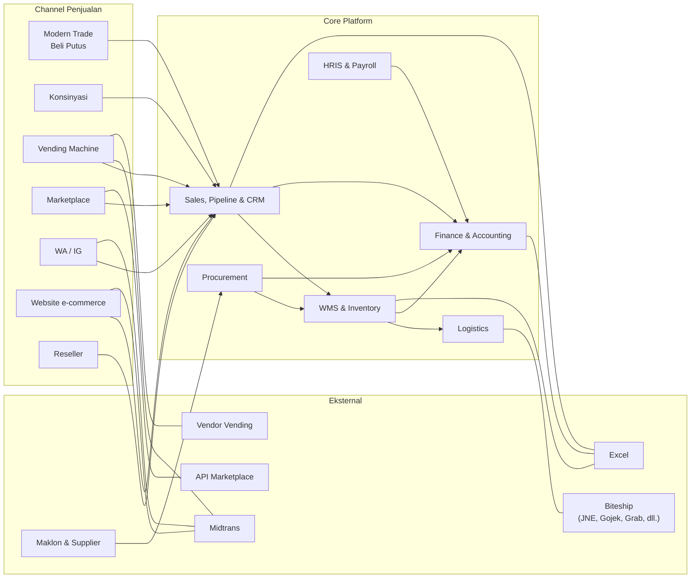

**Prinsip normalisasi channel:** semua channel memakai satu model pesanan, satu sumber stok, dan satu aturan jurnal. Channel hanya membedakan price list, lokasi stok, cara bayar, dan waktu pengakuan penjualan.

---

## 5. Proses Bisnis (To-Be)

### 5.1 Struktur Gudang & Lokasi Stok

**Alur dari catatan Balans (Catatan #1):**

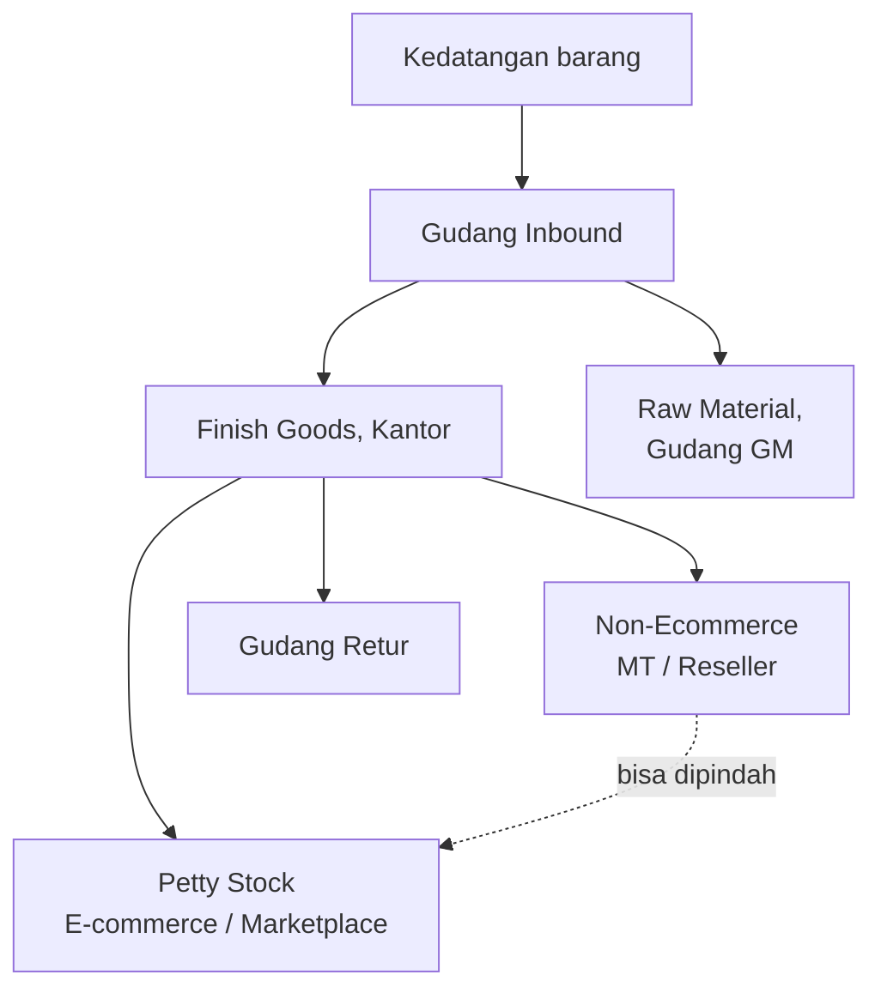

**Detail usulan** (U-01, U-08, U-27, U-12):

- **RM = Raw Material (bahan mentah)** dan **GM = Goods Material (bahan jadi)** (U-01). **Gudang GM** adalah area penyimpanan material dengan dua lokasi: **RM** untuk packaging (Tube, Pouch, Roll Sachet) dan **GM** untuk barang jadi yang tidak layak jual dan menunggu proses ulang maklon (bahan reprocess dari Gudang Retur). Kedua konteks di catatan tertampung: "Raw Material, Gudang GM" (RM disimpan di Gudang GM) dan "re-processing GM jadi FG" (bahan jadi diproses ulang menjadi FG siap jual).
- Sistem mendukung **lebih dari satu gudang fisik**. Konfigurasi awal yang diusulkan adalah **satu gudang fisik** dengan lokasi persis seperti diagram di atas (U-08). Gudang fisik berikutnya bisa ditambah lewat master data tanpa pengembangan.
- Karena stok di luar gudang tetap milik Balans sampai terjual (Q-24), sistem juga mencatat **lokasi eksternal**: packaging di **maklon** (per maklon), stok **konsinyasi** (per partner), **buffer vending** (per partner), dan **vending machine** (per mesin).

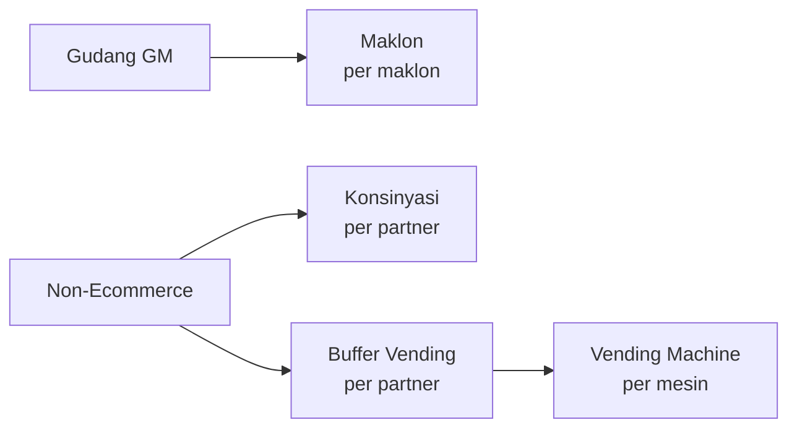

- Barang di Gudang Inbound berstatus **Karantina** sampai diperiksa (batch, tanggal kedaluwarsa, kondisi, qty), baru kemudian dipindah ke lokasi tujuan (U-27).
- Transfer antar gudang fisik dan pengiriman ke partner atau maklon berstatus **In-Transit** sampai penerima mengonfirmasi (U-27).
- **Buffer Vending** dipisah dari stok konsinyasi partner, karena pengakuan penjualannya berbeda: konsinyasi diakui saat rekonsiliasi, vending diakui saat transaksi di mesin (U-12).
- Setiap perpindahan stok dicatat sebagai dokumen transfer (dari → ke, SKU, batch, qty, user, tanggal).
- **Inbound dan Outbound** (arahan Balans): semua barang masuk gudang diproses lewat **Inbound**, dan semua barang keluar lewat **Outbound**. QC adalah langkah di dalam keduanya: di Inbound sebelum barang dipindah dari Karantina ke lokasi tujuan, dan di Outbound sebelum barang diserahkan ke pengiriman.
- **Pembagian kerja gudang** (Flow Inbound & Outbound Balans): Staf Gudang menyiapkan barang (picking & packing); tim **Fulfillment** (Fulfillment Leader / Merchandiser) mengecek ulang barang sebagai QC Outbound lalu mengirimkannya, termasuk dengan **kurir internal** (Merchandiser). Logistik Leader menyiapkan dokumen dan mengetahui setiap pengeluaran barang.
- **Petty Stock** dikelola tim Fulfillment. Perpindahan dari Non-Ecommerce ke Petty Stock diajukan Fulfillment Leader, diteruskan Logistik Leader, disiapkan Staf Gudang, lalu dicek ulang dan dikonfirmasi diterima oleh Fulfillment Leader.
- Barang yang dibawa ke **event** dipindah ke lokasi **Event** dan tetap tercatat sebagai stok Balans sampai sisa barang dikembalikan (5.12).
- **QC Outbound tidak lolos** (arahan Balans): barang yang ditolak dilepas dari order dan masuk Karantina, lalu sistem langsung mengambil **stok pengganti** dari batch atau unit lain (FEFO). Barang reject dikembalikan ke maklon lewat retur pembelian dengan nota debit, diproses langsung oleh Logistik tanpa approval. Jika stok pengganti tidak cukup, baris order ditahan dan Sales/CS mendapat notifikasi.

### 5.2 Procurement

**Dari catatan Balans:** Divisi Logistik & FAT menangani PO dan pembelian stok serta received stock; reject/waste packaging ditanggung Balans (Catatan #10). Pola approval mengikuti procurement standar (K-06).

**Detail usulan** (U-07, U-24, U-26):

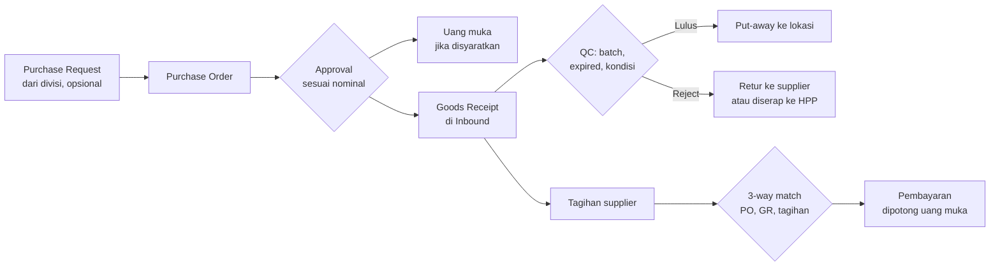

- Approval PO mengikuti matriks di bagian 5.17. Batas nominal dapat dikonfigurasi.
- Penerimaan sebagian diperbolehkan. PO tetap terbuka sampai qty terpenuhi atau ditutup manual dengan alasan.
- Saat barang diterima, nilai persediaan dicatat ke akun **Barang Diterima Belum Ditagih** (U-24). Saat tagihan supplier masuk dan cocok dengan PO dan penerimaan, saldo dipindah ke Utang Usaha. Dengan cara ini, barang yang sudah datang tetapi belum ditagih tetap terlihat di neraca.
- Selisih qty atau harga di atas toleransi (usulan: 0% qty, 1% harga) memblokir pembayaran sampai disetujui Head Finance & Accounting.
- **Reject packaging dari supplier:** jika supplier mengganti atau mengurangi tagihan, dicatat sebagai retur pembelian dengan nota debit (K-15). Jika tidak, biaya reject diserap ke harga per unit packaging yang baik (Catatan #10).

### 5.3 Produksi Maklon

**Alur dari catatan Balans (Catatan #9 – #11):**

Reject/waste packaging ditanggung Balans (#10). Reject/waste dari maklon ditanggung Balans dan menjadi nilai HPP produk (#11). Maklon full service untuk bahan isi produk (K-08).

**Detail usulan** (U-04) — cara mencatatnya:

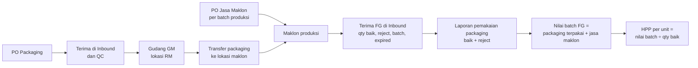

- Packaging yang dikirim ke maklon tetap tercatat sebagai stok Balans di lokasi maklon. Sisa packaging setelah produksi tetap di lokasi maklon sampai dipakai atau ditarik.
- Saat FG diterima, staf mencatat **qty baik, qty reject, nomor batch, dan tanggal kedaluwarsa**, serta pemakaian packaging (baik + reject) sesuai laporan maklon.
- Reject dari maklon ditanggung Balans dan **otomatis masuk ke HPP per unit** karena nilai batch dibagi hanya dengan qty baik (Catatan #11).
- Reject yang baru ditemukan setelah penerimaan dicatat ke akun **HPP – Reject & Waste**, sehingga tetap berada di kelompok HPP.
- PO reprocess (barang retur) memakai alur yang sama, tetapi bahan yang dikirim ke maklon adalah **bahan reprocess (GM)** dari lokasi GM di Gudang GM, bukan packaging baru.

### 5.4 Modern Trade — Beli Putus (One Time)

Catatan #2–#3, K-10.

**Alur dari catatan Balans (Catatan #3):**

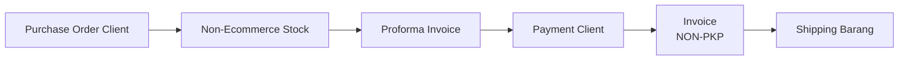

**Detail usulan:**

- PO Client dicatat sebagai Sales Order. Stok Non-Ecommerce langsung dialokasikan (dipesan) agar tidak terjual ke channel lain; batch dipilih FEFO.
- Invoice diterbitkan saat pembayaran dikonfirmasi, dan pembayaran langsung dicatat ke invoice tersebut. Tidak ada uang muka penjualan; Proforma Invoice berfungsi sebagai permintaan pembayaran (K-10).
- Proforma yang tidak dibayar dalam masa berlaku (usulan: 14 hari) otomatis kedaluwarsa dan alokasi stoknya dilepas.
- Shipping memakai DO / surat jalan (LOG-01).
- *Opsional:* minimum sisa umur simpan per channel saat alokasi batch (U-28); termin dan batas kredit untuk customer B2B/corporate (U-30).

### 5.5 Modern Trade — Konsinyasi

**Dari catatan Balans (Catatan #4):** Konsinyasi **wajib PKS**, dengan **rekonsiliasi bulanan** untuk menagihkan stok yang terjual lewat **Invoice**.

**Detail usulan** (U-02) — cara rekonsiliasi dan penanganan selisih:

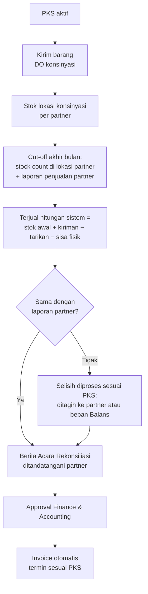

- Partner wajib memiliki **PKS** aktif. Sistem menyimpan nomor, masa berlaku, dokumen PKS, **harga konsinyasi**, **termin pembayaran**, dan **ketentuan selisih**. Pengiriman ke partner yang PKS-nya kedaluwarsa diblokir.
- Rekonsiliasi dilakukan **bulanan dengan cut-off akhir bulan**. Stock count di lokasi partner dilakukan oleh Sales MT (atau partner, lalu diverifikasi Sales MT) memakai form stock count di HP.
- **Ketentuan selisih default** (dapat diubah per PKS):
  - Barang **hilang** atau **rusak karena penanganan partner**: ditagihkan ke partner sebesar harga konsinyasi.
  - Barang **rusak karena produk** (cacat produksi) atau **mendekati kedaluwarsa**: ditanggung Balans, ditarik ke Gudang Retur.
- Sistem mengingatkan batch di lokasi partner yang mendekati tanggal kedaluwarsa agar ditarik tepat waktu (INV-08).
- Invoice konsinyasi dibuat otomatis dari Berita Acara Rekonsiliasi yang sudah disetujui, sehingga dasar tagihan selalu bisa ditelusuri.

### 5.6 Vending Machine

**Alur dari catatan Balans (Catatan #5):**

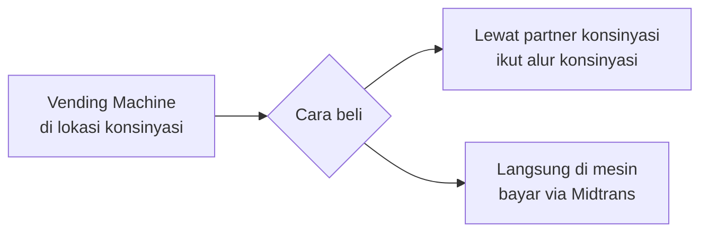

**Arahan Balans:** refill mesin dilakukan oleh **partner** (P-12).

**Detail usulan** (U-05, U-12):

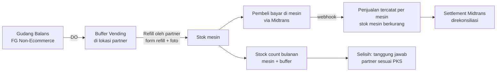

- Balans mengirim stok ke **Buffer Vending** di lokasi partner. Partner mengisi mesin dari buffer dan mencatat refill lewat **form refill** di HP (akses terbatas hanya untuk mesin di lokasinya): SKU, batch, qty per slot, sisa stok sebelum refill, dan foto.
- Penjualan langsung di mesin dibayar via **Midtrans**. Setiap mesin dikenali dari kode mesin di `order_id` transaksi Midtrans. Jika data transaksi dari mesin memuat SKU, stok mesin terpotong per SKU secara otomatis. Jika tidak, penjualan tercatat per mesin dan pemotongan stok per SKU dilakukan saat refill (sisa stok sebelum refill dibandingkan dengan stok sistem).
- Pembelian **lewat partner** (partner menjual sendiri) memakai stok konsinyasi partner dan mengikuti alur 5.5.
- Karena partner memegang stok buffer dan mengisi mesin, **selisih stok mesin dan buffer menjadi tanggung jawab partner** sesuai PKS. Stock count mesin dan buffer dilakukan bersamaan dengan rekonsiliasi konsinyasi bulanan.
- *Opsional:* biaya penempatan mesin per mesin (sewa tetap, bagi hasil, atau tanpa biaya), dihitung otomatis setiap bulan (U-32).
- Mesin vending dicatat sebagai **aset tetap** milik Balans beserta penyusutannya (U-11).
- Akun Midtrans untuk vending harus atas nama Balans agar dana settlement masuk langsung ke rekening Balans (prasyarat, bagian 12.3).

### 5.7 E-commerce Marketplace

**Alur dari catatan Balans (Catatan #6):**

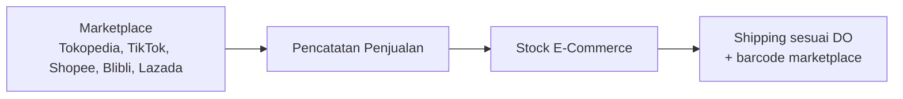

Catatan #23 menyebut integrasi/API marketplace sebagai **opsional**. **Arahan Balans** di Daftar Konfirmasi: integrasi **langsung ke tiap marketplace** (P-21).

**Detail usulan** (U-21, U-25) — setelah integrasi aktif:

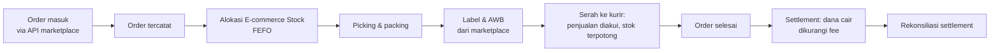

- Integrasi **langsung** ke masing-masing marketplace: tarik order, kirim stok tersedia, ambil label/AWB, perbarui status, dan tarik data settlement. Tokopedia dan TikTok Shop kini berada di bawah satu platform seller, sehingga jumlah integrasi terpisah (4 atau 5) dipastikan saat persiapan integrasi.
- Stok yang dikirim ke marketplace dan website berasal dari satu **E-commerce Stock** yang sama, dikurangi **stok pengaman per channel** (dapat dikonfigurasi) untuk mencegah overselling. Stok bundel dihitung dari stok komponennya.
- Setiap SKU marketplace dipetakan ke SKU Balans (termasuk bundel), sehingga satu listing bisa memotong beberapa SKU komponen.
- Penjualan diakui saat **barang diserahkan ke kurir** (U-25). Pembatalan sebelum diserahkan hanya melepas alokasi stok. Retur setelah diterima pembeli mengikuti alur retur (5.11).
- **Sebelum integrasi aktif**, order dicatat manual atau lewat import Excel dengan format yang sama, sehingga laporan dan rekonsiliasi tidak berubah saat integrasi dinyalakan.

### 5.8 Social Commerce (WhatsApp / Instagram)

**Alur dari catatan Balans (Catatan #7):**

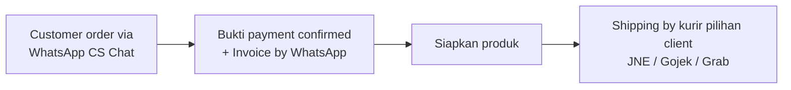

Data customer minimal: **Nama lengkap, Nomor WhatsApp/HP, Alamat pengiriman** (Catatan #8). Setelah website siap, penjualan WA/IG **diarahkan ke website** (Catatan #19).

**Detail usulan:**

- CS menginput order di sistem; customer dicari berdasarkan nomor HP agar tidak terjadi duplikasi.
- CS mengunggah bukti bayar, Finance & Accounting mengonfirmasi, lalu invoice dikirim ke WA.
- Setelah integrasi Biteship aktif, order kurir dan resi dibuat dari sistem (U-20).
- Setelah website live, CS bisa mengirim **link pembayaran Midtrans** sehingga pembayaran terkonfirmasi otomatis, sambil mengarahkan customer untuk order langsung di website. Order WA/IG manual tetap tersedia.

### 5.9 Website E-commerce

**Dari catatan Balans (Catatan #18, #19):** rebuild findyourbalans.com menjadi website e-commerce dengan payment gateway; setelah siap, penjualan WA/IG diarahkan ke website.

**Arahan Balans:** fitur e-commerce **lengkap** (P-16), payment gateway **Midtrans** (P-17), resi/pickup/tracking otomatis **dibutuhkan** (P-20).

**Detail usulan** (U-16, U-17, U-20):

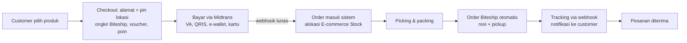

- Stok dipesan saat order dibuat dan dilepas otomatis jika pembayaran tidak selesai dalam batas waktu Midtrans (usulan: 24 jam).
- Customer yang login sebagai **karyawan** atau **reseller** melihat harga sesuai price list masing-masing (5.13, 5.10).
- Fitur lengkap yang diusulkan dirinci di 6.11, dibagi menjadi **fitur launch** dan **fitur lanjutan** setelah launch agar tanggal launch tetap terjaga.
- **Subscription** (langganan produk rutin) diusulkan memakai **pengingat + link pembayaran** setiap periode, bukan pendebitan otomatis. Pendebitan otomatis di Midtrans terbatas pada metode tertentu (misalnya kartu kredit), sedangkan link pembayaran bisa dipakai semua metode.
- **Poin loyalitas** diberikan dari nilai belanja dan bisa ditukar sebagai potongan di transaksi berikutnya.

### 5.10 Reseller

**Dari catatan Balans:** Reseller adalah sub-fungsi Sales (Divisi 2), memakai stok **Non-Ecommerce / MT / Reseller** (Catatan #1), dan memiliki harga sendiri sebagai salah satu model harga (Catatan #17). Alur rincinya tidak diatur di catatan.

**Detail usulan** (U-18):

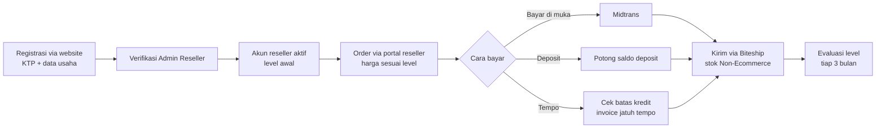

**Struktur level awal (nilai dapat dikonfigurasi):**

| Level | Syarat | Harga | Pembayaran |
|---|---|---|---|
| Bronze | Registrasi disetujui; minimal order Rp1.000.000 per transaksi | Diskon 15% dari harga website | Bayar di muka atau deposit |
| Silver | Pembelian ≥ Rp10.000.000 dalam 3 bulan terakhir | Diskon 20% | Bayar di muka atau deposit |
| Gold | Pembelian ≥ Rp30.000.000 dalam 3 bulan terakhir | Diskon 25% | Ditambah tempo 14 hari dengan batas kredit |

- Order reseller memotong stok **Non-Ecommerce** (Catatan #1).
- Sistem mengusulkan naik/turun level berdasarkan omzet 3 bulan terakhir; perubahan level disetujui Head Sales.
- Ongkir ditanggung reseller. Reseller bisa memilih ambil sendiri di gudang.
- Sistem menyimpan **harga eceran tertinggi (HET)** per SKU sebagai acuan harga jual reseller. Penegakan HET di luar sistem (misalnya di marketplace) tetap menjadi kebijakan Balans.

### 5.11 Retur

**Alur dari catatan Balans (Catatan #12):**

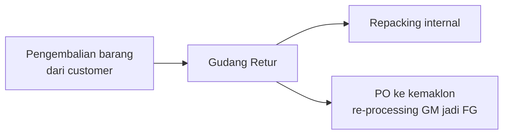

**Detail usulan** (U-09) — pemeriksaan sebelum keputusan, dan tiga opsi tambahan:

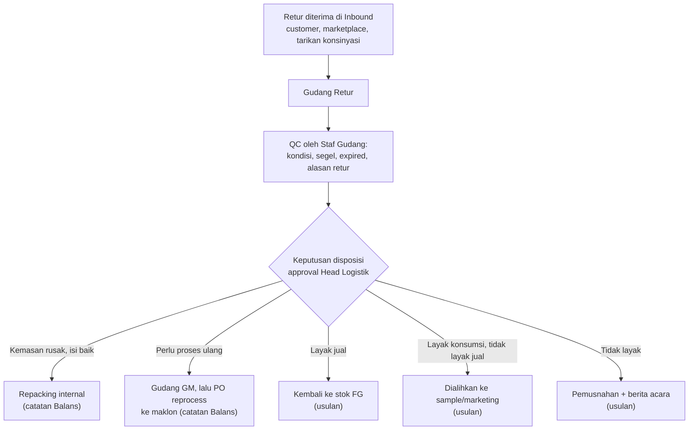

- Semua retur diperiksa (QC) sebelum diputuskan. Staf gudang mengusulkan disposisi; Head Logistik menyetujui. Pemusnahan juga butuh persetujuan Finance & Accounting, dan di atas nilai tertentu persetujuan Direksi (5.17).
- **Pemusnahan** didukung berita acara (tanggal, metode, saksi, foto) karena berpengaruh ke nilai persediaan dan bisa diperiksa auditor/pajak.
- **Retur MT/reseller** (Flow Inbound & Outbound Balans): Sales mencatat detail retur dari partner, Logistik Leader memverifikasi kesesuaiannya dengan SOP retur, lalu Fulfillment Leader menugaskan Merchandiser untuk mengambil barang bila perlu. Saat barang tiba, Sales mengecek ulang, mendokumentasikan, dan melengkapi form retur sebelum barang masuk Inbound.
- Alasan retur dicatat dari master (rusak saat kirim, kedaluwarsa, salah kirim, cacat produksi, customer berubah pikiran) agar bisa dianalisis.
- Penyelesaian ke customer: **website/WA** → refund via Midtrans atau transfer; **MT/reseller** → nota kredit yang mengurangi piutang; **marketplace** → mengikuti proses marketplace dan tercermin di settlement.

### 5.12 Pemakaian Internal FG

**Dari catatan Balans (Catatan #13, #14):**

| Pengguna | Keperluan | Dibebankan ke | Sumber |
|---|---|---|---|
| Marketing | Endorsement, Event, Sample | Biaya Marketing | Catatan #13 |
| HRGA | Sample karyawan | Biaya Operasional / Karyawan | Catatan #14 |

**Detail usulan:**

- Alur: Permintaan barang → Approval (5.17) → Logistik Leader meneruskan → Staf Gudang menyiapkan → serah terima ke divisi peminta → Jurnal biaya otomatis sebesar HPP.
- **Event** (Flow Inbound & Outbound Balans): Marketing maupun Sales dapat mengajukan barang untuk event. Barang dipindah ke lokasi Event dan diantar Fulfillment Leader/Merchandiser. Setelah event, sisa barang dikembalikan ke Inbound dan dicatat paling lambat **H+1**, lalu dicek ulang Logistik Leader/Staf Gudang. Biaya hanya diakui atas qty yang terpakai.
- Property/booth event bukan stok dan tidak dicatat di sistem.
- Pemakaian marketing diberi **kode kampanye**, sehingga biaya produk dan biaya fee (misalnya fee endorser) untuk satu kampanye bisa dilihat bersama.
- Sampling oleh Sales ke calon partner memakai alur yang sama dan dibebankan ke Biaya Marketing (U-19).

### 5.13 Pembelian oleh Karyawan

**Dari catatan Balans (Catatan #15):** karyawan dapat membeli melalui WA/IG dan mendapat **diskon karyawan**. Setelah website siap, pembelian ikut diarahkan ke website (Catatan #19).

**Detail usulan:**

- Customer yang berstatus karyawan otomatis mendapat **harga karyawan**, baik lewat CS maupun login di website (usulan awal: diskon 20% dari harga website).
- Status karyawan diambil dari data karyawan di HRIS. Karyawan yang resign otomatis kehilangan harga karyawan.
- *Opsional:* kuota pembelian per karyawan per bulan dan pembayaran potong gaji setelah payroll aktif (U-31).

### 5.14 Biaya Operasional & Kas Kecil

**Dari catatan Balans:** sistem termasuk software akuntansi (Catatan #21); Marketing menjalankan endorsement dan event (Divisi 3). Proses pengeluaran biaya tidak diatur di catatan.

**Detail usulan** (U-13, U-06):

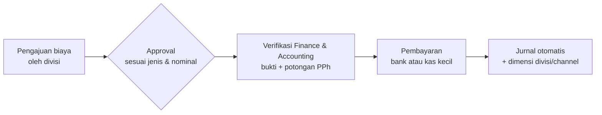

- **Jenis biaya** diatur di master: akun beban, perlu/tidaknya pemotongan PPh, dan approver. Contoh: fee endorsement, biaya event, sewa, iklan digital, langganan software, reimbursement.
- **Fee endorsement:** kontrak/brief → pengajuan biaya dengan kode kampanye → pemotongan PPh 21 (endorser perorangan) atau PPh 23 (agensi berbadan usaha) → pembayaran. Produk untuk endorser dicatat lewat pemakaian internal (5.12) dengan kode kampanye yang sama.
- **Reimbursement:** karyawan mengajukan lewat self-service dengan foto bukti → atasan → Finance & Accounting → dibayar transfer mingguan atau bersama payroll.
- **Kas kecil (sistem imprest):** plafon awal Rp5.000.000 per pemegang kas, maksimal Rp1.000.000 per transaksi, bukti wajib diunggah. Pengisian kembali saat saldo di bawah 30% atau setiap minggu, berdasarkan rekap pengeluaran yang disetujui Head Finance & Accounting.
- *Opsional:* anggaran per divisi, yaitu realisasi biaya dibandingkan anggaran bulanan dengan peringatan saat mendekati batas (ACC-23).

### 5.15 Tutup Buku Bulanan

**Dari catatan Balans:** Catatan #21 (software akuntansi); tutup buku bulanan (K-13).

**Detail usulan:** target tutup buku **paling lambat hari kerja ke-10** bulan berikutnya, dengan urutan:

| Urutan | Aktivitas | PIC |
|---|---|---|
| 1 | Semua dokumen operasional bulan berjalan sudah diposting (GR, DO, invoice, retur, pemakaian internal) | Semua divisi |
| 2 | Rekonsiliasi konsinyasi & vending (stock count + Berita Acara) | Sales MT, Admin Vending |
| 3 | Rekonsiliasi settlement Midtrans & marketplace | Finance & Accounting |
| 4 | Rekonsiliasi bank & kas kecil | Finance & Accounting |
| 5 | Payroll & jurnal payroll | HRGA, Finance & Accounting |
| 6 | Penyusutan aset tetap (otomatis) | Sistem |
| 7 | Rekap PPh yang dipotong dan PPh Final (bila berlaku) | Finance & Accounting |
| 8 | Review selisih persediaan, stok kedaluwarsa, dan Barang Diterima Belum Ditagih | Finance & Accounting, Head Logistik |
| 9 | Review laporan keuangan, lalu tutup periode | Head Finance & Accounting |

Sistem menampilkan checklist ini beserta status tiap langkah. Periode yang sudah ditutup hanya bisa dibuka kembali dengan approval (5.17).

### 5.16 HRIS & Payroll

**Dari catatan Balans:** HRGA mengelola karyawan (Divisi 4), sample karyawan (#14), dan diskon karyawan (#15).

**Arahan Balans:** lingkup HRIS **lengkap sampai absensi, termasuk payroll** (P-22, dikonfirmasi 14 Okt 2026); jumlah karyawan **50+** (P-23).

**Detail usulan** (U-22, U-23):

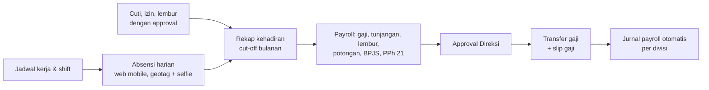

- **Data karyawan:** struktur organisasi, jabatan, divisi, kontrak (PKWT/PKWTT) beserta pengingat habis kontrak, dokumen, rekening, NPWP, dan kepesertaan BPJS.
- **Absensi:** clock-in/out dari browser HP dengan lokasi (geotag) dan foto selfie, dibatasi radius lokasi kerja. Karyawan lapangan (misalnya sales) bisa absen di lokasi kunjungan dengan penanda khusus.
- **Cuti & izin:** saldo cuti tahunan otomatis, pengajuan dan approval atasan, serta kalender tim.
- **Lembur:** pengajuan sebelum lembur, approval atasan, perhitungan upah lembur sesuai ketentuan yang berlaku.
- **Payroll:** cut-off absensi tanggal 20, gaji dibayar tanggal 25 (dapat dikonfigurasi). Komponen: gaji pokok, tunjangan tetap/tidak tetap, lembur, potongan (absen, kasbon), BPJS Kesehatan dan Ketenagakerjaan, serta **PPh 21 metode TER** bulanan dan perhitungan akhir tahun.
- Payroll pertama dijalankan **paralel** dengan cara lama selama satu bulan sebelum dipakai resmi.
- Kapasitas desain: hingga **100 karyawan** tanpa perubahan desain (U-23: saat ini 50+).

### 5.17 Matriks Approval

**Dari catatan Balans:** tidak diatur di catatan; approval PO mengikuti pola procurement standar (K-06).

**Detail usulan** (U-07, U-13): semua batas nominal dan approver dapat dikonfigurasi. Approver yang sedang cuti bisa mendelegasikan approval.

| Dokumen | Level 1 | Level 2 | Level 3 |
|---|---|---|---|
| Purchase Request | Head divisi peminta | — | — |
| Purchase Order (packaging, jasa maklon, lainnya) | ≤ Rp10 jt: Head Finance & Accounting | > Rp10 jt s.d. Rp50 jt: + Direksi | > Rp50 jt: + Direktur Utama |
| Pengajuan biaya / reimbursement | ≤ Rp5 jt: Head divisi | > Rp5 jt s.d. Rp25 jt: + Head Finance & Accounting | > Rp25 jt: + Direksi |
| Pemakaian internal FG | Head divisi peminta | Nilai HPP > Rp5 jt: + Head Finance & Accounting | — |
| Penyesuaian stok (stock count) | Head Logistik | Nilai > Rp2 jt: + Head Finance & Accounting | — |
| Disposisi retur | Head Logistik | Pemusnahan: + Head Finance & Accounting | Pemusnahan > Rp10 jt: + Direksi |
| Retur barang reject QC Outbound ke maklon | Tanpa approval; diproses langsung oleh Logistik | — | — |
| Rekonsiliasi konsinyasi & penagihan selisih | Sales MT (PIC partner) | Head Finance & Accounting | — |
| Price list baru / perubahan harga | Head Sales | Head Finance & Accounting | — |
| Diskon manual di atas batas role | Head Sales | — | — |
| Penjualan tempo melebihi batas kredit (jika U-30 diambil) | Head Sales | Head Finance & Accounting | — |
| Perubahan level reseller | Head Sales | — | — |
| Buka kembali periode yang sudah ditutup | Head Finance & Accounting | Direksi | — |
| Cuti, izin, lembur | Atasan langsung | Cuti > 3 hari: + Head HRGA | — |
| Payroll bulanan | Head HRGA | Direksi | — |

### 5.18 Aturan Harga

**Dari catatan Balans:** ada **beberapa model harga produk dan tidak tetap** (Catatan #17); **diskon opsional** untuk seluruh penjualan (Catatan #16); diskon karyawan (Catatan #15).

**Detail usulan** (U-03) — price list yang disediakan:

| Price list | Berlaku untuk |
|---|---|
| Harga dasar & HET | Acuan semua channel |
| Modern Trade beli putus | Per partner MT (bisa harga khusus per partner) |
| Konsinyasi | Per partner sesuai PKS |
| Marketplace | Acuan internal; harga aktual mengikuti order dari marketplace |
| Website | Harga jual umum di website |
| WA/IG | Sama dengan harga website (default) |
| Reseller | Per level reseller |
| Karyawan | Persentase dari harga website |
| Vending | Per mesin atau seluruh mesin |

**Urutan prioritas saat menentukan harga di transaksi:**

1. Harga khusus per customer/partner
2. Harga promo periode (tanggal mulai–selesai) yang aktif
3. Harga bertingkat berdasarkan qty
4. Price list channel / tipe customer
5. Harga dasar

Setelah harga ditentukan, diskon manual (per item atau per transaksi) dapat diberikan sampai **batas diskon per role**. Di atas batas itu, diskon membutuhkan approval. Voucher dan poin (website) dihitung terakhir.

Setiap perubahan harga tersimpan sebagai versi baru dengan tanggal berlaku. Transaksi lama tetap memakai harga yang berlaku saat transaksi dibuat.

### 5.19 Sales Pipeline & Target

**Dari catatan Balans:** Sales Pipeline berasal dari capture kebutuhan tambahan (tidak ada di catatan 11 September 2026). **Arahan Balans:** dipakai **untuk tracking sales** (P-19).

**Detail usulan** (U-19):

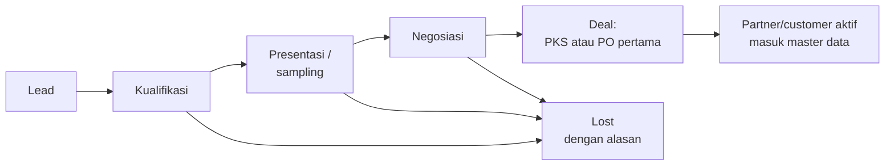

- Jenis lead: **partner Modern Trade/konsinyasi**, **reseller**, dan **B2B/corporate**.
- Aktivitas per lead: kunjungan (check-in lokasi + foto), telepon, follow-up, catatan, dan sampling (terhubung ke pemakaian internal).
- Saat deal, data lead otomatis menjadi master partner/customer tanpa input ulang.
- **Target & pencapaian:** target bulanan per sales dan per channel. Pencapaian dihitung otomatis dari invoice customer/partner yang dipegang sales tersebut.

---

## 6. Kebutuhan Fungsional

**Prioritas:** M = Must have, S = Should have, C = Could have.
**Sumber:** `#n` = nomor di catatan kebutuhan, `CAP` = capture kebutuhan tambahan, `USL` = usulan konsultan, `U-xx` = usulan di bagian 12, `ARH` = arahan eksplisit Balans di Daftar Konfirmasi, `FLW` = Flow Inbound & Outbound Balans.
Requirement bertanda **(opsional)** berasal dari usulan opsional (U-28 s.d. U-32, serta anggaran di U-13) dan hanya masuk lingkup jika dipilih Balans (bagian 12.2).

### 6.1 Master Data (MD)

| ID | Kebutuhan | Prior. | Sumber |
|---|---|---|---|
| MD-01 | Master produk: SKU, nama, varian/rasa, tipe kemasan (Tube/Pouch/Roll Sachet), satuan, barcode, isi per karton, umur simpan. Cetak **label barcode produk** untuk ditempel ke kemasan. | M | #9, FLW |
| MD-02 | Master packaging (RM) dan bahan reprocess (GM). | M | #9, U-01 |
| MD-03 | **Produk bundling virtual**: satu SKU bundle terdiri dari beberapa SKU komponen; stok komponen terpotong saat bundle terjual. | M | #22 |
| MD-04 | Multi price list sesuai 5.18: harga dasar & HET, per channel, per partner, per level reseller, karyawan, vending, dengan masa berlaku dan riwayat versi. | M | #17, U-03 |
| MD-05 | Diskon opsional di semua transaksi penjualan (per item dan per transaksi, nominal atau persen). | M | #16 |
| MD-06 | Master customer: nama lengkap, nomor WA/HP, alamat pengiriman, tipe customer. | M | #8 |
| MD-07 | Master partner MT / konsinyasi, termasuk data PKS: nomor, masa berlaku, dokumen, harga konsinyasi, termin pembayaran, dan ketentuan selisih; **kode produk mitra** (kode artikel/barcode retailer) per SKU; Merchandiser yang ditugaskan. | M | #4, U-02, FLW |
| MD-08 | Master supplier dan maklon. | M | #9 |
| MD-09 | Master gudang / lokasi stok: lebih dari satu gudang fisik beserta lokasi di dalamnya (Inbound, FG Non-Ecommerce, E-commerce Stock, Gudang GM dengan lokasi RM dan GM, Retur), serta lokasi eksternal (maklon, konsinyasi, buffer vending, mesin vending). | M | #1, U-01, U-08 |
| MD-10 | Import / export master data dari dan ke Excel. | M | #20 |
| MD-11 | Penentuan harga otomatis sesuai urutan prioritas di 5.18 (harga khusus → promo → harga bertingkat → price list channel → harga dasar). | M | U-03 |
| MD-12 | Batas diskon manual per role; diskon di atas batas membutuhkan approval. | S | U-03 |
| MD-13 | Master alasan retur, master jenis biaya (akun beban, pemotongan PPh, approver), dan master kode kampanye. | S | U-09, U-13 |

### 6.2 Procurement (PRC)

| ID | Kebutuhan | Prior. | Sumber |
|---|---|---|---|
| PRC-01 | Purchase Order untuk stok, packaging, dan kebutuhan lain. | M | Divisi 1, #9 |
| PRC-02 | PO jasa maklon per batch produksi, termasuk packaging yang dikirim ke maklon. | M | #9 |
| PRC-03 | PO reprocessing barang retur ke maklon. | S | #12 |
| PRC-04 | Penerimaan barang (Goods Receipt) per PO, mendukung penerimaan sebagian. | M | Divisi 1 |
| PRC-05 | Pencatatan **reject/waste** saat penerimaan, baik packaging maupun hasil maklon. | M | #10, #11 |
| PRC-06 | Approval PO berjenjang berdasarkan nominal sesuai matriks 5.17, dengan batas nominal yang dapat dikonfigurasi. | M | Q-05, U-07 |
| PRC-07 | Tagihan supplier (AP) terhubung ke PO dan penerimaan barang (3-way match), dengan toleransi selisih dan blokir pembayaran bila melewati toleransi. | M | USL, U-24 |
| PRC-08 | Purchase Request (PR) dari divisi sebagai dasar pembuatan PO (opsional per transaksi). | S | Q-05 |
| PRC-09 | Uang muka pembelian ke supplier/maklon, yang otomatis dipotongkan dari tagihan terkait. | S | U-26 |
| PRC-10 | Penerimaan FG dari maklon mencatat pemakaian packaging (baik + reject) per batch dan sisa packaging di lokasi maklon. | M | #11, U-04 |

### 6.3 Warehouse Management (WMS)

| ID | Kebutuhan | Prior. | Sumber |
|---|---|---|---|
| WMS-01 | Struktur multi-gudang sesuai bagian 5.1, untuk lebih dari satu gudang fisik. | M | #1, Q-02 |
| WMS-02 | Inbound: semua kedatangan barang (supplier, maklon, retur customer, tarikan konsinyasi) masuk ke Gudang Inbound terlebih dahulu dan diperiksa (QC) sebelum dipindah ke lokasi tujuan. | M | #1, Q-23 |
| WMS-03 | Transfer stok antar gudang/lokasi dengan dokumen dan histori, termasuk **permintaan Petty Stock** oleh Fulfillment dengan konfirmasi terima. | M | #1, FLW |
| WMS-04 | Stock count (penuh dan per lokasi), dengan penyesuaian selisih yang memerlukan approval. | M | Divisi 1 |
| WMS-05 | Picking & packing untuk order keluar. | S | CAP |
| WMS-06 | Scan barcode untuk inbound, transfer, dan picking. | C | USL |
| WMS-07 | Pengelolaan Gudang Retur: QC, usulan disposisi, approval, dan eksekusi disposisi (5.11). | M | #12, U-09 |
| WMS-08 | Stok di lokasi konsinyasi per partner, buffer vending, dan vending machine per mesin. | M | #4, #5, U-12 |
| WMS-09 | Status **Karantina** untuk barang masuk dan retur; stok karantina tidak bisa dialokasikan atau dijual sebelum lulus QC. | M | U-27 |
| WMS-10 | Status **In-Transit** untuk transfer antar gudang fisik dan pengiriman ke partner/maklon, sampai penerima mengonfirmasi. | S | U-27 |
| WMS-11 | Jadwal stock count: cycle count berkala di gudang, stock count konsinyasi & vending bulanan bersama rekonsiliasi, dan stock count penuh akhir tahun. Form stock count bisa dipakai di HP; stock count lokasi konsinyasi bisa dikerjakan Merchandiser yang ditugaskan. | S | U-08, FLW |
| WMS-12 | QC Outbound: semua barang keluar dicek ulang oleh tim Fulfillment (bukan penyiap barang) sebelum dikirim. Barang yang tidak lolos masuk Karantina dan langsung diganti stok dari batch atau unit lain; barang reject dikembalikan ke maklon tanpa approval. | M | ARH, FLW |

### 6.4 Inventory & Costing (INV)

| ID | Kebutuhan | Prior. | Sumber |
|---|---|---|---|
| INV-01 | Kartu stok per SKU per lokasi, real-time. | M | CAP |
| INV-02 | Perhitungan HPP yang memasukkan biaya jasa maklon, packaging, dan reject/waste (5.3). | M | #10, #11 |
| INV-03 | Metode penilaian persediaan **FIFO**. | M | Q-04 |
| INV-04 | Pelacakan batch / lot dan tanggal kedaluwarsa di seluruh pergerakan stok. | M | Q-03 |
| INV-05 | Pemakaian internal FG (marketing, event, sample karyawan, sampling sales) dengan approval, kode kampanye, serah terima, pengembalian sisa barang event (maks H+1), dan jurnal biaya otomatis atas qty terpakai. | M | #13, #14, FLW |
| INV-06 | Repacking barang retur menjadi FG kembali. | S | #12 |
| INV-07 | Peringatan stok minimum per lokasi. | S | USL |
| INV-08 | Peringatan produk mendekati tanggal kedaluwarsa, termasuk stok di lokasi konsinyasi dan vending. | S | USL |
| INV-09 | Saran pengambilan stok **FEFO** (First Expired, First Out) saat picking dan transfer. | S | USL |
| INV-10 | **(opsional)** Minimum sisa umur simpan per channel (usulan awal: MT & konsinyasi ≥ 6 bulan, channel lain ≥ 3 bulan); sistem menolak alokasi batch di bawah batas. | C | U-28 |
| INV-11 | **(opsional)** Bundling fisik (kitting): merakit paket dari SKU komponen menjadi SKU bundel yang memiliki stok sendiri, serta membongkarnya kembali. | C | U-29 |
| INV-12 | Pemusnahan barang (retur, kedaluwarsa, rusak) dengan approval dan berita acara. | M | U-09 |

### 6.5 Logistics (LOG)

| ID | Kebutuhan | Prior. | Sumber |
|---|---|---|---|
| LOG-01 | Delivery Order (DO) / surat jalan untuk pengiriman MT, konsinyasi, reseller, dan order WA/IG, dengan cetak label produk (memakai kode produk mitra bila ada) dan label koli. | M | Divisi 1, #3, FLW |
| LOG-02 | Pencatatan DO dan barcode / resi marketplace. | M | #6 |
| LOG-03 | Pencatatan kurir dan nomor resi (JNE, Gojek, Grab, dll.), termasuk kurir internal (Merchandiser) dengan konfirmasi diterima. | M | #7, FLW |
| LOG-04 | Status pengiriman (disiapkan, dikirim, diterima). | S | CAP |
| LOG-05 | Integrasi Biteship untuk order website, WA/IG, dan reseller: buat order pengiriman, request pickup, nomor resi otomatis, dan tracking via webhook. | M | ARH, U-20 |
| LOG-06 | Cetak label pengiriman dari Biteship dan label/AWB marketplace dari sistem. | S | U-20, U-21 |

### 6.6 Sales Management (SLS)

| ID | Kebutuhan | Prior. | Sumber |
|---|---|---|---|
| SLS-01 | Sales Order MT beli putus: PO Client → Proforma Invoice → Payment → Invoice NON-PKP → Shipping; juga dipakai untuk penjualan B2B/corporate. | M | #3 |
| SLS-02 | Proforma Invoice dan Invoice format NON-PKP (tanpa PPN). | M | Divisi 1, #3 |
| SLS-03 | Konsinyasi: pengiriman titipan, stock count bulanan, perhitungan terjual, Berita Acara Rekonsiliasi, dan invoice otomatis atas barang terjual (5.5). | M | #4, U-02 |
| SLS-04 | Order social commerce (WA/IG): input oleh CS, konfirmasi pembayaran (bukti transfer atau link Midtrans), kirim invoice ke WA. | M | #7 |
| SLS-05 | Pencatatan penjualan marketplace (manual / import Excel sebelum integrasi aktif), memotong E-commerce Stock. | M | #6 |
| SLS-06 | Penerapan price list dan diskon otomatis sesuai channel / tipe customer. | M | #16, #17 |
| SLS-07 | Diskon karyawan otomatis untuk customer berstatus karyawan. | M | #15 |
| SLS-08 | Retur penjualan terhubung ke Gudang Retur dan nota kredit / refund. | M | #12 |
| SLS-09 | Selisih konsinyasi diproses sesuai ketentuan PKS per partner (ditagihkan ke partner atau dibebankan Balans), dengan approval. | M | U-02 |
| SLS-10 | **(opsional)** Batas kredit dan termin pembayaran per customer/partner; transaksi yang melewati batas kredit atau ada tagihan lewat jatuh tempo membutuhkan approval. | C | U-30 |
| SLS-11 | **(opsional)** Pembelian karyawan dengan kuota bulanan dan opsi potong gaji (terhubung ke payroll). | C | U-31 |

### 6.7 Sales Pipeline (SLP)

| ID | Kebutuhan | Prior. | Sumber |
|---|---|---|---|
| SLP-01 | Sales Pipeline: lead → kualifikasi → presentasi/sampling → negosiasi → deal, untuk partner MT/konsinyasi, reseller, dan B2B/corporate. Deal otomatis membuat master partner/customer. | S | ARH, U-19 |
| SLP-02 | Aktivitas sales (kunjungan, telepon, follow-up, catatan, sampling) per lead/partner. | S | ARH, U-19 |
| SLP-03 | Target penjualan bulanan per sales dan per channel, dengan pencapaian dihitung otomatis dari invoice. | S | ARH, U-19 |
| SLP-04 | Check-in kunjungan dengan lokasi dan foto. | C | U-19 |

### 6.8 CRM

| ID | Kebutuhan | Prior. | Sumber |
|---|---|---|---|
| CRM-01 | Satu database customer dari semua channel (WA/IG, website, reseller, MT; marketplace sejauh data tersedia dari API). | M | #8, CAP |
| CRM-02 | Riwayat order dan nilai belanja per customer. | S | CAP |
| CRM-03 | Penandaan / segmentasi customer (karyawan, reseller, repeat buyer, subscriber, dll.). | S | CAP |
| CRM-04 | Pencatatan interaksi CS (keluhan, pertanyaan). | C | CAP |

### 6.9 Reseller (RSL)

| ID | Kebutuhan | Prior. | Sumber |
|---|---|---|---|
| RSL-01 | Registrasi (via website) dan master data reseller, dengan verifikasi. | M | Divisi 2 |
| RSL-02 | Harga reseller per level (Bronze/Silver/Gold) dan minimal order (5.10). | M | #17, U-18 |
| RSL-03 | Order reseller memotong stok Non-Ecommerce. | M | #1 |
| RSL-04 | Ketentuan pembayaran reseller: bayar di muka (default), deposit, atau tempo dengan batas kredit untuk level tertentu. | S | U-18 |
| RSL-05 | Portal reseller di website untuk order mandiri, deposit, tagihan, dan riwayat order. | S | U-16, U-18 |
| RSL-06 | Usulan naik/turun level otomatis berdasarkan omzet 3 bulan terakhir, dengan approval Head Sales. | C | U-18 |
| RSL-07 | Saldo deposit reseller: top-up, pemakaian untuk order, dan mutasi saldo. | S | U-18 |

### 6.10 Vending Machine (VND)

| ID | Kebutuhan | Prior. | Sumber |
|---|---|---|---|
| VND-01 | Master mesin: ID, lokasi, partner konsinyasi tempat mesin berada, slot dan SKU per slot. | M | #5 |
| VND-02 | Stok per mesin dan proses refill (transfer stok dari buffer ke mesin). | M | #5, USL |
| VND-03 | Pencatatan transaksi penjualan langsung di mesin (pembayaran via Midtrans) per mesin, termasuk pengurangan stok mesin (5.6). | M | #5, U-05 |
| VND-04 | Rekonsiliasi berkala antara transaksi Midtrans, penjualan tercatat per mesin, dan stok fisik mesin saat refill/stock count. | M | USL |
| VND-05 | Penjualan lewat partner mengikuti alur konsinyasi (SLS-03). | M | #5 |
| VND-06 | Integrasi API vendor mesin (status stok, status mesin) — bergantung kemampuan vendor. | S | CAP |
| VND-07 | Form refill dan stock count mesin untuk partner (browser HP, akses terbatas per mesin), dengan foto. | M | ARH, U-12 |
| VND-08 | Stok buffer vending di lokasi partner dipisah dari stok konsinyasi partner; selisih stok buffer dan mesin diproses sesuai PKS. | M | ARH, U-12 |
| VND-09 | **(opsional)** Biaya penempatan mesin per mesin (sewa tetap, bagi hasil %, atau tanpa biaya), dihitung otomatis setiap bulan. | C | U-32 |

### 6.11 Web E-commerce (ECM)

Arahan Balans: fitur e-commerce lengkap (U-16). Kolom **Tahap** membedakan fitur yang wajib ada saat launch dan fitur lanjutan setelah launch.

| ID | Kebutuhan | Prior. | Tahap | Sumber |
|---|---|---|---|---|
| ECM-01 | Rebuild findyourbalans.com menjadi website e-commerce: katalog, pencarian & filter, halaman produk (informasi nilai gizi), keranjang, checkout (tamu atau akun). | M | Launch | #18 |
| ECM-02 | Integrasi payment gateway Midtrans (VA, QRIS, e-wallet, kartu). | M | Launch | #18, ARH |
| ECM-03 | Order website otomatis masuk ke sistem dan memotong E-commerce Stock; stok dipesan sampai pembayaran selesai atau kedaluwarsa. | M | Launch | USL |
| ECM-04 | Pilihan kurir dan ongkos kirim saat checkout via Biteship, termasuk pin lokasi untuk kurir instan. | M | Launch | #7, D-02 |
| ECM-05 | Akun customer, riwayat order, multi alamat, voucher / kode diskon. | M | Launch | #16, ARH |
| ECM-06 | Harga khusus untuk karyawan dan reseller yang login. | M | Launch | #15, #17 |
| ECM-07 | Tombol / link dari WA dan IG ke halaman produk website. | S | Launch | #19 |
| ECM-08 | Lacak status pesanan dan notifikasi email/WhatsApp (pembayaran diterima, dikirim, diterima). | M | Launch | ARH |
| ECM-09 | CMS: banner, halaman statis, blog/artikel, FAQ. | S | Launch | ARH |
| ECM-15 | SEO dasar (meta, sitemap, URL ramah), integrasi analytics & pixel iklan (GA4, Meta, TikTok). | M | Launch | ARH |
| ECM-10 | Subscription: langganan produk rutin dengan pengingat dan link pembayaran per periode. | S | Lanjutan | ARH |
| ECM-11 | Member & poin loyalitas: perolehan poin dari belanja, penukaran sebagai potongan, masa berlaku poin. | S | Lanjutan | ARH |
| ECM-12 | Ulasan & rating produk dari pembeli terverifikasi, dengan moderasi. | C | Lanjutan | ARH |
| ECM-13 | Wishlist dan pengingat keranjang tertinggal (email/WA). | C | Lanjutan | ARH |
| ECM-14 | Program referral (kode referral dengan reward voucher/poin). | C | Lanjutan | ARH |
| ECM-16 | Pengajuan retur/refund oleh customer dari akunnya, diteruskan ke alur retur (5.11). | S | Lanjutan | ARH |

### 6.12 HRIS (HR)

Arahan Balans: HRIS lengkap sampai absensi, termasuk payroll (U-22).

| ID | Kebutuhan | Prior. | Sumber |
|---|---|---|---|
| HR-01 | Master data karyawan. | M | Divisi 4 |
| HR-02 | Permintaan dan pencatatan sample karyawan (terhubung ke INV-05). | M | #14 |
| HR-03 | Penandaan karyawan sebagai customer untuk diskon karyawan. | M | #15 |
| HR-04 | Struktur organisasi, jabatan, kontrak (PKWT/PKWTT) dengan pengingat habis kontrak, dan dokumen karyawan. | M | ARH, U-22 |
| HR-05 | Absensi dari browser HP dengan geotag dan selfie, dibatasi radius lokasi kerja; jadwal kerja dan shift. | M | ARH, U-22 |
| HR-06 | Cuti dan izin dengan approval dan saldo cuti otomatis. | M | ARH, U-22 |
| HR-07 | Lembur dengan pengajuan dan approval. | S | U-22 |
| HR-08 | Payroll: komponen gaji, tunjangan, potongan (termasuk kasbon dan pembelian karyawan), slip gaji. | M | ARH, U-22 |
| HR-09 | BPJS Kesehatan dan Ketenagakerjaan (porsi perusahaan dan karyawan). | M | U-22 |
| HR-10 | PPh 21 metode TER bulanan, perhitungan akhir tahun, dan data bukti potong. | M | U-22, U-06 |
| HR-11 | Jurnal payroll otomatis ke Finance & Accounting per divisi. | M | U-22 |
| HR-12 | Self-service karyawan: slip gaji, saldo cuti, pengajuan cuti/lembur/reimbursement. | S | U-22 |

### 6.13 Finance & Accounting (ACC)

| ID | Kebutuhan | Prior. | Sumber |
|---|---|---|---|
| ACC-01 | Chart of Accounts, jurnal umum, buku besar. COA awal mengikuti usulan di 7.1. | M | #21, U-04 |
| ACC-02 | Jurnal otomatis dari transaksi operasional (lihat bagian 7). | M | #21 |
| ACC-03 | Piutang (AR): invoice, pembayaran, umur piutang per customer / partner. | M | #21 |
| ACC-04 | Utang (AP): tagihan supplier / maklon, pembayaran, umur utang. | M | #21 |
| ACC-05 | Kas & bank, termasuk rekonsiliasi bank (import mutasi dari file bank). | M | #21 |
| ACC-06 | Rekonsiliasi settlement Midtrans dan marketplace (gross, potongan fee, net cair), otomatis setelah integrasi aktif. | M | USL, U-21 |
| ACC-07 | Laporan keuangan: Neraca, Laba Rugi, Arus Kas. | M | #21 |
| ACC-08 | Tutup buku bulanan dengan checklist (5.15) dan penguncian periode. | S | USL |
| ACC-10 | Import / export data transaksi dari dan ke Excel. | M | #20 |
| ACC-11 | Pencatatan biaya operasional di luar PO (fee endorsement, event, sewa, reimbursement) dengan approval. | M | USL, U-13 |
| ACC-12 | Kas kecil (sistem imprest): pengisian, pengeluaran dengan bukti, dan rekap saldo. | S | USL, U-13 |
| ACC-13 | Jurnal yang sudah diposting tidak bisa diedit/dihapus; koreksi lewat jurnal balik (reversal). | M | USL |
| ACC-14 | Input saldo awal saat mulai memakai sistem, dan membuka kembali periode yang sudah ditutup hanya dengan approval. Transaksi bertanggal mundur hanya diizinkan di periode yang masih terbuka; HPP yang terdampak dihitung ulang otomatis. | M | USL |
| ACC-15 | Pembayaran sebagian dan alokasi satu pembayaran ke beberapa invoice/tagihan (customer dan supplier). | M | USL |
| ACC-16 | Retur pembelian ke supplier dengan nota debit (mis. packaging reject). | S | USL |
| ACC-17 | Dimensi di setiap baris jurnal: **channel**, **sub-channel** (marketplace / partner), **divisi**, dan **kode kampanye** (opsional), untuk laporan laba rugi per dimensi sejak go-live. | M | U-14 |
| ACC-18 | Laporan Neraca Saldo (trial balance) dan Buku Besar detail. | M | USL |
| ACC-19 | Pemotongan PPh 21 / PPh 23 / PPh 4(2) pada tagihan supplier dan pengajuan biaya, utang pajak, serta rekap data bukti potong untuk diinput ke Coretax. | M | U-06 |
| ACC-20 | PPh Final UMKM atas omzet bulanan (dapat diaktifkan/dinonaktifkan sesuai status pajak Balans). | S | U-06 |
| ACC-21 | Register aset tetap (termasuk mesin vending per lokasi) dan penyusutan otomatis bulanan metode garis lurus. | S | U-11 |
| ACC-22 | Akun Barang Diterima Belum Ditagih untuk penerimaan yang belum ditagih supplier, beserta laporan saldonya. | M | U-24 |
| ACC-23 | **(opsional)** Anggaran biaya per divisi per bulan dengan peringatan realisasi. | C | U-13 |

---

## 7. Perlakuan Finance & Accounting

Perlakuan akuntansi di bagian ini adalah usulan U-04. Karena perlakuan akuntansi dan pajak berdampak ke laporan resmi, akuntan atau konsultan pajak Balans disarankan mereview bagian ini sebelum go-live.

### 7.1 Usulan Chart of Accounts

Usulan struktur COA. Nomor akun final ditetapkan saat desain Fase 0. Jika Balans sudah memiliki COA, akun di bawah dipetakan ke COA tersebut.

| Kelompok | Akun utama |
|---|---|
| **1 Aset** | Kas Besar; Kas Kecil; Bank (per rekening); Piutang Usaha; Piutang Midtrans; Piutang Marketplace (per marketplace); Piutang Karyawan; Uang Muka Pembelian; Deposit Biteship; Biaya Dibayar di Muka; Persediaan Packaging; Persediaan Bahan Reprocess; Persediaan FG – Gudang; Persediaan FG – Konsinyasi; Persediaan FG – Vending; Persediaan Retur; Aset Tetap (Mesin Vending, Peralatan Kantor & Komputer, Kendaraan); Akumulasi Penyusutan |
| **2 Liabilitas** | Utang Usaha; Barang Diterima Belum Ditagih; Utang Biaya; Utang Gaji; Utang BPJS; Utang PPh 21; Utang PPh 23; Utang PPh 4(2); Utang PPh Final; Deposit Reseller |
| **3 Ekuitas** | Modal; Laba Ditahan; Laba Tahun Berjalan; Saldo Awal Ekuitas (penampung saat migrasi) |
| **4 Pendapatan** | Penjualan; Potongan Penjualan; Retur Penjualan; Pendapatan Ongkos Kirim |
| **5 HPP** | HPP Barang Jadi; HPP – Reject & Waste; Selisih Harga Pembelian |
| **6 Beban Operasional** | Beban Penjualan & Marketing (endorsement, event, sampel & promosi, iklan, fee marketplace, fee payment gateway, promosi marketplace, pengiriman penjualan, biaya lokasi vending); Beban Karyawan (gaji & tunjangan, BPJS, sampel produk); Beban Umum & Administrasi (sewa, utilitas, perlengkapan, langganan software, penyusutan); Beban Persediaan (selisih stock count, kedaluwarsa & rusak, pemusnahan, kehilangan konsinyasi) |
| **7 Lain-lain** | Pendapatan/Beban Lain-lain; Beban Bank; Beban PPh Final |

Penjualan **tidak** dipecah menjadi akun per channel. Channel, sub-channel, dan divisi dicatat sebagai dimensi di setiap baris jurnal (ACC-17), sehingga COA tetap ringkas dan laporan laba rugi tetap bisa dipisah.

### 7.2 Jurnal Otomatis

**Pembelian & maklon**

| ID | Transaksi | Debit | Kredit | Keterangan |
|---|---|---|---|---|
| A-01 | Penerimaan barang/packaging dari supplier | Persediaan Packaging / Persediaan FG | Barang Diterima Belum Ditagih | Nilai = qty diterima × harga PO. Reject yang tidak diganti supplier diserap ke harga per unit barang baik |
| A-18 | Tagihan supplier/maklon diterima | Barang Diterima Belum Ditagih (+ Selisih Harga Pembelian bila ada) | Utang Usaha | Setelah 3-way match |
| A-19 | Uang muka pembelian | Uang Muka Pembelian | Kas/Bank | Saat tagihan: Debit Utang Usaha, Kredit Uang Muka Pembelian |
| A-02 | Retur pembelian ke supplier | Utang Usaha (atau Barang Diterima Belum Ditagih bila belum ditagih) | Persediaan | Berdasarkan nota debit |
| A-20 | Transfer packaging ke maklon | — | — | Tidak ada jurnal; hanya pindah lokasi dalam akun Persediaan Packaging yang sama |
| A-03 | Penerimaan FG dari maklon | Persediaan FG – Gudang | Persediaan Packaging (qty terpakai: baik + reject) + Barang Diterima Belum Ditagih (jasa maklon) | Nilai batch ÷ qty baik = HPP per unit. Untuk reprocess, kredit ke Persediaan Bahan Reprocess |
| A-04 | Reject/waste | a) Saat penerimaan: tidak ada jurnal terpisah, nilainya sudah masuk HPP per unit (A-01, A-03). b) Ditemukan setelah penerimaan: Debit HPP – Reject & Waste | b) Persediaan | Tetap di kelompok HPP sesuai Catatan #10–#11 |

**Penjualan**

| ID | Transaksi | Debit | Kredit | Keterangan |
|---|---|---|---|---|
| A-05 | Penjualan MT beli putus, WA/IG transfer, reseller, B2B | Piutang Usaha / Kas-Bank / Deposit Reseller; Potongan Penjualan (bila ada diskon) | Penjualan (harga sebelum diskon) | Penjualan website memakai A-21 |
| A-06 | Pengakuan HPP atas setiap penjualan | HPP Barang Jadi | Persediaan FG (akun sesuai lokasi asal) | Nilai mengikuti biaya batch yang keluar (FIFO per batch) |
| A-21 | Penjualan website & link bayar Midtrans | Piutang Midtrans; Potongan Penjualan (voucher/poin) | Penjualan; Pendapatan Ongkos Kirim | Saat settlement: Debit Bank + Beban Fee Payment Gateway, Kredit Piutang Midtrans |
| A-22 | Biaya kirim via Biteship | Top-up: Deposit Biteship. Per kiriman: Beban Pengiriman Penjualan | Top-up: Kas/Bank. Per kiriman: Deposit Biteship | |
| A-07 | Pengiriman barang konsinyasi | Persediaan FG – Konsinyasi | Persediaan FG – Gudang | Belum diakui sebagai penjualan |
| A-08 | Rekonsiliasi konsinyasi (barang terjual) | Piutang Usaha; HPP Barang Jadi | Penjualan; Persediaan FG – Konsinyasi | Dari Berita Acara Rekonsiliasi yang disetujui |
| A-23 | Selisih konsinyasi/vending | Ditagih ke partner: seperti A-08. Ditanggung Balans: Beban Kehilangan Persediaan | Ditanggung Balans: Persediaan FG – Konsinyasi / Vending | Sesuai PKS (U-02) |
| A-24 | Kirim stok ke buffer vending | Persediaan FG – Vending | Persediaan FG – Gudang | Refill buffer → mesin tidak menghasilkan jurnal |
| A-09 | Penjualan vending via Midtrans | Piutang Midtrans; HPP Barang Jadi | Penjualan; Persediaan FG – Vending | Settlement seperti A-21 |
| A-25 | Biaya penempatan mesin vending | Beban Biaya Lokasi Vending | Utang Biaya (atau Piutang Usaha partner bila dikompensasikan) | Bulanan, per mesin. Hanya jika usulan opsional U-32 diambil |
| A-10 | Penjualan marketplace | Piutang Marketplace; Potongan Penjualan (voucher penjual); HPP Barang Jadi | Penjualan; Persediaan FG – Gudang | Diakui saat diserahkan ke kurir (U-25). Saat dana cair: Debit Bank + Beban Fee Marketplace + Beban Promosi Marketplace, Kredit Piutang Marketplace |
| A-13 | Retur penjualan | Retur Penjualan; Persediaan Retur | Piutang Usaha / Kas / Piutang Marketplace; HPP Barang Jadi | Barang masuk Persediaan Retur sebesar HPP asal |
| A-26 | Disposisi retur | Kembali ke stok / repacking: Persediaan FG. Reprocess: Persediaan Bahan Reprocess. Musnah: Beban Pemusnahan Persediaan. Sample: Beban Marketing | Persediaan Retur (+ Persediaan Packaging bila repacking memakai kemasan baru) | Sesuai keputusan disposisi (5.11) |
| A-27 | Kedaluwarsa/rusak di gudang | Beban Persediaan Kedaluwarsa & Rusak | Persediaan FG | Dengan berita acara pemusnahan |
| A-28 | Kitting bundel fisik | Persediaan FG (SKU bundel) | Persediaan FG (SKU komponen) | Nilai bundel = jumlah HPP komponen. Hanya jika usulan opsional U-29 diambil |
| A-33 | Pembelian karyawan potong gaji | Piutang Karyawan; HPP Barang Jadi | Penjualan; Persediaan FG | Dilunasi lewat payroll (A-32). Hanya jika usulan opsional U-31 diambil |
| A-34 | Deposit reseller | Kas/Bank | Deposit Reseller | Dipakai saat order (A-05) |
| A-35 | Penukaran poin loyalitas | Potongan Penjualan | (bagian dari A-21) | Dicatat saat poin ditukar; tidak dicadangkan saat poin diberikan |

**Pemakaian internal & persediaan**

| ID | Transaksi | Debit | Kredit | Keterangan |
|---|---|---|---|---|
| A-11 | Pemakaian FG untuk marketing | Beban Marketing – Sampel & Promosi (dimensi kode kampanye) | Persediaan FG | Sebesar HPP |
| A-12 | Sample produk untuk karyawan | Beban Karyawan – Sampel Produk | Persediaan FG | Sebesar HPP |
| A-14 | Selisih stock count | Kurang: Beban Selisih Persediaan | Kurang: Persediaan | Jika lebih, jurnal dibalik. Perlu approval |

**Biaya, pajak, aset, dan payroll**

| ID | Transaksi | Debit | Kredit | Keterangan |
|---|---|---|---|---|
| A-15 | Biaya operasional | Beban sesuai jenis biaya | Kas/Bank atau Utang Biaya; Utang PPh 21 / 23 / 4(2) bila dipotong | Akun dan PPh mengikuti master jenis biaya |
| A-16 | Pengisian kas kecil | Kas Kecil | Kas/Bank | |
| A-17 | Pengeluaran dari kas kecil | Beban sesuai jenis biaya | Kas Kecil | Didukung bukti pengeluaran |
| A-29 | Penyetoran pajak | Utang PPh 21 / 23 / 4(2) / Final | Kas/Bank | |
| A-30 | PPh Final UMKM (bila berlaku) | Beban PPh Final | Utang PPh Final | Dihitung dari omzet bruto bulanan (U-06) |
| A-31 | Aset tetap | Pembelian: Aset Tetap. Penyusutan bulanan: Beban Penyusutan | Pembelian: Kas/Bank atau Utang Usaha. Penyusutan: Akumulasi Penyusutan | Garis lurus (U-11) |
| A-32 | Payroll | Beban Gaji & Tunjangan; Beban BPJS (porsi perusahaan) | Utang Gaji; Utang BPJS; Utang PPh 21; Piutang Karyawan (potongan) | Per divisi. Saat transfer: Debit Utang Gaji, Kredit Bank |
| A-36 | Saldo awal migrasi | Akun neraca bersaldo debit | Akun neraca bersaldo kredit; selisih ke Saldo Awal Ekuitas | Per tanggal cut-over, di akhir periode akuntansi (U-10) |

---

## 8. Kebutuhan Integrasi

| ID | Sistem | Arah | Kegunaan | Prior. |
|---|---|---|---|---|
| INT-01 | **Midtrans** | Dua arah | Pembayaran website, link bayar WA/IG, pembayaran vending (webhook), refund, data settlement | M |
| INT-02 | **Excel** | Dua arah | Import/export master dan transaksi | M |
| INT-03 | **API Vending Machine** (vendor TBD) | Dua arah | Status stok dan status mesin | S |
| INT-04 | **Marketplace langsung**: Shopee, TikTok Shop & Tokopedia, Lazada, Blibli | Dua arah | Tarik order, sinkron stok, label/AWB, status order, data settlement | S |
| INT-05 | **Biteship** | Dua arah | Cek ongkir, buat order kurir, pickup, resi, tracking (webhook) | M |
| INT-06 | **WhatsApp** (Business API) | Keluar | Kirim invoice, link bayar, notifikasi order, slip gaji (opsional) | C |

**Prinsip ketergantungan pihak ketiga:** setiap integrasi punya jalur cadangan manual atau import Excel, sehingga operasional tidak berhenti jika API pihak ketiga terlambat tersedia atau sedang bermasalah.

---

## 9. Kebutuhan Laporan

| ID | Laporan | Pengguna |
|---|---|---|
| RPT-01 | Posisi stok per SKU per lokasi per batch (termasuk konsinyasi, buffer vending, mesin, maklon, in-transit) | Logistik, Manajemen |
| RPT-02 | Kartu stok / mutasi stok | Logistik, Finance & Accounting |
| RPT-03 | Hasil stock count dan selisihnya | Logistik, Finance & Accounting |
| RPT-04 | HPP per SKU per batch, termasuk rincian reject/waste | Finance & Accounting, Manajemen |
| RPT-05 | Penjualan per channel, per SKU, per periode | Sales, Manajemen |
| RPT-06 | Rekonsiliasi konsinyasi per partner per bulan | Sales MT, Finance & Accounting |
| RPT-07 | Penjualan dan stok per vending machine | Admin Vending |
| RPT-08 | Pemakaian internal (marketing per kampanye, sample karyawan) | Marketing, HRGA, Finance & Accounting |
| RPT-09 | Retur, alasan retur, dan tindak lanjutnya | Logistik, Sales |
| RPT-10 | Outstanding PO, penerimaan barang, dan Barang Diterima Belum Ditagih | Purchasing, Finance & Accounting |
| RPT-11 | Umur piutang dan umur utang | Finance & Accounting |
| RPT-12 | Laporan keuangan (Neraca, Laba Rugi, Arus Kas) | Finance & Accounting, Manajemen |
| RPT-13 | Sales pipeline (jumlah dan nilai per tahap, conversion rate) | Sales, Manajemen |
| RPT-14 | Dashboard eksekutif (penjualan, margin, stok, kas) | Manajemen |
| RPT-15 | Laba rugi per channel, sub-channel, dan divisi; margin kotor per produk/kategori | Finance & Accounting, Manajemen |
| RPT-16 | Target vs pencapaian per sales dan per channel | Sales, Manajemen |
| RPT-17 | Laporan HR: kehadiran, keterlambatan, cuti, lembur, rekap payroll, BPJS, PPh 21 | HRGA, Finance & Accounting |
| RPT-18 | Laporan pajak: rekap PPh yang dipotong, PPh Final, dan pemantauan omzet bruto kumulatif tahun berjalan terhadap batas pengusaha kecil (Rp4,8 miliar) | Finance & Accounting |
| RPT-19 | Stok mendekati kedaluwarsa dan umur stok per batch per lokasi | Logistik, Sales |
| RPT-20 | Laporan e-commerce: penjualan website, pemakaian voucher & poin, subscriber aktif | Sales E-commerce, Marketing |

Laporan yang termasuk lingkup dapat diekspor ke Excel (#20); format dan kolom ekspor disepakati saat desain detail.

---

## 10. Kebutuhan Non-Fungsional

| ID | Kategori | Kebutuhan |
|---|---|---|
| NFR-01 | Platform | Web-based, responsive (desktop, tablet, HP) |
| NFR-02 | Keamanan | Login per user, role-based access control, password policy; akses partner dan reseller dibatasi pada datanya sendiri |
| NFR-03 | Audit | Audit trail untuk transaksi dan perubahan master data (siapa, kapan, apa). Menghapus master data tidak menghapusnya dari database: data tetap tersimpan untuk riwayat dan audit, tetapi tidak tampil di layar |
| NFR-04 | Privasi data | Data pribadi customer dan karyawan dikelola sesuai UU No. 27/2022 tentang Pelindungan Data Pribadi, termasuk persetujuan pemasaran di website. Data gaji hanya bisa diakses role HRGA/Payroll dan Direksi |
| NFR-05 | Lokalisasi | Bahasa Indonesia, mata uang IDR, zona waktu WIB, format tanggal Indonesia |
| NFR-06 | Ketersediaan | Uptime target ≥ 99% pada jam operasional; website e-commerce ≥ 99,5% |
| NFR-07 | Backup | Backup harian otomatis dan prosedur restore yang teruji |
| NFR-08 | Dokumen | Cetak / PDF untuk PO, DO, Proforma, Invoice, nota kredit/debit, Berita Acara Rekonsiliasi, slip gaji, dengan logo Balans dan format penomoran sesuai U-15 |
| NFR-09 | Skalabilitas | Mudah menambah gudang, channel, mesin vending, dan user |
| NFR-10 | Kapasitas | Kapasitas awal tanpa perubahan desain: ≥ 100 karyawan di HRIS, ≥ 40 user back-office, ≥ 50 mesin vending, 5 marketplace |
| NFR-11 | Notifikasi | Notifikasi in-app dan email untuk approval yang menunggu, dengan pengingat jika belum diproses |

---

## 11. Asumsi & Batasan

1. Balans berstatus **NON-PKP** dan tidak berencana menjadi PKP (Q-22). Seluruh invoice diterbitkan tanpa PPN. Sistem memantau omzet kumulatif terhadap batas pengusaha kecil sebagai peringatan dini (RPT-18).
2. Produksi sepenuhnya oleh pihak maklon; tidak ada proses produksi in-house selain repacking (dan kitting bundel jika U-29 diambil).
3. Integrasi marketplace dilakukan **langsung** ke tiap marketplace (arahan Balans) di Fase 4. Sebelum itu, penjualan marketplace dicatat manual atau lewat import Excel.
4. Vendor vending machine menyediakan API atau minimal data transaksi Midtrans yang memuat kode mesin. Jika tidak, rekonsiliasi dilakukan lewat data Midtrans dan form refill partner (U-05).
5. Payment gateway website dan vending adalah **Midtrans** (arahan Balans). Akun Midtrans atas nama Balans.
6. Migrasi data: data master, saldo stok per batch per lokasi, saldo awal akuntansi, piutang/utang terbuka per dokumen, PO terbuka, dan aset tetap. Transaksi historis tidak dimigrasi (U-10).
7. Maklon bersifat full service untuk bahan isi produk (formula/ingredients) dan proses produksi; biaya bahan isi termasuk dalam harga jasa maklon. Raw Material yang dibeli dan dikelola Balans hanya packaging (Q-06).
8. Alur procurement mengikuti pola standar: Purchase Request (opsional) → PO → approval berjenjang berdasarkan nominal → penerimaan barang → tagihan supplier → 3-way match → pembayaran (Q-05).
9. Untuk Modern Trade beli putus, pembayaran selalu diterima sebelum pengiriman dan langsung dicatat ke invoice; tidak ada pencatatan uang muka penjualan.
10. Nilai parameter (batas approval, plafon kas kecil, level reseller, harga karyawan, dll.) adalah nilai awal dan dapat diubah Balans lewat konfigurasi.
11. Akses dan akun pihak ketiga (Midtrans, Biteship, seller center marketplace, vendor vending, WhatsApp Business) atas nama Balans dan diurus Balans.
12. Perhitungan PPh 21, BPJS, dan PPh Final mengikuti regulasi yang berlaku saat implementasi. Perubahan regulasi setelah go-live ditangani sebagai pemeliharaan.

---

## 12. Usulan Solusi atas Pertanyaan Terbuka

Pada konfirmasi 14 Oktober 2026, Balans meminta tim implementasi menetapkan asumsi terbaik untuk sebagian besar pertanyaan, dan memberi arahan eksplisit untuk beberapa pertanyaan lain. Tabel di bawah menjadi jawaban atas seluruh Q-xx di BRD dan P-xx di Daftar Konfirmasi.

Usulan hanya mengisi hal yang tidak diatur di catatan kebutuhan Balans. Jika ada yang bertentangan, catatan Balans yang berlaku (1.3).

**Status:** semua usulan berstatus **Usulan — menunggu persetujuan Balans**. U-01 s.d. U-27 menjadi baseline setelah dokumen ini disetujui; U-28 s.d. U-32 hanya jika dipilih.

### 12.1 Usulan atas Daftar Konfirmasi (P-01 s.d. P-23)

| ID | Ref. | Topik | Jawaban Balans | Usulan | Requirement terdampak |
|---|---|---|---|---|---|
| U-01 | P-01 / Q-01 | Arti "GM" | **Goods Material (bahan jadi)** | **GM = Goods Material (bahan jadi)**, **RM = Raw Material (bahan mentah)**. Gudang GM berisi lokasi RM (packaging) dan GM (barang jadi tidak layak jual yang menunggu reprocess maklon). Bahan isi produk disediakan maklon (D-08, K-08). Kedua konteks di catatan kebutuhan tertampung (5.1) | MD-02, MD-09 |
| U-02 | P-02 / Q-07 | Rekonsiliasi konsinyasi & barang hilang/rusak | Asumsi konsultan | Cut-off akhir bulan; terjual = stok awal + kiriman − tarikan − sisa fisik, dicocokkan dengan laporan partner; Berita Acara Rekonsiliasi → approval → invoice otomatis. Default selisih: hilang/rusak karena partner ditagih ke partner, cacat produk/mendekati expired ditanggung Balans; dapat diubah per PKS (5.5) | MD-07, SLS-03, SLS-09 |
| U-03 | P-03 / Q-09 | Model harga | Asumsi konsultan | Price list per channel, per partner, per level reseller, karyawan, vending; promo periode; harga bertingkat qty; urutan prioritas harga; batas diskon per role (5.18) | MD-04, MD-11, MD-12 |
| U-04 | P-04 / Q-32 | Validasi jurnal & COA | Asumsi konsultan | COA usulan (7.1) dan jurnal otomatis (7.2) | ACC-01, ACC-02, PRC-10 |
| U-05 | P-05 / Q-11 | Vendor & API vending | Asumsi konsultan | Desain tidak bergantung vendor: penjualan dari webhook Midtrans dengan kode mesin di `order_id`; jika SKU tidak terkirim, pemotongan stok per SKU dilakukan saat refill. API vendor (status stok/mesin) bersifat tambahan di Fase 3. Kontak vendor tetap dibutuhkan (12.3) | VND-03, VND-06 |
| U-06 | P-06 / Q-33 | Pajak selain PPN | Asumsi konsultan | Sistem mendukung pemotongan **PPh 21** (karyawan via payroll, endorser perorangan), **PPh 23** (jasa dari badan usaha, termasuk jasa maklon yang umumnya merupakan objek PPh 23), **PPh 4(2)** (sewa bangunan), dan **PPh Final UMKM** atas omzet (dapat diaktifkan sesuai status Balans). Sistem menghasilkan rekap untuk diinput ke Coretax; pelaporan tetap oleh Finance & Accounting. Tarif dan objek pajak final dikonfirmasi konsultan pajak Balans | ACC-19, ACC-20, HR-10, RPT-18 |
| U-07 | P-07 / Q-26 | Approver & batas nominal PO | Asumsi konsultan | ≤ Rp10 jt: Head Finance & Accounting; > Rp10 jt s.d. Rp50 jt: + Direksi; > Rp50 jt: + Direktur Utama. Matriks approval lengkap di 5.17 | PRC-06 |
| U-08 | P-08 / Q-27 | Gudang fisik & lokasi | Asumsi konsultan | Satu gudang fisik (Gudang Utama) dengan lokasi Inbound, FG Non-Ecommerce, E-commerce Stock, Gudang GM (lokasi RM & GM), Retur; plus lokasi eksternal maklon, konsinyasi, buffer vending, mesin. Gudang berikutnya ditambah lewat master data. Jadwal stock count di WMS-11 | MD-09, WMS-11 |
| U-09 | P-09 / Q-28 | QC & disposisi retur | Asumsi konsultan | Semua retur di-QC; staf gudang mengusulkan disposisi, Head Logistik menyetujui. Opsi: kembali ke stok, repacking, reprocess maklon, dialihkan ke sample/marketing, atau **pemusnahan** dengan berita acara dan approval Finance & Accounting (5.11) | WMS-07, INV-12, MD-13 |
| U-10 | P-10 / Q-29 | Migrasi data | Asumsi konsultan | **Opsi A** (data master + saldo awal), ditambah piutang/utang terbuka per dokumen, PO terbuka, stok per batch per lokasi, dan register aset tetap. Saldo awal per tanggal cut-over di akhir periode akuntansi. Transaksi historis tidak dimigrasi; arsip tetap di Excel | ACC-14, A-36 |
| U-11 | P-11 / Q-31 | Mesin vending sebagai aset tetap | Asumsi konsultan | **Opsi A**: register aset tetap dan penyusutan otomatis garis lurus, berlaku untuk semua aset (mesin vending, peralatan, kendaraan) | ACC-21 |
| U-12 | P-12 / Q-12 | Siapa yang refill mesin | **Partner** | Partner mengisi mesin dari Buffer Vending di lokasinya lewat form refill di HP (akses terbatas). Buffer vending dipisah dari stok konsinyasi partner. Selisih stok mesin dan buffer menjadi tanggung jawab partner sesuai PKS (5.6) | VND-07, VND-08, WMS-08 |
| U-13 | P-13 / Q-34 | Biaya operasional & kas kecil | Asumsi konsultan | Pengajuan biaya dengan approval per nominal; master jenis biaya; reimbursement via self-service; kas kecil imprest plafon Rp5 jt, maks. Rp1 jt per transaksi; anggaran per divisi opsional (5.14) | ACC-11, ACC-12, ACC-23, MD-13 |
| U-14 | P-14 / Q-35 | Dimensi laba rugi | Asumsi konsultan | **Semua opsi (A–D)**: channel, sub-channel (per marketplace/partner), dan divisi sebagai dimensi jurnal; produk/kategori dari data penjualan & HPP; kode kampanye opsional. Biaya bersama (gaji, sewa) tidak dialokasikan otomatis di tahap awal | ACC-17, RPT-15 |
| U-15 | P-15 / Q-30 | Penomoran & template dokumen | Asumsi konsultan | Format `KODE/TAHUN/BULAN/NOMOR`, misalnya `INV/2027/05/00012`; nomor urut reset setiap tahun. Kode: PR, PO, GR, DO, PI (Proforma), INV, CN (nota kredit), DN (nota debit), RJ (retur jual), RB (retur beli), TRF, SC (stock count), KSN (rekonsiliasi konsinyasi), EXP (pengajuan biaya), KK (kas kecil), JV (jurnal). Template standar dengan logo, info rekening, dan keterangan NON-PKP | NFR-08 |
| U-16 | P-16 / Q-13 | Fitur website | **Fitur e-commerce lengkap** | Semua fitur di 6.11, dibagi **fitur launch** (katalog, checkout, Midtrans, ongkir & resi Biteship, akun, voucher, harga karyawan/reseller, tracking, CMS/blog, SEO & analytics) dan **fitur lanjutan** (subscription, poin, ulasan, wishlist & keranjang tertinggal, referral, retur online) | ECM-01 s.d. ECM-16, RSL-05 |
| U-17 | P-17 / Q-14 | Payment gateway | **Midtrans** (sama dengan vending) | Satu akun Midtrans atas nama Balans untuk website, link bayar WA/IG, dan vending. Transaksi dibedakan dengan prefix `order_id` per channel/mesin | INT-01, ECM-02 |
| U-18 | P-18 / Q-10 | Alur reseller | Asumsi konsultan | Registrasi via website → verifikasi → level Bronze/Silver/Gold; harga dan minimal order per level; bayar di muka (default), deposit, atau tempo untuk Gold; kirim via Biteship; evaluasi level tiap 3 bulan (5.10) | RSL-01 s.d. RSL-07 |
| U-19 | P-19 / Q-08 | Sales Pipeline | **Untuk tracking sales** | Pipeline untuk partner MT/konsinyasi, reseller, dan B2B; aktivitas dan kunjungan; **target & pencapaian per sales** dihitung otomatis dari invoice (5.19) | SLP-01 s.d. SLP-04, RPT-16 |
| U-20 | P-20 / Q-15 | Resi, pickup, tracking otomatis | **Butuh** | Integrasi Biteship penuh (order kurir, pickup, resi, tracking webhook), masuk **rilis website** agar order website langsung otomatis sejak launch | LOG-05, LOG-06, INT-05 |
| U-21 | P-21 / Q-16 | Integrasi marketplace | **Langsung ke tiap marketplace** | Integrasi langsung: Shopee, TikTok Shop & Tokopedia, Lazada, Blibli. Diluncurkan bertahap (dua marketplace dengan volume terbesar lebih dulu). Import Excel tetap tersedia sebagai cadangan | INT-04, ACC-06 |
| U-22 | P-22 / Q-17 | Lingkup HRIS | **HRIS lengkap sampai absensi, termasuk payroll** (dikonfirmasi) | HRIS lengkap: data & kontrak karyawan, absensi geotag + selfie, shift, cuti/izin, lembur, payroll, BPJS, PPh 21 TER, jurnal payroll, self-service (5.16) | HR-04 s.d. HR-12, RPT-17 |
| U-23 | P-23 / Q-18 | Jumlah karyawan | **50+** | Kapasitas desain HRIS hingga 100 karyawan tanpa perubahan desain | NFR-10 |

### 12.2 Usulan Tambahan dari Tim Implementasi

**a) Usulan pelengkap** — detail yang dibutuhkan agar alur di catatan Balans berjalan dan tercatat benar. Ikut disetujui bersama dokumen ini.

| ID | Topik | Usulan | Kaitan ke catatan Balans | Requirement |
|---|---|---|---|---|
| U-24 | Barang Diterima Belum Ditagih | Penerimaan barang dicatat ke akun penampung sampai tagihan supplier cocok (3-way match) | #21 akuntansi, K-06 procurement: utang hanya diakui atas tagihan yang valid, sementara barang yang sudah datang tetap tercatat di neraca | PRC-07, ACC-22, A-01, A-18 |
| U-25 | Waktu pengakuan penjualan | Marketplace & website: saat barang diserahkan ke kurir. Konsinyasi: saat rekonsiliasi. Vending: saat transaksi di mesin. MT beli putus: saat invoice | #3 – #7, #21: setiap channel di catatan perlu titik pencatatan penjualan yang jelas | A-05, A-09, A-10, A-21 |
| U-26 | Uang muka pembelian | Uang muka ke supplier/maklon dicatat terpisah dan otomatis dipotongkan dari tagihan | #9 PO ke maklon, Divisi 1 pembelian stok: pembayaran di muka ke maklon dan supplier packaging lazim terjadi | PRC-09, A-19 |
| U-27 | Karantina & In-Transit | Status Karantina untuk barang di Inbound sebelum diperiksa; status In-Transit untuk barang dalam perjalanan | #1 semua barang lewat Gudang Inbound; mencegah barang yang belum diperiksa terjual, dan stok tidak "hilang" selama perjalanan | WMS-09, WMS-10 |

**b) Usulan opsional** — fitur tambahan yang **tidak ada di catatan Balans**. Tidak otomatis masuk lingkup; Balans memilih di kolom *Diambil?*.

| ID | Topik | Usulan | Manfaat | Requirement | Diambil? (Ya/Tidak) |
|---|---|---|---|---|---|
| U-28 | Minimum sisa umur simpan | Batas minimum sisa umur simpan per channel saat alokasi batch (awal: MT & konsinyasi ≥ 6 bulan, lainnya ≥ 3 bulan) | Ritel modern umumnya menolak produk dengan sisa umur simpan pendek; mengurangi retur dan tarikan | INV-10 | |
| U-29 | Bundling fisik (kitting) | Selain bundel virtual (#22, MD-03), sediakan perakitan paket fisik yang disimpan sebagai stok (mis. gift box) | Paket fisik punya stok dan batch sendiri | INV-11, A-28 | |
| U-30 | Batas kredit & termin | Batas kredit dan termin per customer/partner; transaksi melewati batas butuh approval | Mengendalikan risiko piutang konsinyasi, reseller tempo, dan B2B | SLS-10 | |
| U-31 | Kuota & potong gaji karyawan | Kuota pembelian harga karyawan per bulan; opsi bayar potong gaji setelah payroll aktif | Mencegah penyalahgunaan harga karyawan (#15) | SLS-11, A-33 | |
| U-32 | Biaya penempatan vending | Sewa tetap, bagi hasil %, atau tanpa biaya, per mesin | Profitabilitas per mesin lebih akurat | VND-09, A-25 | |

### 12.3 Data & Akses yang Tetap Dibutuhkan dari Balans

Usulan di atas menggantikan keputusan yang belum diambil, tetapi tidak menggantikan **data** milik Balans. Data berikut tetap perlu disiapkan Balans sesuai jadwal di Roadmap:

| Kebutuhan | Dipakai untuk | Dibutuhkan sebelum |
|---|---|---|
| Daftar SKU, bundel, harga dasar/HET, dan price list yang berlaku | MD-01, MD-03, MD-04 | Akhir Fase 0 |
| Daftar partner MT/konsinyasi beserta PKS (harga konsinyasi, termin, ketentuan selisih) | MD-07, SLS-03 | Akhir Fase 0 |
| Nama approver untuk tiap level di matriks approval (5.17) | Konfigurasi approval | Akhir Fase 0 |
| COA yang dipakai saat ini (jika ada) dan laporan keuangan terakhir | 7.1, saldo awal | Akhir Fase 0 |
| Bentuk badan usaha dan tahun terdaftar NPWP, serta apakah saat ini memakai PPh Final UMKM | U-06, ACC-20 | Akhir Fase 0 |
| Alamat gudang fisik dan supplier/maklon aktif | MD-08, MD-09 | Akhir Fase 0 |
| Kontak vendor vending machine dan pemilik akun Midtrans vending saat ini | U-05, U-17 | Akhir Fase 0 (lead time vendor) |
| Akses seller center marketplace untuk registrasi aplikasi integrasi | INT-04 | Awal Fase 3 (proses persetujuan marketplace bisa memakan waktu beberapa minggu) |
| Data karyawan, komponen gaji, kebijakan cuti/lembur, kepesertaan BPJS | HR-04 s.d. HR-10 | Sebelum rilis HRIS |
| Aset brand (logo, foto produk, konten), akses domain findyourbalans.com | ECM | Sebelum desain website |
| Saldo stok per batch per lokasi dan saldo awal akuntansi per tanggal cut-over | Migrasi | Cut-over Fase 1 |

### 12.4 Pernyataan Konfirmasi (K-01 s.d. K-16)

Pernyataan K-01 s.d. K-16 di Daftar Konfirmasi belum diisi Balans. Sesuai arahan Balans, pernyataan tersebut diperlakukan sebagai bagian dari usulan dan ikut disetujui di bagian 15. Isinya sudah tercermin di bagian 5 s.d. 7 dokumen ini.

---

## 13. Usulan Fase Implementasi

Urutan, isi rilis, dan ketergantungan antar fase dirinci di *Roadmap Balans Unified Business Platform v0.6*. Roadmap tidak memuat target tanggal.

| Fase | Fokus | Modul |
|---|---|---|
| **Fase 0 — Discovery & Fondasi** | Persetujuan usulan & desain | BRD v1.0 + pilihan opsional, desain solusi, COA final, konfigurasi approval, persiapan migrasi |
| **Fase 1 — Core Operations & Finance** | Alur catatan Balans di luar website berjalan | MD, PRC, WMS, INV, LOG (manual), SLS (MT beli putus, konsinyasi, WA/IG, marketplace manual/import, B2B), ACC (termasuk PPh, aset tetap), import/export Excel |
| **Fase 2 — Website & Channel Digital** | Pusatkan penjualan online | CRM, RSL (termasuk portal), ECM launch + Midtrans + Biteship penuh, VND (refill partner) |
| **Fase 3 — E-commerce Lanjutan & Sales Tracking** | Lengkapi website & tracking sales | ECM lanjutan, Sales Pipeline & target, WhatsApp API, API vending, scan barcode |
| **Fase 4 — Integrasi Marketplace** | Otomasi marketplace | Integrasi langsung dalam dua gelombang, settlement otomatis |
| **Fase 5 — HRIS Lengkap** | SDM terkelola | Data karyawan, absensi, cuti, lembur, lalu payroll, BPJS, PPh 21 |

---

## 14. Glosarium

Label menu dan fitur di aplikasi mengikuti *Naming Convention Menu & Fitur v1.0*.

| Istilah | Arti |
|---|---|
| FG | Finished Goods — produk jadi siap jual |
| RM | Raw Material — bahan mentah; bagi Balans berarti packaging |
| GM | Goods Material — bahan jadi: barang jadi yang tidak layak jual dan menunggu proses ulang maklon (U-01) |
| Gudang GM | Area penyimpanan material dengan lokasi RM (packaging) dan GM (bahan reprocess) |
| Bahan Reprocess | Barang retur yang diputuskan untuk diproses ulang oleh maklon; disimpan sebagai GM |
| FAT | Finance, Accounting & Tax — divisi keuangan, akuntansi, dan pajak Balans |
| MD | Merchandiser — petugas tim Fulfillment untuk pengantaran, pickup, dan kunjungan partner; berbeda dari Staf Gudang |
| Fulfillment | Tim di dalam Warehouse yang mengelola Petty Stock, QC Outbound, dan pengiriman |
| Petty Stock | Stok E-commerce / Marketplace yang dikelola tim Fulfillment |
| HPP | Harga Pokok Penjualan (COGS / Cost of Goods Sold) |
| FIFO | First In, First Out — metode penilaian persediaan; barang yang masuk lebih dulu dianggap keluar lebih dulu |
| FEFO | First Expired, First Out — urutan pengambilan fisik berdasarkan tanggal kedaluwarsa terdekat |
| Batch / Lot | Kelompok produk dari satu kali produksi, dengan tanggal produksi dan kedaluwarsa yang sama |
| Inbound | Proses semua barang masuk gudang, termasuk QC |
| Outbound | Proses semua barang keluar gudang: picking, packing, dan QC sebelum pengiriman |
| QC | Quality Control — pemeriksaan barang di Inbound dan Outbound |
| Karantina | Status stok yang sudah diterima tetapi belum lulus QC; tidak bisa dijual |
| In-Transit | Status stok yang sedang dalam perjalanan antar lokasi |
| Buffer Vending | Stok Balans di lokasi partner yang khusus dipakai untuk mengisi vending machine |
| Kitting | Merakit beberapa SKU menjadi satu paket fisik yang memiliki stok sendiri |
| Maklon (Kemaklon) | Pihak ketiga yang memproduksi produk atas pesanan Balans |
| MT | Modern Trade — ritel modern (supermarket, minimarket, dll.) |
| Beli Putus | Penjualan putus; barang menjadi milik pembeli |
| Konsinyasi | Barang dititipkan di partner; ditagih sesuai yang terjual |
| PKS | Perjanjian Kerja Sama |
| HET | Harga Eceran Tertinggi — acuan harga jual ke konsumen akhir |
| E-commerce Stock (Petty Stock) | Stok khusus untuk penjualan e-commerce / marketplace / website |
| PKP / NON-PKP | Pengusaha Kena Pajak / bukan PKP |
| Proforma Invoice | Dokumen permintaan pembayaran awal; bukan bukti bahwa pembayaran telah diterima atau invoice final telah diterbitkan |
| DO | Delivery Order / surat jalan |
| PO / PR | Purchase Order / Purchase Request |
| 3-way match | Pencocokan PO, penerimaan barang, dan tagihan supplier sebelum pembayaran |
| Barang Diterima Belum Ditagih | Akun penampung nilai barang yang sudah diterima tetapi tagihannya belum masuk (GRNI) |
| Settlement | Pencairan dana dari Midtrans/marketplace ke rekening Balans setelah dipotong fee |
| Stock Count (Stock Opname) | Penghitungan fisik stok |
| Bundling | Paket produk yang terdiri dari beberapa SKU |
| Imprest | Sistem kas kecil dengan plafon tetap yang diisi kembali sebesar pengeluaran |
| TER | Tarif Efektif Rata-rata — metode pemotongan PPh 21 bulanan |
| Coretax | Sistem administrasi perpajakan DJP untuk pelaporan dan bukti potong |
| ESS | Employee Self-Service — fitur karyawan untuk melihat dan mengajukan data sendiri |

---

## 15. Persetujuan

Dengan menandatangani bagian ini, Balans menyetujui sebagai baseline implementasi: catatan kebutuhan Balans (11 September 2026) sebagaimana dijabarkan di dokumen ini, usulan U-01 s.d. U-27, pernyataan K-01 s.d. K-16, perlakuan akuntansi di bagian 7, serta usulan opsional U-28 s.d. U-32 yang ditandai **Ya** di bagian 12.2.

| Nama | Jabatan | Tanda Tangan | Tanggal |
|---|---|---|---|
| | Balans Nutrition — Direksi | | |
| | Balans Nutrition — Finance & Accounting | | |
| | Balans Nutrition — Sales | | |
| | Balans Nutrition — HRGA | | |
| | Tim Implementasi | | |
