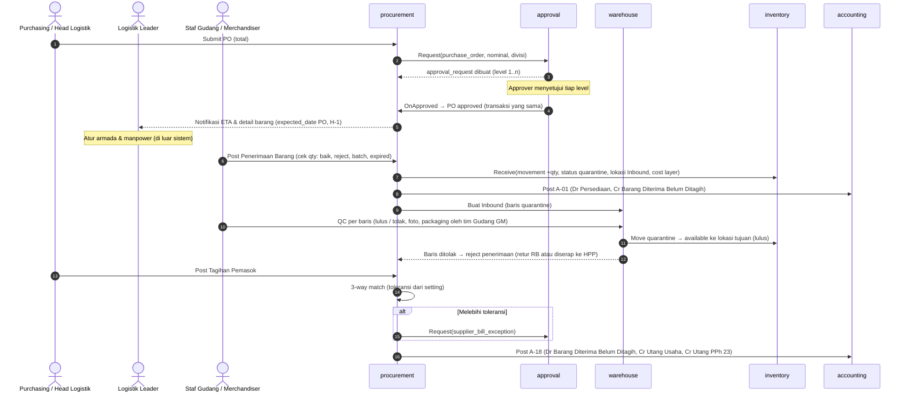
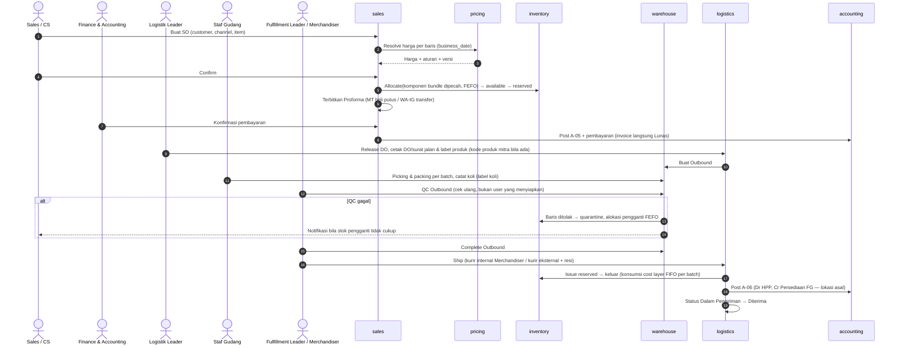
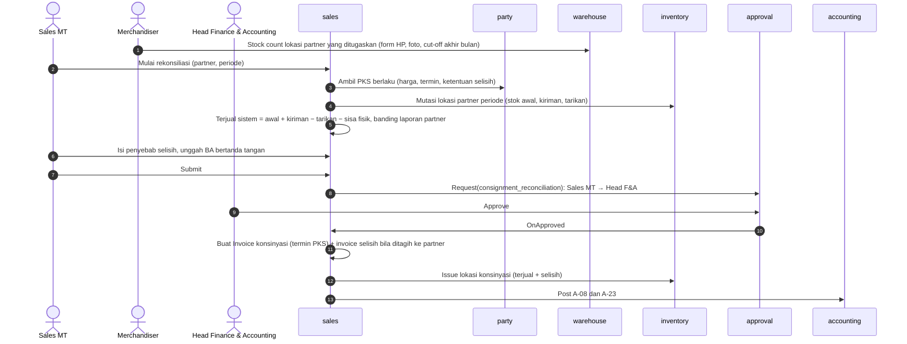
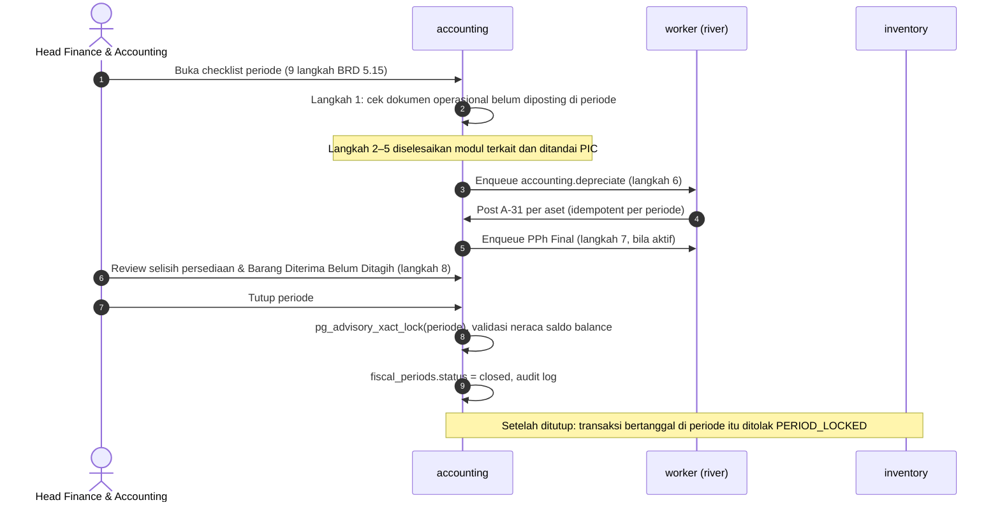
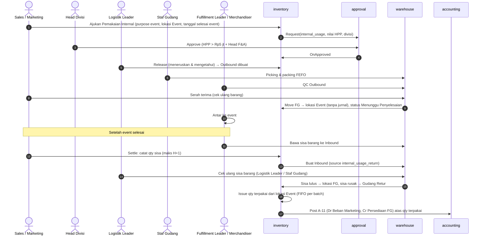
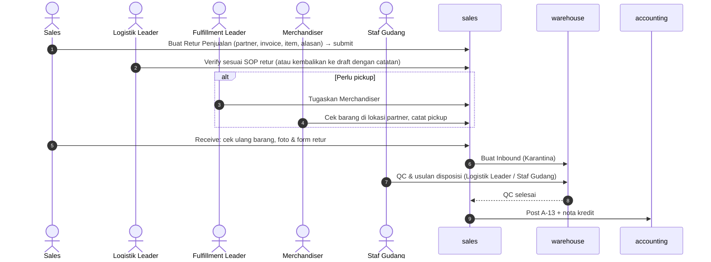
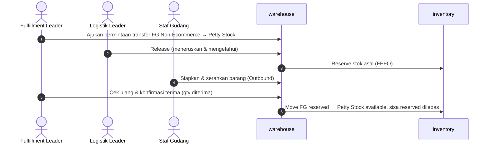

# Desain Alur Lintas Modul Fase 1
## Balans Nutrition — Unified Business Platform

| Item | Keterangan |
|---|---|
| Dokumen | Sequence diagram alur yang melintasi banyak modul (F0-DSN-08) |
| Acuan | BRD v0.7 bagian 5.1 – 5.5, 5.11, 5.12, 5.15; Technical Guideline 5.2, 5.5, 5.7, 5.8, 7 |
| Status | Draft untuk direview tim implementasi |

Prinsip yang berlaku di semua alur:

- Satu aksi user = satu transaksi DB yang memuat mutasi stok, jurnal, approval, dan audit sekaligus (Technical Guideline 5.2, 7.3). Efek ke luar (email, PDF) di-enqueue sebagai job di transaksi yang sama.
- Modul memanggil modul lain lewat API publik root package; arah dependensi mengikuti Technical Guideline 2.3.
- Lock stok diambil berurutan `(product_id, location_id, batch_id, stock_status)` untuk mencegah deadlock.

---

## 1. Beli → Terima → QC → Stok → Jurnal

Untuk PO maklon, langkah 6–7 memakai A-03: nilai batch = packaging terpakai (baik + reject, dari lokasi maklon) + jasa maklon; HPP per unit = nilai batch ÷ qty baik.

---

## 2. Sales Order → Alokasi FEFO → Outbound/QC → DO → Invoice → Jurnal

Alur ini adalah PO Offline dari klien MT dan reseller: Sales → Finance → Logistik Leader → Staf Gudang → Fulfillment Leader/Merchandiser. Marketplace: SO dibuat dari import; penjualan diakui saat DO `ship` (A-10 dan A-06 di transaksi yang sama).

---

## 3. Rekonsiliasi Konsinyasi → Invoice Otomatis

---

## 4. Tutup Buku Bulanan

Buka kembali periode: `request_reopen` → approval Head F&A → Direksi → status `open`, tercatat di audit trail (ACC-14).

---

## 5. Pemakaian untuk Event → Pengembalian Sisa → Jurnal

Property dan booth event bukan stok dan tidak dicatat di sistem Fase 1; pengirimannya cukup diketahui Logistik Leader di luar sistem.

---

## 6. Retur dari MT Offline

Retur dari website, WA/IG, dan marketplace tidak melewati verifikasi; dokumen langsung membuat Inbound saat diajukan.

---

## 7. Permintaan Petty Stock

Transfer antar lokasi dalam satu gudang tidak membentuk jurnal.
