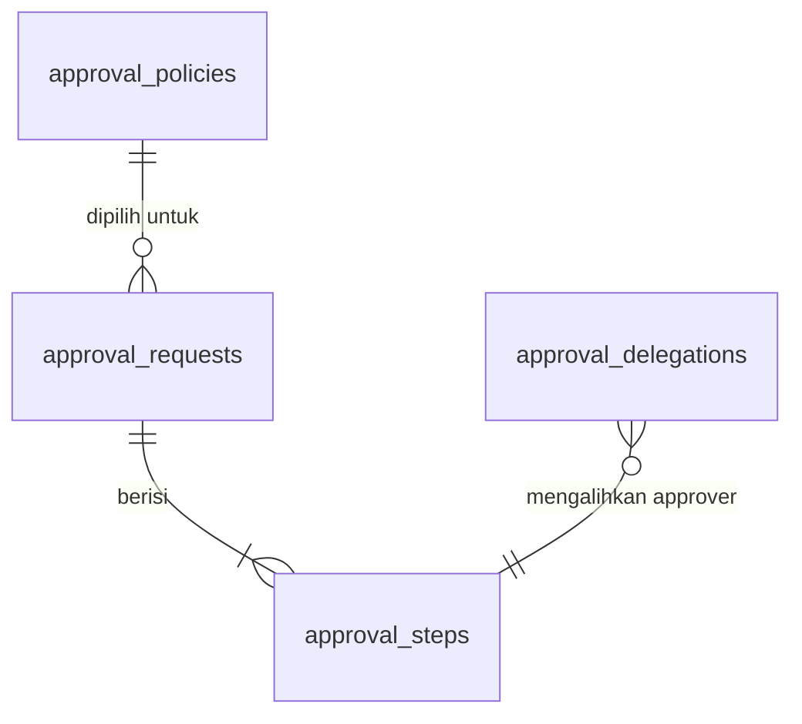
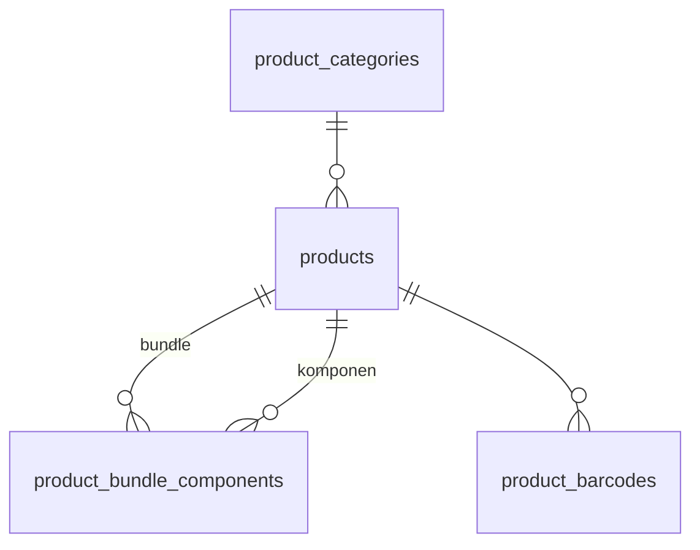
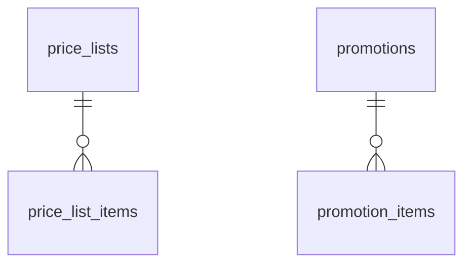
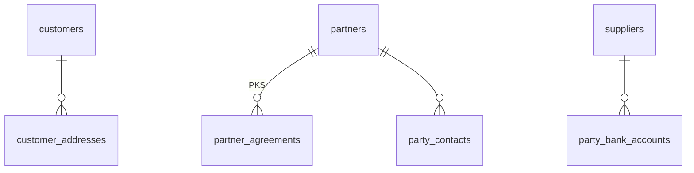
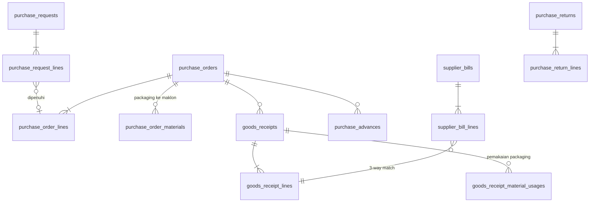
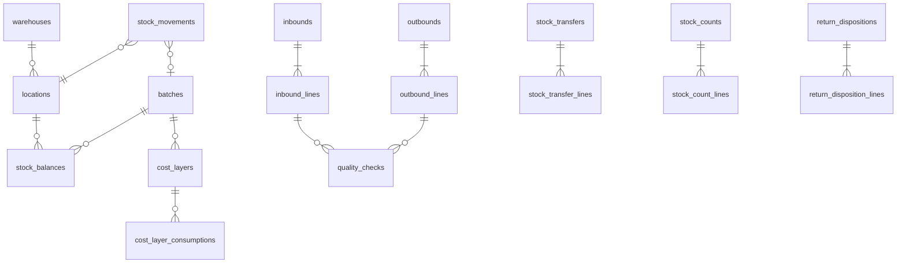
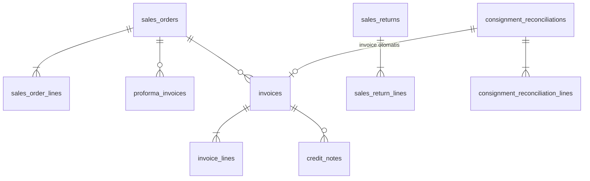
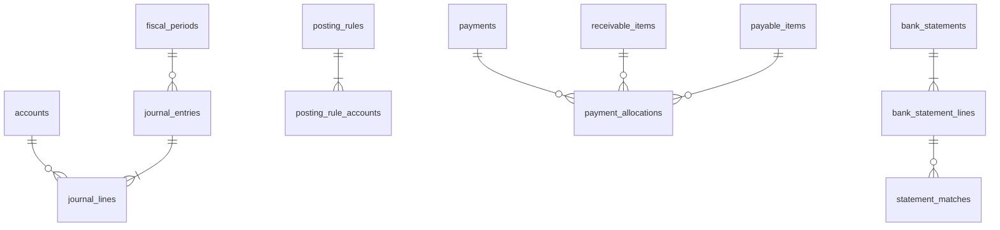

# Desain Data Model Fase 1
## Balans Nutrition — Unified Business Platform

| Item | Keterangan |
|---|---|
| Dokumen | Data model logis Fase 1 (F0-DSN-01) |
| Acuan | BRD v0.7 bagian 5 – 7; Technical Guideline v0.1 bagian 2.2, 2.3, 5, 6; Roadmap v0.6 bagian 6 |
| Status | Draft untuk direview tim implementasi dan Finance & Accounting Balans |

Dokumen ini menetapkan tabel setiap modul Fase 1, kolom kunci, dan relasinya. Setiap tabel punya **satu modul pemilik**; modul lain membaca lewat API publik modul pemilik atau read model, tidak pernah menulis tabel modul lain (Technical Guideline 2.3).

---

## 1. Konvensi

- Nama tabel `snake_case` jamak, tabel detail `<induk_singular>_<anak_jamak>`, kolom mengikuti Technical Guideline 4.4.
- Semua tabel master dan dokumen memakai **kolom standar** (Technical Guideline 6.2): `id uuid` (UUID v7), `created_at`, `created_by`, `updated_at`, `updated_by`, `version`, `deleted_at`, `deleted_by`. Kolom ini tidak ditulis ulang di tabel di bawah.
- Tabel **append-only** (ditandai ⊕) hanya punya `id`, `created_at`, `created_by` dan tidak pernah di-`UPDATE`/`DELETE`.
- Tabel **effective-dated** (ditandai ⏱) memakai `valid_from` / `valid_to` dengan `EXCLUDE` constraint agar periode tidak tumpang tindih (Technical Guideline 5.14).
- Tipe: uang `numeric(18,2)`, HPP per unit `numeric(18,4)`, qty `numeric(18,3)`, persen/tarif `numeric(9,4)`, tanggal bisnis `date`, status `text + CHECK`.
- Dokumen bertransaksi punya `number` (unik, diisi saat submit/posting, Technical Guideline 5.12), `business_date`, `status`, dan dimensi (`channel_id`, `sub_channel_id`, `division_id`, `campaign_id` opsional) bila menghasilkan jurnal.
- Kolom terenkripsi aplikasi (AES-256-GCM) diberi akhiran `_enc`; kolom pencarian persisnya `_hash` (HMAC) (Technical Guideline 6.7).

---

## 2. Peta Modul dan Kepemilikan Tabel

| Modul | Tabel milik modul | Dipakai requirement |
|---|---|---|
| `identity` | `users`, `roles`, `permissions`, `role_permissions`, `user_roles`, `sessions`, `login_attempts` | NFR-02, NFR-03 |
| `approval` | `approval_policies` ⏱, `approval_requests`, `approval_steps`, `approval_delegations` ⏱ | BRD 5.17, PRC-06, MD-12, WMS-04, INV-05, INV-12, SLS-09, ACC-11, ACC-14 |
| `notification` | `notifications`, `notification_emails` | NFR-11 |
| `document` | `document_sequences`, `document_templates` ⏱, `rendered_documents` | U-15, NFR-08 |
| `filestore` | `file_objects` | Lampiran PKS, foto QC, bukti bayar, bukti biaya |
| `dataexchange` | `import_jobs`, `import_job_errors`, `export_jobs`, `job_progress` | MD-10, ACC-10, SLS-05, INT-02 |
| `audit` | `audit_logs` ⊕ | NFR-03 |
| `setting` | `settings` ⏱ | Parameter BRD (asumsi #10) |
| `catalog` | `product_categories`, `products`, `product_bundle_components`, `product_barcodes` | MD-01, MD-02, MD-03 |
| `pricing` | `base_prices` ⏱, `price_lists`, `price_list_items` ⏱, `special_prices` ⏱, `promotions`, `promotion_items`, `tiered_prices` ⏱, `discount_limits` ⏱ | MD-04, MD-05, MD-11, MD-12 |
| `party` | `customers`, `customer_addresses`, `partners`, `partner_agreements` ⏱, `partner_product_codes`, `suppliers`, `party_bank_accounts`, `party_contacts` | MD-06, MD-07, MD-08 |
| `hris` | `employees` (Fase 1: data dasar) | HR-01, HR-03 |
| `procurement` | `purchase_requests`, `purchase_request_lines`, `purchase_orders`, `purchase_order_lines`, `purchase_order_materials`, `goods_receipts`, `goods_receipt_lines`, `goods_receipt_material_usages`, `supplier_bills`, `supplier_bill_lines`, `purchase_advances`, `purchase_returns`, `purchase_return_lines` | PRC-01 s.d. PRC-10, ACC-16 |
| `warehouse` | `warehouses`, `locations`, `inbounds`, `inbound_lines`, `quality_checks`, `stock_transfers`, `stock_transfer_lines`, `stock_counts`, `stock_count_lines`, `outbounds`, `outbound_lines`, `outbound_packages`, `return_dispositions`, `return_disposition_lines` | WMS-01 s.d. WMS-12 |
| `inventory` | `batches`, `stock_movements` ⊕, `stock_balances`, `cost_layers`, `cost_layer_consumptions` ⊕, `internal_usages`, `internal_usage_lines`, `repackings`, `repacking_lines`, `disposals`, `disposal_lines`, `recost_runs` | INV-01 s.d. INV-06, INV-09, INV-12, HR-02 |
| `logistics` | `couriers`, `delivery_orders`, `delivery_order_lines`, `shipments`, `shipment_events` ⊕ | LOG-01 s.d. LOG-04 |
| `sales` | `sales_orders`, `sales_order_lines`, `proforma_invoices`, `invoices`, `invoice_lines`, `credit_notes`, `sales_returns`, `sales_return_lines`, `return_reasons`, `consignment_reconciliations`, `consignment_reconciliation_lines`, `marketplace_order_imports` | SLS-01 s.d. SLS-09, MD-13 |
| `accounting` | `accounts`, `fiscal_periods`, `journal_entries`, `journal_lines` ⊕, `posting_rules`, `posting_rule_accounts` ⏱, `account_period_balances`, `channels`, `sub_channels`, `divisions`, `campaigns`, `expense_types`, `bank_accounts`, `payments`, `payment_allocations`, `receivable_items`, `payable_items`, `bank_statements`, `bank_statement_lines`, `statement_matches`, `settlement_reports`, `settlement_lines`, `petty_cash_funds`, `petty_cash_transactions`, `expense_claims`, `expense_claim_lines`, `withholding_tax_rates` ⏱, `withholdings`, `final_tax_runs`, `fixed_assets`, `depreciation_runs`, `depreciation_lines`, `period_close_checklists` | ACC-01 s.d. ACC-22, MD-13 |
| `tax` | — (kalkulator murni tanpa DB; tarif dimuat `accounting` dari `withholding_tax_rates`) | ACC-19, ACC-20 |
| platform | `idempotency_keys`, `webhook_events`, river (`river_job`, dst.) | Technical Guideline 7 |

Read model laporan (Technical Guideline 5.17): `stock_balances` dan `account_period_balances` di-update di transaksi posting; materialized view `mv_daily_sales_by_channel`, `mv_inventory_aging` dimiliki modul `accounting`/`inventory` dan di-refresh job `accounting.refresh_read_models`.

---

## 3. Lintas Fungsi

### 3.1 `identity`

| Tabel | Kolom kunci | Catatan |
|---|---|---|
| `users` | `email` (unik parsial aktif), `full_name`, `password_hash` (argon2id), `is_active`, `token_version`, `mfa_secret_enc`, `is_mfa_enabled`, `employee_id` (ref `hris`), `last_login_at` | Resign/nonaktif → `token_version` naik (TG 9.1) |
| `roles` | `code` unik, `name`, `requires_mfa` | Role awal BRD 3.1 (lihat Desain Role & Approval) |
| `permissions` | `code` unik `<modul>.<resource>.<aksi>`, `description`, `requires_reauth` | Disemai dari kode, tidak diubah user |
| `role_permissions` | `role_id`, `permission_id` | PK gabungan |
| `user_roles` | `user_id`, `role_id`, `scope_partner_id`, `scope_division_id` | Scope dipakai partner (Fase 2) dan approval per divisi |
| `sessions` | `user_id`, `audience`, `refresh_token_hash`, `family_id`, `expires_at`, `idle_expires_at`, `revoked_at`, `user_agent`, `ip` | Rotasi refresh token |
| `login_attempts` ⊕ | `email_hash`, `ip`, `succeeded` | Kunci akun 5× gagal / 15 menit |

### 3.2 `approval`

| Tabel | Kolom kunci |
|---|---|
| `approval_policies` ⏱ | `subject_type` (mis. `purchase_order`), `division_id` (null = semua), `min_amount`, `max_amount`, `level`, `approver_role_id`, `approver_user_id`, `valid_from`, `valid_to` |
| `approval_requests` | `subject_type`, `subject_id`, `amount`, `division_id`, `requested_by`, `status` (`pending_approval`, `approved`, `rejected`, `cancelled`), `current_level`; unik aktif per `(subject_type, subject_id)` |
| `approval_steps` | `approval_request_id`, `level`, `approver_user_id`, `delegated_from_user_id`, `decision` (`approved`, `rejected`), `note`, `decided_at` |
| `approval_delegations` ⏱ | `from_user_id`, `to_user_id`, `valid_from`, `valid_to`, `reason` |

### 3.3 `notification`, `document`, `filestore`, `dataexchange`, `audit`, `setting`

| Tabel | Kolom kunci |
|---|---|
| `notifications` | `user_id`, `type`, `title`, `body`, `link_path`, `read_at` |
| `notification_emails` | `recipient`, `subject`, `body_text`, `status`, `attempts`, `sent_at` (sudah dibangun di Fase 0) |
| `document_sequences` | `document_type`, `year`, `last_number`; PK `(document_type, year)` |
| `document_templates` ⏱ | `document_type`, `html_template`, `valid_from` |
| `rendered_documents` | `source_type`, `source_id`, `file_object_id`, `template_id` |
| `file_objects` | `object_key` (UUID), `original_name`, `content_type`, `size_bytes`, `sha256`, `owner_type`, `owner_id`, `status` (`pending`, `uploaded`) |
| `import_jobs` | `import_type`, `file_object_id`, `sha256` (unik per tipe), `status`, `total_rows`, `valid_rows`, `error_file_id`, `committed_at` |
| `import_job_errors` | `import_job_id`, `row_number`, `column_name`, `message` |
| `export_jobs` | `export_type`, `parameters` jsonb, `file_object_id`, `status` |
| `job_progress` | `job_id`, `percent`, `message`, `result_file_id` |
| `audit_logs` ⊕ | `actor_id`, `action`, `entity_type`, `entity_id`, `changes` jsonb (field sensitif di-mask), `request_id`, `ip` |
| `settings` ⏱ | `key` (mis. `proforma.validity_days`, `petty_cash.max_per_transaction`), `value` jsonb, `valid_from`, `note` |

---

## 4. Master Data

### 4.1 `catalog`

| Tabel | Kolom kunci | Catatan |
|---|---|---|
| `products` | `sku` (unik permanen, tidak dipakai ulang), `name`, `variant`, `product_type` (`finished_good`, `packaging` = RM, `reprocess_material` = GM), `packaging_type` (`tube`, `pouch`, `roll_sachet`), `uom`, `shelf_life_days`, `has_batch`, `is_bundle`, `category_id`, `min_stock_qty`, `units_per_carton`, `is_active` | Bundle virtual tidak punya stok (TG 5.7.4) |
| `product_bundle_components` | `bundle_product_id`, `component_product_id`, `qty` | Hanya `finished_good` |
| `product_barcodes` | `product_id`, `barcode` (unik), `symbology` (`ean13`, `code128`), `is_primary` | Satu SKU bisa beberapa barcode; barcode utama dicetak di label produk (MD-01) |
| `product_categories` | `code`, `name` | Dipakai margin per kategori (RPT-15) |

### 4.2 `pricing`

| Tabel | Kolom kunci | Prioritas BRD 5.18 |
|---|---|---|
| `base_prices` ⏱ | `product_id`, `base_price_amount`, `max_retail_price_amount` (HET) | 5 |
| `price_lists` | `code`, `name`, `price_list_type` (`modern_trade`, `consignment`, `marketplace`, `website`, `social_commerce`, `reseller`, `employee`, `vending`), `partner_id`, `reseller_level`, `basis` (`fixed`, `percent_of_website`), `percent` | 4 |
| `price_list_items` ⏱ | `price_list_id`, `product_id`, `price_amount` | 4 |
| `tiered_prices` ⏱ | `price_list_id`, `product_id`, `min_qty`, `price_amount` | 3 |
| `promotions` | `code`, `name`, `channel_id`, `valid_from`, `valid_to`, `status` | 2 |
| `promotion_items` | `promotion_id`, `product_id`, `price_amount` atau `discount_percent` | 2 |
| `special_prices` ⏱ | `customer_id` atau `partner_id`, `product_id`, `price_amount` | 1 |
| `discount_limits` ⏱ | `role_id`, `max_line_discount_percent`, `max_document_discount_percent` | MD-12 |

Hasil resolusi harga disimpan di baris transaksi: `price_rule` (`special_price`, `promotion`, `tiered_price`, `price_list`, `base_price`) dan `price_source_id` (TG 5.6).

### 4.3 `party`

| Tabel | Kolom kunci | Catatan |
|---|---|---|
| `customers` | `code`, `full_name`, `phone`, `phone_normalized` (unik parsial aktif), `email`, `customer_type` (`retail`, `b2b`, `reseller`, `employee`), `employee_id`, `marketing_consent_at` | Dicari by HP agar tidak duplikat (BRD 5.8) |
| `customer_addresses` | `customer_id`, `label`, `recipient_name`, `phone`, `address_line`, `district`, `city`, `province`, `postal_code`, `latitude`, `longitude`, `is_default` | |
| `partners` | `code`, `name`, `partner_type` (`modern_trade`, `consignment`), `npwp_enc`, `address`, `pic_name`, `pic_phone`, `sales_user_id`, `merchandiser_user_id` | Satu partner bisa MT dan konsinyasi lewat dua PKS; `merchandiser_user_id` membatasi akses stock count merchandiser |
| `partner_agreements` ⏱ | `partner_id`, `agreement_number`, `agreement_type` (`consignment`, `modern_trade`), `valid_from`, `valid_to`, `file_object_id`, `price_list_id`, `payment_term_days`, `loss_borne_by`, `partner_damage_borne_by`, `product_defect_borne_by`, `near_expiry_borne_by` (`partner`/`balans`) | DO konsinyasi diblokir jika tidak ada PKS berlaku (BRD 5.5) |
| `partner_product_codes` | `partner_id`, `product_id`, `article_code`, `barcode`, `description`; unik `(partner_id, product_id)` | Kode artikel/barcode milik retailer MT; dicetak di label produk & DO partner tersebut bila ada (MD-07) |
| `suppliers` | `code`, `name`, `supplier_type` (`supplier`, `toll_manufacturer`), `npwp_enc`, `is_business_entity`, `default_withholding` (`none`, `pph23`, `pph21`, `pph4_2`), `payment_term_days` | Maklon = `toll_manufacturer` |
| `party_bank_accounts` | `party_type`, `party_id`, `bank_name`, `account_number_enc`, `account_name` | |
| `party_contacts` | `party_type`, `party_id`, `name`, `phone`, `email`, `role` | |

### 4.4 `hris` (data dasar Fase 1)

| Tabel | Kolom kunci | Catatan |
|---|---|---|
| `employees` | `employee_number` (unik permanen), `full_name`, `division_id`, `position_title`, `employment_status` (`active`, `resigned`), `join_date`, `resign_date`, `work_email`, `phone`, `nik_enc`, `nik_hash` | HR-03: `customers.employee_id` → harga karyawan otomatis hilang saat `resigned` |

---

## 5. Procurement

| Tabel | Kolom kunci | Catatan |
|---|---|---|
| `purchase_requests` | `number` (PR), `division_id`, `requested_by`, `needed_date`, `status`, `note` | Opsional (PRC-08) |
| `purchase_request_lines` | `product_id` atau `description`, `qty`, `estimated_price_amount`, `fulfilled_qty` | |
| `purchase_orders` | `number` (PO), `order_type` (`goods`, `packaging`, `toll_manufacturing`, `reprocess`, `other`), `supplier_id`, `division_id`, `business_date`, `expected_date`, `subtotal_amount`, `total_amount`, `status`, `close_reason` | Approval via `approval` (nominal = `total_amount`) |
| `purchase_order_lines` | `product_id` (FG hasil maklon / packaging) atau `description`, `ordered_qty`, `unit_price_amount`, `received_qty`, `billed_qty`, `purchase_request_line_id` | Untuk maklon: `unit_price_amount` = jasa maklon per unit |
| `purchase_order_materials` | `purchase_order_id`, `material_product_id`, `planned_qty` | Packaging/bahan reprocess yang direncanakan dipakai (PRC-02, PRC-03) |
| `goods_receipts` | `number` (GR), `purchase_order_id`, `business_date`, `location_id` (Inbound), `inbound_id`, `status` | Memicu Inbound + jurnal A-01/A-03 |
| `goods_receipt_lines` | `purchase_order_line_id`, `product_id`, `good_qty`, `reject_qty`, `batch_number`, `production_date`, `expiry_date`, `unit_cost` (hasil hitung), `reject_disposition` (`return_to_supplier`, `absorbed`) | Reject diserap → masuk HPP per unit (A-04a) |
| `goods_receipt_material_usages` | `goods_receipt_id`, `material_product_id`, `from_location_id` (lokasi maklon), `used_good_qty`, `used_reject_qty` | PRC-10; nilai packaging masuk nilai batch (A-03) |
| `supplier_bills` | `number` (nomor tagihan pemasok, unik per supplier), `supplier_id`, `bill_date`, `due_date`, `subtotal_amount`, `withholding_amount`, `advance_applied_amount`, `total_payable_amount`, `match_status` (`matched`, `exceeds_tolerance`, `approved_exception`), `status` | PRC-07, A-18 |
| `supplier_bill_lines` | `goods_receipt_line_id`, `qty`, `unit_price_amount`, `price_variance_amount` | Toleransi dari `settings` |
| `purchase_advances` | `purchase_order_id`, `amount`, `paid_payment_id`, `applied_amount` | PRC-09, A-19 |
| `purchase_returns` | `number` (RB), `supplier_id`, `purchase_order_id`, `reason` (`qc_inbound`, `qc_outbound`, `other`), `debit_note_number` (DN), `status` | QC Outbound gagal → tanpa approval (D-24) |
| `purchase_return_lines` | `product_id`, `batch_id`, `qty`, `unit_cost`, `amount` | A-02 |

---

## 6. Warehouse dan Inventory

### 6.1 `warehouse`

| Tabel | Kolom kunci | Catatan |
|---|---|---|
| `warehouses` | `code`, `name`, `address` | Konfigurasi awal: satu gudang fisik (U-08) |
| `locations` | `code`, `name`, `warehouse_id` (null untuk lokasi eksternal), `location_type` (`inbound`, `finished_goods`, `ecommerce`, `raw_material`, `goods_material`, `returns`, `event`, `toll_manufacturer`, `consignment`, `vending_buffer`, `vending_machine`), `external_party_type`, `external_party_id`, `is_sellable` | Lokasi eksternal per maklon/partner/mesin (MD-09); `ecommerce` = Petty Stock; `raw_material` dan `goods_material` = lokasi RM dan GM di Gudang GM; `event` = stok yang dibawa ke event, tidak bisa dijual |
| `inbounds` | `number`, `source_type` (`goods_receipt`, `sales_return`, `consignment_pullback`, `stock_transfer`, `internal_usage_return`), `source_id`, `location_id`, `business_date`, `status` | Semua barang masuk lewat Inbound (WMS-02); `internal_usage_return` = sisa barang event |
| `inbound_lines` | `product_id`, `batch_id`, `received_qty`, `passed_qty`, `rejected_qty`, `destination_location_id` | Status stok `quarantine` → `available` saat lulus |
| `quality_checks` | `document_type` (`inbound`, `outbound`), `document_line_id`, `result` (`passed`, `rejected`), `qty`, `checks` (batch/expired/kondisi/segel), `note`, `photo_file_id`, `checked_by`, `checked_at` | TG 5.7.2 |
| `stock_transfers` | `number` (TRF), `transfer_type` (`direct`, `request`), `from_location_id`, `to_location_id`, `business_date`, `requested_by`, `released_by`, `prepared_by`, `received_by`, `shipped_at`, `received_at`, `status` | `in_transit` antar gudang/eksternal (WMS-10); `request` = permintaan Petty Stock oleh Fulfillment (WMS-03) |
| `stock_transfer_lines` | `product_id`, `batch_id`, `qty`, `received_qty` | |
| `stock_counts` | `number` (SC), `count_type` (`full`, `cycle`, `consignment`, `vending`), `location_id`, `snapshot_at`, `business_date`, `status` | Selisih → approval → penyesuaian (A-14) |
| `stock_count_lines` | `product_id`, `batch_id`, `system_qty`, `counted_qty`, `variance_qty`, `variance_amount`, `photo_file_id` | Form HP (WMS-11) |
| `outbounds` | `number`, `source_type` (`delivery_order`, `stock_transfer`, `internal_usage`, `purchase_return`), `source_id`, `location_id`, `prepared_by`, `checked_by`, `handed_over_to_user_id`, `handed_over_at`, `status` | Picking/packing oleh Staf Gudang → QC oleh Fulfillment (WMS-12); serah terima ke divisi peminta untuk pemakaian internal |
| `outbound_lines` | `product_id`, `batch_id`, `allocated_qty`, `picked_qty`, `passed_qty`, `rejected_qty`, `replacement_of_line_id` | QC gagal → baris pengganti otomatis |
| `outbound_packages` | `outbound_id`, `package_number`, `package_count`, `weight_grams`, `contents` jsonb (produk, batch, qty) | Koli; dasar cetak label koli (LOG-01) |
| `return_dispositions` | `number`, `inbound_id`, `status` | WMS-07, U-09 |
| `return_disposition_lines` | `product_id`, `batch_id`, `qty`, `disposition` (`restock`, `repack`, `reprocess`, `marketing_sample`, `dispose`), `reason_id` | Pemusnahan → `inventory.disposals` |

### 6.2 `inventory`

| Tabel | Kolom kunci | Catatan |
|---|---|---|
| `batches` | `product_id`, `batch_number`, `production_date`, `expiry_date`; unik `(product_id, batch_number)` | INV-04 |
| `stock_movements` ⊕ | `product_id`, `location_id`, `batch_id`, `stock_status` (`available`, `quarantine`, `in_transit`, `reserved`), `qty` (±), `unit_cost`, `source_type`, `source_id`, `source_line_id`, `business_date`; unik `(source_type, source_line_id, stock_status, location_id, sign)` | Ledger; kartu stok (INV-01) |
| `stock_balances` | PK `(product_id, location_id, batch_id, stock_status)`, `qty` `CHECK (qty >= 0)` | Dikunci `FOR UPDATE` berurutan |
| `cost_layers` | `product_id`, `batch_id`, `source_type`, `source_id`, `received_qty`, `remaining_qty`, `unit_cost` (4 desimal), `business_date` | FIFO dalam batch (INV-03) |
| `cost_layer_consumptions` ⊕ | `cost_layer_id`, `stock_movement_id`, `qty`, `unit_cost` | Jejak HPP per penjualan (RPT-04) |
| `internal_usages` | `number`, `purpose` (`marketing`, `event`, `employee_sample`, `sales_sampling`), `division_id`, `campaign_id`, `requested_by`, `released_by`, `event_location_id`, `event_end_date`, `settle_due_date`, `status` | INV-05, HR-02; A-11/A-12. `event`: stok dipindah ke lokasi Event, biaya diakui saat penyelesaian (maks H+1 setelah event) |
| `internal_usage_lines` | `product_id`, `qty`, `batch_id` (diisi FEFO saat keluar), `returned_qty`, `consumed_qty`, `cost_amount` | `consumed_qty = qty − returned_qty`; `cost_amount` atas `consumed_qty` |
| `repackings` | `number`, `status` | INV-06; input bahan retur + packaging baru, output FG |
| `repacking_lines` | `direction` (`input`, `output`), `product_id`, `batch_id`, `qty` | |
| `disposals` | `number`, `reason` (`expired`, `damaged`, `return`), `disposal_date`, `method`, `witnesses`, `photo_file_ids`, `status` | INV-12, berita acara; A-26/A-27 |
| `disposal_lines` | `product_id`, `batch_id`, `location_id`, `qty`, `cost_amount` | |
| `recost_runs` | `product_id`, `from_business_date`, `trigger_source_type`, `trigger_source_id`, `status`, `adjustment_journal_id` | Backdate di periode terbuka (TG 5.8.4) |

---

## 7. Logistics

| Tabel | Kolom kunci | Catatan |
|---|---|---|
| `couriers` | `code` (`jne`, `gosend`, `grab`, `jnt`, `sicepat`, `own`), `name`, `is_active` | |
| `delivery_orders` | `number` (DO), `delivery_type` (`sales`, `consignment`, `vending_buffer`, `marketplace`, `transfer`), `sales_order_id`, `partner_id`, `ship_to_address`, `business_date`, `status` | LOG-01; DO konsinyasi → A-07, buffer → A-24 |
| `delivery_order_lines` | `sales_order_line_id`, `product_id`, `qty` | Batch dari Outbound |
| `shipments` | `delivery_order_id`, `courier_id`, `internal_courier_user_id`, `service_code`, `tracking_number`, `marketplace_awb`, `shipping_cost_amount`, `status`, `shipped_at`, `delivered_at` | LOG-02 – LOG-04; Biteship mulai R2.2. Kurir `own` = kurir internal (Merchandiser), `internal_courier_user_id` wajib |
| `shipment_events` ⊕ | `shipment_id`, `status`, `occurred_at`, `source` (`manual`, `webhook`) | |

---

## 8. Sales

| Tabel | Kolom kunci | Catatan |
|---|---|---|
| `sales_orders` | `number` (SO), `channel_id`, `sub_channel_id`, `order_type` (`modern_trade`, `b2b`, `social_commerce`, `marketplace`, `employee`), `customer_id`, `partner_id`, `external_order_id` (unik per sub-channel), `business_date`, `subtotal_amount`, `discount_amount`, `shipping_amount`, `total_amount`, `status` | Satu model pesanan untuk semua channel (BRD 4) |
| `sales_order_lines` | `product_id` (boleh bundle), `qty`, `unit_price_amount`, `price_rule`, `price_source_id`, `discount_percent`, `discount_amount`, `line_total_amount`, `allocated_qty`, `delivered_qty` | Bundle dipecah ke komponen saat alokasi (TG 5.7.4) |
| `proforma_invoices` | `number` (PI), `sales_order_id`, `amount`, `valid_until`, `status` | Kedaluwarsa melepas alokasi (BRD 5.4) |
| `invoices` | `number` (INV), `invoice_type` (`sales`, `consignment`, `variance`), `sales_order_id`, `consignment_reconciliation_id`, `customer_id`, `partner_id`, `invoice_date`, `due_date`, `total_amount`, `paid_amount`, `status` | NON-PKP tanpa PPN (SLS-02) |
| `invoice_lines` | `product_id`, `qty`, `unit_price_amount`, `discount_amount`, `line_total_amount` | |
| `credit_notes` | `number` (CN), `invoice_id`, `sales_return_id`, `amount`, `status` | |
| `sales_returns` | `number` (RJ), `sales_order_id`, `invoice_id`, `channel_id`, `partner_id`, `settlement_method` (`credit_note`, `refund`, `marketplace`), `verified_by`, `verified_at`, `pickup_required`, `pickup_user_id`, `picked_up_at`, `documentation_file_ids`, `status` | Retur MT/reseller diverifikasi Logistik Leader sebelum barang diambil; pickup oleh Merchandiser bila perlu; barang masuk Inbound → Gudang Retur |
| `sales_return_lines` | `product_id`, `batch_id`, `qty`, `return_reason_id`, `unit_price_amount`, `original_unit_cost` | A-13 |
| `return_reasons` | `code`, `name` | MD-13 |
| `consignment_reconciliations` | `number` (KSN), `partner_id`, `partner_agreement_id`, `period_month`, `stock_count_id`, `status` | SLS-03 |
| `consignment_reconciliation_lines` | `product_id`, `opening_qty`, `delivered_qty`, `pulled_qty`, `physical_qty`, `sold_qty_calc`, `partner_reported_qty`, `variance_qty`, `variance_cause` (`lost`, `partner_damage`, `product_defect`, `near_expiry`), `variance_borne_by`, `unit_price_amount` | Rumus BRD 5.5; selisih A-23 |
| `marketplace_order_imports` | `import_job_id`, `sub_channel_id`, `external_order_id`, `sales_order_id` | SLS-05 sebelum integrasi |

---

## 9. Accounting

| Tabel | Kolom kunci | Catatan |
|---|---|---|
| `accounts` | `code` (unik permanen), `name`, `account_group` (1–7), `normal_balance` (`debit`, `credit`), `parent_id`, `is_postable`, `allow_manual_posting`, `is_active` | COA final (Desain Finance & Accounting) |
| `fiscal_periods` | `year`, `month`, `status` (`open`, `closed`), `closed_at`, `closed_by`, `reopened_count` | ACC-08, ACC-14 |
| `journal_entries` | `number` (JV), `business_date`, `fiscal_period_id`, `source_type`, `source_id`, `posting_rule_code`, `description`, `reversal_of_id`, `status` (`posted`); unik `(source_type, source_id, posting_rule_code)` | ACC-13: tidak bisa diedit |
| `journal_lines` ⊕ | `journal_entry_id`, `account_id`, `debit_amount`, `credit_amount` (`ck_journal_lines_debit_xor_credit`), `channel_id`, `sub_channel_id`, `division_id`, `campaign_id`, `party_type`, `party_id`, `memo` | ACC-17 |
| `posting_rules` | `code` (A-01 … A-36), `name`, `required_dimensions`, `is_active` | |
| `posting_rule_accounts` ⏱ | `posting_rule_code`, `amount_key` (mis. `inventory_value`, `grni`), `side`, `account_id`, `account_resolver` (`fixed`, `location_inventory_account`, `expense_type_account`, `bank_account`) | Mapping dapat diubah tanpa ubah kode |
| `account_period_balances` | PK `(account_id, fiscal_period_id, channel_id, sub_channel_id, division_id)`, `debit_amount`, `credit_amount` | Read model laporan |
| `channels` | `code` (`modern_trade`, `consignment`, `marketplace`, `social_commerce`, `website`, `reseller`, `vending`, `b2b`, `employee`, `internal`), `name` | Dimensi |
| `sub_channels` | `channel_id`, `code`, `name`, `party_type`, `party_id` | Per marketplace / partner |
| `divisions` | `code`, `name` | Logistik & FA, Sales, Marketing, HRGA, Direksi |
| `campaigns` | `code`, `name`, `valid_from`, `valid_to`, `budget_amount` | MD-13 |
| `expense_types` | `code`, `name`, `expense_account_id`, `withholding_type`, `requires_receipt`, `approval_subject` | MD-13, ACC-11 |
| `bank_accounts` | `code`, `bank_name`, `account_number_enc`, `account_id` (akun GL) | |
| `payments` | `number`, `direction` (`incoming`, `outgoing`), `method` (`bank_transfer`, `cash`, `petty_cash`, `deposit`), `bank_account_id`, `party_type`, `party_id`, `payment_date`, `amount`, `proof_file_id`, `status` | ACC-15 |
| `payment_allocations` | `payment_id`, `target_type` (`receivable_item`, `payable_item`), `target_id`, `amount` | Satu bayar → banyak invoice |
| `receivable_items` | `document_type` (`invoice`, `credit_note`, `opening_balance`), `document_id`, `party_type`, `party_id`, `due_date`, `amount`, `open_amount` | Umur piutang (RPT-11) |
| `payable_items` | `document_type` (`supplier_bill`, `debit_note`, `expense_claim`, `opening_balance`), `document_id`, `supplier_id`, `due_date`, `amount`, `open_amount` | Umur utang |
| `bank_statements` / `bank_statement_lines` | `bank_account_id`, `period`, `import_job_id` / `transaction_date`, `description`, `amount`, `reference` | ACC-05 |
| `statement_matches` | `statement_line_id`, `payment_id` atau `journal_entry_id`, `match_rule`, `confirmed_by` | TG 5.8.5 |
| `settlement_reports` / `settlement_lines` | `provider` (`midtrans`, marketplace), `period`, `import_job_id` / `external_order_id`, `gross_amount`, `fee_amount`, `promo_amount`, `net_amount`, `matched_receivable_id` | ACC-06 tahap 1 |
| `petty_cash_funds` | `holder_user_id`, `ceiling_amount`, `account_id`, `balance_amount` | ACC-12 (imprest) |
| `petty_cash_transactions` | `number` (KK), `fund_id`, `transaction_type` (`replenish`, `expense`), `expense_type_id`, `amount`, `receipt_file_id`, `status` | A-16, A-17 |
| `expense_claims` | `number` (EXP), `claim_type` (`expense`, `reimbursement`), `division_id`, `campaign_id`, `payee_type`, `payee_id`, `total_amount`, `withholding_amount`, `status` | ACC-11, A-15 |
| `expense_claim_lines` | `expense_type_id`, `description`, `amount`, `receipt_file_id` | |
| `withholding_tax_rates` ⏱ | `tax_type` (`pph21`, `pph23`, `pph4_2`, `final_umkm`), `object_code`, `rate_percent`, `requires_npwp_surcharge` | Dikonfirmasi konsultan pajak |
| `withholdings` | `source_type`, `source_id`, `tax_type`, `object_code`, `taxpayer_name`, `taxpayer_npwp_enc`, `base_amount`, `rate_percent`, `tax_amount`, `tax_period`, `slip_status` | ACC-19, rekap Coretax |
| `final_tax_runs` | `fiscal_period_id`, `gross_revenue_amount`, `rate_percent`, `tax_amount`, `journal_entry_id` | ACC-20, A-30 |
| `fixed_assets` | `code`, `name`, `asset_class` (`vending_machine`, `office_equipment`, `vehicle`), `acquisition_date`, `acquisition_cost_amount`, `useful_life_months`, `salvage_amount`, `location_id`, `status` | ACC-21 |
| `depreciation_runs` / `depreciation_lines` | `fiscal_period_id`, `journal_entry_id` / `fixed_asset_id`, `amount`, `accumulated_amount` | A-31 |
| `period_close_checklists` | `fiscal_period_id`, `step_code` (9 langkah BRD 5.15), `status`, `completed_by`, `completed_at`, `note` | ACC-08 |

---

## 10. Aturan Integritas Kunci

| Aturan | Implementasi |
|---|---|
| Stok tidak pernah minus | `ck_stock_balances_qty_non_negative` + lock urutan `(product_id, location_id, batch_id, stock_status)` |
| Satu sumber diposting sekali per rule | `uq_journal_entries_source (source_type, source_id, posting_rule_code)` |
| Jurnal balance | Dicek `Poster.Post`; total debit = total kredit per entry |
| Nomor dokumen unik | `uq_<tabel>_number`; sequence `UPDATE … RETURNING` di transaksi |
| Kode bisnis tidak dipakai ulang | Unik penuh (bukan parsial) untuk `products.sku`, `accounts.code`, `employees.employee_number`, `partners.code`, `suppliers.code` |
| Periode harga/PKS/kebijakan tidak tumpang tindih | `EXCLUDE USING gist (… WITH =, daterange(valid_from, valid_to) WITH &&)` |
| Dokumen konsinyasi butuh PKS | Dicek service `sales` lewat API `party` sebelum DO konsinyasi |
| Order marketplace tidak ganda | `uq_sales_orders_sub_channel_external_order (sub_channel_id, external_order_id)` |
| Impor file tidak ganda | `uq_import_jobs_type_sha256` |
