# Desain Status Dokumen Fase 1
## Balans Nutrition — Unified Business Platform

| Item | Keterangan |
|---|---|
| Dokumen | State machine dokumen Fase 1 (F0-DSN-02) |
| Acuan | BRD v0.7 bagian 5; Technical Guideline 5.4, 10.8; Naming Convention bagian 7 |
| Status | Draft untuk direview tim implementasi dan key user |

Setiap dokumen punya tabel transisi eksplisit di package `domain` modulnya. Status hanya berubah lewat aksi bernama; aksi yang diizinkan dikirim API sebagai `allowedActions` dan tampil sebagai tombol di ERP (Technical Guideline 5.4). Kode status di API memakai `snake_case`; label UI memakai Naming Convention bagian 7.

---

## 1. Kode dan Label Status

| Kode | Label UI | Dipakai di |
|---|---|---|
| `draft` | Draft | Semua dokumen yang bisa disimpan sebelum diajukan |
| `pending_approval` | Menunggu Persetujuan | Dokumen yang memakai modul `approval` |
| `approved` | Disetujui | |
| `rejected` | Ditolak | Kembali bisa diedit (ke `draft`) |
| `in_progress` | Diproses | Proses fisik berjalan (Inbound, Outbound, Stock Count) |
| `awaiting_payment` | Menunggu Pembayaran | Proforma, Invoice, Tagihan Pemasok |
| `partially_paid` | Dibayar Sebagian | Invoice, Tagihan Pemasok |
| `paid` | Lunas | Invoice, Tagihan Pemasok |
| `posted` | Diposting | Dokumen yang sudah membentuk jurnal/mutasi stok dan tidak bisa diubah |
| `cancelled` | Dibatalkan | Sebelum posting: batal biasa. Setelah posting: lewat dokumen pembatalan/reversal |
| `completed` | Selesai | |
| `closed` | Ditutup | Ditutup sebelum qty terpenuhi, wajib alasan |
| `expired` | Kedaluwarsa | Proforma Invoice |
| `in_transit` | Dalam Pengiriman | Transfer Stok, Delivery Order |
| `partially_received` | Diterima Sebagian | Purchase Order, Transfer Stok |
| `received` | Diterima | Purchase Order, Transfer Stok, Delivery Order |
| `quarantine` | Karantina | Status stok/baris Inbound sebelum QC |
| `qc_rejected` | Ditolak QC | Baris Inbound/Outbound yang gagal QC |
| `submitted` | Diajukan | Permintaan Petty Stock (Transfer Stok), Retur Penjualan MT/reseller |
| `verified` | Terverifikasi | Retur Penjualan MT/reseller setelah crosscheck Logistik Leader |
| `awaiting_settlement` | Menunggu Penyelesaian | Pemakaian Internal event: barang di lokasi Event, sisa belum dicatat |

Aturan umum:

- Dokumen `posted` DILARANG diedit atau dihapus (ACC-13). Koreksi lewat dokumen pembatalan yang membalik mutasi stok dan jurnal dalam satu transaksi (Technical Guideline 5.8.3).
- `draft` boleh dihapus (soft delete). Dokumen lain tidak bisa dihapus.
- Nomor dokumen diberikan saat `submit` atau `post`, bukan saat draft dibuat.
- Setiap transisi dicatat di `audit_logs`.

---

## 2. Procurement

### 2.1 Purchase Request (PR)

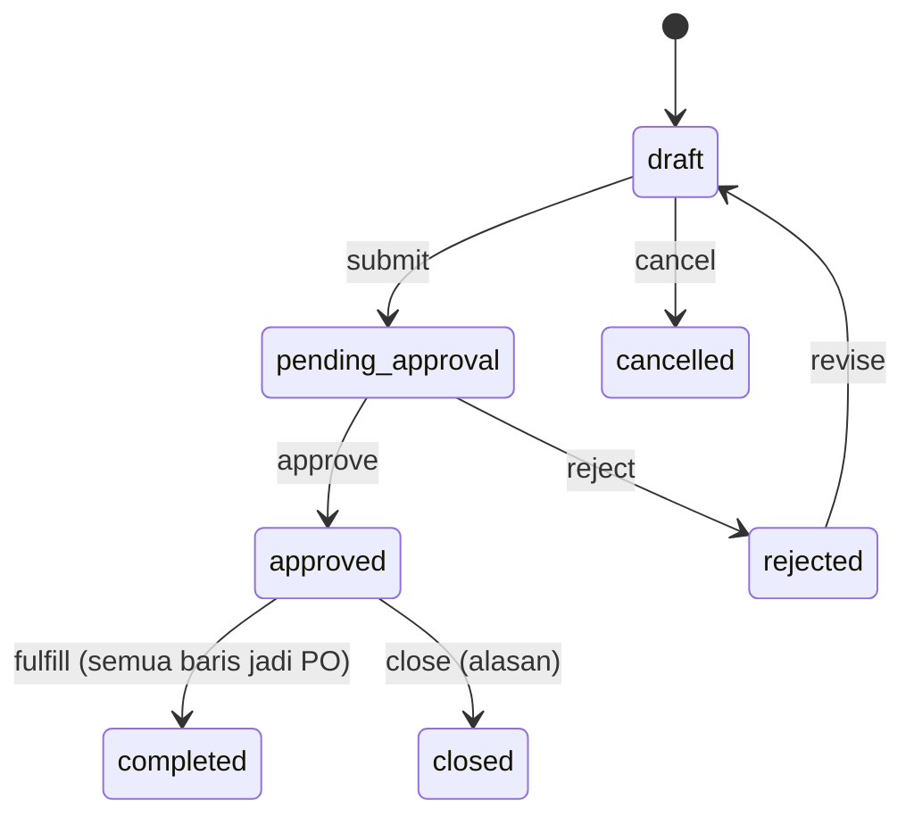

### 2.2 Purchase Order (PO, PO Maklon, PO Reprocess)

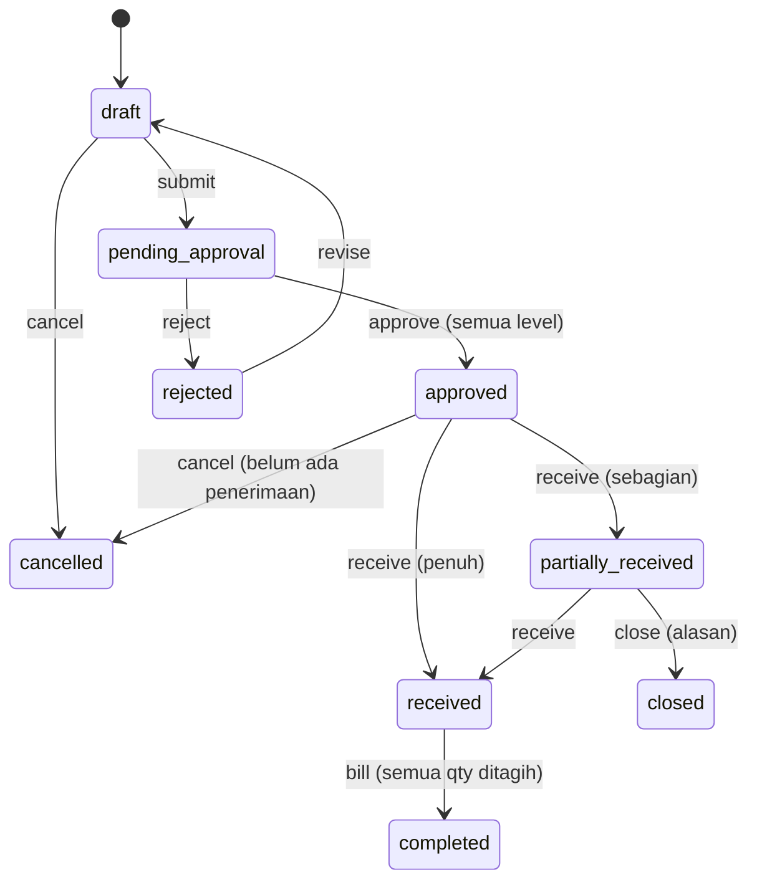

| Aksi | Efek |
|---|---|
| `submit` | Nomor PO; `approval.Request` dengan nominal `total_amount` |
| `approve` | Dipanggil handler `approval` setelah level terakhir; PO bisa diterima dan dibayar uang muka |
| `receive` | Membuat Penerimaan Barang (dokumen terpisah) |
| `close` | Sisa qty tidak ditunggu lagi; PR terkait ikut dihitung ulang |

### 2.3 Penerimaan Barang (GR)

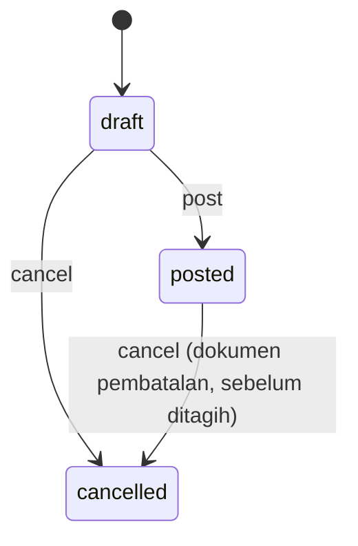

`post`: mutasi stok masuk Inbound berstatus `quarantine`, cost layer per batch, jurnal A-01 (atau A-03 untuk maklon), membuat dokumen Inbound.

### 2.4 Tagihan Pemasok

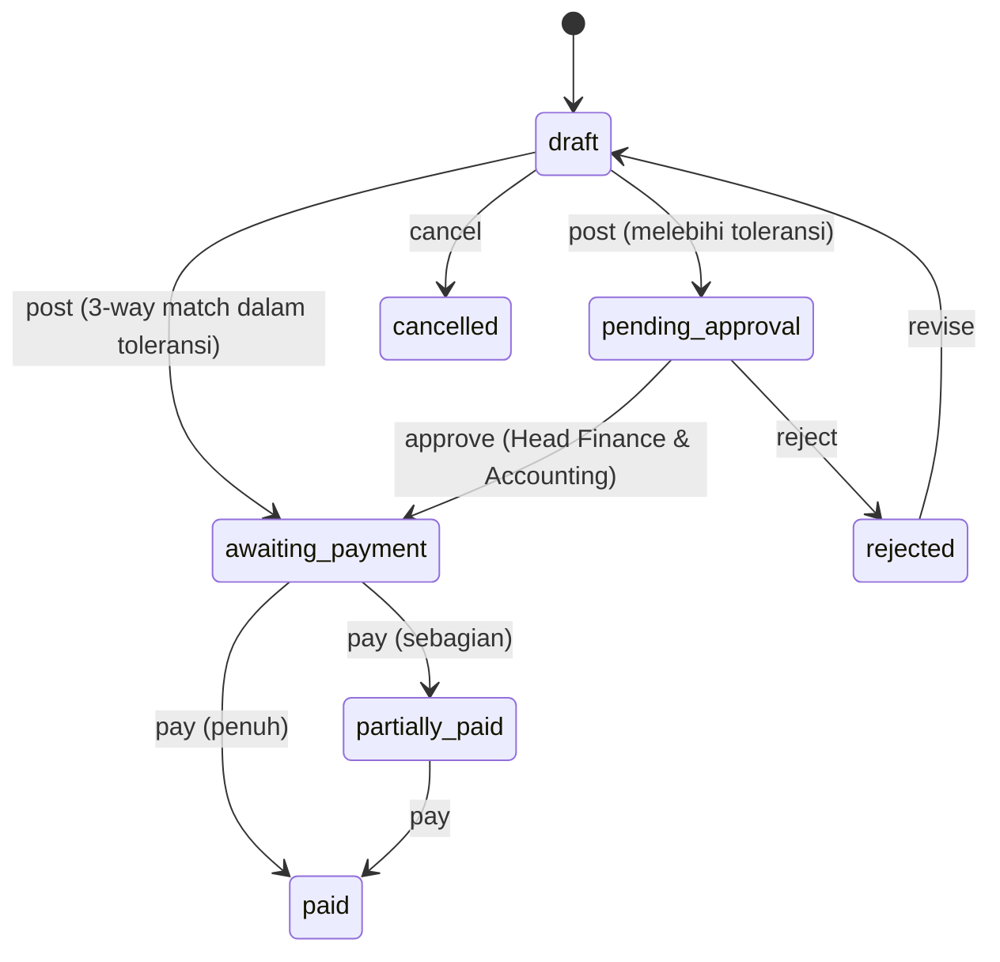

`post`: jurnal A-18, uang muka dipotong otomatis, PPh dipotong sesuai pemasok, `payable_items` terbentuk.

### 2.5 Retur Pembelian (RB, nota debit)

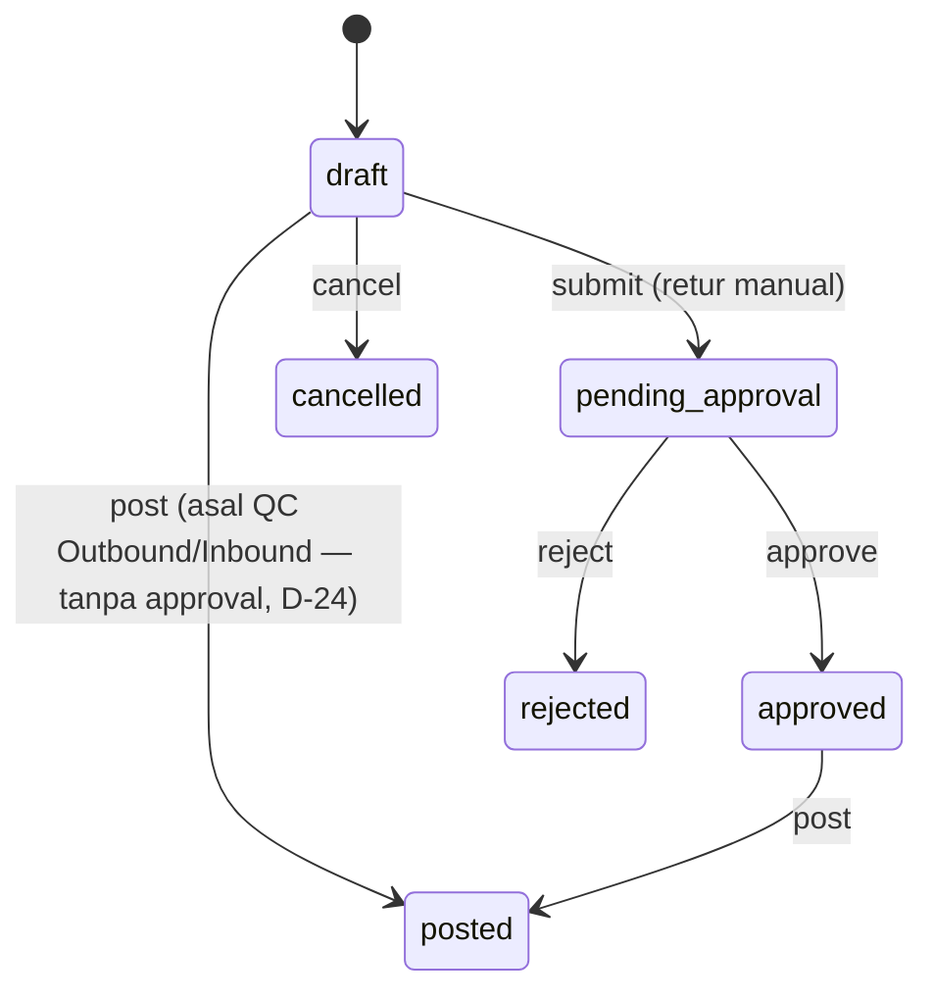

`post`: Outbound barang dari Karantina, nomor nota debit (DN), jurnal A-02.

---

## 3. Gudang

### 3.1 Inbound / QC

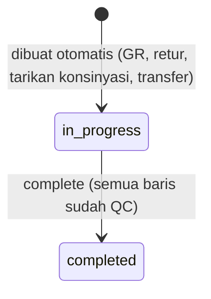

Status baris: `quarantine` → `posted` (lulus, stok pindah `quarantine → available` ke lokasi tujuan) atau `qc_rejected` (tetap Karantina; asal pemasok/maklon → reject penerimaan PRC-05; asal retur/tarikan → Gudang Retur untuk disposisi).

### 3.2 Transfer Stok (TRF)

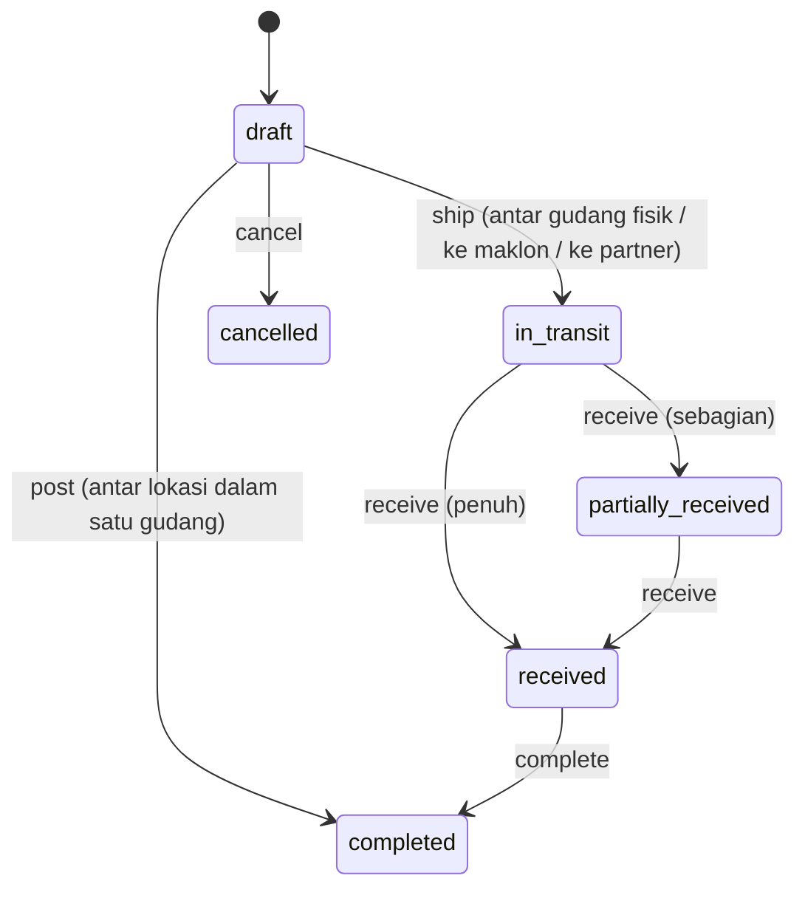

Selisih saat diterima dicatat sebagai baris selisih dan diproses lewat Stock Count lokasi tujuan.

**Permintaan Petty Stock** (`transfer_type = request`, FG Non-Ecommerce → Petty Stock):

```mermaid
stateDiagram-v2
    [*] --> draft
    draft --> submitted: submit (Fulfillment Leader mengajukan permintaan)
    submitted --> in_progress: release (Logistik Leader meneruskan; stok asal reserved, Outbound dibuat)
    in_progress --> completed: receive (Staf Gudang menyerahkan, Fulfillment Leader cek ulang & konfirmasi; stok pindah ke Petty Stock)
    draft --> cancelled: cancel
    submitted --> cancelled: cancel
```

Qty yang dikonfirmasi Fulfillment Leader menjadi qty transfer; kekurangan tetap di lokasi asal dan reserved dilepas.

### 3.3 Stock Count (SC)

```mermaid
stateDiagram-v2
    [*] --> draft
    draft --> in_progress: start (snapshot saldo sistem)
    in_progress --> pending_approval: submit (ada selisih)
    in_progress --> completed: submit (tanpa selisih)
    pending_approval --> approved: approve (Head Logistik; > Rp2 jt + Head Finance & Accounting)
    pending_approval --> rejected: reject
    rejected --> in_progress: recount
    approved --> posted: post (penyesuaian stok + jurnal A-14)
    draft --> cancelled: cancel
```

Stock count konsinyasi/vending tidak membuat penyesuaian sendiri; hasilnya dipakai Rekonsiliasi Konsinyasi.

### 3.4 Outbound / QC

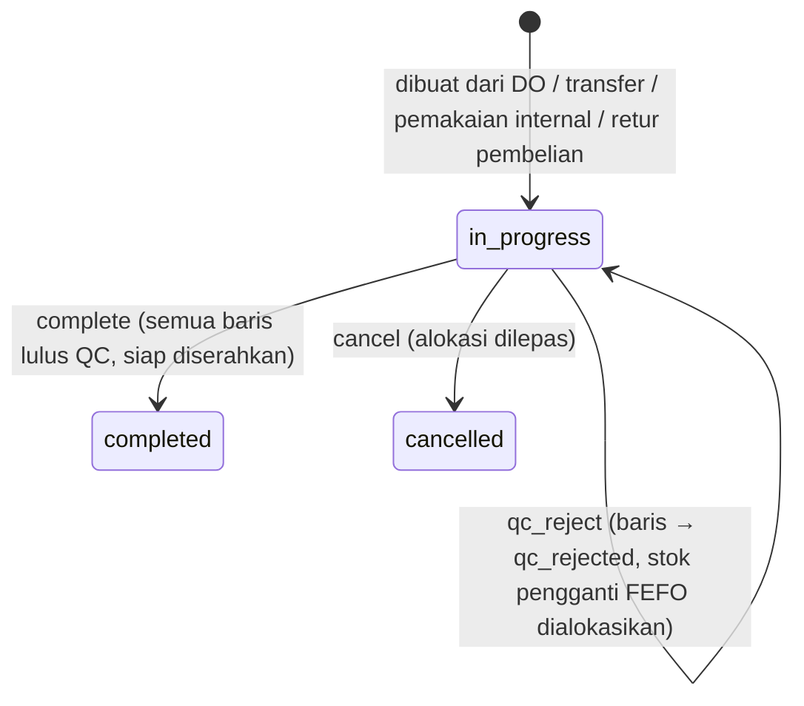

Pembagian kerja: picking dan packing dikerjakan Staf Gudang (`prepared_by`); QC (cek ulang sebelum diserahkan) dikerjakan Fulfillment Leader atau Merchandiser (`checked_by`). Sistem menolak QC oleh user yang sama dengan `prepared_by`. Saat packing, Staf Gudang mencatat koli (`outbound_packages`) untuk label koli.

Untuk Pemakaian Internal, `complete` mewajibkan serah terima: divisi peminta (Sales/Marketing/HRGA) mengecek ulang barang dan mengonfirmasi (`handed_over_to_user_id`).

Jika stok pengganti tidak cukup, baris ditahan dan Sales/CS mendapat notifikasi; pengiriman sebagian hanya atas keputusan user (TG 5.7.2). Barang `qc_rejected` → Retur Pembelian ke maklon tanpa approval.

### 3.5 Disposisi Retur (Gudang Retur)

```mermaid
stateDiagram-v2
    [*] --> draft
    draft --> pending_approval: submit (usulan disposisi per baris)
    pending_approval --> approved: approve (Head Logistik; pemusnahan + Head F&A; > Rp10 jt + Direksi)
    pending_approval --> rejected: reject
    rejected --> draft: revise
    approved --> posted: post (eksekusi per disposisi, jurnal A-26)
```

---

## 4. Persediaan

### 4.1 Pemakaian Internal

```mermaid
stateDiagram-v2
    [*] --> draft
    draft --> pending_approval: submit
    pending_approval --> approved: approve (Head divisi; HPP > Rp5 jt + Head F&A)
    pending_approval --> rejected: reject
    rejected --> draft: revise
    approved --> in_progress: release (Logistik Leader meneruskan & mengetahui; Outbound dibuat)
    in_progress --> posted: post (non-event: Outbound selesai & diserahkan; stok keluar FEFO, jurnal A-11/A-12)
    in_progress --> awaiting_settlement: dispatch (event: Outbound selesai; stok pindah ke lokasi Event, belum ada jurnal)
    awaiting_settlement --> awaiting_settlement: settle (Marketing/Sales mencatat qty sisa; Inbound sisa dibuat)
    awaiting_settlement --> posted: post (Inbound sisa selesai dicek; qty terpakai keluar dari lokasi Event, jurnal A-11)
    draft --> cancelled: cancel
    approved --> cancelled: cancel
```

Pemakaian untuk event (`purpose = event`) bisa diajukan Marketing maupun Sales. Sisa barang wajib dicatat paling lambat H+1 setelah `event_end_date` (`settle_due_date`); job harian mengirim pengingat ke peminta dan Logistik Leader untuk dokumen yang lewat batas. Barang dikembalikan oleh Fulfillment Leader/Merchandiser ke Inbound, lalu dicek ulang Logistik Leader/Staf Gudang. Biaya hanya diakui atas qty terpakai (qty kirim − qty sisa lulus cek).

### 4.2 Pemusnahan dan Repacking

| Dokumen | Transisi |
|---|---|
| Pemusnahan | `draft → pending_approval → approved → posted` (berita acara wajib sebelum `post`; jurnal A-26/A-27) |
| Repacking | `draft → in_progress → posted` (input bahan retur + packaging, output FG dengan batch baru) |

---

## 5. Penjualan

### 5.1 Sales Order (SO)

```mermaid
stateDiagram-v2
    [*] --> draft
    draft --> awaiting_payment: confirm (MT beli putus, WA/IG transfer: stok dialokasikan, Proforma dibuat)
    draft --> in_progress: confirm (marketplace / konsinyasi / tempo: stok dialokasikan)
    draft --> pending_approval: confirm (diskon di atas batas role)
    pending_approval --> draft: reject
    pending_approval --> awaiting_payment: approve
    awaiting_payment --> in_progress: pay (Invoice terbit)
    awaiting_payment --> expired: expire (Proforma lewat masa berlaku, alokasi dilepas)
    in_progress --> in_transit: ship (DO dikirim)
    in_transit --> completed: deliver
    draft --> cancelled: cancel
    awaiting_payment --> cancelled: cancel
    in_progress --> cancelled: cancel (sebelum DO dikirim; alokasi dilepas)
```

### 5.2 Proforma Invoice (PI)

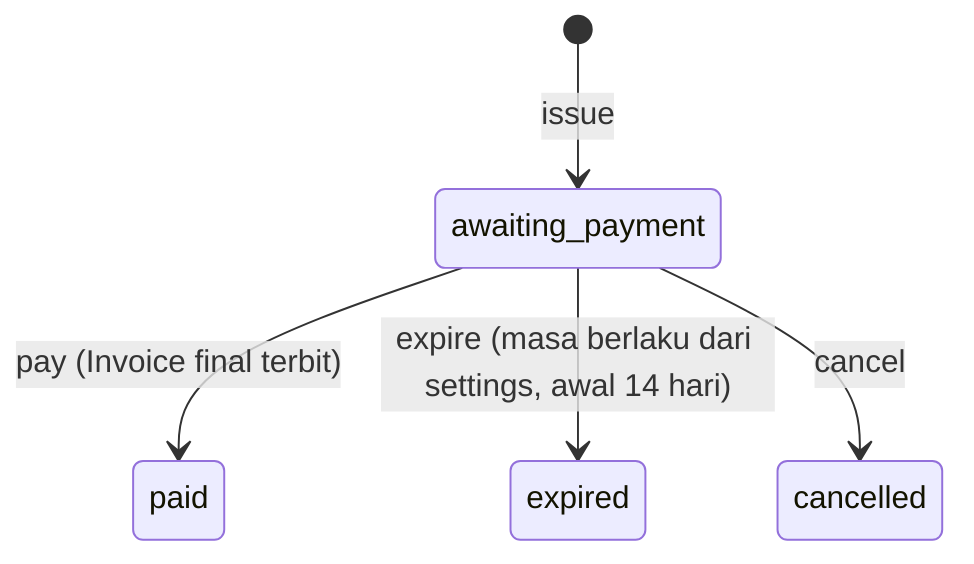

### 5.3 Invoice (INV)

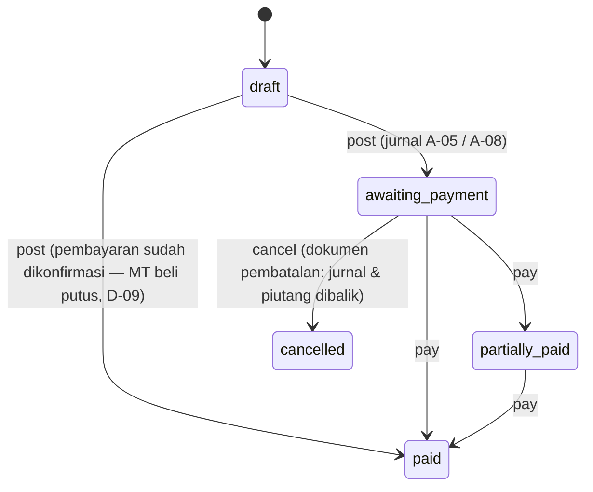

### 5.4 Delivery Order (DO)

```mermaid
stateDiagram-v2
    [*] --> draft
    draft --> in_progress: release (Logistik Leader; cetak DO/surat jalan & label produk; Outbound: picking, packing, QC)
    in_progress --> in_transit: ship (Outbound selesai; resi/kurir dicatat; stok keluar, jurnal HPP A-06 atau A-07/A-24)
    in_transit --> received: deliver
    draft --> cancelled: cancel
    in_progress --> cancelled: cancel
```

Untuk marketplace, `ship` (serah ke kurir) adalah titik pengakuan penjualan (U-25, A-10). Pengiriman dengan kurir internal (`own`) mencatat Merchandiser yang mengantar; `deliver` diisi Merchandiser dengan foto/tanda terima.

### 5.5 Retur Penjualan (RJ)

```mermaid
stateDiagram-v2
    [*] --> draft
    draft --> submitted: submit (MT/reseller: Sales mencatat detail retur dari partner)
    submitted --> draft: return (tidak sesuai SOP retur, catatan wajib)
    submitted --> verified: verify (Logistik Leader crosscheck sesuai SOP; tentukan pickup Merchandiser atau dikirim partner)
    verified --> in_progress: receive (barang tiba; Sales cek ulang, foto & form retur; Inbound dibuat, Karantina)
    draft --> in_progress: submit (website, WA/IG, marketplace: Inbound dibuat, barang Karantina)
    in_progress --> posted: post (QC selesai; jurnal A-13; nota kredit / refund dibuat)
    draft --> cancelled: cancel
    submitted --> cancelled: cancel
    verified --> cancelled: cancel
```

Jika `pickup_required`, Fulfillment Leader menugaskan Merchandiser (`pickup_user_id`); Merchandiser mengecek barang di lokasi partner sebelum mengambil. Setelah Inbound, Logistik Leader/Staf Gudang mengecek dan mengalokasikan barang lewat Disposisi Retur (3.5).

### 5.6 Rekonsiliasi Konsinyasi (KSN, Berita Acara Rekonsiliasi)

```mermaid
stateDiagram-v2
    [*] --> draft
    draft --> in_progress: start (cut-off akhir bulan; stock count partner terhubung)
    in_progress --> pending_approval: submit (BA ditandatangani partner, diunggah)
    pending_approval --> approved: approve (Sales MT → Head Finance & Accounting)
    pending_approval --> rejected: reject
    rejected --> in_progress: revise
    approved --> posted: post (invoice otomatis; jurnal A-08, A-23)
```

---

## 6. Keuangan

### 6.1 Pengajuan Biaya (EXP) dan Reimbursement

```mermaid
stateDiagram-v2
    [*] --> draft
    draft --> pending_approval: submit
    pending_approval --> approved: approve (sesuai nominal BRD 5.17)
    pending_approval --> rejected: reject
    rejected --> draft: revise
    approved --> awaiting_payment: verify (Finance & Accounting: bukti + PPh; jurnal A-15)
    awaiting_payment --> paid: pay
    draft --> cancelled: cancel
```

### 6.2 Kas Kecil (KK)

| Transaksi | Transisi |
|---|---|
| Pengeluaran | `draft → posted` (bukti wajib; maks. per transaksi dari `settings`; jurnal A-17) |
| Pengisian kembali | `draft → pending_approval → approved → posted` (rekap pengeluaran disetujui Head F&A; jurnal A-16) |

### 6.3 Jurnal Umum (JV)

```mermaid
stateDiagram-v2
    [*] --> draft
    draft --> posted: post (balance, periode terbuka, dimensi wajib terisi)
    draft --> cancelled: cancel
    posted --> posted: reverse (membuat JV pembalik baru; JV asal tetap)
```

Jurnal otomatis dibuat langsung `posted` oleh `Poster.Post`.

### 6.4 Periode Akuntansi

```mermaid
stateDiagram-v2
    [*] --> open
    open --> closed: close (checklist 9 langkah selesai; advisory lock per periode)
    closed --> pending_approval: request_reopen (alasan)
    pending_approval --> open: approve (Head F&A → Direksi)
    pending_approval --> closed: reject
```

`open` dan `closed` adalah status khusus periode (label UI: *Terbuka*, *Ditutup*). Transaksi bertanggal di periode `closed` ditolak dengan `PERIOD_LOCKED`.
