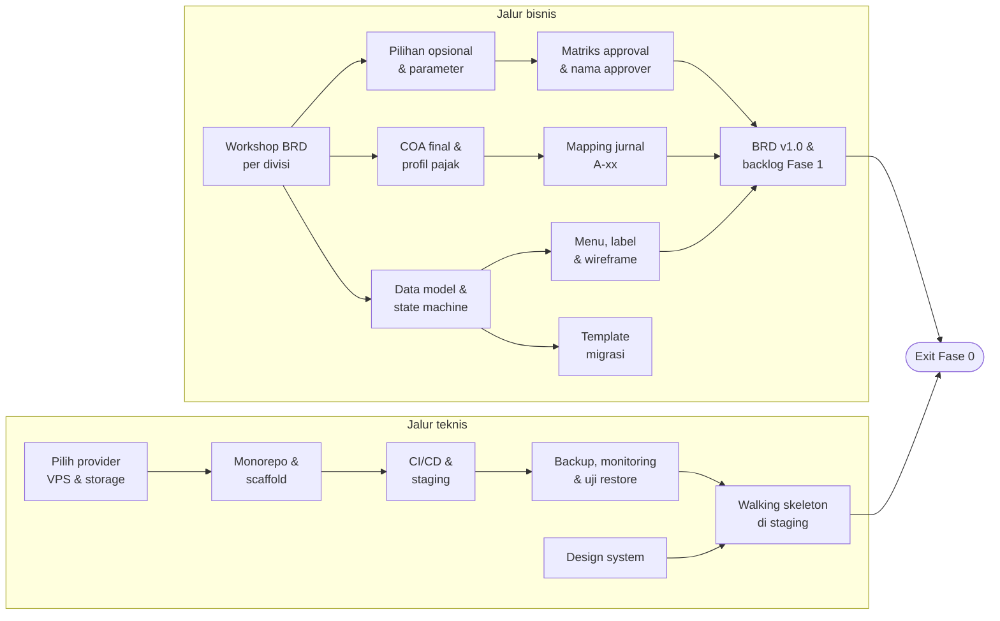

# Product Requirements Document (PRD) — Fase 0
## Balans Nutrition — Unified Business Platform: Discovery & Fondasi

| Item | Keterangan |
|---|---|
| Klien | Balans Nutrition |
| Dokumen | Product Requirements Document Fase 0 — Discovery & Fondasi |
| Versi | 0.1 — Draft |
| Tanggal | 16 Oktober 2026 |
| Acuan | BRD Balans Unified Business Platform v0.7; Roadmap v0.6 (bagian 5, 13); Technical Guideline v0.1; Naming Convention Menu & Fitur v1.0; Flow Inbound & Outbound Balans |
| Status | Draft untuk direview tim implementasi dan Balans |

PRD ini merinci **apa yang harus dihasilkan Fase 0**, kriteria penerimaannya, dan siapa yang bertanggung jawab. Sesuai Roadmap (D-18), dokumen ini **tidak memuat target tanggal**; yang ditetapkan adalah isi, urutan, dan syarat selesai.

---

## Daftar Isi

1. [Ringkasan](#1-ringkasan)
2. [Latar Belakang & Masalah](#2-latar-belakang--masalah)
3. [Tujuan & Ukuran Keberhasilan](#3-tujuan--ukuran-keberhasilan)
4. [Ruang Lingkup](#4-ruang-lingkup)
5. [Stakeholder & Tanggung Jawab](#5-stakeholder--tanggung-jawab)
6. [Kebutuhan Fase 0](#6-kebutuhan-fase-0)
7. [Kebutuhan Non-Fungsional Fondasi](#7-kebutuhan-non-fungsional-fondasi)
8. [Urutan Pekerjaan](#8-urutan-pekerjaan)
9. [Data & Akses dari Balans](#9-data--akses-dari-balans)
10. [Exit Criteria Fase 0](#10-exit-criteria-fase-0)
11. [Risiko & Mitigasi](#11-risiko--mitigasi)
12. [Asumsi & Batasan](#12-asumsi--batasan)
13. [Isu Terbuka](#13-isu-terbuka)
14. [Keterlacakan ke Roadmap & BRD](#14-keterlacakan-ke-roadmap--brd)
15. [Persetujuan](#15-persetujuan)

---

## 1. Ringkasan

Fase 0 adalah fase persiapan sebelum Fase 1 (Core Operations & Finance). Fase ini **tidak menghasilkan fitur bisnis yang dipakai harian** oleh Balans, tetapi menghasilkan empat hal yang menjadi syarat mulainya Fase 1:

| Hasil | Isi | Dipakai untuk |
|---|---|---|
| **Baseline yang disetujui** | BRD v1.0 bertanda tangan, termasuk pilihan usulan opsional U-28 s.d. U-32 dan parameter awal | Dasar lingkup, estimasi, dan UAT |
| **Desain solusi & Finance & Accounting** | Data model, state machine dokumen, matriks role & approval dengan nama approver, COA final, mapping jurnal otomatis, profil pajak, backlog Fase 1 | Dasar build R1.1 – R1.4 |
| **Desain UI/UX** | Design system dari preset shadcn Balans, struktur menu & label, wireframe layar utama Fase 1 | Dasar build frontend ERP |
| **Fondasi aplikasi** | Monorepo, scaffold backend Go & ERP Vite, CI/CD, VPS dengan staging & production, backup off-site, monitoring | Tempat kode Fase 1 dibangun dan dirilis |

Selain itu, Fase 0 menyerahkan **template migrasi data** ke Balans dan memulai komunikasi dengan **pihak ketiga** yang lead time-nya panjang (vendor vending, akun Midtrans vending).

---

## 2. Latar Belakang & Masalah

1. **BRD v0.7 masih berupa usulan.** Sebagian besar pertanyaan terbuka dijawab dengan asumsi konsultan (U-01 s.d. U-27) atas permintaan Balans (D-11). Usulan ini belum mengikat sampai Balans menyetujuinya. Membangun di atas asumsi yang belum disetujui berisiko menimbulkan pengerjaan ulang.
2. **Fase 1 besar dan dirilis sekaligus.** Fase 1 memuat 105 requirement dengan satu go-live di awal periode akuntansi (Roadmap prinsip 4). Fase 1 tidak bisa dimulai tanpa desain data, COA, dan matriks approval yang sudah final, karena hampir semua transaksi menghasilkan jurnal dan butuh approval.
3. **Kualitas saldo awal menentukan kepercayaan pada sistem.** HPP FIFO per batch, piutang, dan laporan keuangan hanya benar jika saldo awal benar. Data migrasi perlu disiapkan Balans jauh sebelum cut-over (Roadmap risiko #2).
4. **Pihak ketiga punya lead time.** Vendor vending dan kepemilikan akun Midtrans vending perlu dipastikan sejak awal (Roadmap risiko #4, #5).
5. **Banyak developer, satu standar.** Technical Guideline v0.1 sudah menetapkan aturan teknis. Fondasi kode, pipeline, dan komponen bersama harus ada lebih dulu agar setiap modul Fase 1 mengikuti pola yang sama sejak baris pertama.

---

## 3. Tujuan & Ukuran Keberhasilan

| ID | Tujuan | Ukuran keberhasilan |
|---|---|---|
| G-01 | Lingkup Fase 1 disepakati dan dibekukan | BRD v1.0 ditandatangani semua pihak di BRD bagian 15; kolom *Diambil?* U-28 s.d. U-32 terisi seluruhnya |
| G-02 | Desain cukup lengkap untuk mulai build tanpa menunggu keputusan | 100% requirement Fase 1 sudah dipetakan ke modul, data model, dan item backlog; tidak ada keputusan desain yang terbuka untuk R1.1 |
| G-03 | Perlakuan akuntansi siap dikonfigurasi | COA final bernomor disetujui Head Finance & Accounting; 100% posting rule A-xx yang berlaku di Fase 1 terpetakan ke akun dan dimensi |
| G-04 | Lingkungan rilis siap pakai | Merge ke `main` otomatis ter-deploy ke staging dan lolos smoke test; rilis tag ke production berjalan lewat approval manual |
| G-05 | Data aman sejak hari pertama | Backup harian + WAL berjalan ke object storage di luar VPS; satu uji restore berhasil dan durasinya tercatat |
| G-06 | Balans bisa mulai menyiapkan data | Seluruh template migrasi (bagian 6.6) sudah diserahkan beserta panduan pengisian dan PIC di sisi Balans |

---

## 4. Ruang Lingkup

### 4.1 Dalam Lingkup

| Kode | Area | Ringkasan |
|---|---|---|
| APR | Persetujuan baseline | Review BRD per divisi, pilihan opsional, parameter awal, BRD v1.0 |
| DSN | Desain solusi | Data model, state machine, role & permission, matriks approval, penomoran & template dokumen, kontrak API awal, backlog Fase 1 |
| FIN | Desain Finance & Accounting | COA final, mapping jurnal otomatis, dimensi, profil pajak |
| UX | UI/UX | Design system, struktur menu & label, wireframe layar utama Fase 1, pola form HP |
| TEK | Fondasi teknis | Monorepo, scaffold backend & ERP, feature flag modul, infrastruktur, CI/CD, backup, observability, test harness |
| MIG | Persiapan migrasi | Template Excel, panduan pengisian, rencana cut-over awal |
| EXT | Pihak ketiga | Pemilihan provider, kontak vendor vending, konfirmasi akun Midtrans vending, domain & DNS |

### 4.2 Di Luar Lingkup Fase 0

- **Fitur bisnis apa pun** dari BRD bagian 6. Seluruh requirement fungsional mulai dikerjakan di R1.1.
- **Login, role-based access, audit trail, dan notifikasi** (NFR-01 s.d. NFR-05, NFR-11). Requirement ini masuk R1.1. Selama Fase 0, akses ke staging dibatasi di level Caddy (basic auth atau allowlist IP).
- **Website e-commerce** (`web-store`, `api-storefront`). Scaffold website dikerjakan menjelang R2.2; Fase 0 hanya menyiapkan foldernya di monorepo.
- **Integrasi pihak ketiga asli** (Midtrans, Biteship, email transaksional, marketplace, vending, WhatsApp). Email, kurir, dan payment memakai adapter mock (F0-TEK-14, D-27); Fase 0 hanya mengurus kontak pihak ketiga yang lead time-nya panjang.
- **Migrasi data aktual.** Fase 0 menyiapkan template; mock migration dan migrasi final dilakukan di Fase 1 (Roadmap bagian 6, UAT, Migrasi & Go-live).

---

## 5. Stakeholder & Tanggung Jawab

R = mengerjakan, A = menyetujui, C = dimintai masukan, I = diberi informasi.

| Area | Tim implementasi | PIC utama Balans | Key user per divisi | Head Finance & Accounting | Direksi | Akuntan / konsultan pajak Balans |
|---|---|---|---|---|---|---|
| APR — Baseline BRD | R | R | C | C | A | I |
| DSN — Desain solusi | R | C | C | C | I | — |
| DSN — Matriks approval & nama approver | R | R | C | C | A | — |
| FIN — COA & mapping jurnal | R | I | — | A | I | C |
| FIN — Profil pajak | R | R | — | A | I | C |
| UX — Menu, label & wireframe | R | C | C (uji label) | C | I | — |
| TEK — Fondasi teknis | R, A | I | — | — | — | — |
| MIG — Template migrasi | R | A | R (mengisi) | C | I | — |
| EXT — Pihak ketiga | C | R | — | — | A | — |

**Key user** yang dibutuhkan mengikuti Roadmap bagian 16: Logistik & Finance & Accounting, Sales MT, Sales E-commerce/CS, Reseller & Vending, Marketing, HRGA, ditambah satu PIC utama proyek.

---

## 6. Kebutuhan Fase 0

**Prioritas:** M = wajib selesai sebelum exit Fase 0; S = sebaiknya selesai di Fase 0, boleh disusulkan di sprint pertama Fase 1 tanpa menghambat R1.1.

### 6.1 Persetujuan Baseline (APR)

| ID | Kebutuhan | Kriteria penerimaan | Prior. | Acuan |
|---|---|---|---|---|
| F0-APR-01 | Workshop review BRD v0.7 per divisi bersama key user | Notulen per divisi memuat status setiap usulan U-01 s.d. U-27 dan pernyataan K-01 s.d. K-16 yang relevan: *Setuju* atau *Koreksi* beserta isi koreksinya | M | BRD 1.3, 12.1, 12.4 |
| F0-APR-02 | Pilihan usulan opsional | Kolom *Diambil?* di BRD 12.2 terisi untuk U-28 s.d. U-32 dan anggaran biaya (ACC-23). Jika lebih dari tiga opsi Fase 1 dipilih, beban Fase 1 dihitung ulang (Roadmap bagian 11) | M | BRD 12.2 |
| F0-APR-03 | Konfirmasi parameter awal | Setiap parameter di tabel di bawah berstatus *Nilai awal disetujui* atau *Diganti dengan nilai X*. Parameter tetap dapat diubah Balans setelah go-live tanpa pengembangan | M | BRD 1.3, asumsi #10 |
| F0-APR-04 | BRD v1.0 | Koreksi dari F0-APR-01 s.d. F0-APR-03 dan isu di bagian 13 sudah masuk; bagian 15 BRD ditandatangani Direksi, Finance & Accounting, Sales, HRGA, dan tim implementasi | M | Roadmap bagian 5 |
| F0-APR-05 | Rencana Fase 1 terkalibrasi | Komposisi tim final, kapasitas per sprint, dan urutan pengerjaan backlog R1.1 – R1.4 disetujui steering committee | M | Roadmap asumsi #2, risiko #3 |

**Parameter awal yang dikonfirmasi (F0-APR-03):**

| Parameter | Nilai awal di BRD | Acuan |
|---|---|---|
| Batas nominal approval PO, pengajuan biaya, pemakaian internal, penyesuaian stok, pemusnahan | Sesuai matriks | BRD 5.17 |
| Toleransi 3-way match | 0% qty, 1% harga | BRD 5.2 |
| Masa berlaku Proforma Invoice | 14 hari | BRD 5.4 |
| Kas kecil | Plafon Rp5 jt per pemegang, maks. Rp1 jt per transaksi, isi ulang saat saldo < 30% atau mingguan | BRD 5.14 |
| Diskon karyawan | 20% dari harga website | BRD 5.13 |
| Batas diskon manual per role | Ditetapkan di workshop Sales | BRD 5.18, MD-12 |
| Target tutup buku | Paling lambat hari kerja ke-10 bulan berikutnya | BRD 5.15 |
| Ketentuan selisih konsinyasi default | Hilang/rusak karena partner ditagih; cacat produk/mendekati kedaluwarsa ditanggung Balans | BRD 5.5 |
| Jadwal stock count | Cycle count gudang berkala; konsinyasi & vending bulanan; penuh akhir tahun | WMS-11, U-08 |
| Batas pencatatan sisa barang event | H+1 setelah event selesai | BRD 5.12, INV-05 |
| Notifikasi ETA kedatangan barang ke Logistik Leader | H-1 dari tanggal kirim diharapkan di PO | PRC-01 |
| Ukuran label | Label produk 50 × 30 mm; label koli 100 × 150 mm | MD-01, LOG-01 |

Parameter fase berikutnya (level reseller, reservasi Midtrans 24 jam, cut-off payroll) ikut dikonfirmasi bila sudah bisa diputuskan, tetapi tidak menghalangi exit Fase 0.

### 6.2 Desain Solusi (DSN)

| ID | Kebutuhan | Kriteria penerimaan | Prior. | Acuan |
|---|---|---|---|---|
| F0-DSN-01 | Data model logis Fase 1 | ERD per modul Fase 1 (`catalog`, `pricing`, `party`, `procurement`, `warehouse`, `inventory`, `logistics`, `sales`, `accounting`, `tax`) dan modul lintas fungsi (`identity`, `approval`, `notification`, `document`, `filestore`, `dataexchange`, `audit`, `setting`). Setiap tabel punya satu modul pemilik; tidak ada tabel yang ditulis dua modul | M | TG 2.2, 2.3, 6 |
| F0-DSN-02 | State machine dokumen Fase 1 | Diagram status dan transisi untuk: Purchase Request, Purchase Order, Penerimaan Barang, Tagihan Pemasok, Inbound/QC, Transfer Stok (termasuk Permintaan Petty Stock), Stock Count, Sales Order, Proforma Invoice, Invoice, Delivery Order, Outbound/QC, Retur Penjualan, Retur Pembelian, Rekonsiliasi Konsinyasi, Pemakaian Internal (termasuk event dan pengembalian sisa), Pengajuan Biaya, Kas Kecil, Jurnal, Periode Akuntansi. Nama status memakai daftar di Naming Convention bagian 7 | M | TG 5.4, NC 7 |
| F0-DSN-03 | Matriks role & permission | Role awal BRD 3.1, termasuk tim gudang dari Flow Inbound & Outbound (Logistik Leader, Fulfillment Leader, Merchandiser), dipetakan ke permission `<modul>.<resource>.<aksi>` untuk seluruh fitur Fase 1. Role yang wajib MFA dan aksi yang butuh re-autentikasi ditandai | M | BRD 3.1, TG 9.1, 9.2 |
| F0-DSN-04 | Matriks approval final | Setiap baris BRD 5.17 punya nama approver per level, batas nominal final, dan approver pengganti untuk delegasi. Disetujui Direksi | M | BRD 5.17, 12.3 |
| F0-DSN-05 | Penomoran & template dokumen | Format nomor U-15 dikonfirmasi; layout cetak PO, DO, Proforma Invoice, Invoice, nota kredit, nota debit, Berita Acara Rekonsiliasi, label produk, label produk mitra, dan label koli disetujui (logo, info rekening, keterangan NON-PKP, ukuran label) | M | U-15, NFR-08 |
| F0-DSN-06 | Backlog Fase 1 | Setiap requirement Fase 1 (Roadmap bagian 14) dipecah menjadi user story dengan kriteria penerimaan dan estimasi, dikelompokkan per rilis R1.1 – R1.4 | M | Roadmap bagian 6, 14 |
| F0-DSN-07 | Kontrak API awal R1.1 | `openapi.yaml` memuat endpoint R1.1 yang paling awal dibangun (sesi & user, master produk, gudang & lokasi) beserta format error standar | S | TG 8 |
| F0-DSN-08 | Desain alur lintas modul | Sequence diagram untuk alur yang melintasi banyak modul: beli → terima → QC → stok → jurnal; sales order → alokasi FEFO → Outbound/QC → DO → invoice → jurnal; rekonsiliasi konsinyasi → invoice otomatis; tutup buku; pemakaian event → pengembalian sisa; retur MT offline; permintaan Petty Stock | S | BRD 5.1 – 5.5, 5.11, 5.12, 5.15 |

### 6.3 Desain Finance & Accounting (FIN)

| ID | Kebutuhan | Kriteria penerimaan | Prior. | Acuan |
|---|---|---|---|---|
| F0-FIN-01 | COA final | Daftar akun bernomor dengan kelompok, tipe (debit/kredit normal), dan akun yang boleh diposting manual. Dibuat dari usulan BRD 7.1, atau dipetakan ke COA Balans jika sudah ada. Disetujui Head Finance & Accounting | M | BRD 7.1, ACC-01 |
| F0-FIN-02 | Mapping jurnal otomatis | Setiap posting rule A-xx yang berlaku di Fase 1 dipetakan ke nomor akun debit/kredit dan dimensi wajibnya. Rule fase berikutnya (A-21, A-22, A-09, A-32, A-34, A-35) dan rule opsional (A-25, A-28, A-33) ditandai fasenya | M | BRD 7.2, ACC-02, ACC-17 |
| F0-FIN-03 | Daftar dimensi | Daftar nilai awal untuk channel, sub-channel (per marketplace dan per partner), divisi, dan aturan pemakaian kode kampanye | M | ACC-17, U-14 |
| F0-FIN-04 | Profil pajak | Bentuk badan usaha, tahun terdaftar NPWP, status PPh Final UMKM (ACC-20 aktif/nonaktif), objek dan tarif PPh 21/23/4(2) awal, serta daftar awal jenis biaya beserta penanda pemotongan PPh. Dikonfirmasi konsultan pajak Balans | M | U-06, ACC-19, ACC-20, MD-13 |
| F0-FIN-05 | Review perlakuan akuntansi | Akuntan atau konsultan pajak Balans memberi catatan review atas BRD bagian 7; koreksinya masuk BRD v1.0 | S | BRD 7 |

### 6.4 UI/UX (UX)

| ID | Kebutuhan | Kriteria penerimaan | Prior. | Acuan |
|---|---|---|---|---|
| F0-UX-01 | Design system | Token warna, tipografi, dan spacing diturunkan dari preset shadcn Balans; mode terang dan gelap; spesifikasi visual komponen bersama: `ErrorDialog`, `ConfirmDialog`, `LoadingButton`, `CircularProgress`, `ProgressDialog`, `DataTable`, `MoneyInput`, `QuantityInput`, `DateInput`, `StatusBadge`, `FileUpload` | M | TG 10.6 – 10.8 |
| F0-UX-02 | Struktur menu & label ERP | Struktur menu mengikuti Naming Convention bagian 5. Menu yang tidak dirilis di Fase 1 dan menu opsional yang tidak dipilih ditandai tersembunyi | M | NC 5, D-26 |
| F0-UX-03 | Wireframe layar utama Fase 1 | Wireframe untuk pola dasar (layout dengan sidebar, list, detail, form, inbox persetujuan, import Excel dengan preview) dan layar kunci: Purchase Order, Penerimaan Barang, Inbound dengan QC, Transfer Stok, Stock Count, Sales Order, Outbound dengan QC, Rekonsiliasi Konsinyasi, Pesanan WhatsApp/Instagram, Invoice & pembayaran, Jurnal Umum, Tutup Buku. Direview key user divisi terkait | M | Roadmap bagian 5 |
| F0-UX-04 | Pola form HP | Wireframe mobile-first untuk Stock Count (gudang dan lokasi partner): target sentuh ≥ 44 px, unggah foto, penyimpanan isi form sementara | S | TG 10.10, WMS-11 |
| F0-UX-05 | Uji label | Label menu dan aksi utama diuji dengan perwakilan Finance & Accounting, Logistik, Sales, Marketing, dan HRGA; temuan masuk Naming Convention | S | NC 8 |

### 6.5 Fondasi Teknis (TEK)

Seluruh kebutuhan di bagian ini mengikuti Technical Guideline v0.1. Kriteria penerimaannya diuji di staging.

| ID | Kebutuhan | Kriteria penerimaan | Prior. | Acuan |
|---|---|---|---|---|
| F0-TEK-01 | Monorepo | Struktur `backend/`, `web-erp/`, `web-store/` (kosong), `deploy/`, `docs/`, `.github/workflows/`. Branch `main` diproteksi: wajib PR, CI hijau, minimal 1 reviewer. Template PR memuat checklist Lampiran C | M | TG 2.4, 14.3, Lampiran C |
| F0-TEK-02 | Scaffold backend | Binary `api`, `worker`, `migrate` berjalan; `cutover` dan `storefront` tersedia sebagai kerangka. Package `platform` (`apperr`, `clock`, `config`, `db` + TxManager, `httpx`, `idempotency`, `logger`, `money`, `retry`) tersedia dan teruji. Pipeline generate `oapi-codegen` dan `sqlc` jalan; migrasi `goose` dan job queue `river` terpasang. Endpoint `GET /healthz` dan `GET /readyz` aktif | M | TG 2.1, 2.5, 3.1, 13 |
| F0-TEK-03 | Aturan dependensi modul | `depguard` di CI menolak import subpackage modul lain dan arah dependensi yang salah | M | TG 2.3 |
| F0-TEK-04 | Scaffold ERP | Proyek Vite dibuat dari preset shadcn Balans; TanStack Router (file-based), TanStack Query, React Hook Form + Zod, Zustand, dan client `openapi-fetch` dari tipe hasil generate. Tersedia: layout `_app` dengan sidebar, halaman 403/404, `lib/format` (uang, tanggal WIB), pesan Zod Bahasa Indonesia, `lib/api/error-messages.ts` berisi kode Lampiran A, `lib/format/status-labels.ts`, dan komponen bersama dari F0-UX-01 | M | TG 3.2, 10 |
| F0-TEK-05 | Feature flag modul | `ENABLED_MODULES` mengatur route API, menu sidebar, dan jadwal job. Modul nonaktif tidak terdaftar dan tidak tampil | M | TG 14.5, D-22 |
| F0-TEK-06 | Walking skeleton | Satu alur ujung ke ujung (ERP → Caddy → `api` → Postgres) tampil di staging, misalnya halaman *Tentang Sistem* yang menampilkan versi aplikasi dan status `/readyz`. Membuktikan kontrak API, generate tipe, build, dan deploy berjalan | M | — |
| F0-TEK-07 | Infrastruktur | VPS (4 core, 8 GB, disarankan lokasi Indonesia) dengan Docker Compose; project Compose staging dan production terpisah dengan DB terpisah, masing-masing di `erp-staging.findyourbalans.com` dan `erp.findyourbalans.com` (D-28); host staging dilindungi basic auth atau allowlist IP dan bertanda `noindex`; batas memori per container sesuai TG 14.1; Caddy dengan HTTPS dan header keamanan; `restart: unless-stopped`, healthcheck, dan log rotation | M | TG 9.4, 14.1, 14.2, D-21 |
| F0-TEK-08 | CI/CD | Workflow `ci.yml`, `deploy-staging.yml`, dan `deploy-production.yml` berjalan sesuai TG 14.3. Image di GHCR bertag SHA dan versi, tanpa `latest`. Production memakai image yang sama dengan staging dan approval manual. Rollback ke tag sebelumnya sudah dicoba sekali | M | TG 14.3, 14.6 |
| F0-TEK-09 | Backup & restore | Full backup harian + WAL kontinu ke object storage di luar VPS (bucket dan kredensial terpisah); versioning bucket file; satu uji restore point-in-time ke DB staging berhasil dan durasinya tercatat; runbook pemulihan ke VPS baru dengan target ≤ 2 jam | M | NFR-07, TG 14.7, 14.8 |
| F0-TEK-10 | Observability | Log `slog` JSON dengan `request_id`; Sentry untuk backend dan ERP dengan scrubbing data pribadi; monitor uptime eksternal untuk ERP dan `/readyz`; alert untuk backup gagal, disk > 80%, dan aplikasi down | M | TG 13 |
| F0-TEK-11 | Pengelolaan secret | Secret hanya di GitHub Actions Secrets, file env VPS (permission `600`), dan password manager tim. Prosedur pembuatan dan rotasi kunci JWT Ed25519 dan kunci enkripsi AES-256-GCM didokumentasikan untuk dipakai di R1.1 | M | TG 6.7, 9.1, 9.4 |
| F0-TEK-12 | Test harness | `go test` dengan testcontainers Postgres, Vitest, dan Playwright (smoke test staging) berjalan di CI; gate coverage 80% terpasang untuk package `domain`, `tax`, `pricing`, `money` | M | TG 12 |
| F0-TEK-13 | Panduan developer | README cara menjalankan lokal (`docker compose` untuk Postgres dan Mailpit), perintah generate, dan alur rilis | S | TG 14.2 |
| F0-TEK-14 | Adapter mock email, kurir & payment | Interface `notification` (email), `logistics.ShipmentProvider` (Biteship), dan `sales.PaymentGateway` (Midtrans) punya implementasi mock yang dipilih lewat env. Email tertangkap di Mailpit; halaman simulasi `/_mock/payments` dan `/_mock/shipments` mengirim webhook bersignature ke endpoint asli. Mock aktif di `local` dan `staging`; proses production menolak start jika modul aktif masih memakai mock | M | TG 5.10, D-27 |

### 6.6 Persiapan Migrasi (MIG)

Template di Fase 0 berupa **spesifikasi Excel**. Saat modul import dibangun di Fase 1, template yang sama dihasilkan oleh sistem (TG 5.15), sehingga data yang sudah disiapkan Balans tidak perlu disusun ulang.

| ID | Kebutuhan | Kriteria penerimaan | Prior. | Acuan |
|---|---|---|---|---|
| F0-MIG-01 | Template master data | Template Produk, Bundling, Packaging & Material, Pelanggan, Mitra Konsinyasi beserta PKS, Pemasok & Maklon, Gudang & Lokasi, dan data dasar Karyawan (HR-01, HR-03) | M | MD-01 s.d. MD-09, U-10 |
| F0-MIG-02 | Template harga | Template harga dasar & HET serta price list per channel, partner, dan karyawan, dengan tanggal berlaku | M | MD-04, BRD 5.18 |
| F0-MIG-03 | Template saldo | Template saldo stok per SKU per batch per lokasi (termasuk lokasi maklon dan konsinyasi), neraca saldo awal, piutang dan utang terbuka per dokumen, PO terbuka, dan register aset tetap | M | U-10, A-36, ACC-14, ACC-21 |
| F0-MIG-04 | Panduan pengisian | Setiap template punya penjelasan kolom, format (tanggal, angka, kode), kolom wajib, aturan validasi, dan contoh baris | M | TG 5.15 |
| F0-MIG-05 | Rencana persiapan data | Setiap template punya PIC di sisi Balans dan urutan pengerjaan; data saldo disiapkan per tanggal cut-over Fase 1 | M | Roadmap bagian 12, 13 |
| F0-MIG-06 | Rencana cut-over awal | Draf urutan cut-over: dua kali mock migration saat UAT, stock count fisik semua lokasi, migrasi final, pengecekan rekonsiliasi (nilai persediaan = saldo akun persediaan, AR/AP terbuka = saldo akun, neraca balance) | S | Roadmap bagian 6, TG 5.19 |

### 6.7 Pihak Ketiga (EXT)

| ID | Kebutuhan | Kriteria penerimaan | Prior. | Acuan |
|---|---|---|---|---|
| F0-EXT-01 | Provider VPS & object storage | Provider dipilih dan akun dibuat atas nama Balans; lokasi VPS di Indonesia disarankan | M | Roadmap bagian 3, 13 |
| F0-EXT-02 | Domain & DNS | Akses DNS findyourbalans.com tersedia; record `erp` dan `erp-staging` diarahkan ke VPS. Domain utama dan `www` tidak diubah sampai website launch di R2.2 | M | Roadmap bagian 13, D-28 |
| F0-EXT-03 | Layanan pendukung | Akun Sentry dan monitor uptime tersedia. Email transaksional memakai mock (F0-TEK-14); provider asli dipilih sebelum UAT Fase 1 | M | TG 13, D-27 |
| F0-EXT-04 | Vendor vending | Kontak vendor vending diperoleh; kemampuan API dan data transaksi Midtrans dari mesin (apakah memuat SKU dan kode mesin) ditanyakan | S | U-05, Roadmap risiko #4 |
| F0-EXT-05 | Akun Midtrans vending | Pemilik akun Midtrans vending saat ini dikonfirmasi. Jika bukan atas nama Balans, rencana pemindahan disepakati sebelum R2.3 | S | U-17, Roadmap risiko #5 |

---

## 7. Kebutuhan Non-Fungsional Fondasi

Fondasi Fase 0 harus sudah memenuhi bagian NFR berikut, agar fitur Fase 1 tinggal mengikutinya.

| NFR BRD | Yang disiapkan di Fase 0 |
|---|---|
| NFR-01 Platform | Layout ERP responsive diuji di lebar desktop, tablet, dan HP |
| NFR-05 Lokalisasi | Formatter Rupiah, tanggal Indonesia, dan WIB; server dan DB dalam UTC |
| NFR-06 Ketersediaan | Monitor uptime eksternal dan alert aktif |
| NFR-07 Backup | Backup harian otomatis dan uji restore berhasil (F0-TEK-09) |
| NFR-09 Skalabilitas | Feature flag modul dan struktur modular siap menerima modul baru tanpa mengubah fondasi |
| NFR-10 Kapasitas | Batas memori per container sesuai TG 14.1 dan pemantauan CPU/memori/disk aktif |
| NFR-02 Keamanan (sebagian) | HTTPS, header keamanan, secret management, dan pembatasan akses staging. Login dan RBAC menyusul di R1.1 |

---

## 8. Urutan Pekerjaan

Fase 0 berjalan dalam dua jalur paralel. Jalur bisnis dipimpin PM/BA bersama Balans; jalur teknis dikerjakan developer dan tidak menunggu persetujuan BRD, karena keputusan teknis sudah ditetapkan di Technical Guideline (D-19 s.d. D-21).

| Urutan | Aktivitas | Bergantung pada |
|---|---|---|
| 1 | Kickoff, penetapan key user, jadwal workshop | Persetujuan BRD v0.7 sebagai dasar pembahasan (Roadmap asumsi #1) |
| 2 | Workshop BRD per divisi; pemilihan provider VPS & object storage; kontak vendor vending | Kickoff |
| 3 | Data model, state machine, COA, profil pajak; monorepo, scaffold, CI/CD, staging | Workshop (jalur bisnis); provider terpilih (jalur teknis) |
| 4 | Matriks approval, mapping jurnal, menu & wireframe, template migrasi; backup, monitoring, design system | Langkah 3 |
| 5 | BRD v1.0, backlog Fase 1, walking skeleton, uji restore | Langkah 4 |
| 6 | Gate exit Fase 0 di steering committee | Langkah 5 dan data di bagian 9 |

---

## 9. Data & Akses dari Balans

Diambil dari BRD 12.3 dan Roadmap bagian 13. Item bertanda **Wajib exit** harus sudah diterima atau dijadwalkan dengan tanggal yang disepakati sebelum Fase 0 ditutup.

| Data / akses | Dipakai untuk | Status gate |
|---|---|---|
| Persetujuan BRD v1.0, pilihan opsional, nama approver | F0-APR, F0-DSN-04 | Wajib exit (diterima) |
| Daftar SKU, bundel, harga dasar/HET, price list yang berlaku | F0-MIG-01, F0-MIG-02, MD-01, MD-03, MD-04 | Wajib exit |
| Daftar partner MT/konsinyasi beserta PKS | F0-MIG-01, MD-07, SLS-03 | Wajib exit |
| COA yang dipakai saat ini (jika ada) dan laporan keuangan terakhir | F0-FIN-01 | Wajib exit |
| Bentuk badan usaha, tahun terdaftar NPWP, status PPh Final UMKM | F0-FIN-04 | Wajib exit (diterima) |
| Alamat gudang fisik, supplier, dan maklon aktif | F0-MIG-01, MD-08, MD-09 | Wajib exit |
| Nama pemegang jabatan Logistik Leader, Fulfillment Leader, Merchandiser; Merchandiser yang ditugaskan per partner | F0-DSN-03, MD-07, WMS-11 | Wajib exit |
| Tipe & ukuran printer label; kode artikel/barcode retailer MT yang mewajibkan label sendiri | F0-DSN-05, MD-01, MD-07 | Disarankan |
| Pemilihan provider VPS & object storage; akses DNS findyourbalans.com | F0-TEK-07, F0-EXT-01, F0-EXT-02 | Wajib exit (diterima) |
| Kontak vendor vending; pemilik akun Midtrans vending | F0-EXT-04, F0-EXT-05 | Disarankan (lead time vendor) |
| Saldo stok per batch, saldo awal akuntansi, AR/AP terbuka, aset tetap | Cut-over Fase 1 | Bukan gate Fase 0; template diserahkan di Fase 0 |

---

## 10. Exit Criteria Fase 0

Fase 0 ditutup di steering committee jika seluruh butir berikut terpenuhi. Butir 1 – 4 berasal dari Roadmap bagian 5; butir 5 – 8 merinci hasil fondasi.

| # | Kriteria | Bukti |
|---|---|---|
| 1 | BRD v1.0 dan desain solusi disetujui | BRD v1.0 bertanda tangan; dokumen desain (F0-DSN-01 s.d. F0-DSN-06, F0-FIN-01 s.d. F0-FIN-04) disetujui |
| 2 | Pilihan opsional sudah ditentukan | Kolom *Diambil?* di BRD 12.2 terisi |
| 3 | Data Fase 1 dari BRD 12.3 sudah diterima atau dijadwalkan | Tabel bagian 9 berstatus diterima atau bertanggal |
| 4 | Template migrasi sudah diserahkan ke Balans | F0-MIG-01 s.d. F0-MIG-05 selesai, PIC Balans ditetapkan |
| 5 | Lingkungan staging dan production siap | Walking skeleton (F0-TEK-06) berjalan di `erp-staging.findyourbalans.com`; adapter mock (F0-TEK-14) aktif di staging; deploy production lewat tag dan rollback sudah dicoba |
| 6 | Backup teruji | Laporan uji restore dengan durasi; runbook pemulihan tersedia |
| 7 | Monitoring aktif | Uptime monitor, Sentry, dan alert terkonfigurasi dan pernah dipicu uji |
| 8 | Backlog Fase 1 siap | Backlog R1.1 terestimasi dan siap masuk sprint planning pertama Fase 1 |

---

## 11. Risiko & Mitigasi

| # | Risiko | Dampak | Mitigasi |
|---|---|---|---|
| 1 | Workshop BRD molor karena key user sulit dijadwalkan | Persetujuan BRD v1.0 dan exit Fase 0 tertunda | Jadwal workshop ditetapkan saat kickoff; usulan sudah lengkap sehingga Balans cukup menyetujui atau mengoreksi; keputusan yang tertunda dibawa ke weekly status |
| 2 | Koreksi BRD mengubah lingkup Fase 1 secara signifikan | Estimasi dan kapasitas Fase 1 berubah | Hitung ulang beban Fase 1 sebelum exit (F0-APR-05); perubahan setelah BRD v1.0 lewat change request |
| 3 | COA lama Balans tidak sesuai struktur dimensi | Mapping jurnal butuh waktu lebih lama | Penjualan tidak dipecah per channel di COA; dimensi dicatat di baris jurnal (BRD 7.1), sehingga COA lama cukup dipetakan |
| 4 | Profil pajak belum pasti (status PPh Final, objek PPh 23 jasa maklon) | Konfigurasi pajak Fase 1 salah | Konfirmasi ke konsultan pajak Balans (F0-FIN-04); tarif disimpan sebagai parameter effective-dated |
| 5 | Pemilihan provider VPS atau akses DNS terlambat | Jalur teknis tertahan | Jalur teknis bisa memakai lingkungan lokal dan CI terlebih dulu; provider dipilih di minggu awal Fase 0 sebagai prioritas Balans |
| 6 | Data master Balans tersebar di banyak file dan tidak konsisten | Pengisian template lambat, mock migration gagal | Panduan pengisian dan contoh baris (F0-MIG-04); PIC per template; pembersihan data dimulai segera setelah template diserahkan |
| 7 | Nama approver belum bisa ditetapkan karena struktur organisasi berubah | Konfigurasi approval R1.1 tertunda | Matriks dirancang per jabatan; nama approver dapat diganti lewat konfigurasi tanpa pengembangan |
| 8 | Ternyata Balans membeli bahan isi produk sendiri atau GM berisi barang lain dari asumsi bagian 12 butir 8 | Alur maklon, jenis stok, dan HPP berubah | Asumsi tertulis di BRD U-01 dan disahkan di BRD v1.0; perubahan setelahnya lewat change request dengan hitung ulang beban Fase 1 |

---

## 12. Asumsi & Batasan

1. Fase 0 dimulai setelah BRD v0.7 disetujui sebagai dasar pembahasan (Roadmap asumsi #1).
2. Keputusan teknis (stack, autentikasi, infrastruktur, rilis per fase) sudah final di Technical Guideline v0.1 dan tidak dibahas ulang di Fase 0, kecuali pemilihan provider VPS dan object storage.
3. Tim inti Fase 0 sama dengan tim Fase 1 (Roadmap asumsi #2). UI/UX dan PM/BA paling banyak terlibat di Fase 0; developer fokus pada fondasi teknis.
4. Akun pihak ketiga dibuat atas nama Balans dan diurus Balans (BRD asumsi #11).
5. Nilai parameter yang disetujui di Fase 0 adalah nilai awal dan dapat diubah Balans setelah go-live (BRD 1.3).
6. Fondasi teknis Fase 0 tidak dibuka untuk pengguna Balans. Akses pengguna dimulai setelah login dan RBAC tersedia di R1.1.
7. Pembagian kerja gudang mengikuti Flow Inbound & Outbound Balans: Staf Gudang menyiapkan barang; tim Fulfillment (Fulfillment Leader, Merchandiser) di dalam Warehouse melakukan QC Outbound dan pengiriman; Logistik Leader, satu tingkat di bawah Head Logistik, meneruskan dan mengetahui pengeluaran barang.
8. **RM = Raw Material (bahan mentah)** berarti packaging dan **GM = Goods Material (bahan jadi)** berarti barang jadi tidak layak jual yang menunggu reprocess maklon; keduanya disimpan di Gudang GM sebagai dua lokasi. Bahan isi produk disediakan maklon (D-08). Asumsi ini dipakai tanpa konfirmasi lanjutan dan disahkan bersama BRD v1.0.
9. Property dan booth event bukan stok dan tidak dicatat di sistem Fase 1.

---

## 13. Isu Terbuka

| # | Isu | Usulan penyelesaian | PIC |
|---|---|---|---|
| 1 | Panduan teknis storefront (SEO, caching, analytics, pixel) disyaratkan sebelum pengerjaan website (TG 10.11) | Bukan lingkup Fase 0; dijadwalkan menjelang desain R2.2 | Tech lead |

---

## 14. Keterlacakan ke Roadmap & BRD

| Aktivitas Fase 0 di Roadmap bagian 5 | Kebutuhan PRD |
|---|---|
| Review BRD v0.7 bersama Balans per divisi | F0-APR-01, F0-APR-02, F0-APR-03 |
| Finalisasi BRD | F0-APR-04 |
| Desain solusi | F0-DSN-01 s.d. F0-DSN-08 |
| Desain Finance & Accounting | F0-FIN-01 s.d. F0-FIN-05 |
| Keputusan teknis (sisa: provider VPS & object storage) | F0-EXT-01 |
| UI/UX | F0-UX-01 s.d. F0-UX-05 |
| Setup teknis | F0-TEK-01 s.d. F0-TEK-14, F0-EXT-02, F0-EXT-03 |
| Persiapan migrasi | F0-MIG-01 s.d. F0-MIG-06 |
| Pihak ketiga | F0-EXT-04, F0-EXT-05 |
| Kalibrasi kapasitas Fase 1 (Roadmap risiko #3, asumsi #2) | F0-APR-05, F0-DSN-06 |

| Rujukan BRD | Kebutuhan PRD |
|---|---|
| 1.3 dasar kebutuhan & usulan; 12.1, 12.2, 12.4; 15 Persetujuan | F0-APR-01 s.d. F0-APR-04 |
| 3.1 role akses | F0-DSN-03 |
| 5.17 matriks approval | F0-DSN-04 |
| 7.1 COA; 7.2 jurnal otomatis; ACC-17 dimensi | F0-FIN-01 s.d. F0-FIN-03 |
| U-06 pajak | F0-FIN-04 |
| U-10 migrasi; A-36 saldo awal | F0-MIG-01 s.d. F0-MIG-06 |
| U-15, NFR-08 penomoran & cetak | F0-DSN-05 |
| 10 NFR | Bagian 7, F0-TEK-07 s.d. F0-TEK-11 |
| 12.3 data dari Balans | Bagian 9 |

---

## 15. Persetujuan

Dengan menandatangani bagian ini, pihak berikut menyetujui isi, kebutuhan, dan exit criteria Fase 0 sebagaimana dijabarkan di dokumen ini.

| Nama | Jabatan | Tanda Tangan | Tanggal |
|---|---|---|---|
| | Balans Nutrition — Direksi | | |
| | Balans Nutrition — PIC Utama Proyek | | |
| | Balans Nutrition — Finance & Accounting | | |
| | Tim Implementasi — Project Manager | | |
| | Tim Implementasi — Tech Lead | | |
