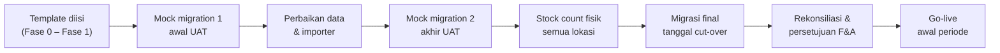

# Panduan & Rencana Migrasi Data Fase 1
## Balans Nutrition — Unified Business Platform

| Item | Keterangan |
|---|---|
| Dokumen | Panduan pengisian (F0-MIG-04), rencana persiapan data (F0-MIG-05), rencana cut-over awal (F0-MIG-06) |
| Template | `docs/migrasi/Template-Migrasi-Master-Data.xlsx`, `Template-Migrasi-Harga.xlsx`, `Template-Migrasi-Saldo-Awal.xlsx` |
| Acuan | BRD v0.7 U-10, A-36, 12.3; Roadmap v0.6 bagian 6, 12, 13; Technical Guideline 5.15, 5.19 |
| Status | Diserahkan ke Balans; PIC per template ditetapkan di bagian 2 |

Migrasi memakai **Opsi A** (U-10): data master, harga, saldo stok per batch per lokasi, saldo awal akuntansi, piutang/utang terbuka per dokumen, PO terbuka, dan register aset tetap. Transaksi historis tidak dimigrasi; arsipnya tetap di Excel lama.

---

## 1. Panduan Pengisian

Setiap workbook memiliki sheet **Petunjuk** berisi, per kolom: nama, wajib/tidak, format, aturan validasi, dan contoh baris. Aturan umum:

1. Isi data mulai baris 2. Jangan mengubah nama sheet, nama kolom, atau urutan kolom; template yang sama akan dihasilkan sistem di Fase 1, sehingga data yang sudah disiapkan tidak perlu disusun ulang.
2. Header oranye dengan tanda `*` wajib diisi; header abu-abu boleh dikosongkan.
3. Tanggal `YYYY-MM-DD`. Angka tanpa titik ribuan dan tanpa `Rp`; desimal memakai titik.
4. Kode (SKU, kode mitra, kode pemasok, kode lokasi, kode akun) ditulis persis sama di semua sheet dan template. Kode tidak boleh dipakai ulang untuk barang/pihak lain.
5. Kolom pilihan memakai dropdown; nilai di luar daftar ditolak saat impor.
6. Satu file per template. Lampiran (PDF PKS) dikirim bersama dalam satu folder dengan nama file sesuai kolom *Nama File Dokumen PKS*.
7. Saat diimpor, sistem memeriksa setiap baris dan mengembalikan file berisi baris error beserta keterangannya. Perbaikan dilakukan di file yang sama lalu diimpor ulang.

**Pemeriksaan sendiri sebelum menyerahkan:**

| Cek | Cara |
|---|---|
| Tidak ada kode ganda | Filter kolom kode, cari duplikat |
| Semua kode rujukan ada | SKU di Harga/Saldo ada di Produk atau Packaging & Material; kode mitra di PKS ada di Mitra Konsinyasi |
| Batch & kedaluwarsa lengkap | Semua baris FG di Saldo Stok punya batch dan tanggal kedaluwarsa |
| Neraca saldo awal balance | Total Debit = total Kredit di sheet Neraca Saldo Awal |
| Piutang/utang cocok dengan neraca | Total *Sisa Belum Dibayar* = saldo akun Piutang Usaha / Utang Usaha di Neraca Saldo Awal |
| Persediaan cocok dengan neraca | Σ (Qty × HPP per Unit) per kelompok lokasi = saldo akun persediaan terkait |

---

## 2. Rencana Persiapan Data

Kolom PIC Balans diisi saat kickoff migrasi. Urutan mengikuti ketergantungan antar data: master dulu, harga setelah produk dan mitra, saldo terakhir.

| Urutan | Template / sheet | PIC Balans (divisi) | Nama PIC | Bergantung pada | Dibutuhkan sebelum |
|---|---|---|---|---|---|
| 1 | Master Data — Gudang & Lokasi | Logistik | | — | Akhir Fase 0 |
| 2 | Master Data — Produk, Bundling | Logistik & Sales | | — | Akhir Fase 0 |
| 3 | Master Data — Packaging & Material | Logistik | | — | Akhir Fase 0 |
| 4 | Master Data — Pemasok & Maklon | Logistik & F&A | | — | Akhir Fase 0 |
| 5 | Master Data — Mitra Konsinyasi, PKS (+ PDF) | Sales MT | | 1 (lokasi konsinyasi) | Akhir Fase 0 |
| 6 | Master Data — Pelanggan | Sales (CS) | | — | Mock migration 1 |
| 7 | Master Data — Karyawan | HRGA | | — | Mock migration 1 |
| 8 | Harga — Harga Dasar & HET, Daftar Harga, Item Daftar Harga, Harga Khusus | Sales & F&A | | 2, 5, 6 | Akhir Fase 0 |
| 9 | Saldo Awal — Aset Tetap | F&A | | 5 (lokasi mesin) | Mock migration 1 |
| 10 | Saldo Awal — PO Terbuka | Logistik | | 2, 3, 4 | Cut-over |
| 11 | Saldo Awal — Piutang Terbuka, Utang Terbuka | F&A | | 4, 5, 6 | Cut-over |
| 12 | Saldo Awal — Saldo Stok (hasil stock count fisik) | Logistik & Sales MT | | 1–5 | Cut-over |
| 13 | Saldo Awal — Neraca Saldo Awal (COA final) | F&A | | 9–12, COA final (F0-FIN-01) | Cut-over |

Data saldo (urutan 9–13) disiapkan **per tanggal cut-over Fase 1** yang jatuh di akhir periode akuntansi (U-10). Untuk mock migration, Balans boleh memakai saldo per akhir bulan terakhir yang sudah ditutup.

Pembersihan data dimulai segera setelah template diserahkan (PRD risiko #6). Tim implementasi mendampingi lewat sesi mingguan sampai template lolos validasi.

---

## 3. Rencana Cut-over Awal

| # | Tahap | Kegiatan | PIC | Kriteria selesai |
|---|---|---|---|---|
| 1 | Mock migration 1 (awal UAT) | Impor semua template ke staging dengan `cmd/cutover`; jalankan pengecekan rekonsiliasi | Tim implementasi + PIC data | Semua baris valid atau tercatat sebagai perbaikan |
| 2 | Perbaikan | Balans membersihkan data; tim memperbaiki importer/aturan validasi | Balans, tim implementasi | Daftar perbaikan kosong |
| 3 | Mock migration 2 (akhir UAT) | Ulangi impor ke staging bersih; key user memeriksa sampel data di layar | Tim implementasi, key user | Rekonsiliasi cocok; key user setuju |
| 4 | Stock count fisik | Hitung fisik semua lokasi: gudang, konsinyasi, buffer vending, maklon; hasil menjadi sheet Saldo Stok | Logistik, Sales MT | Berita acara stock count per lokasi |
| 5 | Freeze | Tidak ada transaksi di sistem lama setelah tanggal cut-over kecuali yang dicatat ulang di sistem baru | Semua divisi | — |
| 6 | Migrasi final | Impor ke production berurutan sesuai bagian 2; saldo awal diposting sebagai jurnal A-36 per tanggal cut-over | Tim implementasi | Impor sukses tanpa error |
| 7 | Rekonsiliasi | Pengecekan otomatis (bagian 4) + review Finance & Accounting | Head F&A | Persetujuan tertulis saldo awal |
| 8 | Go-live | Transaksi periode baru dicatat di sistem; hypercare sampai tutup buku bulan pertama | Semua | Go/no-go Roadmap bagian 6 terpenuhi |

`cmd/cutover` idempotent per file (hash SHA-256), sehingga mock migration bisa diulang di staging sampai hasilnya cocok (Technical Guideline 5.19).

---

## 4. Pengecekan Rekonsiliasi Otomatis

Dijalankan `cmd/cutover` setelah setiap impor; semua harus lolos sebelum go-live.

| Cek | Rumus | Toleransi |
|---|---|---|
| Neraca balance | Σ debit = Σ kredit saldo awal | 0 |
| Nilai persediaan = akun persediaan | Σ (qty × HPP per unit) per kelompok lokasi = saldo 1301, 1302, 1311, 1312, 1313, 1314 | 0 (selisih pembulatan ke 7301 dengan persetujuan F&A) |
| Piutang terbuka = akun piutang | Σ sisa piutang = saldo 1201 (dan 121x jika ada) | 0 |
| Utang terbuka = akun utang | Σ sisa utang = saldo 2101 | 0 |
| Uang muka PO = akun uang muka | Σ uang muka PO terbuka = saldo 1401 | 0 |
| Aset tetap | Σ harga perolehan per kelas = saldo 150x; Σ akumulasi = saldo 159x | 0 |
| Stok konsinyasi punya PKS | Setiap lokasi konsinyasi bersaldo punya PKS berlaku | Tanpa pengecualian |
| Batch FG lengkap | Semua saldo FG punya batch dan tanggal kedaluwarsa | Tanpa pengecualian |
