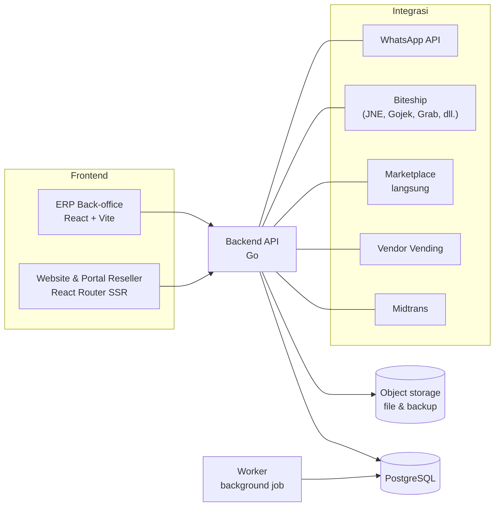
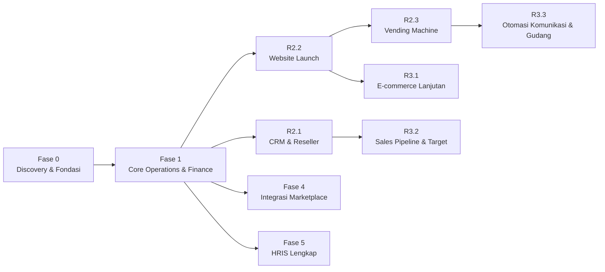

# Product Roadmap Implementasi
## Balans Nutrition — Unified Business Platform (ERP + Finance & Accounting)

| Item | Keterangan |
|---|---|
| Klien | Balans Nutrition |
| Dokumen | Product Roadmap Implementasi |
| Versi | 0.6 — Draft |
| Tanggal | 14 Oktober 2026 |
| Acuan | BRD Balans Unified Business Platform v0.7; Technical Guideline v0.1; Naming Convention Menu & Fitur v1.0 |
| Status | Draft untuk direview klien |

Roadmap ini menetapkan **urutan fase, isi setiap rilis, dan ketergantungan antar fase**. Roadmap ini **tidak memuat target tanggal**.

---

## Daftar Isi

1. [Ringkasan](#1-ringkasan)
2. [Prinsip Penyusunan Roadmap](#2-prinsip-penyusunan-roadmap)
3. [Gambaran Arsitektur & Stack](#3-gambaran-arsitektur--stack)
4. [Urutan & Ketergantungan Fase](#4-urutan--ketergantungan-fase)
5. [Fase 0 — Discovery & Fondasi](#5-fase-0--discovery--fondasi)
6. [Fase 1 — Core Operations & Finance](#6-fase-1--core-operations--finance)
7. [Fase 2 — Website & Channel Digital](#7-fase-2--website--channel-digital)
8. [Fase 3 — E-commerce Lanjutan & Sales Tracking](#8-fase-3--e-commerce-lanjutan--sales-tracking)
9. [Fase 4 — Integrasi Marketplace](#9-fase-4--integrasi-marketplace)
10. [Fase 5 — HRIS Lengkap](#10-fase-5--hris-lengkap)
11. [Paket Opsional](#11-paket-opsional)
12. [Workstream Lintas Fase](#12-workstream-lintas-fase)
13. [Gate Persetujuan & Data per Fase](#13-gate-persetujuan--data-per-fase)
14. [Matriks Keterlacakan Requirement](#14-matriks-keterlacakan-requirement)
15. [Risiko & Mitigasi](#15-risiko--mitigasi)
16. [Tata Kelola Proyek](#16-tata-kelola-proyek)
17. [Asumsi Roadmap](#17-asumsi-roadmap)
18. [Log Keputusan](#18-log-keputusan)

---

## 1. Ringkasan

Roadmap dibagi menjadi **6 fase** dan **15 rilis**. Setiap fase menghasilkan sesuatu yang bisa langsung dipakai Balans. Urutannya mengikuti catatan kebutuhan Balans: operasional inti dan akuntansi dulu, lalu website (Catatan #18 – #19), lalu integrasi yang bergantung pada pihak ketiga.

| Fase | Fokus | Hasil utama | Titik go-live |
|---|---|---|---|
| **Fase 0 — Discovery & Fondasi** | Persetujuan & desain | BRD v1.0 disetujui (termasuk pilihan opsional), desain solusi, COA final, fondasi aplikasi | — |
| **Fase 1 — Core Operations & Finance** | Alur catatan Balans di luar website | Master data & harga, procurement & maklon, gudang & inventory, sales (MT, konsinyasi, WA/IG, marketplace manual/import), logistik, Finance & Accounting termasuk PPh & aset tetap | Satu go-live di awal periode akuntansi |
| **Fase 2 — Website & Channel Digital** | Pusatkan penjualan online | CRM & reseller, website e-commerce (Midtrans, Biteship penuh, portal reseller), vending machine dengan refill partner | Launch website, lalu vending |
| **Fase 3 — E-commerce Lanjutan & Sales Tracking** | Lengkapi website & tracking sales | Subscription, poin, ulasan, referral, retur online; sales pipeline & target; WhatsApp API, API vending, scan barcode | Per rilis |
| **Fase 4 — Integrasi Marketplace** | Otomasi marketplace | Integrasi langsung marketplace dalam dua gelombang, rekonsiliasi settlement otomatis | Per gelombang |
| **Fase 5 — HRIS Lengkap** | SDM terkelola | Data karyawan, absensi, cuti, lembur, self-service, lalu payroll, BPJS, PPh 21 | Absensi dulu, lalu payroll setelah paralel run |

---

## 2. Prinsip Penyusunan Roadmap

1. **Berangkat dari catatan kebutuhan Balans.** Alur di catatan 11 September 2026 menjadi prioritas utama; usulan konsultan dan fitur opsional menyusul (BRD 1.3).
2. **Fondasi data lebih dulu.** Master data, gudang, dan persediaan harus benar sebelum penjualan dan akuntansi bisa dipercaya.
3. **Akuntansi dibangun bersamaan, bukan di akhir.** COA disiapkan di rilis pertama, lalu jurnal otomatis ditambahkan di setiap rilis transaksi.
4. **Satu go-live besar untuk inti operasional.** Stok, penjualan, dan keuangan saling terhubung, jadi Fase 1 dirilis sekaligus di awal periode akuntansi agar saldo awal bersih.
5. **Satu fase, satu hasil yang bisa dipakai.** Fase dipecah agar setiap fase bisa dirilis dan dinilai sendiri, dan fase berikutnya bisa diprioritaskan ulang tanpa mengganggu yang sudah berjalan.
6. **Integrasi pihak ketiga belakangan, dengan cadangan manual.** API marketplace, vendor vending, dan WhatsApp bergantung pada pihak luar. Selama belum tersedia, proses manual atau import Excel tetap jalan.
7. **Fitur opsional tidak mengganggu go-live.** Usulan opsional yang dipilih Balans ditempatkan di rilis yang paling kecil dampaknya (bagian 11).

---

## 3. Gambaran Arsitektur & Stack

| Komponen | Pilihan | Status |
|---|---|---|
| Frontend ERP / back-office | React + Vite + shadcn/ui (preset Balans), TanStack Router, TanStack Query | Diputuskan (D-19) |
| Frontend website e-commerce & portal reseller | React + React Router (framework mode, SSR) + shadcn/ui (preset Balans) | Diputuskan |
| Form HP (absensi, refill partner, stock count) | Bagian dari ERP, responsive di browser HP | Diputuskan (BRD 2.2) |
| Backend API | Go, modular monolith (`chi`, `pgx` + `sqlc`, job queue `river`), kontrak OpenAPI | Diputuskan (D-19) |
| Database | PostgreSQL 18 | Diputuskan (D-19) |
| Autentikasi | JWT: access token pendek + refresh token dengan rotasi, dapat dicabut | Diputuskan (D-20) |
| Hosting & infrastruktur | 1 VPS (4 core, 8 GB), Docker Compose, Caddy | Diputuskan (D-21); provider dipilih di Fase 0 |
| CI/CD | GitHub Actions, image di GitHub Container Registry | Diputuskan (D-21) |
| File & backup | Object storage S3-compatible di luar VPS | Diputuskan (D-21); provider dipilih di Fase 0 |
| Host aplikasi | ERP `erp.findyourbalans.com`, staging `erp-staging.findyourbalans.com`; website di domain utama mulai R2.2 | Diputuskan (D-28) |
| Email transaksional | Adapter mock selama pengembangan; provider asli dipilih sebelum UAT Fase 1 | Diputuskan (D-27) |
| Payment gateway | Midtrans (website, link bayar WA/IG, vending); adapter mock sampai akun asli tersedia | Diputuskan (arahan Balans, U-17, D-27) |
| Shipping aggregator | Biteship (cek ongkir, order kurir, pickup, resi, tracking di R2.2); adapter mock sampai akun asli tersedia | Diputuskan (D-02, D-12, D-27) |
| Marketplace | Integrasi langsung ke tiap marketplace | Diputuskan (arahan Balans, U-21) |

Aturan teknis lengkap ada di *Technical Guideline v0.1*; label menu dan fitur mengikuti *Naming Convention Menu & Fitur v1.0*.

---

## 4. Urutan & Ketergantungan Fase

Urutan default adalah Fase 0 → 1 → 2 → 3 → 4 → 5. Diagram berikut menunjukkan ketergantungan yang sebenarnya: panah berarti "harus selesai lebih dulu". Fase yang tidak saling bergantung bisa dikerjakan paralel jika kapasitas tim memungkinkan.

| Fase / rilis | Bergantung pada | Alasan |
|---|---|---|
| Fase 1 | Fase 0 | Butuh BRD v1.0, COA final, dan desain solusi |
| R2.1 CRM & Reseller | Fase 1 | Memakai master customer, price list, dan stok Non-Ecommerce |
| R2.2 Website Launch | Fase 1 | Order website memotong E-commerce Stock dan menghasilkan jurnal. Desain UI website bisa dimulai lebih awal, paralel dengan UAT Fase 1 |
| R2.3 Vending Machine | R2.2 | Memakai integrasi Midtrans yang dibangun di R2.2 |
| R3.1 E-commerce Lanjutan | R2.2 | Melengkapi website yang sudah live |
| R3.2 Sales Pipeline & Target | R2.1 | Lead reseller dan customer B2B memakai data CRM |
| R3.3 Otomasi | R2.3 | API vending melengkapi pencatatan vending di R2.3 |
| Fase 4 Integrasi Marketplace | Fase 1 | Menggantikan input manual/import marketplace dari Fase 1. Registrasi aplikasi ke marketplace sebaiknya dimulai lebih awal (paralel dengan Fase 3) karena proses persetujuannya bisa memakan waktu beberapa minggu |
| Fase 5 HRIS Lengkap | Fase 1 | Memakai master karyawan (HR-01) dan COA untuk jurnal payroll. Tidak bergantung pada Fase 2 – 4, sehingga bisa dimajukan atau dikerjakan paralel jika ada tambahan kapasitas |

---

## 5. Fase 0 — Discovery & Fondasi

| Aktivitas | Output |
|---|---|
| Review BRD v0.7 bersama Balans per divisi | Persetujuan usulan U-01 s.d. U-27 dan **pilihan usulan opsional U-28 s.d. U-32** |
| Finalisasi BRD | **BRD v1.0** disetujui sebagai baseline |
| Desain solusi | Data model, alur status dokumen, matriks role & approval (BRD 5.17) dengan nama approver |
| Desain Finance & Accounting | COA final (dari usulan BRD 7.1 atau COA Balans), mapping jurnal otomatis (BRD 7.2), profil pajak (U-06) |
| Keputusan teknis | **Sudah ditetapkan** di Technical Guideline v0.1 (D-19 s.d. D-21). Sisa: pemilihan provider VPS dan object storage |
| UI/UX | Design system dari preset shadcn, wireframe layar utama Fase 1, struktur menu & label sesuai Naming Convention v1.0 |
| Setup teknis | Monorepo (`backend/`, `web-erp/`, `web-store/`, `deploy/`, `docs/`), scaffold ERP (Vite) & backend Go, CI/CD GitHub Actions, VPS dengan environment staging (`erp-staging.findyourbalans.com`) & production (`erp.findyourbalans.com`), backup off-site, adapter mock email, Midtrans & Biteship |
| Persiapan migrasi | Template Excel: master data, price list, PKS partner, saldo stok per batch, saldo awal akuntansi, piutang/utang terbuka, aset tetap |
| Pihak ketiga | Kontak vendor vending & konfirmasi kepemilikan akun Midtrans vending |

**Exit criteria:** BRD v1.0 dan desain solusi disetujui; pilihan opsional sudah ditentukan; data Fase 1 dari BRD 12.3 sudah diterima atau dijadwalkan; template migrasi sudah diserahkan ke Balans.

---

## 6. Fase 1 — Core Operations & Finance

**Tujuan:** Seluruh alur di catatan Balans yang tidak bergantung pada website berjalan di satu sistem: Catatan #1 – #4, #6 – #17, #20 – #22.

### R1.1 — Fondasi & Master Data

| Lingkup | Requirement |
|---|---|
| Login, role-based access, audit trail, lokalisasi, privasi data, notifikasi approval | NFR-01 s.d. NFR-05, NFR-11 |
| Master produk, packaging & bahan reprocess, bundling virtual | MD-01, MD-02, MD-03 |
| Price list, aturan prioritas harga, diskon & batas diskon per role | MD-04, MD-05, MD-11, MD-12 |
| Master customer, partner + PKS, supplier/maklon, gudang/lokasi (termasuk Gudang GM & lokasi eksternal) | MD-06, MD-07, MD-08, MD-09 |
| Master alasan retur, jenis biaya, kode kampanye | MD-13 |
| Import/export master data Excel | MD-10, INT-02 |
| COA, buku besar, jurnal balik, dimensi channel/sub-channel/divisi/kampanye | ACC-01, ACC-13, ACC-17 |
| Master karyawan & penanda karyawan sebagai customer | HR-01, HR-03 |

**Deliverable:** Seluruh master data bisa diinput dan diimpor; struktur gudang, price list, dan COA sudah terbentuk.

### R1.2 — Procurement, Maklon, Gudang & Inventory

| Lingkup | Requirement |
|---|---|
| PR, PO, approval berjenjang, uang muka pembelian | PRC-01, PRC-06, PRC-08, PRC-09 |
| PO jasa maklon, pemakaian packaging per batch, PO reprocess | PRC-02, PRC-03, PRC-10 |
| Goods receipt, reject/waste, 3-way match, Barang Diterima Belum Ditagih | PRC-04, PRC-05, PRC-07, ACC-22 |
| Multi-gudang, **Inbound** (QC & status Karantina), transfer & In-Transit, stock count terjadwal | WMS-01, WMS-02, WMS-03, WMS-04, WMS-09, WMS-10, WMS-11 |
| Gudang retur (QC & disposisi), lokasi konsinyasi, buffer vending, mesin, maklon | WMS-07, WMS-08 |
| Kartu stok, HPP (termasuk reject/waste), FIFO, batch & expired, FEFO | INV-01, INV-02, INV-03, INV-04, INV-09 |
| Pemakaian internal, repacking, pemusnahan | INV-05, INV-06, INV-12, HR-02 |
| Utang usaha, retur pembelian/nota debit, jurnal otomatis pembelian & persediaan | ACC-04, ACC-16, ACC-02 (pembelian & persediaan) |
| Cetak PO | NFR-08 (PO) |

**Deliverable:** Siklus beli → terima → periksa → simpan → kirim ke maklon → terima FG → hitung stok berjalan, lengkap dengan HPP per batch dan jurnal.

### R1.3 — Sales Management & Logistics

| Lingkup | Requirement |
|---|---|
| MT beli putus (alur Catatan #3) & B2B | SLS-01, SLS-02 |
| Konsinyasi: stock count partner, Berita Acara Rekonsiliasi, invoice otomatis, selisih sesuai PKS | SLS-03, SLS-09 |
| Order WA/IG oleh CS, bukti bayar, invoice | SLS-04 |
| Penjualan marketplace (manual / import Excel) | SLS-05 |
| Penerapan price list, diskon, diskon karyawan | SLS-06, SLS-07 |
| Retur penjualan, nota kredit / refund | SLS-08 |
| DO, resi marketplace, kurir & resi (manual), status pengiriman | LOG-01, LOG-02, LOG-03, LOG-04 |
| **Outbound** dengan QC sebelum DO dikirim: stok pengganti otomatis bila QC gagal, barang reject ke Karantina lalu diretur ke maklon (D-24) | WMS-12, ACC-16 |
| Piutang usaha, pembayaran sebagian & alokasi, jurnal otomatis penjualan/HPP | ACC-03, ACC-15, ACC-02 (penjualan) |
| Cetak DO, proforma, invoice, Berita Acara Rekonsiliasi | NFR-08 |

**Deliverable:** Semua channel penjualan di catatan Balans selain website dan vending tercatat, stok terpotong otomatis, piutang terbentuk.

### R1.4 — Finance Close, Pajak & Laporan

| Lingkup | Requirement |
|---|---|
| Kas & bank, rekonsiliasi bank, kas kecil, biaya operasional dengan approval | ACC-05, ACC-11, ACC-12 |
| Rekonsiliasi settlement marketplace via import (tahap 1) | ACC-06 (tahap 1) |
| Pemotongan PPh 21/23/4(2), PPh Final UMKM, rekap untuk Coretax | ACC-19, ACC-20 |
| Register aset tetap & penyusutan | ACC-21 |
| Laporan keuangan, neraca saldo & buku besar, tutup buku dengan checklist, saldo awal & buka kembali periode | ACC-07, ACC-18, ACC-08, ACC-14 |
| Import/export transaksi Excel | ACC-10, INT-02 |
| Laporan stok, mutasi, stock count, HPP, kedaluwarsa | RPT-01, RPT-02, RPT-03, RPT-04, RPT-19 |
| Laporan penjualan, konsinyasi, pemakaian internal, retur | RPT-05, RPT-06, RPT-08, RPT-09 |
| Outstanding PO, umur piutang/utang, laporan keuangan, laba rugi per dimensi, laporan pajak | RPT-10, RPT-11, RPT-12, RPT-15, RPT-18 |
| Dashboard eksekutif (versi dasar) | RPT-14 (dasar) |
| Backup, monitoring, kapasitas, kesiapan produksi | NFR-06, NFR-07, NFR-09, NFR-10 |

**Deliverable:** Sistem siap UAT end-to-end, termasuk tutup buku bulanan.

**Beban Fase 1:** Fase 1 memuat 105 requirement, termasuk QC & karantina, Berita Acara Rekonsiliasi, PPh, aset tetap, dan Barang Diterima Belum Ditagih. Kapasitas tim dikalibrasi di Fase 0.

### UAT, Migrasi & Go-live Fase 1

| Urutan | Tahap | Aktivitas |
|---|---|---|
| 1 | UAT | Skenario end-to-end per divisi oleh key user, berbasis alur di catatan Balans; perbaikan defect |
| 2 | Training | Paralel dengan UAT; training per role, materi & video panduan |
| 3 | Mock migration | 2× selama UAT: uji coba import master, saldo stok per batch, saldo awal, piutang/utang terbuka, aset tetap |
| 4 | Stock count fisik | Menjelang cut-over; hitung fisik semua lokasi (gudang, konsinyasi, maklon) sebagai saldo awal stok |
| 5 | Cut-over | Migrasi final; saldo awal per tanggal cut-over disetujui Finance & Accounting |
| 6 | **Go-live** | Di awal periode akuntansi; transaksi periode tersebut dicatat di sistem baru |
| 7 | Hypercare | Pendampingan harian, perbaikan cepat, sampai tutup buku bulan pertama selesai |

**Go / no-go criteria:**
- Tidak ada defect kritis yang terbuka dari UAT.
- Saldo awal stok dan akuntansi sudah disetujui Finance & Accounting.
- Semua key user sudah ditraining dan menandatangani UAT.
- Backup dan prosedur restore sudah diuji.

---

## 7. Fase 2 — Website & Channel Digital

**Tujuan:** Website e-commerce live (Catatan #18), penjualan WA/IG mulai diarahkan ke website (Catatan #19), reseller dan vending machine (Catatan #5) masuk sistem.

### R2.1 — CRM & Reseller

| Lingkup | Requirement |
|---|---|
| Database customer terpadu, riwayat order, segmentasi | CRM-01, CRM-02, CRM-03 |
| Registrasi & verifikasi reseller, level & harga reseller, order reseller, ketentuan bayar, deposit | RSL-01, RSL-02, RSL-03, RSL-04, RSL-07 |
| Peringatan stok minimum & mendekati kedaluwarsa | INV-07, INV-08 |

### R2.2 — Website Launch

**Tahapan:** desain UI (bisa dimulai paralel dengan UAT Fase 1) → build → UAT & soft launch → launch.

| Lingkup | Requirement |
|---|---|
| Rebuild findyourbalans.com: katalog, pencarian, halaman produk, keranjang, checkout | ECM-01 |
| Midtrans: pembayaran website & link bayar WA/IG | ECM-02, INT-01 (website & link bayar) |
| Order website masuk sistem & memotong E-commerce Stock | ECM-03 |
| Ongkir Biteship dengan pin lokasi | ECM-04 |
| Biteship penuh: order kurir, pickup, resi otomatis, tracking webhook, cetak label | LOG-05, LOG-06, INT-05 |
| Akun customer, multi alamat, voucher | ECM-05 |
| Harga karyawan & reseller yang login; portal reseller | ECM-06, RSL-05 |
| Link WA/IG ke website, lacak pesanan & notifikasi | ECM-07, ECM-08 |
| CMS (banner, halaman, blog, FAQ), SEO & analytics/pixel | ECM-09, ECM-15 |
| Picking & packing di dalam Outbound untuk order website | WMS-05 |
| Rekonsiliasi settlement Midtrans | ACC-06 (Midtrans) |

Integrasi Biteship penuh (U-20, D-12) masuk rilis ini karena provider dan kredensialnya sama dengan cek ongkir. Dengan begitu, order website langsung memiliki resi dan tracking otomatis sejak launch.

**Peralihan channel:** Setelah website launch, CS mulai mengarahkan order WA/IG ke website (Catatan #19) dan bisa mengirim link bayar Midtrans. Order WA/IG manual (SLS-04) tetap tersedia.

### R2.3 — Vending Machine

| Lingkup | Requirement |
|---|---|
| Master mesin & slot, stok per mesin, refill | VND-01, VND-02 |
| Buffer vending di lokasi partner, form refill & stock count partner (arahan Balans: refill oleh partner) | VND-07, VND-08 |
| Pencatatan transaksi mesin via Midtrans | VND-03, INT-01 (vending) |
| Rekonsiliasi Midtrans vs penjualan vs stok mesin | VND-04 |
| Penjualan lewat partner mengikuti alur konsinyasi | VND-05 |
| Laporan penjualan & stok per mesin | RPT-07 |

**Ketergantungan:** Jika data transaksi Midtrans dari mesin tidak memuat SKU, pemotongan stok per SKU dilakukan saat refill (BRD 5.6, U-05). Akun Midtrans vending harus atas nama Balans.

---

## 8. Fase 3 — E-commerce Lanjutan & Sales Tracking

**Tujuan:** Melengkapi website sesuai arahan "fitur e-commerce lengkap" (U-16), menjalankan tracking sales (U-19), dan otomasi yang bergantung pihak ketiga. R3.1 dikerjakan tim website, sedangkan R3.2 dan R3.3 dikerjakan tim ERP, sehingga ketiganya bisa berjalan paralel.

### R3.1 — E-commerce Lanjutan

| Lingkup | Requirement |
|---|---|
| Subscription dengan pengingat & link bayar | ECM-10 |
| Member & poin loyalitas | ECM-11 |
| Ulasan & rating, wishlist & keranjang tertinggal, referral | ECM-12, ECM-13, ECM-14 |
| Pengajuan retur/refund online | ECM-16 |
| Evaluasi level reseller otomatis | RSL-06 |
| Laporan e-commerce | RPT-20 |

### R3.2 — Sales Pipeline & Target

| Lingkup | Requirement |
|---|---|
| Pipeline lead → deal (partner MT/konsinyasi, reseller, B2B), aktivitas sales | SLP-01, SLP-02 |
| Target & pencapaian per sales/channel, check-in kunjungan | SLP-03, SLP-04 |
| Interaksi CS | CRM-04 |
| Laporan pipeline, target vs pencapaian | RPT-13, RPT-16 |

### R3.3 — Otomasi Komunikasi & Gudang

| Lingkup | Requirement |
|---|---|
| WhatsApp Business API: invoice, link bayar & notifikasi | INT-06 |
| API vendor vending: status stok & mesin (jika vendor menyediakan) | VND-06, INT-03 |
| Scan barcode untuk inbound, transfer, picking | WMS-06 |

---

## 9. Fase 4 — Integrasi Marketplace

**Tujuan:** Integrasi **langsung** ke tiap marketplace (arahan Balans, U-21), menggantikan input manual/import Excel dari Fase 1.

**Persiapan (dimulai sebelum fase ini, paralel dengan Fase 3):** pendaftaran aplikasi integrasi di tiap marketplace atas nama Balans, pengajuan akses API, dan pemetaan SKU marketplace ke SKU Balans. Persiapan ini dimulai lebih awal karena proses persetujuan marketplace bisa memakan waktu beberapa minggu.

### R4.1 — Gelombang 1

| Lingkup | Requirement |
|---|---|
| Dua marketplace dengan volume terbesar (usulan: Shopee dan TikTok Shop & Tokopedia): tarik order, sinkron stok, label/AWB, status, data settlement | INT-04 (gelombang 1) |
| Rekonsiliasi settlement otomatis untuk marketplace gelombang 1 | ACC-06 (otomatis) |

### R4.2 — Gelombang 2

| Lingkup | Requirement |
|---|---|
| Marketplace lainnya (usulan: Lazada dan Blibli) | INT-04 (gelombang 2) |
| Rekonsiliasi settlement otomatis untuk semua marketplace | ACC-06 (otomatis) |
| Dashboard eksekutif lanjutan | RPT-14 (lanjutan) |

Integrasi dibagi dua gelombang agar marketplace dengan volume terbesar lebih cepat terotomasi, dan pelajaran dari gelombang 1 dipakai di gelombang 2 (D-13). Urutan marketplace final ditentukan dari data penjualan Fase 1. Tokopedia dan TikTok Shop kini berada di satu platform seller, sehingga jumlah integrasi terpisah (4 atau 5) dipastikan saat registrasi.

---

## 10. Fase 5 — HRIS Lengkap

**Tujuan:** HRIS lengkap sampai absensi, termasuk payroll (arahan Balans, U-22; dikonfirmasi), untuk 50+ karyawan dengan kapasitas hingga 100. Dibagi dua rilis: absensi bisa dipakai lebih dulu, sedangkan payroll butuh paralel run.

### R5.1 — Data Karyawan, Absensi & Cuti

| Lingkup | Requirement |
|---|---|
| Struktur organisasi, jabatan, kontrak & dokumen karyawan | HR-04 |
| Absensi browser HP dengan geotag & selfie, jadwal & shift | HR-05 |
| Cuti & izin dengan approval dan saldo cuti | HR-06 |
| Lembur dengan approval | HR-07 |
| Self-service karyawan (cuti, lembur, reimbursement) | HR-12 |

### R5.2 — Payroll, BPJS & PPh 21

**Tahapan:** build → paralel run satu periode payroll → payroll resmi di periode berikutnya.

| Lingkup | Requirement |
|---|---|
| Payroll: komponen gaji, tunjangan, potongan, slip gaji | HR-08 |
| BPJS Kesehatan & Ketenagakerjaan | HR-09 |
| PPh 21 TER bulanan & perhitungan akhir tahun | HR-10 |
| Jurnal payroll otomatis per divisi | HR-11 |
| Laporan HR | RPT-17 |

Payroll pertama dihitung paralel dengan cara lama selama satu periode. Selisih dianalisis dan diperbaiki sebelum payroll periode berikutnya memakai sistem secara resmi (D-14).

**Opsi paralel:** Fase 5 hanya bergantung pada Fase 1 (bagian 4). Dengan tambahan satu tim kecil (1 backend, 1 frontend), Fase 5 bisa dikerjakan paralel dengan Fase 3 atau Fase 4, sehingga absensi dan payroll lebih cepat tersedia. Keputusan ini diambil di steering committee setelah go-live Fase 1.

---

## 11. Paket Opsional

Usulan opsional U-28 s.d. U-32 (BRD 12.2) tidak berasal dari catatan Balans dan hanya dikerjakan jika dipilih saat persetujuan BRD. Tabel berikut menunjukkan rilis yang paling kecil dampaknya untuk tiap opsi.

| Usulan | Requirement | Rilis jika diambil | Dampak |
|---|---|---|---|
| U-28 Minimum sisa umur simpan | INV-10 | R1.2 | Kecil; logika alokasi batch lebih mudah dibangun sejak awal |
| U-29 Bundling fisik (kitting) | INV-11, A-28 | R1.2 | Kecil |
| U-30 Batas kredit & termin | SLS-10 | R1.3 | Kecil |
| U-31 Kuota & potong gaji karyawan | SLS-11, A-33 | Kuota di R2.2; potong gaji di R5.2 | Kecil; potong gaji butuh payroll |
| U-32 Biaya penempatan vending | VND-09, A-25 | R2.3 | Kecil |
| Anggaran biaya per divisi (bagian dari U-13) | ACC-23 | R3.2 | Kecil |

Jika lebih dari tiga opsi Fase 1 dipilih sekaligus, beban Fase 1 dihitung ulang di Fase 0.

---

## 12. Workstream Lintas Fase

| Workstream | Kegiatan | Kapan |
|---|---|---|
| **Migrasi data** | Template, pembersihan data oleh Balans, mock migration, migrasi final | Fase 0 sampai cut-over Fase 1; data reseller/customer di Fase 2; data karyawan & komponen gaji sebelum Fase 5 |
| **Quality assurance** | Test per sprint (Technical Guideline bagian 12), checklist pull request, regression sebelum rilis, UAT per fase | Setiap sprint & rilis |
| **Training & change management** | Key user per divisi, training per role, panduan pengguna; panduan form HP untuk partner dan karyawan | Menjelang setiap go-live |
| **DevOps & keamanan** | CI/CD GitHub Actions, Docker Compose di VPS, backup off-site & uji restore bulanan, monitoring uptime eksternal, review akses | Mulai Fase 0, berkelanjutan |
| **Akuntansi** | Validasi jurnal otomatis setiap rilis oleh Finance & Accounting | Setiap rilis yang menghasilkan jurnal |
| **Pihak ketiga** | Akun & kredensial Midtrans, Biteship, marketplace, vendor vending, WhatsApp | Sesuai gate di bagian 13 |

---

## 13. Gate Persetujuan & Data per Fase

Pertanyaan terbuka di BRD sudah dijawab lewat usulan U-01 s.d. U-32. Gate di bawah memastikan **persetujuan** dan **data dari Balans** (BRD 12.3) tersedia sebelum fase atau rilis dimulai.

| Sebelum | Yang dibutuhkan | Alasan |
|---|---|---|
| **Akhir Fase 0** | Persetujuan BRD v1.0 (U-01 s.d. U-27, K-01 s.d. K-16, perlakuan akuntansi); pilihan opsional U-28 s.d. U-32; nama approver; SKU, bundel & price list; daftar partner & PKS; COA lama (jika ada); bentuk badan usaha & status PPh Final; alamat gudang, supplier & maklon | Dasar desain dan konfigurasi Fase 1 |
| **Akhir Fase 0** | Pemilihan provider VPS (disarankan lokasi Indonesia) dan object storage; akses DNS findyourbalans.com untuk record `erp` dan `erp-staging` | Setup environment staging & production |
| **Akhir Fase 0** (disarankan, karena lead time vendor) | Kontak vendor vending; konfirmasi akun Midtrans vending atas nama Balans | Vendor perlu dihubungi sejak awal |
| **UAT Fase 1** | Provider email transaksional dan alamat pengirim di findyourbalans.com (SPF, DKIM, DMARC) | Notifikasi approval (NFR-11) diuji dengan email asli; production tidak bisa berjalan dengan adapter mock |
| **Cut-over Fase 1** | Saldo stok per batch per lokasi, saldo awal akuntansi, piutang/utang terbuka, register aset tetap | Saldo awal go-live |
| **Desain R2.2** | Aset brand (logo, foto produk, konten), akses domain findyourbalans.com | Desain dan build website; build memakai adapter mock Midtrans & Biteship |
| **UAT R2.2** | Akun Midtrans & Biteship atas nama Balans (sandbox lalu production) | Pembayaran, ongkir, dan resi diuji dengan provider asli sebelum launch |
| **R2.1** | Konfirmasi nilai level reseller (atau memakai nilai awal di BRD 5.10) | Konfigurasi reseller |
| **Persiapan Fase 4** | Akses seller center tiap marketplace; urutan gelombang marketplace | Registrasi aplikasi integrasi |
| **Fase 5** | Data karyawan, komponen gaji, kebijakan cuti/lembur, kepesertaan BPJS, lokasi kerja untuk radius absensi | Konfigurasi HRIS & payroll |

---

## 14. Matriks Keterlacakan Requirement

Semua requirement BRD v0.7 dan rilis tempat masing-masing dikerjakan.

| Modul | Fase 1 | Fase 2 | Fase 3 | Fase 4 | Fase 5 | Opsional |
|---|---|---|---|---|---|---|
| **MD** Master Data | MD-01 s.d. MD-13 (R1.1) | | | | | |
| **PRC** Procurement | PRC-01 s.d. PRC-10 (R1.2) | | | | | |
| **WMS** Warehouse | WMS-01, 02, 03, 04, 07, 08, 09, 10, 11 (R1.2); WMS-12 (R1.3) | WMS-05 (R2.2) | WMS-06 (R3.3) | | | |
| **INV** Inventory | INV-01 s.d. INV-06, INV-09, INV-12 (R1.2) | INV-07, INV-08 (R2.1) | | | | INV-10, INV-11 |
| **LOG** Logistics | LOG-01 s.d. LOG-04 (R1.3) | LOG-05, LOG-06 (R2.2) | | | | |
| **SLS** Sales Management | SLS-01 s.d. SLS-09 (R1.3) | | | | | SLS-10, SLS-11 |
| **SLP** Sales Pipeline | | | SLP-01 s.d. SLP-04 (R3.2) | | | |
| **CRM** | | CRM-01, 02, 03 (R2.1) | CRM-04 (R3.2) | | | |
| **RSL** Reseller | | RSL-01 s.d. RSL-04, RSL-07 (R2.1); RSL-05 (R2.2) | RSL-06 (R3.1) | | | |
| **VND** Vending Machine | | VND-01 s.d. VND-05, VND-07, VND-08 (R2.3) | VND-06 (R3.3) | | | VND-09 |
| **ECM** Web E-commerce | | ECM-01 s.d. ECM-09, ECM-15 (R2.2) | ECM-10 s.d. ECM-14, ECM-16 (R3.1) | | | |
| **HR** HRIS | HR-01, HR-03 (R1.1); HR-02 (R1.2) | | | | HR-04 s.d. HR-07, HR-12 (R5.1); HR-08 s.d. HR-11 (R5.2) | |
| **ACC** Finance & Accounting | ACC-01, 13, 17 (R1.1); ACC-02 (R1.2–R1.3); ACC-04, 16, 22 (R1.2); ACC-03, 15 (R1.3); ACC-05, 06 tahap 1, 07, 08, 10, 11, 12, 14, 18, 19, 20, 21 (R1.4) | ACC-06 Midtrans (R2.2) | | ACC-06 otomatis (R4.1–R4.2) | | ACC-23 |
| **INT** Integrasi | INT-02 (R1.1, R1.4) | INT-01 (R2.2, R2.3); INT-05 (R2.2) | INT-03, INT-06 (R3.3) | INT-04 (R4.1–R4.2) | | |
| **RPT** Laporan | RPT-01 s.d. RPT-06, RPT-08 s.d. RPT-12, RPT-14 dasar, RPT-15, RPT-18, RPT-19 (R1.4) | RPT-07 (R2.3) | RPT-13, RPT-16 (R3.2); RPT-20 (R3.1) | RPT-14 lanjutan (R4.2) | RPT-17 (R5.2) | |
| **NFR** Non-Fungsional | NFR-01 s.d. NFR-05, NFR-11 (R1.1); NFR-08 (R1.2–R1.3); NFR-06, 07, 09, 10 (R1.4) | | | | | |

### Jumlah Requirement per Fase

| Fase | Must | Should | Could | Total |
|---|---|---|---|---|
| Fase 1 | 90 | 15 | — | 105 |
| Fase 2 | 23 | 11 | — | 34 |
| Fase 3 | 3 | 8 | 8 | 19 |
| Fase 4 | — | 1 | — | 1 |
| Fase 5 | 8 | 2 | — | 10 |
| Opsional (jika dipilih) | — | — | 6 | 6 |
| **Total** | **124** | **37** | **14** | **175** |

Hitungan berdasarkan rilis pertama tiap requirement; requirement yang dikerjakan bertahap (ACC-02, ACC-06, RPT-14, INT-01, INT-02, INT-04, NFR-08) dihitung sekali. Fase 4 hanya berisi satu requirement (INT-04), tetapi mencakup 4 – 5 integrasi marketplace terpisah. NFR dan RPT tidak berprioritas di BRD dan dihitung sebagai Must.

---

## 15. Risiko & Mitigasi

| # | Risiko | Dampak | Mitigasi |
|---|---|---|---|
| 1 | Persetujuan BRD v1.0 atau data Fase 1 terlambat | Desain dan Fase 1 tertunda | Gate di bagian 13; usulan sudah tersedia sehingga Balans cukup menyetujui atau mengoreksi |
| 2 | Kualitas data migrasi (stok per batch, saldo awal) rendah | Laporan & HPP tidak akurat sejak hari pertama | Template sejak Fase 0, 2× mock migration, stock count fisik sebelum cut-over |
| 3 | Beban Fase 1 besar (105 requirement) | Fase 1 lebih lama dari perkiraan awal | Kalibrasi kapasitas di Fase 0; opsi Fase 1 dibatasi (bagian 11) |
| 4 | Vendor vending tidak punya API atau tidak mengirim SKU | Pemotongan stok mesin tidak real-time | Hubungi vendor sejak Fase 0; fallback pemotongan stok saat refill (U-05) |
| 5 | Akun Midtrans vending milik vendor, bukan Balans | Dana settlement tidak langsung ke Balans; rekonsiliasi sulit | Konfirmasi di Fase 0; pindahkan ke akun Balans sebelum R2.3 |
| 6 | Persetujuan akses API marketplace lambat atau API berubah | Fase 4 tertunda | Registrasi dimulai paralel dengan Fase 3; dua gelombang; import Excel tetap tersedia |
| 7 | Data batch & expired tidak disiplin di lapangan | FEFO & HPP FIFO tidak akurat | Wajib input batch & expired saat goods receipt; status Karantina; scan barcode di R3.3; training staf gudang |
| 8 | Partner tidak konsisten mengisi form refill | Stok mesin dan buffer tidak akurat | Form sederhana di HP dengan foto; stock count bulanan; selisih menjadi tanggung jawab partner sesuai PKS |
| 9 | Regulasi PPh 21, BPJS, atau PPh Final berubah | Perhitungan payroll/pajak salah | Paralel run payroll; tarif sebagai parameter; perubahan regulasi ditangani sebagai pemeliharaan |
| 10 | Scope creep, terutama pada fitur e-commerce lengkap | Biaya membengkak, fase berikutnya tertunda | Fitur dibagi launch (R2.2) dan lanjutan (R3.1); BRD v1.0 sebagai baseline; perubahan lewat change request |
| 11 | Adopsi pengguna rendah | Kembali ke Excel/WA manual | Key user per divisi, training per role, hypercare, dukungan manajemen |
| 12 | Seluruh aplikasi berjalan di 1 VPS (single point of failure); kapasitas 8 GB makin padat saat website & SSR aktif di Fase 2 | Downtime ERP dan website sekaligus; target uptime website 99,5% (NFR-06) bergantung pada keandalan provider | Backup off-site dengan point-in-time recovery, monitoring uptime eksternal, runbook pemulihan ≤ 2 jam, batas memori per container; jalur naik kelas: upgrade VPS → pisahkan database → pisahkan website (tanpa ubah arsitektur) |

---

## 16. Tata Kelola Proyek

| Forum | Frekuensi | Peserta | Tujuan |
|---|---|---|---|
| Sprint planning & review (demo) | Setiap 2 minggu | Tim implementasi, key user | Rencana sprint, demo hasil, umpan balik |
| Weekly status | Mingguan | PM, PIC Balans | Progres, isu, keputusan yang dibutuhkan |
| Steering committee | Bulanan & di setiap gate fase | Direksi Balans, PM | Persetujuan fase, prioritas & urutan fase berikutnya, change request, opsi paralel Fase 5 |
| Change request | Sesuai kebutuhan | PM, PIC Balans | Evaluasi dampak lingkup & biaya sebelum disetujui |

**Key user yang dibutuhkan dari Balans:** satu perwakilan per divisi (Logistik & Finance & Accounting, Sales MT, Sales E-commerce/CS, Reseller & Vending, Marketing, HRGA), ditambah satu PIC utama proyek.

---

## 17. Asumsi Roadmap

1. Fase 0 dimulai setelah BRD v0.7 disetujui sebagai dasar pembahasan.
2. Sprint 2 minggu dengan satu tim inti, misalnya PM/BA, UI/UX, 2 frontend, 2 backend, dan QA. Mulai Fase 2, tim dibagi menjadi track website dan track ERP yang berjalan paralel; track website butuh tambahan kapasitas frontend. Komposisi tim final ditetapkan di Fase 0.
3. Key user Balans tersedia untuk workshop, review sprint, dan UAT.
4. Data migrasi dan data di BRD 12.3 disiapkan Balans sesuai template dan gate di bagian 13.
5. Akses ke pihak ketiga (Midtrans, Biteship, marketplace, vendor vending, WhatsApp) diurus Balans sebagai pemilik akun.
6. Fase 3 – 5 mengikuti urutan default dengan tim yang sama, kecuali steering committee memutuskan urutan lain atau menyetujui opsi paralel Fase 5 (bagian 4).
7. Setiap fase dirilis sebagai versi aplikasi (go-live Fase 1 = `v1.0.0`, fase berikutnya menaikkan versi minor). Modul fase berikutnya bisa sudah ada di kode tetapi disembunyikan dengan feature flag modul sampai fasenya dirilis. Nama fase hanya dipakai di dokumen dan catatan rilis, tidak di kode, branch, atau tag (D-22).

---

## 18. Log Keputusan

| ID | Topik | Keputusan | Alasan | Tanggal |
|---|---|---|---|---|
| D-01 | Batch & tanggal kedaluwarsa (INV-04) | Masuk R1.2 sebagai Must (final, Q-03: perlu) | Menambahkan batch/expired setelah sistem berjalan jauh lebih mahal karena mengubah struktur stok | 14 Okt 2026 |
| D-02 | Ongkir di checkout website (ECM-04) | Memakai **Biteship** sebagai shipping aggregator | Satu API mencakup kurir di catatan klien (JNE, Gojek/GoSend, Grab) plus kurir reguler lain (J&T, SiCepat, AnterAja, dll.). RajaOngkir lebih murah untuk cek ongkir kurir reguler, tetapi kurir instannya terbatas (GoSend, tanpa Grab) dan pembuatan resi/pickup hanya ada di paket Enterprise | 14 Okt 2026 |
| D-03 | Metode penilaian persediaan (INV-03) | **FIFO**, dengan saran pengambilan fisik FEFO (INV-09) | Jawaban Q-04; FEFO melengkapi pelacakan expired | 14 Okt 2026 |
| D-04 | Status pajak | Balans tetap **NON-PKP**; invoice tanpa PPN. ACC-09 (kesiapan PPN/e-Faktur) dikeluarkan dari lingkup | Jawaban Q-22: tidak ada rencana menjadi PKP | 14 Okt 2026 |
| D-05 | Kepemilikan stok konsinyasi & vending | Stok di lokasi konsinyasi dan vending tetap milik Balans sampai terjual; mesin vending milik Balans | Jawaban Q-24 | 14 Okt 2026 |
| D-06 | Alur procurement | Pola standar: PR (opsional) → PO → approval berjenjang berdasarkan nominal → GR → tagihan → 3-way match → bayar | Jawaban Q-05: mengikuti sistem procurement pada umumnya | 14 Okt 2026 |
| D-07 | Gudang & inbound | Master gudang mendukung lebih dari satu gudang fisik; semua kedatangan barang masuk Gudang Inbound terlebih dahulu | Jawaban Q-02 dan Q-23 | 14 Okt 2026 |
| D-08 | Raw Material & maklon | Maklon full service untuk bahan isi produk & produksi. RM yang dikelola Balans = packaging; packaging dikirim ke maklon dan tercatat sebagai stok Balans di lokasi maklon sampai dipakai produksi | Jawaban Q-06 | 14 Okt 2026 |
| D-09 | Modern Trade beli putus | Invoice diterbitkan saat pembayaran dikonfirmasi; pembayaran langsung dicatat ke invoice. Tidak ada uang muka penjualan | Pembayaran selalu diterima sebelum pengiriman, sehingga akun uang muka tidak diperlukan | 14 Okt 2026 |
| D-10 | Kelengkapan Finance & Accounting | Tambah ACC-11 s.d. ACC-18 | Review kelengkapan modul Finance & Accounting terhadap kebutuhan inti Balans | 14 Okt 2026 |
| D-11 | Pertanyaan terbuka | Balans meminta konsultan menetapkan asumsi terbaik, dengan catatan kebutuhan 11 Sep 2026 tetap sebagai dasar utama. Dijawab lewat BRD (U-01 s.d. U-27, opsional U-28 s.d. U-32) | Konfirmasi Balans 14 Okt 2026 | 14 Okt 2026 |
| D-12 | Biteship penuh | Order kurir, pickup, resi, dan tracking dimajukan dari Fase 3 ke R2.2 | Arahan Balans (P-20: dibutuhkan); provider sama dengan cek ongkir, sehingga order website otomatis sejak launch | 14 Okt 2026 |
| D-13 | Integrasi marketplace | Langsung ke tiap marketplace, dalam dua gelombang (Fase 4) | Arahan Balans (P-21); dua gelombang mengurangi risiko dan mempercepat marketplace bervolume terbesar | 14 Okt 2026 |
| D-14 | HRIS | HRIS lengkap menjadi Fase 5 (bukan lagi opsional), dibagi R5.1 absensi dan R5.2 payroll dengan paralel run | Arahan Balans (P-22: lengkap sampai absensi, termasuk payroll — dikonfirmasi; P-23: 50+ karyawan) | 14 Okt 2026 |
| D-15 | Website e-commerce | Fitur lengkap dibagi launch (R2.2) dan lanjutan (R3.1) | Arahan Balans (P-16: fitur lengkap) tanpa menunda launch | 14 Okt 2026 |
| D-16 | Rekonsiliasi settlement marketplace | Tahap 1 (via import) dimajukan dari R2.2 ke R1.4 | Penjualan marketplace sudah dicatat sejak go-live Fase 1, sehingga Piutang Marketplace perlu direkonsiliasi sejak bulan pertama | 14 Okt 2026 |
| D-17 | Struktur roadmap | Dipecah dari 4 menjadi 6 fase | Lingkup bertambah (website lengkap, marketplace langsung, HRIS lengkap); setiap fase menghasilkan rilis yang bisa dipakai dan diprioritaskan ulang sendiri | 14 Okt 2026 |
| D-18 | Jadwal | Roadmap tidak memuat target tanggal; yang ditetapkan adalah urutan fase, isi rilis, dan ketergantungan | Arahan tim: proyek tidak berpatokan pada timeline tanggal | 14 Okt 2026 |
| D-19 | Stack aplikasi | Backend Go (modular monolith), PostgreSQL 18, kontrak OpenAPI; ERP memakai TanStack Router & TanStack Query | Kebutuhan transaksi stok & akuntansi yang konsisten; kapasitas NFR-10 tidak membutuhkan microservices | 14 Okt 2026 |
| D-20 | Autentikasi | JWT (access token 15 menit + refresh token dengan rotasi), dapat dicabut seketika lewat versi token per user; MFA untuk role sensitif | Arahan tim | 14 Okt 2026 |
| D-21 | Infrastruktur | 1 VPS (4 core, 8 GB) dengan Docker Compose; CI/CD GitHub Actions; file & backup di object storage di luar VPS | Arahan tim; backup di luar VPS agar data aman jika VPS rusak | 14 Okt 2026 |
| D-22 | Rilis per fase | Versi semver per fase + feature flag modul; nama fase tidak dipakai di kode, branch, atau tag | Kode fase berikutnya bisa digabung lebih awal tanpa terlihat user production; penamaan tetap bersih | 14 Okt 2026 |
| D-23 | Inbound & Outbound | Gudang memakai proses **Inbound** dan **Outbound**; QC adalah langkah di dalam keduanya, bukan menu tersendiri | Arahan Balans | 14 Okt 2026 |
| D-24 | QC outbound gagal | Barang ditolak dilepas dari order dan masuk Karantina; sistem langsung mengambil stok pengganti (batch atau unit lain); barang reject diretur ke maklon lewat Retur Pembelian + nota debit, diproses langsung oleh Logistik tanpa approval | Arahan Balans | 14 Okt 2026 |
| D-25 | Hapus data & backdate | Hapus master data = soft delete (tetap di database, tidak tampil di UI); transaksi backdate hanya di periode terbuka dengan perhitungan ulang HPP | Arahan tim; menjaga riwayat transaksi & laporan | 14 Okt 2026 |
| D-26 | Label UI | Label menu & fitur mengikuti Naming Convention v1.0 (antara lain `Packaging & Material`, `Retur & Refund`, `Inbound`, `Outbound`) | Satu konsep satu label di seluruh UI | 14 Okt 2026 |
| D-27 | Email, kurir & payment | Dikembangkan dengan adapter mock (Technical Guideline 5.10). Provider email asli dipilih sebelum UAT Fase 1; akun Midtrans & Biteship asli dibutuhkan sebelum UAT R2.2. Production menolak berjalan dengan mock | Arahan tim; pengembangan tidak menunggu akun pihak ketiga, dan jalur webhook sudah teruji sebelum akun asli tersedia | 14 Okt 2026 |
| D-28 | Host aplikasi | ERP di `erp.findyourbalans.com`, staging ERP di `erp-staging.findyourbalans.com`. Website di `findyourbalans.com` dan staging website di `staging.findyourbalans.com` mulai R2.2 | findyourbalans.com adalah domain milik Balans di BRD; form HP partner dan self-service karyawan bagian dari ERP (BRD 2.2) sehingga cukup satu host; cookie sesi host-only menjaga ERP dan website tetap terpisah; website lama tidak terganggu sampai launch | 14 Okt 2026 |
| D-29 | Versi untuk fase dengan beberapa titik go-live | Setiap titik go-live menaikkan satu versi minor (misalnya R2.1, R2.2, dan R2.3 masing-masing satu versi). Fase dengan satu go-live tetap satu versi minor | Melengkapi D-22; setiap go-live bisa ditelusuri dan di-rollback sendiri | 17 Okt 2026 |

**Estimasi biaya D-02:** Paket Biteship *Grow* Rp149.000/bulan, mencakup 10.000 request cek ongkir, 2.000 pengiriman/bulan, dan 10 kurir aktif (skema paket berlaku mulai 2 Nov 2026). Ongkir dibayar sesuai tarif kurir dan tidak termasuk langganan. Paket final dipilih sesuai volume order website.
