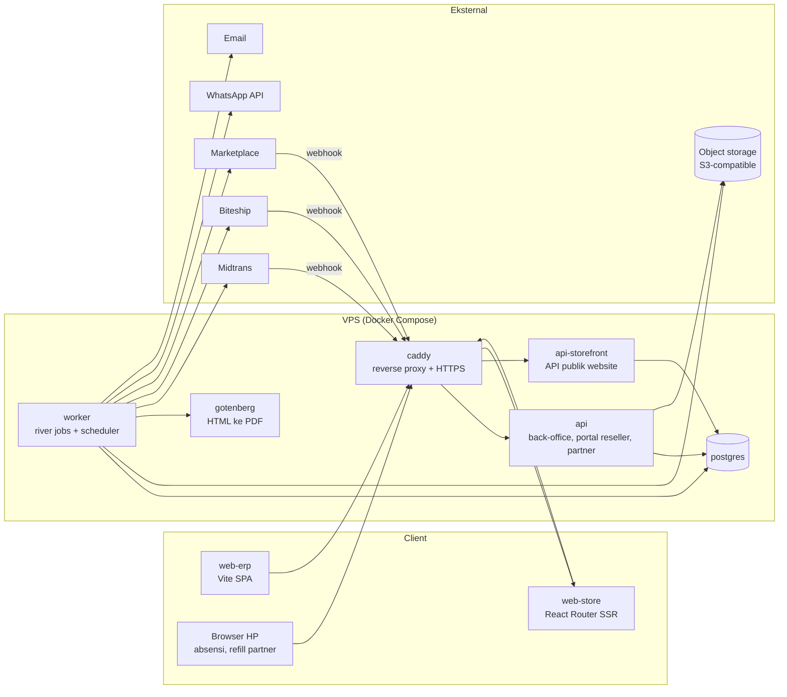

# Technical Guideline
## Balans Nutrition — Unified Business Platform (ERP + Finance & Accounting)

| | |
|---|---|
| Versi | 0.1 (draft) |
| Tanggal | 14 Oktober 2026 |
| Acuan | BRD Balans Unified Business Platform v0.7, Roadmap v0.6, Naming Convention Menu & Fitur v1.0 |
| Pembaca | Tim engineering: backend (Go), frontend (React), DevOps, reviewer kode |

---

## Daftar Isi

1. [Pendahuluan](#1-pendahuluan)
2. [Arsitektur Sistem](#2-arsitektur-sistem)
3. [Stack & Library](#3-stack--library)
4. [Naming Convention](#4-naming-convention)
5. [Design Pattern Backend](#5-design-pattern-backend)
6. [Database](#6-database)
7. [Idempotency, Concurrency, Async & Retry](#7-idempotency-concurrency-async--retry)
8. [Standar API](#8-standar-api)
9. [Keamanan](#9-keamanan)
10. [Frontend ERP](#10-frontend-erp)
11. [Clean Code](#11-clean-code)
12. [Testing](#12-testing)
13. [Observability](#13-observability)
14. [Deployment & CI/CD](#14-deployment--cicd)
15. [Keterlacakan Requirement](#15-keterlacakan-requirement)
- [Lampiran A — Katalog Kode Error](#lampiran-a--katalog-kode-error)
- [Lampiran B — Katalog Background Job](#lampiran-b--katalog-background-job)
- [Lampiran C — Checklist Pull Request](#lampiran-c--checklist-pull-request)

---

## 1. Pendahuluan

### 1.1 Tujuan

Dokumen ini adalah aturan teknis yang mengikat seluruh kode Balans Platform. Tujuannya:

- Kode dari developer berbeda terlihat seperti ditulis satu orang.
- Kebutuhan kritis di BRD (stok, HPP, jurnal, pajak, payroll, integrasi) ditangani dengan pola yang sama di semua modul, bukan diselesaikan ulang di setiap fitur.
- Reviewer punya acuan yang jelas saat menerima atau menolak pull request.

### 1.2 Kata Kunci

| Kata | Arti |
|---|---|
| **WAJIB** | Tidak boleh dilanggar. PR yang melanggar ditolak. |
| **DILARANG** | Tidak boleh dilakukan. PR yang melakukannya ditolak. |
| **SEBAIKNYA** | Default yang diharapkan. Penyimpangan harus dijelaskan di deskripsi PR. |

### 1.3 Ringkasan Keputusan Teknis

| Area | Keputusan |
|---|---|
| Arsitektur | Modular monolith, satu repository (monorepo) |
| Backend | Go, router `chi`, `pgx` v5 + `sqlc`, migrasi `goose`, job queue `river` |
| Database | PostgreSQL 18 |
| Primary key | UUID v7 |
| Kontrak API | OpenAPI 3.0 spec-first; server Go dan client TypeScript digenerate dari spec |
| JSON | `camelCase` |
| Otentikasi | JWT: access token pendek + refresh token dengan rotasi, disimpan dan bisa dicabut di DB |
| Frontend ERP | Vite + React + TypeScript + shadcn/ui, TanStack Router, TanStack Query, React Hook Form + Zod, Zustand |
| Website e-commerce | React Router (framework mode, SSR), memakai kontrak API yang sama |
| Hosting | 1 VPS (4 core, 8 GB RAM), Docker Compose, Caddy |
| File & backup | Object storage S3-compatible eksternal (di luar VPS) |
| CI/CD | GitHub Actions, image di GitHub Container Registry (GHCR) |
| Host | ERP `erp.findyourbalans.com`, staging `erp-staging.findyourbalans.com` (14.2) |
| Email, kurir & payment | Adapter mock sampai akun asli tersedia (5.10) |

---

## 2. Arsitektur Sistem

### 2.1 Modular Monolith

Seluruh backend adalah **satu codebase Go** yang dibangun menjadi beberapa binary/proses. Kapasitas di NFR-10 (≥ 40 user back-office, ≥ 50 mesin vending, 5 marketplace) tidak membutuhkan microservices. Batas antar modul tetap ditegakkan secara ketat supaya modul bisa dipisah di kemudian hari tanpa menulis ulang.



| Proses | Binary | Tugas |
|---|---|---|
| `api` | `cmd/api` | API back-office, portal reseller, form partner, self-service karyawan, endpoint webhook |
| `api-storefront` | `cmd/storefront` | API publik website: katalog, keranjang, checkout, akun customer. Dipisah agar beban back-office tidak menjatuhkan website (NFR-06). |
| `worker` | `cmd/worker` | Menjalankan background job dan jadwal berkala |
| `migrate` | `cmd/migrate` | Menjalankan migrasi skema saat deploy |
| `cutover` | `cmd/cutover` | Import data awal saat go-live (U-10, A-36) |

### 2.2 Modul

Setiap modul memetakan satu domain di BRD.

| Kode BRD | Package | Isi |
|---|---|---|
| MD | `catalog` | Produk, varian, kemasan, bundle virtual, packaging, bahan reprocess |
| MD | `pricing` | Price list, harga khusus, promo, harga bertingkat, batas diskon per role |
| MD | `party` | Customer, supplier, maklon, partner MT/konsinyasi beserta PKS |
| PRC | `procurement` | Purchase request, purchase order, goods receipt, uang muka, 3-way match |
| WMS | `warehouse` | Gudang, lokasi, transfer, picking/packing, stock count, karantina |
| INV | `inventory` | Ledger stok, saldo, batch, FIFO cost layer, alokasi FEFO, reservasi, pemakaian internal, pemusnahan |
| LOG | `logistics` | Delivery order, kurir, resi, status pengiriman |
| SLS | `sales` | Sales order semua channel, proforma, invoice, retur penjualan, konsinyasi |
| SLP | `pipeline` | Lead, aktivitas sales, target |
| CRM | `crm` | Segmentasi, riwayat order, interaksi CS |
| RSL | `reseller` | Level reseller, deposit, portal |
| VND | `vending` | Mesin, slot, refill, rekonsiliasi mesin |
| ECM | `storefront` | Keranjang, checkout, voucher, poin, subscription, CMS, ulasan |
| HR | `hris` | Karyawan, organisasi, kontrak, absensi, cuti, lembur |
| HR | `payroll` | Komponen gaji, run payroll, slip gaji |
| ACC | `accounting` | COA, jurnal, posting rule, AR, AP, kas/bank, kas kecil, aset tetap, tutup buku, rekonsiliasi |
| ACC/HR | `tax` | Kalkulator PPh 21 TER, PPh 23, PPh 4(2), PPh Final, BPJS (fungsi murni, tanpa DB) |
| INT | `integration/midtrans`, `integration/biteship`, `integration/marketplace/{shopee,tiktokshop,lazada,blibli}`, `integration/vendingvendor`, `integration/whatsapp` | Adapter pihak ketiga |

Modul lintas fungsi:

| Package | Isi |
|---|---|
| `identity` | User, role, permission, sesi, JWT, MFA |
| `approval` | Engine approval generik (5.17) |
| `notification` | Notifikasi in-app, email, WhatsApp (NFR-11) |
| `document` | Penomoran dokumen (U-15), template, render PDF (NFR-08) |
| `filestore` | Upload/download file ke object storage |
| `dataexchange` | Import/export Excel |
| `audit` | Audit trail (NFR-03) |
| `setting` | Parameter yang dapat dikonfigurasi Balans (asumsi #10) |

### 2.3 Aturan Dependensi Antar Modul

1. Modul lain **WAJIB** dipanggil lewat API publik di root package modul tersebut (mis. `inventory.Service`). **DILARANG** mengimpor subpackage modul lain (`inventory/domain`, `inventory/postgres`, dst.).
2. **DILARANG** membaca atau menulis tabel milik modul lain lewat SQL. Laporan lintas modul memakai read model (5.17).
3. Dependensi antar modul satu arah. Kalau dua modul saling butuh, salah satunya memakai domain event (5.11) atau callback yang didaftarkan (contoh: `approval`).
4. Arah dependensi umum:

```
storefront, sales, procurement, vending, reseller, payroll
        ↓
inventory, warehouse, logistics, pricing, approval
        ↓
catalog, party, accounting, tax, document, audit, setting, identity
        ↓
platform (db, config, httpx, apperr, logger, retry, clock)
```

`accounting` berada di bawah karena hampir semua modul memosting jurnal ke sana, dan `accounting` tidak boleh mengimpor modul operasional.

Aturan ini dicek otomatis oleh linter `depguard` di CI.

### 2.4 Struktur Repository

```
balans/
├── backend/
├── web-erp/
├── web-store/
├── deploy/
│   ├── compose.yaml
│   ├── compose.production.yaml
│   ├── compose.staging.yaml
│   ├── Caddyfile
│   └── env.example
├── docs/
└── .github/workflows/
```

### 2.5 Struktur Backend

```
backend/
├── api/
│   └── openapi.yaml              # kontrak API, sumber kebenaran
├── cmd/
│   ├── api/main.go
│   ├── storefront/main.go
│   ├── worker/main.go
│   ├── migrate/main.go
│   └── cutover/main.go
├── internal/
│   ├── app/                      # wiring: menyusun semua modul (dependency injection)
│   ├── platform/
│   │   ├── apperr/               # tipe error & kode error
│   │   ├── clock/                # sumber waktu (bisa di-mock di test)
│   │   ├── config/
│   │   ├── db/                   # pool, TxManager, helper query
│   │   ├── httpx/                # middleware, response, error mapping
│   │   ├── idempotency/
│   │   ├── logger/
│   │   ├── money/                # tipe Money & aturan pembulatan
│   │   └── retry/
│   ├── procurement/
│   │   ├── procurement.go        # API publik modul + konstruktor
│   │   ├── domain/               # entity, value object, state machine, error domain
│   │   ├── service/              # use case; mendefinisikan interface repository yang dibutuhkan
│   │   ├── postgres/             # implementasi repository
│   │   │   ├── queries/          # file .sql untuk sqlc
│   │   │   └── sqlcgen/          # hasil generate sqlc (jangan diedit)
│   │   └── http/                 # handler (mengimplementasikan interface hasil oapi-codegen)
│   ├── inventory/
│   └── ...
├── migrations/
├── sqlc.yaml
└── go.mod
```

### 2.6 Layer & Tanggung Jawab

| Layer | Boleh | DILARANG |
|---|---|---|
| `http` | Parsing request, validasi format (wajib diisi, tipe, panjang), cek otentikasi, memanggil service, memetakan hasil ke response | Aturan bisnis, query DB, membuka transaksi |
| `service` | Orkestrasi use case, membuka transaksi, cek permission & scoping data, memanggil domain, repository, dan modul lain | SQL langsung, mengetahui HTTP (status code, header) |
| `domain` | Entity, invariant, kalkulasi, transisi status, error domain | Import DB, HTTP, logger, `time.Now()` langsung (pakai `clock`) |
| `postgres` | Query lewat sqlc, mapping row ke entity | Aturan bisnis |

Contoh handler yang benar (tipis):

```go
func (h *Handler) ApprovePurchaseOrder(ctx context.Context, req ApprovePurchaseOrderRequestObject) (ApprovePurchaseOrderResponseObject, error) {
	po, err := h.service.Approve(ctx, service.ApprovePurchaseOrder{
		ID:      req.Id,
		Version: req.Body.Version,
		Note:    req.Body.Note,
	})
	if err != nil {
		return nil, err // dipetakan ke response error oleh middleware httpx
	}
	return ApprovePurchaseOrder200JSONResponse(toPurchaseOrderResponse(po)), nil
}
```

---

## 3. Stack & Library

### 3.1 Backend

| Kebutuhan | Pilihan | Keterangan |
|---|---|---|
| Bahasa | Go versi stabil terbaru | Versi dikunci di `go.mod` dan `Dockerfile` |
| HTTP router | `github.com/go-chi/chi/v5` | Kompatibel dengan `net/http` |
| Kontrak API | `oapi-codegen` (`chi-server` + `strict-server`) | Interface handler dan tipe request/response digenerate dari `openapi.yaml` |
| Database driver | `github.com/jackc/pgx/v5` | |
| Query | `sqlc` | SQL ditulis tangan dan type-safe. **DILARANG** memakai ORM. |
| Migrasi | `github.com/pressly/goose/v3` | |
| Job queue | `github.com/riverqueue/river` | Berbasis Postgres. Job di-enqueue di dalam transaksi bisnis. |
| Validasi request | `github.com/go-playground/validator/v10` | Validasi format saja; validasi bisnis di domain |
| Desimal | `github.com/shopspring/decimal` | **DILARANG** memakai `float32`/`float64` untuk uang, qty, tarif, dan persentase |
| Logging | `log/slog` (JSON) | |
| JWT | `github.com/golang-jwt/jwt/v5` | Algoritma EdDSA (Ed25519) |
| Hash password | `golang.org/x/crypto/argon2` (argon2id) | |
| MFA | `github.com/pquerna/otp` (TOTP) | |
| Object storage | `github.com/aws/aws-sdk-go-v2/service/s3` | Memakai endpoint S3-compatible |
| Excel | `github.com/xuri/excelize/v2` | |
| PDF | Gotenberg (container) + `html/template` | Template HTML dengan logo Balans dan keterangan NON-PKP |
| Test | `testing`, `github.com/stretchr/testify`, `github.com/testcontainers/testcontainers-go` | |
| Lint | `golangci-lint` | Konfigurasi di `backend/.golangci.yml` |

### 3.2 Frontend ERP

| Kebutuhan | Pilihan |
|---|---|
| Build | Vite, TypeScript `strict` |
| Package manager | pnpm |
| UI | shadcn/ui (preset Balans), Tailwind CSS |
| Routing | TanStack Router (file-based) |
| Server state | TanStack Query |
| Form | React Hook Form + `@hookform/resolvers/zod` |
| Validasi | Zod |
| Client state | Zustand |
| API client | `openapi-typescript` + `openapi-fetch` (tipe digenerate dari `openapi.yaml`) |
| Toast | Sonner (bawaan shadcn) |
| Desimal | `big.js` (hanya untuk preview kalkulasi di layar) |
| Test | Vitest, Testing Library, Playwright |
| Lint & format | ESLint, Prettier |

---

## 4. Naming Convention

### 4.1 Bahasa

- **Kode** (identifier, nama file, tabel, kolom, endpoint, kode error, nama job) **WAJIB** dalam bahasa Inggris.
- **Teks untuk user** (label, pesan error, isi notifikasi, PDF) **WAJIB** dalam Bahasa Indonesia (NFR-05).
- Istilah domain **WAJIB** mengikuti glosarium di 4.8. Kalau istilah belum ada, tambahkan ke glosarium lewat PR sebelum dipakai.
- **Label UI** (menu, submenu, judul halaman, tombol, status, kolom tabel, laporan) **WAJIB** mengikuti dokumen *Naming Convention — Menu & Feature Labeling* (`docs/Naming-Convention-Balans-Menu-Fitur-v1.0.md`). Jika kolom Label UI di 4.8 berbeda dengan dokumen tersebut, dokumen label yang berlaku.
- Pesan error, notifikasi, isi PDF, dan template Excel memakai istilah yang sama dengan label UI.

### 4.2 Nama File Harus Bersih

Nama file, folder, package, tabel, migrasi, branch, tag image, dan nama job **WAJIB** menggambarkan isi atau konsep bisnisnya. **DILARANG** memuat:

| Dilarang | Contoh salah | Contoh benar |
|---|---|---|
| Nama fase atau tahap proyek | `fase1_purchase_order.go`, `phase2/`, `stage3_sales.go` | `purchase_order.go` |
| Versi | `invoice_v2.go`, `pricing_new/` | `invoice.go`, `pricing/` |
| Sprint, tiket, tanggal | `sprint5_fix.go`, `BAL-123.go`, `report_okt.go` | `aging_report.go` |
| Sifat sementara | `temp.go`, `test2.go`, `old_stock.go`, `final_journal.go`, `backup/` | Hapus file sementara sebelum PR |
| Nama orang | `andi_helper.go` | Nama berdasarkan fungsi |
| Nama generik | `utils.go`, `helpers.go`, `common/`, `misc/` | `money/rounding.go`, `clock/clock.go` |

Fase BRD hanya muncul di catatan rilis (`CHANGELOG.md`, GitHub Release) dan dokumen proyek, **tidak** di kode.

### 4.3 Go

| Elemen | Aturan | Contoh |
|---|---|---|
| Package | lowercase, satu kata, singular, tanpa underscore | `procurement`, `inventory`, `apperr` |
| File | `snake_case.go`, sesuai konsep | `purchase_order.go`, `goods_receipt_service.go`, `stock_balance_store.go` |
| File test | `<file>_test.go` | `purchase_order_test.go` |
| Type, func ekspor | PascalCase | `PurchaseOrder`, `NewService` |
| Tidak diekspor | camelCase | `calculateLineTotal` |
| Singkatan | Huruf besar konsisten | `ID`, `SKU`, `URL`, `HTTP`, `PPh21` → `purchaseOrderID`, `SKUCode` |
| Interface | Dinamai menurut perilaku, didefinisikan di sisi pemakai | `StockReserver`, `JournalPoster` |
| Konstruktor | `New<Type>` | `NewGoodsReceiptService` |
| Receiver | 1–2 huruf, konsisten per type | `func (po *PurchaseOrder) Approve(...)` |
| Error sentinel | `Err<Sesuatu>` | `ErrInsufficientStock` |
| Boolean | Prefix `is`, `has`, `can`, `should` | `isTaxable`, `hasBatch` |
| Konstanta enum | `<Type><Nilai>` | `StatusDraft`, `MovementTypeGoodsReceipt` |
| Context | Parameter pertama, bernama `ctx` | `func (s *Service) Post(ctx context.Context, ...)` |

### 4.4 Database

| Elemen | Aturan | Contoh |
|---|---|---|
| Tabel | `snake_case`, jamak | `purchase_orders`, `stock_movements` |
| Tabel detail | `<induk_singular>_<anak_jamak>` | `purchase_order_lines` |
| Kolom | `snake_case` | `business_date`, `unit_cost` |
| Primary key | `id` (UUID v7) | |
| Foreign key | `<entity_singular>_id` | `purchase_order_id`, `product_id` |
| Boolean | Prefix `is_`/`has_` | `is_active`, `has_batch` |
| Waktu | `<aksi>_at` (`timestamptz`) | `approved_at`, `posted_at` |
| Tanggal bisnis | `<makna>_date` (`date`) | `business_date`, `due_date`, `expiry_date` |
| Uang | `<makna>_amount` | `total_amount`, `discount_amount` |
| Kuantitas | `<makna>_qty` | `ordered_qty`, `received_qty` |
| Status | `status` (`text` + `CHECK`) | |
| Index | `idx_<tabel>_<kolom>` | `idx_stock_movements_product_id_location_id` |
| Unique | `uq_<tabel>_<kolom>` | `uq_products_sku` |
| Check | `ck_<tabel>_<aturan>` | `ck_stock_balances_qty_non_negative` |
| Foreign key constraint | `fk_<tabel>_<kolom>` | `fk_purchase_order_lines_product_id` |
| File migrasi | `<timestamp>_<aksi>_<objek>.sql` | `20261014093000_create_purchase_orders.sql` |
| Query sqlc | `<Verb><Objek>[By<Kunci>]` | `GetPurchaseOrderByID`, `ListPurchaseOrders`, `LockStockBalance` |

### 4.5 API

| Elemen | Aturan | Contoh |
|---|---|---|
| Prefix | `/api/v1` | |
| Resource | kebab-case, jamak | `/purchase-orders`, `/goods-receipts` |
| Detail | `/{id}` | `/purchase-orders/{id}` |
| Sub-resource | Bersarang maksimal satu level | `/purchase-orders/{id}/lines` |
| Aksi perubahan status | `POST /{resource}/{id}/<verb>` | `POST /purchase-orders/{id}/approve`, `/cancel`, `/submit` |
| Query parameter | camelCase | `?status=approved&page=2&pageSize=50&sort=-createdAt` |
| Field JSON | camelCase | `purchaseOrderId`, `totalAmount` |
| Uang di JSON | String desimal | `"totalAmount": "1250000.00"` |
| Tanggal bisnis | `YYYY-MM-DD` | `"businessDate": "2026-10-14"` |
| Timestamp | RFC 3339 UTC | `"createdAt": "2026-10-14T02:30:00Z"` |
| Enum | `snake_case` | `"status": "pending_approval"` |
| Operation ID OpenAPI | camelCase `<verb><Objek>` | `approvePurchaseOrder` |

### 4.6 Frontend

| Elemen | Aturan | Contoh |
|---|---|---|
| File & folder | kebab-case | `purchase-order-form.tsx`, `use-approve-purchase-order.ts` |
| Komponen | PascalCase | `PurchaseOrderForm` |
| Hook | `use<Aksi><Objek>` | `usePurchaseOrders`, `useApprovePurchaseOrder` |
| Schema Zod | `<objek>Schema` | `purchaseOrderSchema` |
| Tipe dari schema | PascalCase | `type PurchaseOrderInput = z.infer<typeof purchaseOrderSchema>` |
| Query key factory | `<objek>Keys` | `purchaseOrderKeys` |
| Store Zustand | `use<Nama>Store` di file `<nama>-store.ts` | `useAuthStore` |
| Konstanta | `SCREAMING_SNAKE_CASE` | `MAX_UPLOAD_SIZE` |

### 4.7 Git

| Elemen | Aturan | Contoh |
|---|---|---|
| Branch | `<tipe>/<deskripsi-kebab>` | `feat/purchase-order-approval`, `fix/fifo-cost-rounding` |
| Commit | Conventional Commits | `feat(procurement): add three-way match tolerance` |
| Tag rilis | Semver | `v1.0.0`, `v1.1.0` |
| Tipe | `feat`, `fix`, `refactor`, `perf`, `test`, `docs`, `chore`, `ci`, `build` | |

### 4.8 Glosarium Istilah (Konsep → Kode → Label UI)

| Istilah bisnis | Kode | Label UI |
|---|---|---|
| Barang jadi (FG) | `finished_good` | Produk Jadi |
| Packaging | `packaging` | Packaging |
| Bahan reprocess | `reprocess_material` | Material |
| Maklon (pihak) | `toll_manufacturer` | Maklon |
| Jasa maklon / PO maklon | `toll_manufacturing` / `toll_manufacturing_order` | Purchase Order Maklon |
| Purchase Request | `purchase_request` | Purchase Request |
| Penerimaan barang | `goods_receipt` | Penerimaan Barang |
| Tagihan supplier | `supplier_bill` | Tagihan Pemasok |
| Uang muka pembelian | `purchase_advance` | Uang Muka Pembelian |
| Barang Diterima Belum Ditagih | `goods_received_not_billed` | Barang Diterima Belum Ditagih |
| Reject / waste | `reject` / `waste` | Reject & Waste |
| Gudang | `warehouse` | Gudang |
| Lokasi stok | `location` | Lokasi |
| Kartu stok / mutasi stok | `stock_movement` | Kartu Stok / Mutasi Stok |
| Saldo stok | `stock_balance` | Stok per Lokasi |
| Karantina | `quarantine` | Karantina |
| Dalam perjalanan | `in_transit` | Dalam Pengiriman |
| Transfer stok | `stock_transfer` | Transfer Stok |
| Stock count | `stock_count` | Stock Count |
| Penyesuaian stok | `stock_adjustment` | Penyesuaian Stok |
| Inbound / outbound | `inbound` / `outbound` | Inbound / Outbound |
| Quality control | `quality_check` | QC |
| Picking & packing | `picking` / `packing` | Picking & Packing |
| Pemusnahan | `disposal` | Pemusnahan |
| Disposisi retur | `return_disposition` | Disposisi Retur |
| Pemakaian internal | `internal_usage` | Pemakaian Internal |
| Bundel virtual / kitting | `bundle` / `kitting` | Bundling |
| Modern Trade beli putus | `modern_trade_outright` | Modern Trade |
| Konsinyasi | `consignment` | Konsinyasi |
| Berita Acara Rekonsiliasi | `reconciliation_report` | Berita Acara Rekonsiliasi |
| Selisih | `variance` | Selisih |
| Proforma invoice | `proforma_invoice` | Proforma Invoice |
| Invoice | `invoice` | Invoice |
| Nota kredit / nota debit | `credit_note` / `debit_note` | Nota Kredit / Nota Debit |
| Retur penjualan / pembelian | `sales_return` / `purchase_return` | Retur Penjualan / Retur Pembelian |
| Surat jalan / Delivery Order | `delivery_order` | Delivery Order |
| Resi | `tracking_number` | Resi |
| Ongkos kirim | `shipping_cost` | Ongkos Kirim |
| Price list | `price_list` | Daftar Harga |
| Harga dasar / HET | `base_price` / `max_retail_price` | Harga Dasar / HET |
| Harga bertingkat | `tiered_price` | Harga Bertingkat |
| Kode kampanye | `campaign_code` | Kampanye |
| Mitra | `partner` | Mitra Konsinyasi |
| Mesin vending / isi ulang | `vending_machine` / `refill` | Mesin Vending / Refill |
| Stok buffer vending | `vending_buffer` | Buffer Vending |
| Lead / aktivitas sales | `lead` / `sales_activity` | Lead / Aktivitas Sales |
| Deposit reseller | `reseller_deposit` | Deposit |
| Bagan akun / akun | `chart_of_accounts` / `account` | Chart of Accounts / Akun |
| Jurnal / baris jurnal | `journal_entry` / `journal_line` | Jurnal Umum |
| Aturan jurnal otomatis (A-xx) | `posting_rule` | Aturan Jurnal Otomatis |
| Periode akuntansi / tutup buku | `fiscal_period` / `period_close` | Periode / Tutup Buku |
| Piutang / utang | `receivable` / `payable` | Piutang Usaha / Utang Usaha |
| Kas kecil | `petty_cash` | Kas Kecil |
| Aset tetap / penyusutan | `fixed_asset` / `depreciation` | Aset Tetap / Penyusutan |
| Pemotongan PPh / bukti potong | `withholding_tax` / `withholding_slip` | Pajak & Bukti Potong |
| Pengajuan biaya | `expense_claim` | Biaya Operasional |
| Karyawan | `employee` | Karyawan |
| Absensi / cuti / lembur | `attendance` / `leave` / `overtime` | Absensi / Cuti & Izin / Lembur |
| Slip gaji / kasbon | `payslip` / `salary_advance` | Slip Gaji / Kasbon |
| Divisi | `division` | Divisi |
| Channel / sub-channel | `channel` / `sub_channel` | Channel / Sub-channel |
| Pelanggan | `customer` | Pelanggan |
| Pemasok | `supplier` | Pemasok |
| Persetujuan | `approval` | Persetujuan |
| Refund | `refund` | Refund |
| HPP | `cogs` | Harga Pokok Penjualan (HPP) |
| Batch / lot | `batch` | Batch |
| Tanggal kedaluwarsa | `expiry_date` | Tanggal Kedaluwarsa |

---

## 5. Design Pattern Backend

### 5.1 Dependency Injection Manual

- Semua dependensi dimasukkan lewat konstruktor. Wiring dilakukan di `internal/app`.
- **DILARANG** memakai variabel global untuk state (koneksi DB, config, logger). Pengecualian: konstanta dan tabel transisi status.
- **DILARANG** memakai framework DI berbasis reflection.

### 5.2 Repository & Transaction Manager

Transaksi DB dibuka di layer `service` lewat `TxManager`. Repository mengambil koneksi dari `context`, sehingga beberapa repository dan beberapa modul bisa berjalan dalam **satu transaksi** (mis. goods receipt + mutasi stok + jurnal).

```go
// internal/platform/db/tx.go
func (m *TxManager) WithTx(ctx context.Context, fn func(ctx context.Context) error) error {
	if hasTx(ctx) {
		return fn(ctx) // transaksi bersarang memakai transaksi yang sudah ada
	}
	return retry.Do(ctx, retry.TransientDBError, func() error {
		tx, err := m.pool.BeginTx(ctx, pgx.TxOptions{})
		if err != nil {
			return fmt.Errorf("begin tx: %w", err)
		}
		defer tx.Rollback(ctx) //nolint:errcheck // no-op setelah commit

		if err := fn(withTx(ctx, tx)); err != nil {
			return err
		}
		return tx.Commit(ctx)
	})
}

// Conn mengembalikan transaksi aktif jika ada, jika tidak pool.
func Conn(ctx context.Context, pool *pgxpool.Pool) sqlcgen.DBTX { ... }
```

```go
// internal/inventory/postgres/stock_balance_store.go
func (s *StockBalanceStore) q(ctx context.Context) *sqlcgen.Queries {
	return sqlcgen.New(db.Conn(ctx, s.pool))
}
```

Contoh use case lintas modul dalam satu transaksi:

```go
func (s *GoodsReceiptService) Post(ctx context.Context, cmd PostGoodsReceipt) (*domain.GoodsReceipt, error) {
	var receipt *domain.GoodsReceipt
	err := s.tx.WithTx(ctx, func(ctx context.Context) error {
		po, err := s.purchaseOrders.GetForUpdate(ctx, cmd.PurchaseOrderID)
		if err != nil {
			return err
		}
		receipt, err = po.Receive(cmd.Lines, cmd.BusinessDate) // aturan bisnis di domain
		if err != nil {
			return err
		}
		if receipt.Number, err = s.numbers.Next(ctx, document.TypeGoodsReceipt, cmd.BusinessDate); err != nil {
			return err
		}
		if err := s.receipts.Create(ctx, receipt); err != nil {
			return err
		}
		if err := s.inventory.Receive(ctx, receipt.StockMovements()); err != nil { // masuk Inbound, status karantina
			return err
		}
		if err := s.ledger.Post(ctx, receipt.PostingRequest()); err != nil { // A-01
			return err
		}
		return s.audit.Record(ctx, audit.Created(receipt))
	})
	return receipt, err
}
```

### 5.3 Domain Model & Value Object

- Invariant dijaga di konstruktor dan method entity, bukan di handler.
- Field entity tidak diubah langsung dari luar domain. Perubahan lewat method yang punya nama bisnis (`po.Approve(...)`, `invoice.ApplyPayment(...)`).
- Value object wajib untuk:

| Value object | Aturan |
|---|---|
| `money.Amount` | Desimal IDR, pembulatan sesuai 5.8.6 |
| `inventory.Quantity` | Desimal non-negatif, satuan jelas |
| `document.Number` | Format `KODE/TAHUN/BULAN/NOMOR` |
| `accounting.Dimensions` | Channel, sub-channel, divisi, kode kampanye |
| `clock.BusinessDate` | Tanggal bisnis WIB, tanpa jam |

### 5.4 State Machine Dokumen

Setiap dokumen bertransaksi (PR, PO, GR, DO, invoice, retur, stock count, BA rekonsiliasi, pengajuan biaya, cuti, payroll run, dll.) **WAJIB** punya tabel transisi status eksplisit di package `domain`. Status hanya berubah lewat method yang memvalidasi transisi.

```go
var purchaseOrderTransitions = map[Status][]Status{
	StatusDraft:             {StatusPendingApproval, StatusCancelled},
	StatusPendingApproval:   {StatusApproved, StatusRejected},
	StatusRejected:          {StatusDraft},
	StatusApproved:          {StatusPartiallyReceived, StatusReceived, StatusCancelled},
	StatusPartiallyReceived: {StatusReceived, StatusClosed},
	StatusReceived:          {StatusClosed},
}

func (po *PurchaseOrder) transitionTo(next Status) error {
	if !slices.Contains(purchaseOrderTransitions[po.Status], next) {
		return apperr.InvalidStateTransition("purchase_order", string(po.Status), string(next))
	}
	po.Status = next
	return nil
}
```

Transisi yang diizinkan didokumentasikan di OpenAPI (deskripsi endpoint aksi) dan ditampilkan sebagai tombol aksi di FE berdasarkan field `allowedActions` di response detail.

### 5.5 Approval Engine

Semua approval di 5.17 BRD memakai modul `approval`. Dokumen **DILARANG** menyimpan logika approval sendiri.

| Tabel | Isi |
|---|---|
| `approval_policies` | Jenis dokumen, rentang nominal, level, role/user approver, `valid_from` |
| `approval_requests` | Dokumen yang meminta approval, nominal, status |
| `approval_steps` | Langkah per level, approver, keputusan, catatan, waktu |
| `approval_delegations` | Delegasi approver yang cuti, dengan periode berlaku |

Alur:

1. Service dokumen memanggil `approval.Request(ctx, approval.Subject{Type, ID, Amount, Division})` di dalam transaksi bisnis.
2. Engine memilih kebijakan berdasarkan jenis dokumen dan nominal, lalu membuat langkah-langkahnya.
3. Saat semua level selesai, engine memanggil handler yang didaftarkan modul pemilik dokumen, **di transaksi yang sama** dengan keputusan approval:

```go
approval.RegisterHandler(approval.SubjectPurchaseOrder, approval.HandlerFuncs{
	OnApproved: procurementService.MarkApproved,
	OnRejected: procurementService.MarkRejected,
})
```

4. Pengingat approval yang tertunda dikirim lewat job (NFR-11).

### 5.6 Penentuan Harga (Chain of Responsibility)

Urutan prioritas 5.18 BRD diimplementasikan sebagai rantai aturan di modul `pricing`:

```go
type PriceRule interface {
	Name() string
	Resolve(ctx context.Context, q PriceQuery) (Price, bool, error)
}

// urutan WAJIB sama dengan BRD 5.18
resolver := pricing.NewResolver(
	pricing.SpecialPriceRule{...},   // 1. harga khusus customer/partner
	pricing.PromoPriceRule{...},     // 2. promo periode aktif
	pricing.TieredPriceRule{...},    // 3. harga bertingkat qty
	pricing.ChannelPriceListRule{...}, // 4. price list channel / tipe customer
	pricing.BasePriceRule{...},      // 5. harga dasar
)
```

- Hasil resolusi menyimpan **nama aturan dan ID versi harga** yang dipakai di baris transaksi, untuk audit dan untuk menjelaskan harga ke user.
- Setelah harga dasar ditentukan: diskon manual (dicek terhadap batas per role, MD-12), lalu voucher dan poin dihitung terakhir.
- Harga diambil berdasarkan `business_date` transaksi (5.14), bukan harga terbaru.

### 5.7 Inventory

#### 5.7.1 Ledger Append-Only

| Tabel | Sifat |
|---|---|
| `stock_movements` | Append-only. Setiap mutasi menyimpan `product_id`, `location_id`, `batch_id`, `stock_status`, `qty` (bertanda + / −), `unit_cost`, `source_type`, `source_id`, `business_date`. **DILARANG** `UPDATE`/`DELETE`. |
| `stock_balances` | Saldo terkini per `product_id × location_id × batch_id × stock_status`. Di-update di transaksi yang sama dengan movement. Kolom `qty` memakai `CHECK (qty >= 0)`. |
| `batches` | Nomor batch, tanggal produksi, `expiry_date` |
| `cost_layers` | Lapisan biaya FIFO per penerimaan batch: qty awal, qty sisa, biaya per unit |

Kartu stok (INV-01, RPT-02) dibaca dari `stock_movements`. Posisi stok (RPT-01) dibaca dari `stock_balances`.

#### 5.7.2 Status Stok

| Status | Bisa dialokasikan/dijual? | Contoh |
|---|---|---|
| `available` | Ya | Stok normal |
| `quarantine` | Tidak | Barang masuk dan retur sebelum lulus QC (WMS-09) |
| `in_transit` | Tidak | Transfer antar gudang, kirim ke partner/maklon (WMS-10) |
| `reserved` | Tidak (sudah dipesan) | Checkout website sebelum bayar (ECM-03) |

Perubahan status adalah movement (keluar dari status lama, masuk ke status baru), bukan update kolom.

**QC** adalah langkah di dalam proses `inbound` dan `outbound` di modul `warehouse`, bukan modul atau menu tersendiri:

- **Inbound**: semua barang masuk (pemasok, maklon, retur pelanggan, tarikan konsinyasi) berstatus `quarantine` sampai lulus QC, lalu dipindah ke `available` (WMS-02, WMS-09).
- **Outbound**: picking → packing → QC sebelum barang diserahkan ke pengiriman (WMS-05). Jika barang tidak lolos QC, dalam satu transaksi:
  1. Barang yang ditolak dilepas dari order dan dipindah ke `quarantine` dengan status QC `qc_rejected`, sehingga tidak bisa teralokasi lagi.
  2. Sistem langsung mengalokasikan **stok pengganti** dari stok `available` lain (batch lain atau unit lain) memakai strategi alokasi yang sama (FEFO + batas sisa umur simpan), lalu picking ulang.
  3. Jika stok pengganti tidak cukup, baris order tersebut ditahan dengan status menunggu stok dan Sales/CS mendapat notifikasi. Pengiriman sebagian hanya atas keputusan user.
  4. Barang yang ditolak di `quarantine` **dikembalikan ke maklon** lewat Retur Pembelian (RB) dengan nota debit (ACC-16, jurnal A-02). Retur ini diproses langsung oleh Logistik **tanpa approval**.
- Barang yang ditolak QC di **Inbound** diproses sesuai asalnya: dari pemasok/maklon dicatat sebagai reject penerimaan (PRC-05); dari retur pelanggan atau tarikan konsinyasi masuk ke disposisi retur (WMS-07, INV-12).
- Hasil QC (lolos/tolak, qty, catatan, foto) dicatat per baris di tabel `quality_checks` dengan referensi ke dokumen inbound/outbound.

#### 5.7.3 Alokasi FEFO & Biaya FIFO

- **Batch fisik yang diambil** ditentukan strategi alokasi **FEFO** (INV-09): batch dengan `expiry_date` paling dekat diambil lebih dulu.
- **Minimal sisa umur simpan per channel** (INV-10, jika U-28 diambil) adalah filter di strategi alokasi. Batch yang tidak memenuhi ditolak dengan `BATCH_SHELF_LIFE_TOO_SHORT`.
- **HPP** mengikuti `cost_layers` batch yang benar-benar keluar, dikonsumsi FIFO di dalam batch tersebut (INV-03, A-06).
- Strategi alokasi adalah interface `BatchAllocator` sehingga bisa diganti per kasus (mis. user memilih batch secara manual saat stock count).

#### 5.7.4 Bundle Virtual

Bundle virtual (MD-03) **WAJIB** dipecah menjadi komponen di layer `service` modul `sales`/`storefront` sebelum memanggil `inventory`. Modul `inventory` tidak pernah menerima SKU bundle virtual. Harga dan diskon tetap tercatat di baris bundle; HPP adalah jumlah HPP komponen.

#### 5.7.5 Reservasi Stok

- Checkout website membuat movement `available → reserved` dengan `expires_at` sesuai masa berlaku pembayaran Midtrans.
- Pembayaran sukses: `reserved` → keluar (penjualan). Pembayaran gagal atau kedaluwarsa: job melepas reservasi kembali ke `available`.

### 5.8 Accounting

#### 5.8.1 Double-Entry & Posting Rule

- Semua jurnal otomatis A-01 s.d. A-36 didefinisikan sebagai **posting rule** di modul `accounting`. Modul lain mengirim `PostingRequest` berisi kode rule, dokumen sumber, nilai, dan dimensi. Modul lain **DILARANG** menyusun debit/kredit sendiri.
- Pemetaan rule ke akun disimpan di tabel `posting_rule_accounts` agar bisa disesuaikan dengan COA final tanpa ubah kode.
- `Poster.Post` **WAJIB** menolak jurnal yang tidak balance, periode tertutup, atau dimensi wajib yang kosong.
- Satu dokumen sumber hanya bisa diposting satu kali per rule: `UNIQUE (source_type, source_id, posting_rule_code)`.

```go
type PostingRequest struct {
	RuleCode     string            // contoh "A-01"
	SourceType   string            // contoh "goods_receipt"
	SourceID     uuid.UUID
	BusinessDate clock.BusinessDate
	Amounts      map[string]money.Amount // nilai bernama sesuai kebutuhan rule
	Dimensions   Dimensions
	Description  string
}
```

#### 5.8.2 Dimensi Jurnal

Setiap `journal_line` **WAJIB** membawa `channel`, `sub_channel`, `division`, dan `campaign_code` opsional (ACC-17). Rule menentukan dimensi mana yang wajib. Laporan laba rugi per dimensi (RPT-15) dibaca langsung dari dimensi ini.

#### 5.8.3 Immutability & Reversal

- Jurnal yang sudah diposting **DILARANG** diedit atau dihapus (ACC-13).
- Koreksi dilakukan dengan jurnal reversal yang mereferensikan jurnal asal, lalu jurnal baru jika perlu.
- Pembatalan dokumen operasional (GR, DO, invoice, retur) **WAJIB** lewat dokumen pembatalan yang membalik movement stok **dan** jurnal dalam satu transaksi.

#### 5.8.4 Periode & Backdate

- Transaksi dengan `business_date` di periode tertutup ditolak dengan `PERIOD_LOCKED`.
- Backdate **hanya diizinkan di periode yang masih terbuka**.
- Backdate yang memengaruhi biaya (penerimaan, retur, penyesuaian) memicu job **recost** untuk SKU terdampak di periode terbuka tersebut. Selisih HPP diposting sebagai jurnal penyesuaian yang mereferensikan dokumen penyebab. Jurnal lama tidak diubah.
- Buka kembali periode tertutup hanya lewat approval (ACC-14) dan tercatat di audit trail.
- Tutup buku memakai advisory lock per periode, sehingga tidak bisa berjalan bersamaan dengan posting di periode yang sama.

#### 5.8.5 Rekonsiliasi

Rekonsiliasi bank (ACC-05), settlement Midtrans & marketplace (ACC-06), dan vending (VND-04) memakai pola yang sama:

1. **Import** data eksternal (mutasi bank, laporan settlement) menjadi baris `statement_lines`.
2. **Matching engine** menjalankan aturan berurutan: referensi persis → nominal + tanggal dalam toleransi → manual.
3. Hasil berupa **usulan pasangan** yang dikonfirmasi user.
4. Konfirmasi memosting jurnal settlement (mis. Bank + Beban Fee, Kredit Piutang Midtrans).

#### 5.8.6 Pembulatan

| Nilai | Presisi | Aturan |
|---|---|---|
| Harga, subtotal, invoice, pembayaran, jurnal | 2 desimal di DB; ditampilkan dan ditagihkan dalam rupiah penuh | Half-up ke rupiah di total dokumen |
| HPP per unit, cost layer | 4 desimal | Total HPP per baris dibulatkan ke 2 desimal |
| PPh 21/23/4(2), BPJS | Rupiah penuh | Mengikuti aturan pembulatan regulasi yang berlaku |
| Persentase (diskon, tarif) | 4 desimal | |

Selisih pembulatan **WAJIB** dibukukan ke akun selisih pembulatan, tidak boleh hilang. Semua pembulatan lewat package `money`.

### 5.9 Kalkulator Pajak & Payroll

- PPh 21 TER, PPh 23, PPh 4(2), PPh Final, BPJS, dan penyusutan garis lurus adalah **fungsi murni** di package `tax` dan `accounting/depreciation`: input → output, tanpa DB, tanpa `time.Now()`.
- Tarif dan tabel (TER, persentase BPJS, batas upah) adalah data **effective-dated** (5.14), dimuat oleh service lalu dikirim ke kalkulator.
- Setiap kalkulator **WAJIB** punya table-driven test dengan contoh resmi dari regulasi.

### 5.10 Adapter Integrasi (Anti-Corruption Layer)

- Setiap pihak ketiga punya package di `integration/` yang menerjemahkan model eksternal ke model domain Balans. Tipe dari SDK/API pihak ketiga **DILARANG** keluar dari package adapter.
- Modul domain bergantung pada interface, misalnya `logistics.ShipmentProvider` dan `sales.PaymentGateway`, bukan pada adapter langsung.
- Sesuai prinsip ketergantungan pihak ketiga di BRD bagian 8, setiap integrasi **WAJIB** punya jalur manual: input manual atau import Excel dengan hasil akhir yang sama di DB.
- Reference yang dikirim ke provider adalah ID dokumen Balans (`order_id` Midtrans, `reference_id` Biteship), supaya provider juga menolak duplikat.

**Adapter mock (D-27).** Email, kurir (Biteship), dan payment (Midtrans) dikembangkan memakai adapter **mock** sampai akun asli tersedia. Mock adalah implementasi interface yang sama, bukan percabangan di kode modul.

| Integrasi | Konfigurasi (env) | Perilaku mock |
|---|---|---|
| Email | `EMAIL_PROVIDER=mock` | Email tidak dikirim keluar; ditangkap Mailpit dan bisa dilihat di `/_mock/mail` |
| Biteship | `SHIPMENT_PROVIDER=mock` | Ongkir dari tabel tarif statis per kurir; order menghasilkan resi `MOCK-<id>`; perubahan status pengiriman dipicu dari halaman simulasi `/_mock/shipments` dan dikirim sebagai webhook ke endpoint asli |
| Midtrans | `PAYMENT_GATEWAY=mock` | Membuat transaksi dan link bayar ke halaman simulasi `/_mock/payments` dengan pilihan *Berhasil*, *Gagal*, *Kedaluwarsa*; hasilnya dikirim sebagai webhook bersignature ke endpoint asli, dan API cek status mengembalikan status yang sama |

- Webhook dari mock **WAJIB** melewati jalur yang sama dengan webhook asli (verifikasi signature, cek ulang status, idempotency), sehingga jalur tersebut sudah teruji sebelum akun asli tersedia.
- Mock hanya boleh aktif di `local` dan `staging`. Route `/_mock/*` dan Mailpit hanya didaftarkan saat mock aktif. Proses **WAJIB** menolak start di `production` jika provider untuk modul yang aktif (`ENABLED_MODULES`) masih `mock`.
- Peralihan ke provider asli cukup dengan mengganti env dan kredensial; kode modul tidak berubah.
- Provider email transaksional asli dipilih sebelum UAT Fase 1 (notifikasi approval NFR-11). Akun Midtrans dan Biteship asli dibutuhkan sebelum UAT R2.2.

### 5.11 Domain Event & Outbox

- Efek samping ke luar transaksi (notifikasi, panggilan API pihak ketiga, PDF, sinkron marketplace) **WAJIB** di-enqueue sebagai job `river` **di dalam transaksi bisnis** (`InsertTx`). Ini adalah pola transactional outbox: job hanya ada jika transaksi commit.
- **DILARANG** memanggil API pihak ketiga atau mengirim email di dalam transaksi DB.
- Efek di dalam sistem yang harus konsisten (stok, jurnal, approval) dikerjakan langsung secara sinkron di transaksi yang sama, bukan lewat event.

### 5.12 Penomoran Dokumen

- Format `KODE/TAHUN/BULAN/NOMOR` (U-15), contoh `INV/2027/05/00012`. Nomor urut reset setiap tahun.
- Kode: PR, PO, GR, DO, PI, INV, CN, DN, RJ, RB, TRF, SC, KSN, EXP, KK, JV.
- Sequence disimpan di tabel `document_sequences (document_type, year, last_number)` dan diambil dengan `UPDATE … RETURNING` di dalam transaksi bisnis, sehingga nomor tidak loncat kalau transaksi gagal.
- Nomor diberikan saat dokumen **diposting atau disubmit**, bukan saat draft dibuat.

### 5.13 Soft Delete

- Tombol **Hapus** di FE untuk master data dan draft dokumen melakukan soft delete: kolom `deleted_at` dan `deleted_by` diisi. Baris tetap ada di DB.
- Data yang dihapus **tidak tampil** di list, pencarian, dan dropdown untuk transaksi baru. Query list sqlc **WAJIB** memuat `deleted_at IS NULL`.
- Data yang dihapus **tetap tampil** di dokumen dan laporan lama yang mereferensikannya.
- Kode bisnis (SKU, kode akun, nomor karyawan, kode partner) **tidak boleh dipakai ulang** walaupun sudah dihapus. Field unik lain yang boleh dipakai ulang memakai unique index parsial `WHERE deleted_at IS NULL`.
- Restore hanya oleh Admin Sistem dan tercatat di audit trail.
- Dokumen yang sudah diposting **tidak bisa dihapus**. Batalkan lewat reversal (5.8.3).
- Permintaan penghapusan data pribadi (UU PDP) ditangani dengan **anonimisasi** (nama, HP, alamat, NIK diganti), bukan soft delete, sehingga transaksi tetap utuh.

### 5.14 Data Effective-Dated

Data yang nilainya berubah dari waktu ke waktu dan memengaruhi perhitungan **WAJIB** disimpan dengan `valid_from` (dan `valid_to` opsional), tidak di-update:

- Price list, harga khusus, promo, harga reseller dan karyawan (MD-04)
- Tarif PPh 21 TER, BPJS, PPh Final (HR-09, HR-10, ACC-20)
- Kebijakan approval, batas diskon per role
- Ketentuan PKS partner (harga konsinyasi, termin, ketentuan selisih)

Perhitungan memakai versi yang berlaku pada `business_date` transaksi. `EXCLUDE` constraint mencegah periode berlaku yang tumpang tindih.

### 5.15 Import & Export Excel

Alur import (MD-10, ACC-10, INT-02, SLS-05):

1. Upload file → disimpan di object storage, hash SHA-256 dicatat. File yang sama tidak bisa diimpor dua kali.
2. **Validasi per baris** di job: format, referensi master, aturan bisnis.
3. **Preview (dry-run)**: user melihat ringkasan baris valid/invalid. Baris error bisa diunduh sebagai Excel dengan kolom keterangan error.
4. **Commit**: baris valid diproses dalam transaksi. Satu import = satu transaksi untuk master data; untuk transaksi besar, per batch dengan idempotency per baris.

Template import diunduh dari sistem, tidak dibuat manual.

### 5.16 File

- File (foto selfie absensi, foto refill, check-in sales, dokumen PKS, kontrak, bukti transfer, lampiran biaya) disimpan di object storage, bukan di DB. DB hanya menyimpan metadata (`file_objects`: key, ukuran, content type, pemilik, hash).
- Upload memakai **presigned PUT URL** langsung dari browser. Setelah upload, FE mengirim `fileId` di request bisnis, dan backend memvalidasi pemilik, ukuran, dan tipe.
- Bucket private. Unduhan lewat **presigned GET URL** berumur 5 menit setelah cek permission.
- Foto dari HP dikompres di browser (maks. ±1 MB) sebelum upload.

### 5.17 Read Model untuk Laporan

- Laporan (RPT-01 s.d. RPT-20) dan dashboard **DILARANG** menjumlah ulang seluruh ledger setiap kali dibuka.
- Tabel saldo di-update di transaksi posting: `stock_balances`, `account_period_balances` (akun × periode × dimensi).
- Ringkasan lain (penjualan harian per channel, dashboard eksekutif) memakai materialized view yang di-refresh job (`REFRESH MATERIALIZED VIEW CONCURRENTLY`).
- Export laporan besar ke Excel berjalan sebagai job (7.3).

### 5.18 Parameter yang Dapat Dikonfigurasi

- Nilai bisnis yang bisa berubah (batas approval, plafon kas kecil, radius absensi, masa berlaku reservasi, toleransi 3-way match, level reseller, dll.) disimpan di modul `setting` atau tabel master terkait, **bukan** di kode atau env.
- **DILARANG** magic number untuk nilai bisnis di kode.
- Env hanya untuk konfigurasi teknis (URL DB, kredensial, port).

### 5.19 Migrasi Data Awal (Cut-over)

- `cmd/cutover` mengimpor master data, saldo stok per batch per lokasi, AR/AP terbuka per dokumen, PO terbuka, aset tetap, dan saldo awal GL (U-10, A-36).
- Setelah import, tool **WAJIB** menjalankan pengecekan: nilai persediaan = saldo akun persediaan, total AR/AP terbuka = saldo akun piutang/utang, neraca balance.
- Cut-over bisa dijalankan ulang di staging sampai hasilnya cocok (idempotent per file).

---

## 6. Database

### 6.1 Tipe Data Standar

| Data | Tipe Postgres | Tipe Go |
|---|---|---|
| ID | `uuid` default `uuidv7()` | `uuid.UUID` |
| Uang | `numeric(18,2)` | `decimal.Decimal` via `money.Amount` |
| HPP per unit, cost layer | `numeric(18,4)` | `decimal.Decimal` |
| Kuantitas | `numeric(18,3)` | `decimal.Decimal` |
| Persentase / tarif | `numeric(9,4)` | `decimal.Decimal` |
| Timestamp | `timestamptz` | `time.Time` (UTC) |
| Tanggal bisnis | `date` | `clock.BusinessDate` |
| Status / enum | `text` + `CHECK` | tipe string bernama |
| Data semi-struktur | `jsonb` | Hanya untuk payload eksternal, snapshot, atau metadata. **DILARANG** untuk data yang di-query atau di-join. |

### 6.2 Kolom Standar

Semua tabel master dan dokumen **WAJIB** punya:

```sql
id          uuid        PRIMARY KEY DEFAULT uuidv7(),
created_at  timestamptz NOT NULL DEFAULT now(),
created_by  uuid        NOT NULL,
updated_at  timestamptz NOT NULL DEFAULT now(),
updated_by  uuid        NOT NULL,
version     integer     NOT NULL DEFAULT 1,     -- optimistic locking
deleted_at  timestamptz,                         -- soft delete (master & draft)
deleted_by  uuid
```

Tabel append-only (`stock_movements`, `journal_lines`, `audit_logs`) cukup `id`, `created_at`, `created_by`.

### 6.3 Constraint

- Aturan yang bisa dijaga DB **WAJIB** dijaga di DB juga, bukan hanya di Go: `NOT NULL`, `CHECK`, `UNIQUE`, foreign key, `EXCLUDE`.
- Contoh wajib:
  - `ck_stock_balances_qty_non_negative`
  - `uq_journal_entries_source` pada `(source_type, source_id, posting_rule_code)`
  - `uq_<dokumen>_number` pada nomor dokumen
  - `ck_journal_lines_debit_xor_credit` (satu baris hanya debit atau kredit)
- Foreign key **WAJIB** punya index.

### 6.4 Migrasi

- Satu perubahan skema = satu file migrasi `goose` dengan `-- +goose Up` dan `-- +goose Down`.
- **DILARANG** mengedit file migrasi yang sudah masuk `main`. Koreksi lewat migrasi baru.
- Perubahan yang merusak kompatibilitas memakai pola **expand → contract**: tambah kolom/tabel baru → deploy kode yang menulis ke keduanya → backfill → deploy kode yang hanya memakai yang baru → hapus yang lama di rilis berikutnya. Dengan begitu, rollback image tetap aman.
- Index di tabel besar dibuat dengan `CREATE INDEX CONCURRENTLY` (migrasi tanpa transaksi: `-- +goose NO TRANSACTION`).

### 6.5 Waktu & Zona Waktu

- Server dan DB berjalan dalam UTC. Timestamp disimpan sebagai `timestamptz`.
- `business_date` (tanggal transaksi menurut user) disimpan sebagai `date` dan menentukan periode akuntansi, harga yang berlaku, dan umur piutang.
- Konversi ke WIB (`Asia/Jakarta`) hanya di layer presentasi (FE, PDF, Excel) dan saat menghitung `business_date` default dari "sekarang".
- Semua akses waktu di Go lewat interface `clock.Clock` agar bisa diuji.

### 6.6 Audit Trail

- Setiap create, update, delete, restore, perubahan status, approval, dan login dicatat di `audit_logs`: `actor_id`, `action`, `entity_type`, `entity_id`, `changes` (diff `jsonb` sebelum/sesudah), `request_id`, `ip`, `created_at` (NFR-03).
- Audit dicatat di layer service **dalam transaksi yang sama** dengan perubahan datanya.
- Field sensitif (gaji, NIK, rekening) di-mask di `changes`.
- Tabel audit append-only; user aplikasi DB tidak punya hak `UPDATE`/`DELETE` atasnya.

### 6.7 Data Pribadi (UU PDP, NFR-04)

- NIK, NPWP, nomor rekening, dan komponen gaji **dienkripsi di level aplikasi** (AES-256-GCM) sebelum disimpan. Kunci di secret env dan mendukung rotasi (`key_id` disimpan bersama ciphertext).
- Kolom yang perlu dicari (mis. NIK) memakai kolom hash terpisah (HMAC) untuk pencarian persis.
- Data gaji hanya bisa dibaca role HRGA/Payroll dan Direksi. Pengecekan dilakukan di service, bukan hanya di FE.
- Persetujuan pemasaran customer website disimpan dengan waktu dan versi teks persetujuan.

---

## 7. Idempotency, Concurrency, Async & Retry

### 7.1 Idempotency

Semua request yang mengubah data **WAJIB** idempotent. Ada empat lapis:

| Lapis | Mekanisme | Mencegah |
|---|---|---|
| Request dari FE | Header `Idempotency-Key` | Double-click, retry jaringan, refresh |
| Webhook | Dedup `UNIQUE (provider, event_id)` di tabel `webhook_events` | Pembayaran/resi tercatat dua kali |
| Background job | Unique job per sumber (`river` unique opts), mis. satu job "create Biteship order" per DO | Order kurir ganda |
| Database | Unique constraint bisnis (jurnal per sumber, nomor dokumen, movement per baris sumber) | Data ganda walaupun lapis atas bocor |

**Tabel `idempotency_keys`:**

```sql
CREATE TABLE idempotency_keys (
    user_id        uuid        NOT NULL,
    key            uuid        NOT NULL,
    request_method text        NOT NULL,
    request_path   text        NOT NULL,
    request_hash   bytea       NOT NULL,
    status         text        NOT NULL CHECK (status IN ('processing', 'completed')),
    response_code  integer,
    response_body  jsonb,
    created_at     timestamptz NOT NULL DEFAULT now(),
    expires_at     timestamptz NOT NULL,
    PRIMARY KEY (user_id, key)
);
```

**Alur middleware:**

1. Request `POST`/`PUT`/`PATCH`/`DELETE` tanpa `Idempotency-Key` ditolak `400 IDEMPOTENCY_KEY_REQUIRED`. Pengecualian: login, refresh token, dan webhook (memakai event ID).
2. Insert key dengan status `processing` (`ON CONFLICT DO NOTHING`).
3. Kalau key sudah ada:
   - hash berbeda → `422 IDEMPOTENCY_KEY_REUSED`
   - status `processing` → `409 IDEMPOTENCY_IN_PROGRESS`
   - status `completed` → response tersimpan dikirim ulang apa adanya
4. Proses bisnis berjalan. Status `completed` dan response disimpan **di transaksi bisnis yang sama**.
5. Kalau proses gagal karena error sementara (5xx), key dihapus agar request bisa diulang. Error bisnis (4xx) disimpan sebagai response final.
6. Job harian menghapus key yang sudah lewat `expires_at` (24 jam).

### 7.2 Concurrency

| Kasus | Mekanisme |
|---|---|
| Edit master/dokumen oleh dua user | **Optimistic locking**: request membawa `version`; `UPDATE … WHERE id = $1 AND version = $2`. Jika 0 baris → `409 VERSION_CONFLICT`. |
| Saldo yang diperebutkan: stok per SKU × lokasi × batch × status, deposit reseller, batas kredit, sequence nomor dokumen, cost layer | **Pessimistic locking**: `SELECT … FOR UPDATE` di dalam transaksi |
| Proses tunggal per periode: tutup buku, payroll run, penyusutan, recost | **Advisory lock** `pg_advisory_xact_lock` dengan kunci dari jenis proses + periode |
| Pengaman terakhir | Constraint DB (`CHECK qty >= 0`, unique) |

**Aturan pencegahan deadlock:**

- Lock baris **WAJIB** diambil dengan urutan yang sama: diurutkan berdasarkan `(product_id, location_id, batch_id, stock_status)` untuk stok, dan berdasarkan `id` untuk entitas lain.
- Transaksi dibuat sesingkat mungkin. **DILARANG** memanggil API eksternal, render PDF, atau proses berat di dalam transaksi.
- Isolation level default `READ COMMITTED` + lock eksplisit. `SERIALIZABLE` hanya untuk kasus yang dijustifikasi di PR.
- Deadlock (`40P01`) dan serialization failure (`40001`) di-retry otomatis oleh `TxManager` (7.4).

**Aturan di Go:**

- Setiap request dan job membawa `context` dengan timeout.
- **DILARANG** shared mutable state antar goroutine tanpa sinkronisasi. Cache in-memory memakai struktur yang aman untuk concurrency.
- Paralelisme dibatasi dengan `errgroup.SetLimit` atau worker pool. **DILARANG** membuat goroutine tanpa batas di loop.
- Goroutine **WAJIB** punya jalur berhenti (cancel via `context`).

### 7.3 Asynchronous

| Sinkron (dalam satu transaksi request) | Asinkron (job `river`) |
|---|---|
| Mutasi stok + jurnal otomatis | Pemrosesan webhook (terima cepat, proses di job) |
| Perubahan status dokumen + audit trail | Notifikasi email/WA, pengingat approval |
| Approval dan efeknya | Order & pickup Biteship, sinkron marketplace |
| Penerimaan barang, invoice, pembayaran | Import Excel, export laporan, render PDF |
| Reservasi stok saat checkout | Recost, payroll run, penyusutan bulanan, tutup buku (langkah berat) |
| | Jadwal berkala (Lampiran B) |

**Aturan job:**

- Job di-enqueue dengan `InsertTx` di transaksi bisnis (5.11).
- Setiap job **WAJIB** idempotent: aman dijalankan lebih dari sekali dengan hasil yang sama.
- Argumen job hanya berisi ID dan parameter kecil. Data dimuat ulang dari DB saat job berjalan.
- Job dipisah per queue sesuai prioritas: `critical` (webhook pembayaran, reservasi), `default`, `bulk` (import/export, recost). Ini supaya import besar tidak menahan konfirmasi pembayaran.

**Proses panjang dengan progress:**

1. Endpoint mengembalikan `202 Accepted` dengan `{ "jobId": "…" }`.
2. Job menulis progress (`0–100`) dan pesan ke tabel `job_progress`.
3. FE polling `GET /api/v1/jobs/{jobId}` dan menampilkan progress (10.7).
4. Hasil akhir (file export, ringkasan import) dapat diambil dari endpoint yang sama.

### 7.4 Retry

**Prinsip:**

1. Hanya error **sementara** yang di-retry: timeout, koneksi putus, HTTP 5xx, HTTP 429, Postgres `40001`/`40P01`.
2. **DILARANG** me-retry error validasi (4xx), error bisnis, error otentikasi, dan `VERSION_CONFLICT`.
3. Hanya operasi idempotent yang di-retry, dengan idempotency key/reference yang sama.
4. Backoff eksponensial dengan **jitter**.
5. Retry tidak boleh melewati deadline `context`.

**Retry per lapis:**

| Lapis | Aturan |
|---|---|
| Transaksi DB | Seluruh fungsi transaksi diulang, maks. 3 percobaan, backoff 50–200 ms + jitter (`TxManager`) |
| Panggilan API di dalam request user | Timeout ≤ 10 detik, maks. 2 retry. Jika masih gagal, pekerjaan dialihkan ke job dan user diberi tahu prosesnya berlanjut di latar belakang. |
| Respons 429 | Mengikuti header `Retry-After` |
| Circuit breaker per provider | Setelah 5 kegagalan berturut-turut dalam 1 menit, panggilan langsung gagal (`PROVIDER_UNAVAILABLE`) selama 30 detik, lalu dicoba satu panggilan uji. UI menawarkan jalur manual. |
| Background job | Batas percobaan per jenis job (Lampiran B). Setelah habis, job berstatus `discarded` (dead-letter), alert dikirim, dan admin dapat me-retry manual dari halaman Monitoring Job. |
| Webhook masuk | Respons `200` dikirim hanya setelah event tersimpan di `webhook_events` dan job ter-enqueue dalam satu transaksi. Retry pemrosesan dilakukan job internal. |
| Rekonsiliasi status | Job berkala menanyakan status ke Midtrans/Biteship untuk transaksi `pending` yang melewati batas waktu, untuk berjaga-jaga jika webhook tidak pernah datang. |

Setiap retry dicatat di log dengan `attempt`, `provider`, dan `error_code`.

---

## 8. Standar API

### 8.1 Spec-First

- `backend/api/openapi.yaml` adalah sumber kebenaran. Perubahan API dimulai dari spec, lalu generate:
  - Go: `oapi-codegen` → interface handler + tipe
  - TypeScript: `openapi-typescript` → `web-erp/src/lib/api/schema.gen.ts`
- CI gagal jika hasil generate tidak sama dengan yang di-commit.
- Spec dipecah per modul dengan `$ref` (`api/paths/procurement.yaml`, dst.).

### 8.2 Response

Sukses, objek tunggal:

```json
{ "id": "0192…", "number": "PO/2026/10/00012", "status": "approved", "version": 3, "allowedActions": ["receive", "cancel"] }
```

Sukses, list dengan pagination:

```json
{
  "items": [ … ],
  "page": 1,
  "pageSize": 50,
  "totalItems": 1240,
  "totalPages": 25
}
```

- Pagination default `pageSize=50`, maksimum `200`.
- Sort: `sort=-createdAt,number` (minus = descending). Field yang boleh di-sort didaftarkan per endpoint.
- Filter memakai nama field: `status=approved&supplierId=…&businessDateFrom=2026-10-01&businessDateTo=2026-10-31`.

### 8.3 Format Error

Mengikuti RFC 7807 (`application/problem+json`) dengan field tambahan:

```json
{
  "type": "https://docs.balans.local/errors/validation-failed",
  "title": "Data tidak valid",
  "status": 422,
  "code": "VALIDATION_FAILED",
  "detail": "Periksa kembali isian yang ditandai.",
  "fields": {
    "lines[0].qty": "Jumlah harus lebih dari 0",
    "supplierId": "Supplier wajib dipilih"
  },
  "requestId": "01J…"
}
```

- `code` adalah kontrak stabil untuk FE (Lampiran A). FE **DILARANG** menentukan perilaku berdasarkan teks `title`/`detail`.
- `detail` adalah pesan Bahasa Indonesia yang aman ditampilkan ke user.
- Error internal (5xx) **DILARANG** membocorkan stack trace, SQL, atau pesan library. Cukup `INTERNAL_ERROR` + `requestId`.

### 8.4 Pemetaan Status HTTP

| Status | Kapan |
|---|---|
| 200 / 201 | Sukses / resource dibuat |
| 202 | Diterima, diproses di latar belakang (job) |
| 400 | Request tidak bisa dibaca (JSON rusak, header wajib tidak ada) |
| 401 | Belum login / token tidak valid atau kedaluwarsa |
| 403 | Login tapi tidak punya izin, atau data di luar scope |
| 404 | Tidak ditemukan (juga untuk data di luar scope partner/reseller, supaya keberadaannya tidak bocor) |
| 409 | Konflik versi, konflik status, idempotency in progress |
| 422 | Validasi gagal atau aturan bisnis dilanggar |
| 429 | Rate limit |
| 503 | Provider pihak ketiga tidak tersedia (circuit breaker terbuka) |

### 8.5 Validasi Backend

| Jenis | Tempat | Contoh |
|---|---|---|
| Format | `http` (validator tag + skema OpenAPI) | Wajib diisi, UUID valid, panjang maks., format email |
| Bisnis | `domain` / `service` | Stok cukup, periode terbuka, transisi status valid, harga ≥ 0, batas diskon role, batch memenuhi sisa umur simpan |

Backend **WAJIB** memvalidasi ulang semua yang sudah divalidasi FE. Validasi FE hanya untuk kenyamanan user.

---

## 9. Keamanan

### 9.1 Otentikasi (JWT)

| Token | Umur | Disimpan di | Isi |
|---|---|---|---|
| Access token | 15 menit | **Memori** FE (Zustand). **DILARANG** di `localStorage`/`sessionStorage`. | `sub`, `aud`, `sid`, `ver`, `iat`, `exp`, `jti` |
| Refresh token | Sesuai audiens (tabel di bawah) | Cookie `HttpOnly`, `Secure`, `SameSite=Strict`, `Path=/api/v1/auth` | String acak (bukan JWT), disimpan sebagai hash di tabel `sessions` |

- Penandatanganan memakai **EdDSA (Ed25519)** dengan header `kid` untuk rotasi kunci. Kunci privat hanya ada di `api` dan `api-storefront`.
- **Audiens dipisah** dengan claim `aud`: `backoffice`, `reseller`, `partner`, `customer`. Token satu audiens ditolak di endpoint audiens lain.
- **Rotasi refresh token**: setiap refresh menghasilkan refresh token baru, dan token lama langsung tidak berlaku. Jika token lama dipakai lagi (indikasi pencurian), seluruh keluarga sesi dicabut.
- **Pencabutan langsung**: tabel `users` punya `token_version`. Saat user resign, dinonaktifkan, role berubah, atau ganti password, `token_version` dinaikkan dan semua sesi dicabut. Middleware membandingkan claim `ver` dengan `token_version` (cache in-memory 30 detik), sehingga akses berhenti dalam hitungan detik tanpa menunggu access token kedaluwarsa.
- Permission **tidak** disimpan di token. Permission dimuat server-side per user (cache 30 detik, di-invalidate saat role berubah) dan dikirim ke FE lewat `GET /api/v1/me`.

| Audiens | Idle timeout refresh | Umur maksimum sesi |
|---|---|---|
| `backoffice` | 60 menit | 12 jam |
| `partner` | 60 menit | 12 jam |
| `reseller` | 7 hari | 30 hari |
| `customer` | 30 hari | 90 hari |

**Kebijakan password & login:**

- Hash dengan **argon2id**.
- Panjang minimal 10 karakter, dicek terhadap daftar password umum.
- Gagal login 5 kali dalam 15 menit → akun dikunci 15 menit (`AUTH_ACCOUNT_LOCKED`).
- Pesan login gagal selalu sama: **"Email atau password salah"**, supaya tidak bisa dipakai untuk menebak email terdaftar.
- **MFA (TOTP) wajib** untuk role Admin Sistem, Head Finance & Accounting, Direksi, dan HRGA/Payroll.
- **Re-autentikasi (step-up)** dengan password/TOTP untuk aksi sensitif: buka periode, approve pembayaran, lihat atau proses payroll, ubah role user. Hasilnya berupa claim `reauth_at` dengan masa berlaku 5 menit.

### 9.2 Otorisasi

- Permission berformat `<modul>.<resource>.<aksi>`, contoh `procurement.purchase_order.approve`, `payroll.payslip.read`.
- Role adalah kumpulan permission dan dikonfigurasi di sistem (role awal dari BRD 3.1).
- Cek permission **WAJIB** di layer service. Menyembunyikan tombol di FE bukan pengamanan.
- **Scoping data** dijalankan otomatis di repository berdasarkan identitas di `context`:
  - Partner hanya melihat mesin/lokasi miliknya (VND-07).
  - Reseller hanya melihat order, deposit, dan tagihannya (RSL-05).
  - Karyawan self-service hanya melihat datanya sendiri (HR-12).

### 9.3 Webhook

- Signature **WAJIB** diverifikasi sebelum payload diproses (Midtrans `signature_key`, Biteship, marketplace). Payload dengan signature tidak valid ditolak dan dicatat.
- Status pembayaran **WAJIB** dikonfirmasi ulang lewat API status Midtrans sebelum order dianggap lunas. Payload webhook tidak dipercaya mentah-mentah.

### 9.4 Lainnya

- **Rate limit**: login, register, reset password, OTP, dan seluruh API publik storefront dibatasi per IP dan per akun.
- **CORS**: FE dan API dilayani dari origin yang sama lewat Caddy (`/api` di-proxy), sehingga CORS tidak perlu dibuka.
- **Header keamanan** di Caddy: HSTS, `Content-Security-Policy`, `X-Content-Type-Options`, `Referrer-Policy`.
- **Secret** hanya di GitHub Actions Secrets dan file env di VPS (permission `600`). **DILARANG** commit secret, termasuk di `env.example`.
- **SQL injection**: semua query lewat sqlc/parameter. **DILARANG** menyusun SQL dengan string concatenation dari input user.
- **Upload**: validasi ukuran dan content type, nama file disimpan sebagai metadata, key object memakai UUID.
- **Dependency**: `govulncheck` dan `pnpm audit` dijalankan di CI.

---

## 10. Frontend ERP

### 10.1 Struktur Folder

```
web-erp/src/
├── app/
│   ├── providers.tsx          # QueryClient, Router, Theme, Toaster
│   ├── query-client.ts        # konfigurasi default & error handler global
│   └── router.tsx
├── routes/                    # file-based routing TanStack Router
│   ├── __root.tsx
│   ├── login.tsx
│   ├── _app.tsx               # layout terautentikasi (sidebar, header)
│   └── _app/
│       └── procurement/
│           └── purchase-orders/
│               ├── index.tsx           # list
│               ├── new.tsx             # buat
│               └── $purchaseOrderId.tsx # detail
├── features/
│   └── procurement/
│       ├── api/               # query & mutation hook, query key
│       ├── components/        # komponen khusus fitur
│       ├── schemas/           # schema Zod
│       └── utils/
├── components/
│   ├── ui/                    # komponen shadcn (hasil generate)
│   └── common/                # ErrorDialog, LoadingButton, ProgressDialog, DataTable, MoneyInput, ...
├── lib/
│   ├── api/                   # api client, schema.gen.ts, error parser
│   ├── auth/
│   ├── format/                # format uang, tanggal, angka
│   └── zod/                   # pesan error Zod Bahasa Indonesia
└── stores/
    ├── auth-store.ts
    └── ui-store.ts
```

- File di `routes/` hanya berisi definisi route dan komposisi halaman. Logika dan komponen ada di `features/`.
- Satu fitur **DILARANG** mengimpor internal fitur lain. Komponen yang dipakai bersama dipindah ke `components/common`.

### 10.2 Routing

- TanStack Router **file-based** dengan code splitting otomatis per route.
- Route terautentikasi berada di bawah layout `_app`. `beforeLoad` di `_app` memastikan sesi valid (refresh token bila perlu) dan mengarahkan ke `/login` jika gagal.
- Permission dicek per route di `beforeLoad`:

```ts
export const Route = createFileRoute('/_app/procurement/purchase-orders/')({
  validateSearch: purchaseOrderSearchSchema,
  beforeLoad: ({ context }) =>
    requirePermission(context.auth, 'procurement.purchase_order.read'),
  component: PurchaseOrderListPage,
})
```

- **Filter, pagination, sort, dan tab aktif disimpan di URL search params** dan divalidasi dengan Zod (`validateSearch`), sehingga halaman bisa di-bookmark, dibagikan, dan tombol back berfungsi.

```ts
export const purchaseOrderSearchSchema = z.object({
  page: z.number().int().min(1).catch(1),
  pageSize: z.number().int().min(1).max(200).catch(50),
  status: z.enum(['draft', 'pending_approval', 'approved', 'received', 'closed', 'cancelled']).optional(),
  q: z.string().optional(),
  sort: z.string().catch('-createdAt'),
})
```

- URL route mengikuti nama resource API (kebab-case, jamak): `/procurement/purchase-orders/$purchaseOrderId`.
- Menu sidebar dibangkitkan dari daftar modul aktif (14.5) dan permission user.

### 10.3 State Management

| Jenis state | Alat | Contoh |
|---|---|---|
| Server state (data dari API) | TanStack Query | List PO, detail invoice, saldo stok |
| URL state | TanStack Router search params | Filter, halaman, sort, tab |
| Form state | React Hook Form | Isian form PO |
| Client state global | Zustand (sedikit) | Access token, data user aktif, preferensi UI (sidebar terlipat) |
| State lokal komponen | `useState` | Dialog terbuka/tertutup |

- **DILARANG** menyalin data server ke Zustand atau `useState`. Ambil dari TanStack Query.
- **DILARANG** fetch data di `useEffect`. Gunakan `useQuery` atau `loader` route.
- **DILARANG** Redux.
- Nilai turunan dihitung saat render, tidak disimpan sebagai state.

### 10.4 Data Fetching

- Client API: `openapi-fetch` dengan tipe dari `schema.gen.ts`. **DILARANG** menulis tipe response secara manual.
- Query key **WAJIB** lewat factory per resource:

```ts
export const purchaseOrderKeys = {
  all: ['purchase-orders'] as const,
  list: (search: PurchaseOrderSearch) => [...purchaseOrderKeys.all, 'list', search] as const,
  detail: (id: string) => [...purchaseOrderKeys.all, 'detail', id] as const,
}
```

- Setelah mutation sukses, invalidate key yang terdampak (`purchaseOrderKeys.all`), jangan mengubah cache manual kecuali untuk optimistic update yang dijustifikasi.
- **Retry default**: query di-retry maks. 2 kali hanya untuk error jaringan dan 5xx. Mutation **tidak** di-retry otomatis.
- **Idempotency**: semua mutation memakai `useIdempotentMutation`, yang membuat satu `Idempotency-Key` per percobaan submit. Key tetap sama saat user menekan "Coba lagi" setelah gagal jaringan, dan baru diganti setelah sukses atau form di-reset.
- **Refresh token**: interceptor menangani `401 AUTH_TOKEN_EXPIRED` dengan satu panggilan refresh bersama (single-flight), lalu mengulang request yang tertunda. Jika refresh gagal → modal sesi berakhir (10.6).
- **Multi-tab**: logout dan pergantian user disinkronkan antar tab dengan `BroadcastChannel`.

### 10.5 Form & Validasi

- Schema Zod per form di `features/<modul>/schemas/`. Pesan error Bahasa Indonesia lewat error map global di `lib/zod`.
- Integrasi dengan React Hook Form lewat `zodResolver`.
- Mode validasi: `onTouched` (setelah field disentuh), lalu ulang saat submit.
- Saat submit gagal karena field: fokus dan scroll ke field error pertama.
- Error dari backend dipetakan otomatis:

```ts
onError: (error) => {
  const problem = parseProblem(error)
  if (problem.code === 'VALIDATION_FAILED' && problem.fields) {
    applyFieldErrors(form, problem.fields) // tampil inline di bawah field
    return
  }
  showErrorDialog(problem) // error bisnis/otentikasi tampil di modal
}
```

- Uang diinput dengan `MoneyInput` (format `1.250.000`) dan dikirim sebagai string desimal (`"1250000.00"`). **DILARANG** memakai `number` JavaScript untuk nilai uang yang dikirim ke backend.
- Kalkulasi di FE (subtotal, total) hanya untuk preview memakai `big.js`. Nilai final selalu dari backend.

### 10.6 Penanganan Error (UX)

| Jenis error | Tampilan | Contoh kode |
|---|---|---|
| Error bisnis & otentikasi | **Modal** (`ErrorDialog`, berbasis shadcn `AlertDialog`) | `AUTH_INVALID_CREDENTIALS`, `AUTH_ACCOUNT_LOCKED`, `PERIOD_LOCKED`, `STOCK_INSUFFICIENT`, `APPROVAL_REQUIRED`, `INVALID_STATE_TRANSITION`, `CREDIT_LIMIT_EXCEEDED` |
| Error per field | **Inline** di bawah field | `VALIDATION_FAILED` dengan `fields` |
| Konflik versi | **Modal** dengan tombol **Muat ulang** | `VERSION_CONFLICT` |
| Jaringan / server / provider | **Modal** dengan tombol **Coba lagi** (idempotency key yang sama) | `NETWORK_ERROR`, `INTERNAL_ERROR`, `PROVIDER_UNAVAILABLE` |
| Sesi berakhir | **Modal** dengan tombol **Masuk kembali**; isi form tetap disimpan sementara | `AUTH_SESSION_EXPIRED` |
| Tidak punya izin | **Modal**, atau halaman 403 jika saat membuka route | `FORBIDDEN` |
| Sukses / info | **Toast** | — |

**Isi `ErrorDialog`:**

- Judul singkat sesuai kode (mis. "Gagal masuk", "Periode sudah ditutup", "Stok tidak cukup").
- Penjelasan dari `detail` backend, atau teks default per kode jika kosong.
- Untuk error 5xx: tampilkan `requestId` kecil agar user bisa melapor ke tim IT.
- Tombol aksi sesuai jenis error (Tutup, Coba lagi, Muat ulang, Masuk kembali).

Contoh login dengan password salah: modal berjudul **"Gagal masuk"** dengan isi **"Email atau password salah."** dan tombol **Tutup**. Field password dikosongkan dan diberi fokus kembali.

Pemetaan kode → judul, teks default, dan tombol didefinisikan di satu file (`lib/api/error-messages.ts`). Error handler global di `query-client.ts` memanggil `ErrorDialog` untuk error yang tidak ditangani secara khusus di halaman.

### 10.7 Loading (UX)

Indikator loading memakai **circular progress**.

| Situasi | Tampilan |
|---|---|
| Submit form / aksi tombol | `LoadingButton`: circular progress kecil di dalam tombol, label berubah (mis. "Menyimpan…"), tombol **di-disable** untuk mencegah double-submit |
| Memuat halaman / tabel / panel | Circular progress di tengah area konten yang dimuat, bukan menutup seluruh layar. Header dan sidebar tetap bisa dipakai. |
| Refetch di latar (data sudah tampil) | Circular progress kecil di header tabel/panel; data lama tetap terlihat |
| Proses panjang via job (import, export, payroll, tutup buku, recost) | `ProgressDialog`: circular progress **dengan persentase** dan pesan tahap (mis. "Memvalidasi baris 1.200 dari 5.000"), dari polling `GET /jobs/{jobId}` tiap 1 detik. Tersedia tombol **Jalankan di latar belakang**; notifikasi in-app muncul saat selesai. |
| Upload file | Circular progress dengan persentase upload |

**Aturan:**

- Indikator muncul setelah **300 ms**. Request yang lebih cepat tidak menampilkan indikator, untuk menghindari kedipan.
- Setelah tampil, indikator ditampilkan minimal **500 ms**.
- Komponen: `components/common/loading-button.tsx`, `components/common/circular-progress.tsx` (determinate dan indeterminate), `components/common/progress-dialog.tsx`. **DILARANG** membuat spinner sendiri di halaman.
- Circular progress punya `aria-label` dan `role="progressbar"` (dengan `aria-valuenow` untuk mode persentase).

### 10.8 Komponen Bersama

| Komponen | Fungsi |
|---|---|
| `ErrorDialog` | Modal error standar (10.6) |
| `ConfirmDialog` | Konfirmasi aksi berisiko (batalkan dokumen, hapus, posting) |
| `LoadingButton`, `CircularProgress`, `ProgressDialog` | Loading (10.7) |
| `DataTable` | Tabel list dengan sort, filter, pagination yang terhubung ke URL |
| `MoneyInput`, `QuantityInput`, `DateInput` | Input dengan format Indonesia |
| `StatusBadge` | Badge status dokumen dengan warna konsisten |
| `PermissionGate` | Menampilkan/menyembunyikan elemen berdasarkan permission |
| `FileUpload` | Upload via presigned URL + kompresi gambar |

**Label status.** Nilai status di API memakai `snake_case` Inggris (4.5). `StatusBadge` menerjemahkannya ke label UI dari satu file pemetaan (`lib/format/status-labels.ts`), sesuai bagian 7 dokumen label:

| Kode status | Label UI |
|---|---|
| `draft` | Draft |
| `pending_approval` | Menunggu Persetujuan |
| `approved` | Disetujui |
| `rejected` | Ditolak |
| `in_progress` | Diproses |
| `awaiting_payment` | Menunggu Pembayaran |
| `partially_paid` | Dibayar Sebagian |
| `paid` | Lunas |
| `cancelled` | Dibatalkan |
| `completed` | Selesai |
| `expired` | Kedaluwarsa |
| `in_transit` | Dalam Pengiriman |
| `received` | Diterima |
| `quarantine` | Karantina |
| `qc_rejected` | Ditolak QC |
| `partially_received` | Diterima Sebagian |
| `posted` | Diposting |
| `closed` | Ditutup |

- Komponen di `components/ui` adalah hasil generate shadcn. Kustomisasi lewat wrapper di `components/common` atau variant, bukan mengubah logika komponen secara besar-besaran.

### 10.9 Lokalisasi

- Uang: `Intl.NumberFormat('id-ID', { style: 'currency', currency: 'IDR', maximumFractionDigits: 0 })` → `Rp1.250.000`.
- Tanggal: format `14 Okt 2026`; tanggal dan jam dalam WIB `14 Okt 2026 09.30`.
- Semua formatter di `lib/format`. **DILARANG** memformat langsung di komponen.

### 10.10 Form untuk HP

Absensi (HR-05), refill & stock count partner (VND-07, WMS-11), dan check-in sales (SLP-04) dipakai di browser HP dengan sinyal yang mungkin lemah:

- Layout mobile-first, target sentuh minimal 44 px.
- Isi form disimpan sementara di `sessionStorage` sampai submit sukses, sehingga tidak hilang saat gagal jaringan atau sesi berakhir.
- Foto dikompres sebelum upload.
- Geolokasi diminta saat dibutuhkan saja, dengan pesan yang jelas jika izin ditolak. Validasi radius tetap di backend.

### 10.11 Website E-commerce (`web-store`)

- Memakai React Router framework mode (SSR) untuk SEO (ECM-15).
- Mengikuti naming, kontrak API, format error, dan aturan loading/error yang sama dengan ERP, disesuaikan untuk customer.
- Memanggil `api-storefront`, bukan `api` back-office.
- Refresh token customer di cookie `HttpOnly`; data dimuat di `loader` server-side.
- Panduan spesifik storefront (SEO, caching, analytics, pixel) dibuat sebagai dokumen terpisah sebelum pengerjaan website dimulai.

---

## 11. Clean Code

### 11.1 Prinsip Umum

1. **Nama menjelaskan maksud.** Jika butuh komentar untuk menjelaskan apa isi variabel, ganti namanya.
2. **Satu fungsi, satu tanggung jawab.** SEBAIKNYA fungsi ≤ 50 baris dan ≤ 4 parameter. Lebih dari itu, pakai struct parameter (`cmd`).
3. **Early return.** Hindari nesting lebih dari 3 level.
4. **Tidak ada magic number/string.** Nilai bisnis dari `setting`; nilai teknis sebagai konstanta bernama.
5. **Tidak ada duplikasi logika bisnis.** Aturan harga, HPP, pajak, dan pembulatan hanya ada di satu tempat.
6. **Komentar menjelaskan *kenapa*, bukan *apa*.** Rujuk ID requirement saat relevan (`// A-03: reject diserap ke HPP per unit`).
7. **Tidak ada kode mati.** Hapus kode yang dikomentari, fitur yang ditunda memakai feature flag (14.5).
8. **Batas modul dijaga** (2.3).
9. **Boy scout rule:** tinggalkan kode sedikit lebih rapi dari saat ditemukan, tanpa refactor besar di PR fitur.

### 11.2 Go

- **Error handling**:
  - Setiap error **WAJIB** ditangani atau dikembalikan. **DILARANG** `_ = err` tanpa alasan tertulis.
  - Bungkus dengan konteks: `fmt.Errorf("post goods receipt %s: %w", id, err)`.
  - Error yang ditujukan ke user memakai `apperr` dengan kode dari Lampiran A.
  - Bandingkan error dengan `errors.Is` / `errors.As`, bukan string.
  - **DILARANG** `panic` untuk alur normal. `panic` hanya untuk kesalahan pemrograman saat startup (config wajib hilang).
  - Error dicatat di log **satu kali**, di batas teratas (middleware/job runner), bukan di setiap layer.

```go
// internal/platform/apperr/error.go
type Error struct {
	Code    Code              // kode stabil, lihat Lampiran A
	Message string            // pesan Bahasa Indonesia untuk user
	Fields  map[string]string // error per field
	Err     error             // penyebab internal, tidak dikirim ke client
}
```

- **Interface kecil** dan didefinisikan di package pemakai. Jangan membuat interface "untuk jaga-jaga".
- **Jangan return interface**, return tipe konkret dari konstruktor.
- **`context.Context`** selalu parameter pertama dan tidak disimpan di struct.
- **Tidak ada `init()`** dengan efek samping.
- **Tidak ada naked return** dan named return kecuali untuk dokumentasi singkat.
- Gunakan `slog` dengan field terstruktur, bukan `fmt.Println`/`log.Printf`.
- `gofmt`, `goimports`, dan `golangci-lint` **WAJIB** lolos. Linter minimal: `errcheck`, `govet`, `staticcheck`, `revive`, `gosec`, `depguard`, `gocritic`, `bodyclose`, `rowserrcheck`, `sqlclosecheck`, `contextcheck`, `nilerr`.

### 11.3 TypeScript & React

- `strict: true`. **DILARANG** `any`; gunakan `unknown` lalu persempit. **DILARANG** non-null assertion (`!`) tanpa alasan.
- Satu komponen per file. SEBAIKNYA ≤ 200 baris; pecah jika lebih.
- Logika (fetching, transformasi, aturan tampilan) di custom hook. Komponen fokus ke tampilan.
- **DILARANG** logika bisnis di komponen (hitung pajak, tentukan harga, tentukan status boleh/tidak). FE menampilkan hasil dari backend (`allowedActions`, total, harga).
- Props eksplisit dengan tipe. Hindari spread props tanpa batas.
- `useEffect` hanya untuk sinkron dengan sistem luar (event listener, integrasi DOM). Bukan untuk fetch, bukan untuk menghitung state turunan.
- Key list memakai ID stabil, bukan index.
- ESLint (termasuk `react-hooks`, `jsx-a11y`) dan Prettier **WAJIB** lolos.

### 11.4 Anti-pattern yang Ditolak di Review

| Anti-pattern | Gantinya |
|---|---|
| `float64` untuk uang/qty | `decimal.Decimal` / `money.Amount` |
| Update/delete di `stock_movements` atau jurnal terposting | Movement/jurnal reversal |
| Panggil API eksternal di dalam transaksi DB | Enqueue job |
| Query SQL di handler | Service → repository |
| Membaca tabel modul lain | API publik modul / read model |
| Logika approval di modul dokumen | Modul `approval` |
| Harga/HPP/pajak dihitung di FE | Ambil dari backend |
| `time.Now()` di domain | `clock.Clock` |
| Nilai batas approval di kode | `setting` / `approval_policies` |
| Data server disalin ke Zustand | TanStack Query |
| Spinner buatan sendiri | Komponen loading bersama |
| `utils.go`, `helpers.ts`, file bernama fase/versi | Nama sesuai konsep (4.2) |

---

## 12. Testing

| Jenis | Cakupan | Alat |
|---|---|---|
| Unit | Domain, kalkulator (harga, HPP FIFO, pembulatan, PPh 21 TER, PPh 23/4(2), BPJS, penyusutan), state machine, posting rule | `testing` + testify, table-driven |
| Integrasi | Repository & service dengan Postgres asli (migrasi dijalankan), termasuk transaksi lintas modul | testcontainers-go |
| Concurrency | Dua/lebih request bersamaan: stok tidak minus, jurnal tidak ganda, nomor dokumen tidak ganda, deposit tidak minus, idempotency key bekerja | goroutine + `sync.WaitGroup` terhadap DB asli |
| Akuntansi | Setiap posting rule A-xx menghasilkan jurnal **balance** dengan akun dan dimensi yang benar | table-driven per rule |
| Kontrak | Handler sesuai OpenAPI; tipe FE hasil generate ter-compile | oapi-codegen, `tsc` |
| Adapter | Adapter integrasi diuji terhadap server palsu (`httptest`) termasuk timeout, 429, 5xx, signature salah | `httptest` |
| Frontend unit | Hook, schema Zod, formatter, pemetaan error | Vitest, Testing Library |
| End-to-end | Alur kritis: login (termasuk password salah → modal), PO → approval → GR → tagihan → pembayaran, sales order → DO → invoice, konsinyasi → BA rekonsiliasi, tutup buku | Playwright di staging |

**Aturan:**

- PR yang mengubah logika bisnis **WAJIB** menyertakan test.
- Bug yang diperbaiki **WAJIB** disertai test yang gagal sebelum perbaikan.
- Target coverage minimal **80%** untuk package `domain`, `tax`, `pricing`, `money`, dan posting rule.
- Test **DILARANG** bergantung pada urutan eksekusi, waktu nyata (`clock` di-mock), atau layanan eksternal sungguhan.

---

## 13. Observability

| Aspek | Aturan |
|---|---|
| Log | `slog` JSON ke stdout. Field wajib: `time`, `level`, `msg`, `request_id`, `user_id` (jika ada), `module`. Job: `job_kind`, `job_id`, `attempt`. |
| Data pribadi di log | **DILARANG**: password, token, NIK, NPWP, rekening, gaji, alamat lengkap, nomor HP penuh |
| Request ID | Dibuat Caddy/middleware, diteruskan ke job dan dikembalikan di header `X-Request-ID` serta di body error |
| Health check | `GET /healthz` (proses hidup), `GET /readyz` (DB terhubung, migrasi terbaru) |
| Error tracking | Sentry (SaaS) untuk backend dan FE, dengan scrubbing data pribadi |
| Uptime | Monitor eksternal (di luar VPS) untuk website, ERP, dan `/readyz` |
| Alert | Job dead-letter, circuit breaker terbuka, backup gagal, disk > 80%, website down → email/WA tim IT |
| Monitoring job | Halaman admin di ERP: antrean, job gagal, dead-letter, tombol retry manual |

---

## 14. Deployment & CI/CD

### 14.1 Topologi 1 VPS (4 core, 8 GB)

Semua proses berjalan di satu VPS dengan Docker Compose. File (object storage) dan backup **berada di luar VPS** agar data tetap aman jika VPS rusak.

| Container | Batas memori | Keterangan |
|---|---|---|
| `postgres` | 3 GB | `shared_buffers=2GB`, `effective_cache_size=4GB`, `work_mem=16MB`, `max_connections=100` |
| `api` | 512 MB | `GOMEMLIMIT=400MiB` |
| `api-storefront` | 512 MB | `GOMEMLIMIT=400MiB` |
| `worker` | 512 MB | `GOMEMLIMIT=400MiB` |
| `web-store` (SSR) | 512 MB | Aktif saat website go-live |
| `gotenberg` | 768 MB | `cpus: 1` |
| `caddy` | 128 MB | Juga melayani file static `web-erp` |
| Staging (opsional) | 1 GB total | `api` + `worker` + DB staging dengan batas kecil, ditambah `mailpit` untuk email mock (5.10); dihentikan jika production butuh sumber daya |
| OS & cadangan | ± 1 GB | |

Container memakai `restart: unless-stopped`, healthcheck, dan log rotation (`max-size: 10m`, `max-file: 5`).

### 14.2 Environment

| Environment | Tempat | Host | Dipicu |
|---|---|---|---|
| `local` | Laptop developer (`docker compose` untuk Postgres, Mailpit & dependensi) | `localhost` | Manual |
| `staging` | VPS yang sama, project Compose terpisah, DB terpisah | ERP: `erp-staging.findyourbalans.com`; website (mulai R2.2): `staging.findyourbalans.com` | Push ke `main` |
| `production` | VPS | ERP: `erp.findyourbalans.com`; website (mulai R2.2): `findyourbalans.com`, `www` dialihkan ke domain utama | Tag `v*.*.*` + approval manual di GitHub Environment |

**Aturan host (D-28):**

- ERP melayani back-office, form HP partner, dan self-service karyawan di satu host. API dilayani di host yang sama lewat path `/api` (9.4); website memanggil `api-storefront` lewat `/api` di host website.
- Cookie refresh token bersifat host-only (tanpa atribut `Domain`), sehingga sesi ERP, staging, dan website tidak saling terbaca walaupun berada di domain yang sama.
- Host staging dilindungi basic auth atau allowlist IP di Caddy dan mengirim `X-Robots-Tag: noindex`.
- Sampai website launch di R2.2, hanya record DNS `erp` dan `erp-staging` yang diarahkan ke VPS. Domain utama dan `www` tetap di hosting website yang berjalan sekarang, lalu dipindahkan saat launch.

### 14.3 GitHub Actions

| Workflow | File | Pemicu | Langkah |
|---|---|---|---|
| CI | `.github/workflows/ci.yml` | Pull request | Path filter per aplikasi. **Backend**: `golangci-lint`, cek generate (`sqlc`, `oapi-codegen`) tidak berubah, `go test ./...` dengan Postgres service, `govulncheck`. **Frontend**: `pnpm lint`, `tsc --noEmit`, `vitest`, `vite build`, `pnpm audit`. |
| Deploy staging | `.github/workflows/deploy-staging.yml` | Push ke `main` | Build image (tag SHA) → push ke GHCR → SSH ke VPS → `migrate up` → `docker compose up -d` → smoke test `/readyz` → E2E Playwright |
| Deploy production | `.github/workflows/deploy-production.yml` | Push tag `v*.*.*` | Approval manual (GitHub Environment `production`) → **retag image yang sama dengan staging** (tanpa build ulang) → backup DB sebelum migrasi → `migrate up` → `docker compose up -d` → smoke test → rollback otomatis jika gagal |

- Image dibangun dengan multi-stage Dockerfile: Go → `distroless/static` dengan user non-root; `web-erp` → file static di image Caddy.
- Tag image: `ghcr.io/<org>/balans-api:<git-sha>` dan `:<versi>`. **DILARANG** tag `latest` di production dan tag bernama fase.
- Branch `main` diproteksi: wajib PR, CI hijau, minimal 1 approval reviewer.

### 14.4 Migrasi Saat Deploy

- Migrasi dijalankan sebagai langkah terpisah (`docker compose run --rm migrate up`) **sebelum** container aplikasi diganti.
- Karena memakai pola expand → contract (6.4), kode versi lama tetap berjalan di atas skema baru, sehingga rollback image tidak membutuhkan rollback skema.
- Migrasi `Down` hanya untuk development lokal. Di production, perbaikan selalu maju (migrasi baru).

### 14.5 Rilis per Fase BRD

- Setiap fase BRD dirilis sebagai versi semver: go-live pertama `v1.0.0`, fase berikutnya menaikkan minor (`v1.1.0`, `v1.2.0`, …). Nama fase hanya ditulis di catatan rilis.
- Modul yang belum dirilis dikendalikan **feature flag modul** di konfigurasi (`ENABLED_MODULES=catalog,pricing,party,procurement,…`):
  - Route API modul nonaktif tidak didaftarkan.
  - Menu FE modul nonaktif tidak ditampilkan.
  - Job modul nonaktif tidak dijadwalkan.
- Dengan begitu kode modul fase berikutnya bisa di-merge ke `main` lebih awal tanpa terlihat oleh user production.

### 14.6 Rollback

1. Jalankan ulang workflow deploy production dengan tag versi sebelumnya (image sudah ada di GHCR).
2. Skema tidak di-rollback (14.4).
3. Jika data rusak: restore point-in-time (14.7) ke DB baru, verifikasi, lalu alihkan.

### 14.7 Backup & Restore (NFR-07)

| Data | Mekanisme | Retensi |
|---|---|---|
| Postgres | WAL-G/pgBackRest: full backup harian + WAL kontinu ke object storage eksternal (bucket terpisah, kredensial terpisah) → point-in-time recovery | 14 harian + 12 bulanan |
| File | Versioning bucket + replikasi ke bucket/provider lain | Mengikuti retensi dokumen |
| Konfigurasi | Compose, Caddyfile, dan env template di repository; secret di password manager tim | — |

- **Uji restore setiap bulan** ke DB staging, dicatat hasil dan durasinya.
- Backup gagal memicu alert (13).

### 14.8 Batasan 1 VPS

| Risiko | Mitigasi |
|---|---|
| VPS adalah single point of failure; target uptime website 99,5% (NFR-06) bergantung sepenuhnya pada keandalan provider | Monitor uptime eksternal; runbook pemulihan; target pemulihan ≤ 2 jam dari backup ke VPS baru; semua konfigurasi di repository |
| Beban back-office (import, laporan, payroll) mengganggu website | Proses `api-storefront` terpisah, batas memori per container, job berat di queue `bulk` dengan konkurensi rendah dan dijadwalkan di luar jam sibuk |
| Staging berebut sumber daya dengan production | Batas sumber daya staging kecil; staging dihentikan saat production butuh |
| Kapasitas habis | Pemantauan CPU/memori/disk; jalur naik kelas: (1) upgrade VPS, (2) pisahkan Postgres ke VPS sendiri, (3) pisahkan website ke VPS sendiri. Arsitektur di dokumen ini tidak perlu diubah untuk langkah-langkah tersebut. |

---

## 15. Keterlacakan Requirement

| Requirement BRD | Bagian guideline |
|---|---|
| MD-03 bundle virtual | 5.7.4 |
| MD-04, MD-11, MD-12, SLS-06, SLS-07, ECM-06 harga & diskon | 5.6, 5.14 |
| MD-10, ACC-10, INT-02, SLS-05 Excel | 5.15 |
| 5.17, PRC-06, MD-12, WMS-04, INV-05, INV-12, SLS-09, ACC-11, ACC-14 approval | 5.5 |
| PRC-07, ACC-22 3-way match & Barang Diterima Belum Ditagih | 5.8.1, 5.18 (toleransi) |
| INV-01, INV-02, INV-03, INV-04 kartu stok, HPP, FIFO, batch | 5.7.1, 5.7.3 |
| INV-09, INV-10 FEFO & sisa umur simpan | 5.7.3 |
| WMS-09, WMS-10, ECM-03 karantina, in-transit, reservasi | 5.7.2, 5.7.5 |
| WMS-02, WMS-12 Inbound & QC Outbound | 5.7.2 |
| ACC-02, A-01 s.d. A-36 jurnal otomatis | 5.8.1 |
| ACC-13 immutability | 5.8.3 |
| ACC-08, ACC-14 tutup buku & buka periode | 5.8.4, 7.2 |
| ACC-17, RPT-15 dimensi jurnal | 5.8.2 |
| ACC-05, ACC-06, VND-04 rekonsiliasi | 5.8.5 |
| ACC-19, ACC-20, HR-08 s.d. HR-10 pajak & payroll | 5.9, 5.14 |
| ACC-21 penyusutan | 5.9, Lampiran B |
| U-10, A-36 migrasi data | 5.19 |
| U-15, NFR-08 penomoran & PDF | 5.12, 3.1 |
| LOG-05, INT-01 s.d. INT-06 integrasi | 5.10, 7.4, 9.3 |
| HR-05, VND-07, SLP-04, WMS-11 form HP & foto | 5.16, 10.10 |
| RPT-01 s.d. RPT-20 laporan | 5.17 |
| NFR-02 keamanan & scoping | 9 |
| NFR-03 audit trail | 6.6 |
| NFR-04 data pribadi | 5.13, 6.7, 9.1 |
| NFR-05 lokalisasi | 4.1, 6.5, 10.9 |
| NFR-06, NFR-07, NFR-10 ketersediaan, backup, kapasitas | 14 |
| NFR-11 notifikasi | 5.5, 7.3 |

---

## Lampiran A — Katalog Kode Error

| Kode | HTTP | Tampilan FE | Pesan default |
|---|---|---|---|
| `VALIDATION_FAILED` | 422 | Inline per field | Periksa kembali isian yang ditandai. |
| `AUTH_INVALID_CREDENTIALS` | 401 | Modal | Email atau password salah. |
| `AUTH_ACCOUNT_LOCKED` | 423 | Modal | Akun dikunci sementara karena terlalu banyak percobaan masuk. Coba lagi dalam 15 menit. |
| `AUTH_MFA_REQUIRED` | 401 | Langkah input kode TOTP | Masukkan kode dari aplikasi autentikator. |
| `AUTH_MFA_INVALID` | 401 | Inline di field kode | Kode autentikasi salah. |
| `AUTH_TOKEN_EXPIRED` | 401 | Tidak tampil (refresh otomatis) | — |
| `AUTH_SESSION_EXPIRED` | 401 | Modal | Sesi Anda berakhir. Silakan masuk kembali. |
| `AUTH_REAUTH_REQUIRED` | 401 | Modal input password/TOTP | Konfirmasi identitas Anda untuk melanjutkan. |
| `AUTH_MFA_ENROLLMENT_REQUIRED` | 403 | Arahkan ke halaman aktivasi MFA | Role Anda mewajibkan autentikasi dua langkah. Aktifkan terlebih dahulu untuk melanjutkan. |
| `AUTH_PASSWORD_TOKEN_INVALID` | 422 | Inline di halaman atur password | Tautan sudah dipakai atau kedaluwarsa. Minta tautan baru. |
| `FORBIDDEN` | 403 | Modal / halaman 403 | Anda tidak memiliki akses untuk tindakan ini. |
| `NOT_FOUND` | 404 | Halaman 404 / modal | Data tidak ditemukan. |
| `VERSION_CONFLICT` | 409 | Modal + Muat ulang | Data sudah diubah oleh pengguna lain. Muat ulang untuk melihat perubahan terbaru. |
| `INVALID_STATE_TRANSITION` | 409 | Modal | Status dokumen tidak memungkinkan tindakan ini. |
| `IDEMPOTENCY_KEY_REQUIRED` | 400 | Modal (bug FE) | Terjadi kesalahan. Muat ulang halaman. |
| `IDEMPOTENCY_IN_PROGRESS` | 409 | Modal | Permintaan sebelumnya masih diproses. Tunggu sebentar. |
| `IDEMPOTENCY_KEY_REUSED` | 422 | Modal (bug FE) | Terjadi kesalahan. Muat ulang halaman. |
| `DUPLICATE_CODE` | 422 | Inline di field kode | Kode sudah dipakai. |
| `PERIOD_LOCKED` | 422 | Modal | Periode {periode} sudah ditutup. Transaksi tidak bisa dibuat atau diubah. |
| `STOCK_INSUFFICIENT` | 422 | Modal | Stok {produk} di {lokasi} tidak cukup. Tersedia {qty}. |
| `BATCH_SHELF_LIFE_TOO_SHORT` | 422 | Modal | Sisa umur simpan batch {batch} kurang dari batas channel {channel}. |
| `APPROVAL_REQUIRED` | 422 | Modal | Tindakan ini membutuhkan persetujuan. Dokumen sudah diajukan untuk persetujuan. |
| `APPROVAL_POLICY_MISSING` | 422 | Modal | Kebijakan persetujuan untuk dokumen ini belum diatur. Hubungi Admin Sistem. |
| `DISCOUNT_LIMIT_EXCEEDED` | 422 | Modal | Diskon melebihi batas role Anda dan membutuhkan persetujuan. |
| `CREDIT_LIMIT_EXCEEDED` | 422 | Modal | Transaksi melebihi batas kredit pelanggan. |
| `THREE_WAY_MATCH_FAILED` | 422 | Modal | Tagihan tidak cocok dengan PO dan penerimaan barang melebihi toleransi. |
| `DEPOSIT_INSUFFICIENT` | 422 | Modal | Saldo deposit reseller tidak cukup. |
| `OUTSIDE_ATTENDANCE_RADIUS` | 422 | Modal | Lokasi Anda di luar radius lokasi kerja. |
| `FILE_TOO_LARGE` / `FILE_TYPE_NOT_ALLOWED` | 422 | Inline di field file | Ukuran/tipe file tidak diizinkan. |
| `IMPORT_ALREADY_PROCESSED` | 409 | Modal | File ini sudah pernah diimpor. |
| `RATE_LIMITED` | 429 | Modal | Terlalu banyak permintaan. Coba lagi sebentar lagi. |
| `BAD_REQUEST` | 400 | Modal | Permintaan tidak dapat dibaca. Muat ulang halaman. |
| `PROVIDER_UNAVAILABLE` | 503 | Modal + Coba lagi / jalur manual | Layanan {provider} sedang tidak tersedia. |
| `NETWORK_ERROR` | — (FE) | Modal + Coba lagi | Koneksi terputus. Periksa jaringan Anda lalu coba lagi. |
| `INTERNAL_ERROR` | 500 | Modal + `requestId` | Terjadi kesalahan pada sistem. Laporkan kode {requestId} ke tim IT. |

Kode baru ditambahkan lewat PR yang mengubah lampiran ini, `apperr`, OpenAPI, dan `lib/api/error-messages.ts` sekaligus.

---

## Lampiran B — Katalog Background Job

| Job (`kind`) | Queue | Pemicu / jadwal (WIB) | Maks. percobaan |
|---|---|---|---|
| `payment_webhook.process` | critical | Webhook Midtrans | 15 (± 24 jam) |
| `payment_status.reconcile` | critical | Tiap 15 menit | 5 |
| `stock_reservation.expire` | critical | Tiap 1 menit | 5 |
| `sales.expire_proformas` | default | Tiap 1 jam dan saat worker mulai: Proforma Invoice lewat masa berlaku → Kedaluwarsa, alokasi stok SO dilepas | 3 |
| `shipment.create_order` | default | DO siap kirim (Biteship) | 10 (± 6 jam) |
| `shipment_webhook.process` | default | Webhook Biteship | 15 |
| `shipment_status.reconcile` | default | Tiap 1 jam | 5 |
| `notification.send_email` / `notification.send_whatsapp` | default | Event bisnis | 5 (± 30 menit) |
| `approval.remind` | default | Tiap 1 jam (jam kerja) | 3 |
| `document.render_pdf` | default | Dokumen diposting / diminta | 3 |
| `inventory.recost` | bulk | Backdate di periode terbuka | 5 |
| `inventory.alert_near_expiry` | default | Harian 07.00 | 3 |
| `inventory.alert_min_stock` | default | Harian 07.00 | 3 |
| `dataexchange.import` / `dataexchange.export` | bulk | Diminta user | 3 |
| `marketplace.sync_orders` / `marketplace.sync_stock` | default | Tiap 5–15 menit (Fase marketplace) | 25 (± 24 jam) |
| `accounting.ensure_fiscal_periods` | default | Harian 00.05 dan saat worker mulai: buat periode bulan berjalan & berikutnya | 3 |
| `accounting.depreciate` | bulk | Tanggal 1, 01.00, untuk bulan sebelumnya | 3 |
| `accounting.refresh_read_models` | bulk | Tiap 15 menit | 3 |
| `payroll.run` | bulk | Diminta HRGA | 3 |
| `hris.alert_contract_expiry` | default | Harian 07.00 | 3 |
| `consignment.remind_stock_count` | default | Bulanan, sesuai jadwal rekonsiliasi | 3 |
| `maintenance.cleanup_idempotency_keys` | bulk | Harian 02.00 | 3 |

Setiap job: idempotent, argumen hanya ID, log dengan `job_kind`/`job_id`/`attempt`, dan masuk dead-letter + alert setelah percobaan habis.

---

## Lampiran C — Checklist Pull Request

**Umum**
- [ ] Nama file, folder, branch bersih (tanpa fase, versi, sprint, temp)
- [ ] Istilah domain sesuai glosarium
- [ ] Tidak ada secret, kode mati, `console.log`/`fmt.Println`
- [ ] Lint dan test lolos; test ditambahkan untuk logika baru/bug fix

**Backend**
- [ ] Layer dipatuhi: tidak ada aturan bisnis di handler, tidak ada SQL di service
- [ ] Tidak mengakses tabel/subpackage modul lain
- [ ] Uang/qty memakai desimal; pembulatan lewat `money`
- [ ] Endpoint yang mengubah data idempotent; update memakai `version`
- [ ] Lock diambil dengan urutan konsisten; tidak ada panggilan eksternal di transaksi
- [ ] Efek samping eksternal lewat job di dalam transaksi
- [ ] Jurnal lewat posting rule; dimensi lengkap; tidak ada update/delete ledger
- [ ] Permission & scoping data dicek di service
- [ ] Audit trail dicatat
- [ ] Migrasi bersifat expand → contract, FK punya index
- [ ] Kode error baru terdaftar di Lampiran A dan OpenAPI
- [ ] Tidak ada data pribadi di log

**Frontend**
- [ ] Tipe API dari hasil generate, bukan manual
- [ ] Filter/pagination di URL; data server lewat TanStack Query
- [ ] Mutation memakai `useIdempotentMutation`
- [ ] Error field inline, error bisnis/otentikasi di `ErrorDialog`
- [ ] Loading memakai komponen bersama (`LoadingButton`, `CircularProgress`, `ProgressDialog`)
- [ ] Uang dikirim sebagai string desimal; format lewat `lib/format`
- [ ] Tampilan dicek di lebar HP
